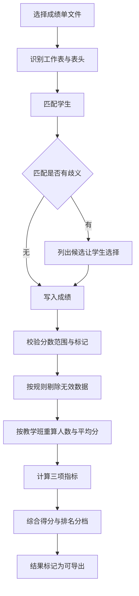

# 后续功能与数据层设计

本文档记录数据层目标模型和后续能力。当前已实现的系统结构、Schema v1 真实表结构、界面状态与限制见 `docs/system-design.md`，两者冲突时以当前实现文档为准。阶段划分以 `docs/product-redesign.md` 第 9 节与 v2 重构进度为准，本文档下面的旧阶段名称与早期目标表只保留为历史设计记录。目前产品 1～6 期基础功能（含本次考核工作台、方案配置页、多维分析与保存视图、WebDAV 加密同步）以及 Tally v2 阶段 1（Schema v1 存储引擎）、阶段 2（全校统一导航、年级档案 6 页签、升学与毕业封存向导、师生三年完整档案、走班教学班编排）与「结果归档」历史数据导入模式均已实现；后续待落地项为考核级分档边界按科微调入口、自动触发核算，以及远期的智能分班与智能分考场模块。

## 阶段划分

当前阶段只做「导入 Excel → 计算 → 导出 Excel」。后续功能按数据依赖排列，每一阶段都能独立交付并投入使用。


| 阶段 | 内容 | 依赖 | 交付后能省掉的工作 |
|---|---|---|---|
| 一 | 导入教务处整理后的报名表、成绩单、分数线，按标记剔除、重算、指标、排名、赋分、导出 | 无 | 手工公式、手工汇总、手工排名分档 |
| 二 | 分班 | 学生名单与入口成绩 | 手工分班、手工核算各班均衡性 |
| 三 | 分考场 | 分班结果 | 手工排考场、手工做桌贴与签到表 |
| 四 | 直接导入考务系统原始导出文件，自动识别表头、匹配学生、识别标记，复用阶段一的计算引擎 | 一、二 | 手工整理原始成绩单、手工匹配学生、手工剔除无效数据 |
| 五 | 教务统计 | 一至四 | 教师工作量、班级趋势、学生跟踪 |

阶段二和阶段三的顺序由数据决定：分考场需要分班结果，分班不需要分考场。阶段四与阶段二、三并行推进，它复用的是阶段一已经建好的计算引擎。

阶段一已经包含按报名表和成绩单里的标记剔除无效数据、重算人数与平均分。阶段四增加的是原始文件的自动识别和学生匹配，减少把考务系统导出文件整理成标准表格的人工工作。

## 分班

### 输入

- 学生名单：学号、姓名、性别、初中毕业学校、中考总分、各科成绩、住宿情况、选科意向、特殊标记。
- 班级设置：班级数量、班额上限、班主任、教室容量。
- 班型与选科组合：物理类、历史类、具体选科组合，作为分班的先决分组条件。
- 约束条件：双胞胎不同班、同一初中分散、男女比例、住宿生比例、成绩均衡。

### 计算方式

分两步。先按班型与选科组合分组，同一组内的学生按入口总分降序做蛇形分配，把学生轮流分配到各班，这一步让各班的平均分和分数段人数接近。再做局部交换，在班级之间成对交换学生，降低均衡指标的差异。交换只接受让目标值变小的移动，达到局部最优后停止。不同选科组合的学生不跨组交换。

目标函数按优先级排序，前一项满足后才优化后一项：

1. 各班入口总分平均值的极差。
2. 各班各分数段人数的差异。
3. 各班男女比例的差异。
4. 各班住宿生比例的差异。

双胞胎不同班、指定学生固定班级属于必须满足的条件。无法满足时明确列出冲突的学生和原因，由教务处决定放宽哪一条，系统不自行放宽。

随机数使用固定种子，同样的输入和同样的种子得到同样的结果，便于复现和解释。

### 人工干预

分班结果需要人工调整。教务处需要调整个别学生，系统支持：

- 锁定学生，后续优化不再移动。
- 两名学生对调，界面立即显示对调后各项均衡指标的变化。
- 重新优化未锁定的学生。
- 保存多个分班方案，对比后选定一个。

### 输出

- 分班表：学号、姓名、性别、班级、各科入口成绩、总分。
- 均衡性报告：各班人数、总分均值、各分数段人数、男女比例、住宿生比例。
- 调整记录：谁在什么时候把哪个学生从哪个班调到哪个班。

### 与阶段一的衔接

分班结果确认后，班级科目基数（按统计组保存）可以直接由分班数据计算，不需要再导入基数表。基数的口径在阶段一已经确定，这里只更换数据来源。已经导入的外部基数表继续支持，用于历史批次和学校自行计算的情况。

## 分考场

### 输入

- 考生名单，来自报名表与分班结果的交集。
- 考场设置：考场数量、每场人数、教室容量、楼层分布。
- 特殊考生：行动不便、视力问题、其他需要单独安排的情况。

### 规则与优先级

规则之间会冲突，优先级由用户配置，默认顺序为：

1. 特殊考生安排在低楼层或指定考场。
2. 同班学生尽量不在同一考场。
3. 各考场考生成绩分布接近，避免某个考场整体水平过高。
4. 座位号连续分配，便于监考。

第 2 条用贪心加交换实现：先按成绩蛇形分配到考场，再检查同班冲突，把冲突的学生与另一考场的学生交换，交换后不增加新的冲突。

### 输出

- 考场安排表：考场、座位号、学号、姓名、班级。
- 桌贴：按考场分页，每页一个考场，可直接打印。
- 签到表：每个考场一张。
- 监考安排：如果学校需要，按考场分配监考教师，避开本班任课教师。

## 成绩导入后的自动计算

### 处理流水线



### 学生匹配

匹配顺序固定，不做模糊猜测：

1. 学号精确匹配。
2. 学号缺失时用姓名加班级匹配，唯一命中才接受。
3. 命中多条时列出候选，由用户选择。
4. 完全匹配不到的学生进入未匹配清单，不写入成绩。

未匹配清单必须处理完才能计算。这是避免成绩错位的关键，姓名相同的学生在高中阶段并不少见。

### 表格方向

考务系统给出的全量成绩单通常是一行一个学生、每个科目一列，而系统内部按一行一条成绩保存。导入时做一次转换：

- 识别学号列、姓名列、班级列，其余数值列按表头匹配到科目。
- 表头里带「总分」「名次」「等级」的列单独保存为汇总值，不当作科目。
- 某一科的表头在科目表里找不到时，标记为待确认列，由用户指定科目或忽略。
- 缺考标记出现在某个科目列里，只影响该科目，不影响其他科目。

一个文件里同时有多个年级或多个科目组合时，按班级列或年级列分成多条导入记录，分别归属到对应的考核批次。

### 真实工作簿的读取

教务处现有文件是「一个工作簿包含全部阶段」的形态。一个量化计算工作簿通常有二十到三十五个工作表，基础数据、均分、基数、提升率、达线率、完成率、量化、排名赋分和个人得分都在同一个文件里。导入器按下面的模型读取。

导入任务分三层：

| 层次 | 内容 | 保存位置 |
|---|---|---|
| 文件 | 原始工作簿、内容哈希、相对路径、文件格式 | `files/` 与 `imports` |
| 工作表 | 工作表名称、索引、表头行、数据范围、识别出的角色 | `import_sheets` |
| 列映射 | 原始列名、标准字段、合并后的列名、用户改选记录 | `import_columns` |

一个工作簿在一个批次内导入一次，生成一条 `imports` 记录；其中每个被使用的工作表生成一条 `import_sheets` 记录，带角色和表头行。同一批次从多个工作簿导入时，按角色合并，不按文件顺序覆盖。跨年级的教师一览表导入多个批次时，每个批次各有一条 `imports` 记录，引用同一个内容哈希。

工作表角色是有限集合，与 `docs/historical-data-checklist.md` 的角色索引一致：教师一览、基础数据、均分整理、均分计算、基数、均分提升率、达线整理、达线统计、达线率、目标任务、完成率、量化计算、排名赋分、个人得分、备用数字。角色识别按名称关键词、表头关键词、用户指定三级顺序进行，识别结果写入 `import_sheets`，允许用户改选后重新导入。

同一工作簿存在多个同类工作表时，按版本标记选择当前版本：带「新」「修改」「核对后」的作为当前版本，带「旧」「修改前」的作为历史版本，无法判断时两份都导入并标记为待确认。导入记录保存所有候选工作表，计算只使用被标记为当前版本的工作表。

### 旧版文件

excelize 只支持 `.xlsx`。`.xls` 文件在导入时通过 LibreOffice 无界面转换：

1. 应用检测 `soffice`，用独立的用户配置目录执行 `--headless --convert-to xlsx`，输出到应用数据目录下的转换缓存。
2. 转换后检查工作表名称与数量、合并单元格范围、公式数量和抽样数值。任何一项不一致时阻止导入，列出差异，不把转换失败当成空数据。
3. 校验通过后，转换文件按内容哈希保存，原文件继续保留。导入记录保存原文件路径、转换文件路径、转换程序版本和校验结果。
4. 未安装 LibreOffice 时阻止导入，提示安装 LibreOffice 或者手工另存为 `.xlsx`。

转换只用于读取，不回写原文件。转换缓存随导入记录保留，便于追溯。已验证 4 个旧版文件可以转换并被 excelize 打开，公式保留；工作表名称、数量和合并单元格在导入时逐项校验。

### 导入身份

- 文件按内容哈希去重，同一个文件重复导入只保存一份。
- 工作表按「文件哈希 + 工作表名称」识别，工作表改名后视为新的工作表。
- 学生按考号匹配，考号按文本保存，保留前导零；没有考号时用姓名加班级匹配，唯一命中才接受。
- 教师按姓名加学科加班级匹配；有工号时按工号匹配。
- 班级按年级加班级名称匹配，名称写法不同时先做规范化，再让用户确认。

### 无效标记

不同考务系统对缺考、违纪的写法不同，标记表由用户配置，默认包含：空值、`/`、`-`、`缺考`、`缺`、`违纪`、`作弊`、`-1`。数值列出现这些标记时按无效处理，不当作零分。

### 触发方式

当前由用户点击「计算」触发。导入可能分多次完成，自动核算会在数据尚未就绪时产生中间结果，因此没有启用自动触发。输入变化会使导出摘要不匹配，未重新计算时导出被拒绝；界面还没有「需要重新计算」标记。

后续可以在所有输入就绪并且校验通过后自动计算，不需要单独点「计算」按钮，界面顶部显示状态，未重新计算时导出按钮不可用。

计算在后台执行，界面不阻塞。计算结果与输入快照绑定，快照包含学生集合、成绩集合、基数、目标、方案版本的哈希。重新计算时哈希不变就直接复用结果。

## 考核方案配置

考核方案的完整结构、默认值、公式变量、校验规则和界面见 `docs/assessment-plan.md`。本节记录设计边界和数据层的对应关系。

方案配置的是「怎么算」，批次数据配置的是「拿什么算」。学校当前只维护一套方案，所有年级统一使用；高考专项通过 `programs` 条件规则表达。指标分值、公式、封顶、档位权重、名次边界、并列规则、合并组算法、个人得分规则和零目标处理都属于方案配置，计算代码不另写默认值。

| 层次 | 配置内容 | 关键字段 |
|---|---|---|
| 数据口径 | 有效考生、剔除标记、基数来源、年级均分来源、走班与日语艺体处理 | `data.*` |
| 指标 | 指标键、满分、封顶、公式、合并组算法 | `indicators[]` |
| 档位 | 完成率档位的代码、显示名称和权重 | `tiers[]` |
| 排名与分档 | 排名组、并列规则、边界模式、覆盖、赋分 | `ranking.*` |
| 个人得分 | 取最高两个统计组、跨年级按年级分别记录 | `personal.*` |
| 专项规则 | 高考完成率的 60/40 组合 | `programs[]` |
| 校验 | 阻断项、提醒项、零目标补齐 | `validation.*` |

### 方案库与版本

系统初始只有内置默认方案。默认方案可以修改，修改生成新版本；派生方案从某个版本复制，独立演进。方案版本有 `draft`、`published`、`retired` 三种状态，只有 `published` 可以正式核算。批次和计算结果引用具体版本号，不引用方案名称。

核算时在对话框顶部选择方案版本。新批次默认使用内置默认方案的最新已发布版本；已经核算过的批次默认使用上次的版本。同一批数据可以用两个版本试算，并排比较得分、名次、档次和赋分变化，确认后选定一个版本作为正式结果。

### 关键默认值

| 配置项 | 默认 | 说明 |
|---|---|---|
| `ranking.tieMode` | `competition` | 同分同名次，下一名跳过（如 1、1、3）；已确认 |
| `ranking.boundary.mode` | `ratio` | 默认按 `floor(n/3)` / `round(2n/3)` 提供参考，支持 `manual` / 考核级按科人工微调；已确认 |
| `indicators.pass.merge.numerator` | `sum_members` | 合并组达线人数为成员教学班之和 |
| `indicators.pass.merge.denominator` | `group_target` | 合并组分母为统计组目标，成员目标之和可以与它不同 |
| `indicators.pass.merge.resultRow` | `lead_class` | 结果写在承担统计职责的班级行 |
| `validation.zeroTarget.action` | `pause_and_prompt` | 目标基础分为 0 时暂停并弹窗补齐 |
| `personal.mode` | `top_two_average` | 取最高两个统计组赋分的平均 |
| `personal.scope` | `per_grade` | 跨年级教师按年级分别记录 |

### 方案版本与试算

每次修改方案生成新版本，旧版本保留。发布后的版本只读；编辑已发布版本时复制出新的草稿版本。批次引用某个版本，计算结果记录实际使用的版本号。

同一批数据可以用多个方案试算，结果并排对比：总分差异、名次变化、档位变化。确认后再选定一个版本作为正式结果。试算结果不进入正式导出，但保留在批次里供追溯。

### 配置的存储形式

配置保存为 JSON，带 `schemaVersion` 字段。界面提供表单编辑，高级用户可以直接编辑 JSON。JSON 结构固定，字段名不随界面文字变化，便于跨版本迁移和人工核对。旧版本按写入时的 `schemaVersion` 解释，新版本写成当前结构；无法自动决定含义的变化由用户在迁移对话框确认。

## 数据层

业务实体关系见 `docs/requirements-analysis.md` 的“数据关系”，当前真实表关系见 `docs/system-design.md`。本节列出完整目标模型的存储表和字段，修改时同步更新。

### 存储选型

使用 MyGo 自带的 SQLite 插件。它是原生模块，不需要 cgo，也不需要用户安装数据库，随应用一起分发。数据量按三个年级、每年两千名学生、九个学科、五年历史估算，成绩行约一百万条，SQLite 完全够用。

不使用纯文本或单个 JSON 文件保存数据：导入过程中断电会损坏整个文件，而且查询排名需要把全部数据读进内存。

### 目录结构

当前实现创建主数据库、原始文件副本、备份和旧版转换目录：

```text
<用户数据目录>/
  tally.db              主数据库
  files/<哈希>          导入的原始 Excel，按内容哈希命名
  backups/              迁移前与手动备份
  converted/            旧版 .xls 转换后的 .xlsx
```

导出文件由用户在保存对话框中选择路径，不写入固定的 `exports/` 目录。运行日志属于后续功能：

```text
<用户数据目录>/
  tally.db              主数据库
  files/<哈希>          导入的原始 Excel，按内容哈希命名
  backups/              迁移前与手动备份
  converted/            旧版 .xls 转换后的 .xlsx
  logs/                 运行日志
```

原始文件按内容哈希保存，同一个文件重复导入只占一份空间，并且可以随时追溯某次计算用的是哪个文件。

### 数据表与一致性

真实数据表、索引、事务与一致性规则已统一重构为 **Schema v1（`SchemaVersion = 1`）**，不再维护旧版 `batches`、`terms`、`cohort_stages` 等早期规划表；完整 ER 图、表结构与一致性约束以 `docs/system-design.md` 及 `internal/store/schema.go` 为准。

### 计算快照

当前每次计算保存一个 SHA-256 输入摘要，内容覆盖方案配置和整个批次数据。目标模型可以分成学生集合、成绩集合、基数版本、目标版本和方案版本几个独立摘要。

导出前重新构建摘要，不一致时拒绝导出。导出的 Excel「计算依据」工作表列出输入摘要、方案版本、核算时间和导出时间，教师对结果有疑问时可以据此复核。

## 历史数据与对比分析

历史数据要长期保存、可以回看、可以对比。保存分四层，上下层之间通过固定标识关联。

| 层次 | 内容 | 是否可变 |
|---|---|---|
| 原始层 | 导入的 Excel 文件、导入记录、列映射、行号范围 | 不可变 |
| 标准层 | 学生、教师、行政班、教学班、统计组、任课关系、成绩、基数、目标 | 随批次修改，保留版本 |
| 结果层 | 每次计算的指标、排名、档位、赋分 | 不可变，新计算产生新记录 |
| 导出层 | 导出的 Excel、导出时间、对应的计算版本 | 不可变 |

### 时间维度

历史对比依赖稳定的时间与身份维度：

- 入学年级：例如 2024 级，一个学生从高一到高三保持同一个入学年级。
- 学年学期：例如 2025-2026 学年第二学期。
- 考试：期中、期末、月考，带先后顺序。
- 班级归属：按学期记录学生属于哪个行政班与哪个教学班。
- 任课关系：按学期记录教师教哪个教学班、哪个学科。
- 学生状态：在籍、转学、休学、借读，按学期记录。

学生、教师、班级、学科、入学年级都使用固定标识。班级名称会在不同学年重复使用，教师可能同名同姓，学生可能转班，靠名称比较会得到错误结果。

### 结果版本

每次计算生成一条结果记录，包含批次、方案版本、输入哈希、计算时间、是否正式版本、被哪次计算替代。

同一批次只能有一个正式版本。重新计算会生成新记录，旧记录继续保留。历史页面默认显示正式版本，可以切换到其他版本查看。

已经计算的结果不能直接修改。发现成绩或口径错误时，先修正输入数据，再重新计算，形成新的结果版本。这样历史结果始终能对应到当时的输入与方案。

### 数据完整度

每个批次记录数据完整度，分为基础数据、考试数据、计算结果、正式版本四项。历史批次可能只保留了最终结果，没有原始成绩。

完整度决定哪些分析可用：

- 只有最终结果：可以查看教师排名、档位、赋分，可以按教师或班级做结果层对比。
- 有成绩与报名表：可以查看学生明细、重算指标、做学生跟踪。
- 有基数与目标：可以查看均分提升率与完成率。
- 缺少某一项：界面显示「数据不完整」，对应分析不可用，不用零值代替。

### 两种历史导入模式

- 完整复算：导入基础数据、考试数据与方案，系统重新计算。结果可以查看学生明细，可以换方案试算。
- 结果归档：只导入最终结果、排名分档赋分、个人量化得分。系统保存为只读结果，不再重算。用于早期历史数据或原始成绩已经找不到的情况。

两种模式共用结果层。结果归档批次可以参与教师、班级、学科的结果层对比，不能参与学生明细与重新计算。导入时由用户选择模式，界面说明两种模式的能力差异。

### 对比规则

- 只在同一入学年级或同一年级内比较。不同届学生的成绩不能直接比较。
- 指标定义一致时才比较综合得分。方案版本不同时，默认关闭综合得分对比，可以比较平均分、达线率等原始指标，并在界面标注「方案不同」。
- 基数来源不同时，标注「基数不同」，不把提升率放在同一张图上。
- 有效人数差异过大时，显示人数，提醒用户结果可能受样本影响。
- 教师、班级、学生按固定标识匹配，不按姓名或班级名称匹配。
- 缺失数据显示为「无数据」，不补零。

### 查看方式

历史页面按学年学期、考试、年级、入学年级筛选。批次详情分几个页签：

- 概览：批次状态、数据完整度、正式版本、计算时间。
- 原始文件：导入的文件、哈希、工作表、导入时间。
- 导入数据：学生、教师、任课关系、成绩、分数线、基数、目标。
- 有效考生：报名人数、有效人数、剔除名单与原因。
- 计算结果：教师、班级、学科的指标、排名、档位、赋分。
- 计算历史：每次计算的方案版本、输入哈希、时间、是否正式版本。
- 导出记录：导出的文件、时间、对应的计算版本。

对比分析提供以下视图：

- 教师趋势：选择教师与时间范围，查看历次考试的均分提升率、达线率、完成率、排名、档位、赋分变化。
- 班级趋势：选择班级或入学年级，查看各科指标与完成率变化。
- 学科对比：选择年级与学科，查看同组教师的得分分布、档位分布。
- 学生跟踪：选择学生，查看历次考试各科成绩、总分、名次变化。
- 方案对比：同一批次选择两个方案版本，查看名次与档位变化。
- 批次对比：选择两到五个批次，按教师、班级、学科汇总后并排查看。

| 分析视图 | 需要的数据 | 数据不足时的表现 |
|---|---|---|
| 教师趋势 | 结果层、教师标识 | 可以看排名与赋分，不能看学生明细 |
| 班级趋势 | 结果层、班级标识、入学年级 | 可以看班级汇总，不能跨届比较 |
| 学生跟踪 | 标准层成绩、学生标识 | 需要原始成绩，结果归档批次不可用 |
| 学科对比 | 结果层、同组教师 | 组内人数不足时只显示明细，不做分布 |
| 方案对比 | 同一批次的多个结果版本 | 只有一个版本时提示先试算 |
| 批次对比 | 结果层、一致的指标定义 | 方案或基数不同时标注，不默认比较综合得分 |

对比结果可以导出 Excel，包含对比表、参与对比的批次、方案版本、数据完整度。图表只在界面显示，导出文件保留数值表，便于二次处理。

### 查询与缓存

历史分析按需查询，不预先保存所有汇总。数据量在一百万条成绩以内，SQLite 的索引足够支撑。

常用索引：

- 成绩按考试、学生、科目。
- 结果按计算版本、教师。
- 结果按计算版本、班级。
- 任课关系按学期、教师。

分析结果可以按「批次集合、指标、方案版本、输入哈希」缓存。新的计算版本产生后，对应缓存失效。

### 保留策略

- 原始文件、正式结果、导出记录长期保留。
- 非正式的计算版本默认保留，用户可以手动清理，清理前提示备份。
- 删除批次进入回收站，保留三十天；正式结果在回收站期间仍然可以恢复。
- 数据库升级不删除历史数据，迁移前自动备份。

## 数据迁移与多端

### 数据库升级

数据库带版本号。当前实现已切为洁净 **Schema v1（`SchemaVersion = 1`）**，首次启动遇到旧版不兼容数据库直接返回 `ErrIncompatibleDatabase` 提示新建干净库，不再保留历史版本的旧库迁移脚本；后续从 v1 起的版本演进沿用「先自动备份、再按顺序向前迁移、失败回滚备份」机制。

迁移脚本随应用发布，只做向前迁移。降级安装旧版本时，应用检测到数据库版本高于自身支持的版本，拒绝打开并提示，避免写坏数据。

方案版本同时记录 `schemaVersion`。应用升级后读取旧版本时在内存里升级到当前结构，新字段填入默认值；发布新版本时写成当前结构。旧版本的计算结果不重写，仍按当时的配置解释。

### 历史数据迁移

首次使用时，按学期导入历史 Excel。每个文件原样保存到 `files/`，不修改源文件。旧版 `.xls` 由 LibreOffice 转换后保存转换文件，原文件与转换文件都保留。导入记录保存文件哈希、原文件路径、转换文件路径、转换程序版本、工作表名、表头行、列映射和行号范围，任意一条成绩都能回溯到原始文件的具体位置。

历史批次可以只导入最终结果，用于对比；也可以导入全部阶段数据，用于完整复算。导入时由用户选择，界面说明两种方式的区别。

现有历史数据按「学期 → 考试批次 → 年级或专项」组织，目录深度不固定。批次识别以目录和文件名里的学期、考试类型、年级为准，具体日期只作为版本参考。`2026高考/` 这类专项目录单独建立毕业年级批次，不与期中、期末批次混用。

历史工作簿的多个工作表按角色导入，同一批次可以由多个工作簿补齐：教师一览来自学期级文件，基础数据和计算结果来自年级级文件，分数线和目标任务可能单独成文件。每个角色只保留一个当前版本，其余版本作为历史版本保存，可以查看但不能参与计算。

原始文件、导入记录和列映射都保留相对路径，迁移到另一台电脑时按相对路径重新定位。相对路径解析失败时，界面列出缺失文件，由用户重新指定目录，不按文件名在其他目录里自动搜索。

### WebDAV 同步

使用场景是同一名教务老师在办公室和家里各一台电脑上使用，两台电脑不会同时操作。同步直接连接 WebDAV 服务器，不依赖网盘客户端，也不把数据库文件放到远端。每台电脑保留完整的本地数据库，远端只存放数据包和原始文件。

设置项：

- 地址：完整的 WebDAV 目录地址，例如 `https://dav.example.com/remote.php/dav/files/teacher/`。
- 用户名与密码：保存在系统凭据库，不写入数据库和配置文件。
- 远端目录：地址下的子目录，默认 `Tally`，应用自动创建 `packages/` 与 `files/`。
- 设备名称：默认为计算机名称，可以改成「办公室」「家里」。
- 同步密码：用于数据包加密，默认开启，保存在系统凭据库。建议单独设置，也可以与 WebDAV 密码相同。

连接要求：只接受 HTTPS，证书校验不提供关闭选项。HTTP 只允许内网地址，并在设置页面明确提示数据可能被截获。

远端结构：

```
Tally/
  latest.json
  packages/Tally-office-r128-20251119-1420.tally
  files/<内容哈希>.xlsx
```

`latest.json` 是同步的指针文件，记录数据库标识、格式版本、修订号、来源修订号、设备标识、设备名称、导出时间、包名、包哈希、原始文件哈希列表、加密参数、每个批次的修订号。

`latest.json` 只包含同步元数据、哈希和加密参数，不包含学生成绩和原始表格内容。

数据包文件名使用设备标识的 ASCII 形式，设备名称只保存在元数据里，避免中文路径在不同 WebDAV 服务器上的编码差异。

上传顺序固定为：缺少的原始文件、数据包、`latest.json`。只有 `latest.json` 更新成功才算同步完成。中途失败时远端仍指向旧版本，另一台电脑不会读到写了一半的数据包。

数据包是 zip 文件，包含：

- `manifest.json`：与 `latest.json` 相同的元数据，包含格式版本、KDF 参数、salt、每个文件的 nonce。
- `tally.db`：整个数据库的快照；开启加密时保存为 `tally.db.enc`。

原始 Excel 文件按内容哈希单独存放，同一个文件只上传一次；开启加密时以 `.enc` 结尾。数据包不重复包含这些文件，日常同步体积保持在数据库快照的大小。

加密容器格式：

- 文件头为 `TALLYENC1`，后面是 1 字节格式版本和 1 字节算法编号。
- KDF 使用 scrypt，参数为 N=32768、r=8、p=1，输出 32 字节密钥；每个同步包生成 16 字节随机 salt。
- 加密使用 AES-256-GCM，每个文件生成 12 字节随机 nonce，认证标签 16 字节，附在密文末尾。
- `latest.json` 和 `manifest.json` 记录格式版本、KDF 参数、salt、每个文件的 nonce 和明文 SHA-256。
- 同一个包内所有文件共用 salt 和派生密钥，nonce 不重复。解密后先校验明文 SHA-256，再执行 SQLite 完整性检查。

上传流程：

1. 检查连接与远端目录。
2. 备份本地数据库，生成快照与数据包。
3. 上传本地新增的原始文件。
4. 上传数据包。
5. 回读数据包并校验哈希。校验失败时删除远端数据包并提示，不更新 `latest.json`。
6. 把 `latest.json` 写入临时文件，再用 MOVE 改名为正式文件。MOVE 失败时本次同步判定为失败，远端继续指向旧版本。
7. 记录本地同步状态。

下载流程：

1. 读取 `latest.json`。
2. 比较数据库标识、修订号、来源修订号。
3. 没有更新时显示「已是最新，上次同步：11 月 19 日 14:20，来自办公室电脑」。
4. 有新版本时把数据包下载到本地临时文件，校验哈希。
5. 备份本地数据库。
6. 补齐本地缺少的原始文件，逐个校验哈希。
7. 在临时副本上解密并执行 SQLite 完整性检查，确认数据库版本兼容后再替换本地数据库，更新本地同步状态。

判断规则：

- 远端修订号等于本地修订号，包哈希相同：无需导入。
- 远端修订号大于本地修订号，并且远端数据包的来源修订号等于本地修订号：可以直接导入。
- 远端修订号小于本地修订号：提示本地更新，不上传也不导入。
- 两台电脑都改过，修订号不一致且无法直接判断先后：提示冲突，列出两边各自修改过的批次，让用户选择「使用远端的数据」或「取消，保留本地」。选择使用远端数据时，本地数据库先自动备份，可以随时恢复。

系统不做自动合并。同一位老师在两台电脑上修改同一个批次的情况很少，自动合并会让结果难以解释。备份加人工选择更可靠。

启动时只检查远端版本，不自动导入。上传由用户点击「同步到 WebDAV」触发，避免后台写入和网络失败造成困惑。可选「退出时提醒同步」，不自动上传。

网络错误的提示按原因区分：401 为账号或密码错误，403 为目录权限不足，404 为地址或目录不存在，507 为服务器空间不足，证书错误为 HTTPS 证书不受信任。超时与断线显示失败原因和「重试」按钮，不无限重试，也不自动改用其他地址。

服务器兼容性按常见 WebDAV 服务验证：坚果云、Nextcloud、群晖。使用的方法为 PROPFIND、GET、PUT、MKCOL、DELETE、MOVE。WebDAV 客户端使用成熟库，避免手写 XML 解析。服务器不支持某个方法时明确报错，不静默降级。

数据包默认加密。加密使用 AES-256-GCM，密码经 scrypt 派生，密码保存在系统凭据库，两台电脑各输入一次。原始文件同样加密后上传，文件名仍用明文内容哈希，便于去重。关闭加密需要在设置里二次确认，并提示服务器管理员可以看到学生成绩。

手动导出与导入数据包继续保留，用于备份、换电脑和交给同事核对，与 WebDAV 同步共用同一种数据包格式。

### 备份

- 每次计算完成、每次导出、每次数据库迁移前自动备份。
- 备份保存在 `backups/`，按时间命名，默认保留最近二十份。
- 备份可以在界面里直接恢复，恢复前先备份当前数据。
- 界面提供「立即备份」和「打开备份目录」。

备份使用关闭连接后复制文件的方式：暂停导入和计算，关闭全部 SQLite 连接，确认同目录没有 `tally.db-wal` 和 `tally.db-shm`，然后把 `tally.db` 复制到 `backups/`，再重新打开连接。不执行 `ATTACH`、`DETACH` 或 `VACUUM INTO`，因为 MyGo 的 SQLite 插件会拒绝这些语句。恢复时先备份当前数据库，再替换文件并执行完整性检查。

### 数据安全

- 数据库始终保存在本机用户目录。两台电脑之间的传递通过用户配置的 WebDAV 服务器完成，应用不向其他服务器上传成绩。
- 依赖操作系统账户权限隔离不同用户。
- 自动更新只在用户开启时访问发布地址，只下载安装包，不上传任何本地数据。
- 同步数据包默认加密，手动导出的数据包可以选择是否加密。加密使用 AES-256-GCM，密钥由用户输入的密码经 scrypt 派生。忘记密码无法恢复，界面上明确提示。
- 导出 Excel 默认不包含身份证号等无关字段，只包含考核需要的学号、姓名、班级。

## 阶段五的候选内容

以下功能在阶段一至四稳定后再评估，不在当前范围：

- 教师工作量统计：课时数、教学班数量、跨年级任课。
- 班级成绩趋势：同一班级历次考试的均分、达线率变化。
- 学生成绩跟踪：个人历次成绩、名次变化、薄弱科目。
- 教学常规检查记录：备课、听课、作业批改。
- 与考务系统对接：如果学校后续采购考务系统，改为直接读取其导出文件或接口，不改变内部数据模型。

## 实施顺序与验收

Excel 读写、WebDAV 客户端、表达式求值都使用成熟库。新增依赖前实测应用包体积，确保不超过 40 MB 的限制（含内嵌字体）；超过时在提交说明里写明增长来源。

测试数据和黄金样例的组织方式见 `docs/README.md` 的测试策略。

| 早期阶段 | 状态 | 首个可验收成果 | 验收方式 |
|---|---|---|---|
| 一 | 基础链路已实现，黄金样例验收进行中 | 用一个学期的真实数据完成一次完整计算并导出 | 与人工 Excel 逐格比对，已知公式错误按确认口径重算后，其余差异为零 |
| 二 | 未开始 | 用真实学生名单生成分班方案 | 各班总分均值极差小于人工结果，必须满足的约束全部满足 |
| 三 | 未开始 | 生成考场安排与桌贴 | 同班冲突数为零，各考场成绩均值差异小于设定阈值 |
| 四 | 未开始 | 导入考务系统原始导出文件后自动完成剔除与计算 | 剔除名单与人工名单一致，平均分一致 |
| 五 | 未开始 | 按需确定 | 按需确定 |

阶段二与阶段三的算法结果需要教务处实际使用一学期后才能判断是否可用。系统提供人工调整能力，算法给出的是起点，最终结果由教务处确认。
