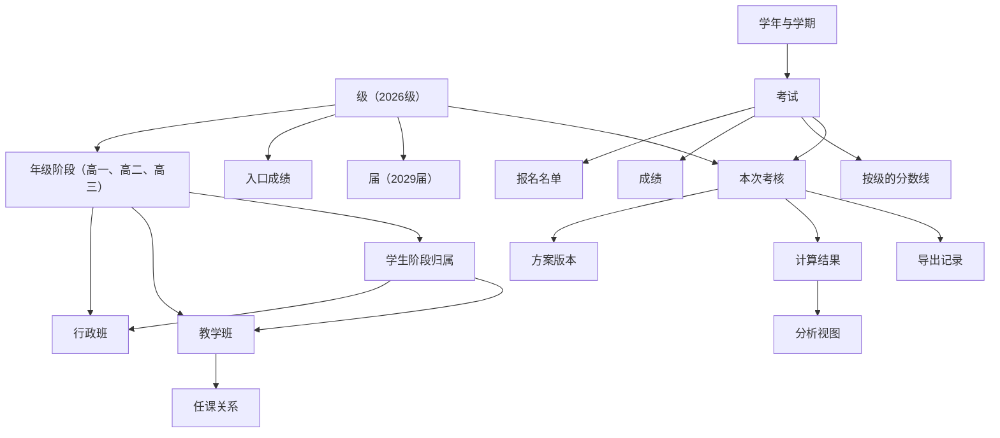
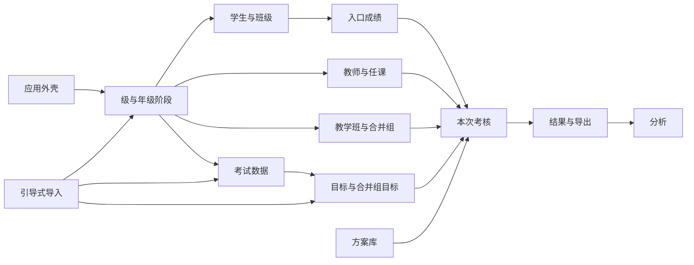
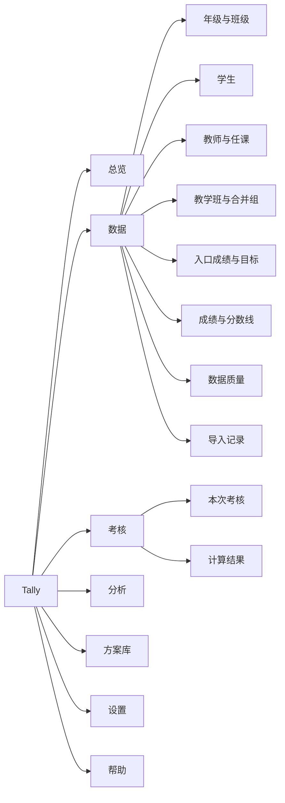
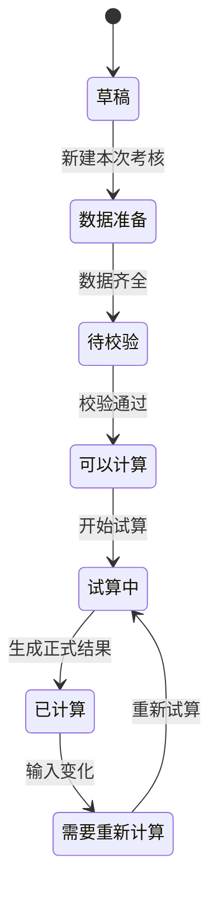
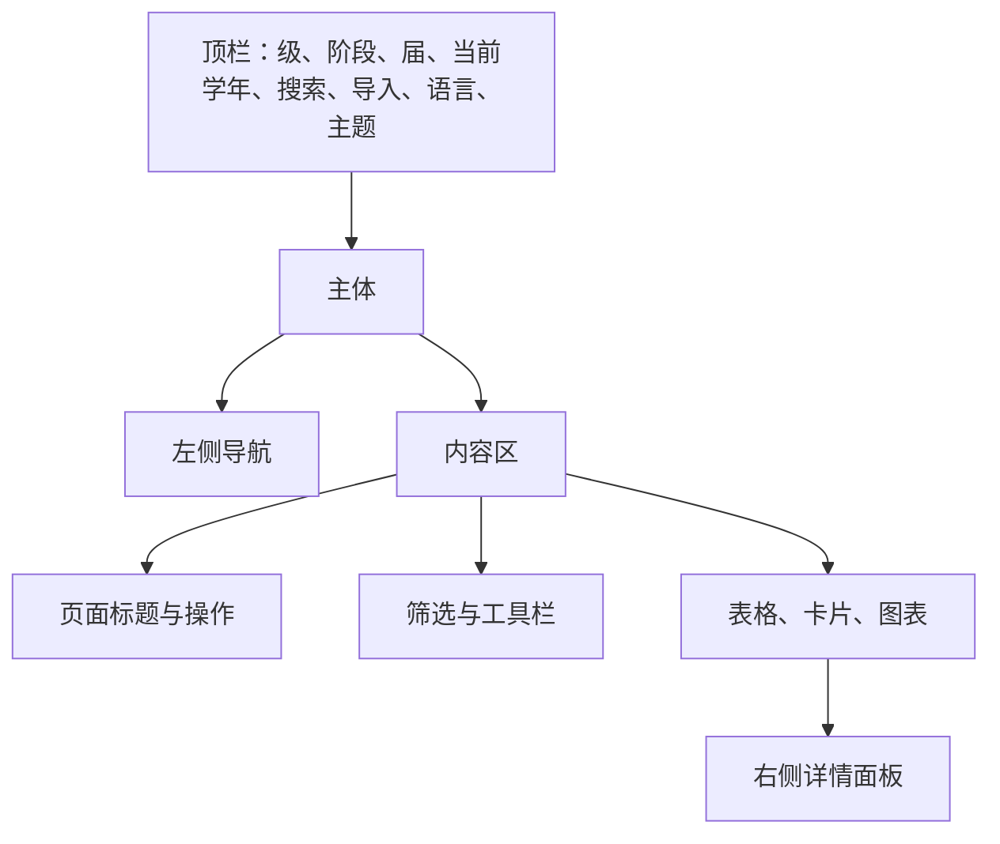
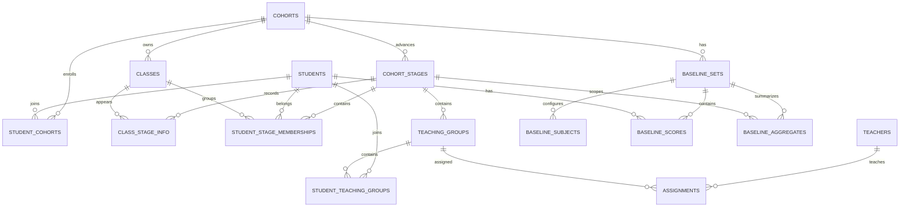
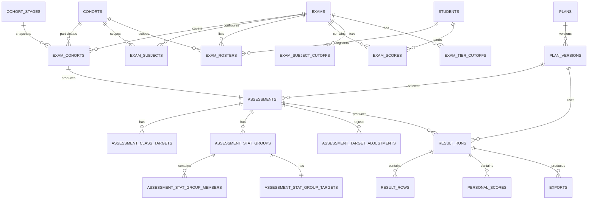

# 教学数据工作台重构设计

状态：已确认，进入实现

本文档提出 Tally 的产品结构、基础数据模型、引导式导入、考核流程、方案配置、界面与视觉规范。当前实现的计算口径继续以 `docs/requirements-analysis.md` 的口径确认表为准，方案配置字段以 `docs/assessment-plan.md` 为准。第 11 节的决策已经采用文档中的建议方案，后续按第 9 节实施。

## 1. 设计目标

### 1.1 当前使用方式的问题

当前应用以 `batches` 为中心组织。一次导入对应一次计算和一份导出。下一场考试需要重新导入全部材料，基础数据没有成为可以长期查看和查询的对象。

导入入口只有一个，用户面对整份工作簿时无法判断每张工作表的作用、来源和影响。导入完成后，学生、教师、班级、任课关系、入口成绩、成绩只能通过结果表间接看到，无法独立浏览、筛选和对比。

界面目前只有方案库和旧版工作台两个页签。功能增加后，缺少稳定的信息结构，数据查询、导入引导、趋势分析没有合适的位置。

### 1.2 新的产品定位

Tally 是一个本地运行的教学数据工作台。

级（入学年份）是长期容器。2026级在 2026 年入学，默认 2029 年毕业；当前是高一、高二还是高三，由当前学年和入学年份推导。学生与教师身份跨级保存；行政班、教学班和任课关系按级和年级阶段保存；入口成绩（基数）按级保存；考试按学年和学期组织，可以覆盖多个级；本次考核按考试和级建立，引用已保存的数据和方案版本。

每个级同时显示对应的届。2026级对应 2029届；2026届对应 2023级。届用于识别毕业年份，达到毕业年份的级自动开放高考专项考核入口。

考核计算是工作台的产出之一。日常查看学生、教师、班级和成绩，检查数据质量，对比历次考试，同样属于核心功能。

### 1.3 设计原则

| 原则 | 含义 | 对界面的要求 |
|---|---|---|
| 数据先于计算 | 先建立可查询、可核对的基础数据，再进入计算 | 每个数据项有独立入口、状态和准备情况 |
| 一项数据一次导入 | 每类数据有独立向导、说明、校验和导入记录 | 用户不必理解整份工作簿才能开始 |
| 数值可追溯 | 每个数值可以回到导入文件、工作表、行号和导入时间 | 详情面板固定显示来源 |
| 查询优先 | 表格、筛选、搜索、详情和图表覆盖日常查看 | 主导航保留数据入口 |
| 引导逐步出现 | 首次使用有准备清单，重复使用有快捷路径 | 空状态、字段说明和导入向导承担教学 |
| 规则可配置 | 指标、公式、分值、档位、排名、合并和个人得分都由方案配置驱动 | 方案配置页覆盖全部计算规则，代码不保存第二套默认值 |
| 计算口径保持稳定 | 现有方案配置和计算引擎继续使用 | 重构不改变已确认的口径 |

### 1.4 成功标准

1. 新学年开始时，级和年级阶段自动推进；教师、学生、班级、任课关系和入口成绩只处理变化部分，期中与期末共享同一套基础数据。
2. 用户不阅读外部文档也能完成每类数据导入，并在每一步知道这项数据是什么、从哪里获取、需要哪些列名、导入后影响哪些结果。
3. 任意学生、教师、班级、成绩或结果可以在三次点击内找到，并能看到来源与关联记录。
4. 数据缺失、重复、越界和班级不匹配在导入阶段被发现，阻断问题不会进入计算。
5. 任意结果可以展开查看分子、分母、入口成绩、目标、方案版本和参与计算的学生名单。
6. 中文与英文界面完整，Windows 与 macOS 表现一致，离线可用。
7. 历史阶段、历史考试和历史结果保持原样；切换到新学年后，旧数据不需要重新导入，也不会被改写。
8. 2026届在 2026 年自动出现高考专项入口，其他届不显示可用入口。

### 1.5 设计范围

本期设计覆盖：

- 级与年级阶段工作区、基础数据持久化、阶段推进与历史阶段保留。
- 学生、教师、班级、教学班、任课关系、入口成绩、成绩、分数线、目标的数据浏览与查询。
- 每类数据的引导式导入、校验、差异确认、导入记录与撤销。
- 本次考核的准备、校验、方案选择、试算、正式计算、结果查看与导出。
- 教师、班级、学科和学生维度的趋势与对比。
- 方案库的查看、保存为新的方案、更新当前方案、配置编辑与公式编辑。
- 自动备份、恢复备份、原始工作簿副本和操作记录。
- 新的应用外壳、导航、颜色、字体、间距、组件和交互规范。

本期不纳入：

- 排课、学籍管理、家长端和移动端。
- 考务系统接口对接，仍然读取考务系统导出的文件。
- 多人同时编辑与自动合并。
- 新的同步协议与多端合并。现有 WebDAV 同步继续使用，本次只调整设置入口和状态展示。
- 解析 Word、PDF 和图片格式的考核方案。
- 在安装包内嵌入 LibreOffice。
- 产品内的 PDF 报告导出。设计评审使用的对比 PDF 不属于产品功能。

## 2. 核心概念与信息结构

### 2.1 概念定义

| 概念 | 定义 | 生命周期 |
|---|---|---|
| 学年 | 一个学年，例如 2026-2027 学年，从 9 月到次年 8 月 | 时间属性 |
| 学期 | 学年中的第一学期或者第二学期 | 跟随考试 |
| 级 | 入学年份相同的一届学生，例如 2026级 | 长期保存，三年一个周期 |
| 届 | 毕业年份相同的一届学生，例如 2029届 | 跟随级，可以按学生覆盖 |
| 年级阶段 | 高一、高二、高三，由级和当前学年推导 | 每学年推进一次，历史阶段保留 |
| 行政班 | 学生日常管理班级 | 跟随级和阶段，班级身份可以跨阶段保留 |
| 教学班 | 按学科组织的授课单位，可以包含多个行政班的学生 | 跟随级和阶段 |
| 学生 | 具有稳定学号的个人 | 跨级保存 |
| 教师 | 具有稳定身份的个人，优先使用工号 | 跨级保存 |
| 任课关系 | 教师在某个级某个阶段承担某个教学班的课程 | 跟随教学班 |
| 入口成绩（基数） | 入学成绩形成的比较基准，当前口径取中考成绩 | 按级保存 |
| 选科组合 | 学生参加高考的科目组合，例如物理、化学、生物 | 跟随级和阶段 |
| 类别 | 分数线使用的选科类别，首次使用预置物理类与历史类 | 跟随考试 |
| 考试 | 学年和学期内的一次考试，例如期中、期末、高考专项 | 跟随学年与学期 |
| 报名名单 | 参加某次考试的学生与选科组合、类别信息 | 跟随考试和级 |
| 成绩 | 学生在某次考试某学科的分数与标记 | 跟随考试 |
| 分数线 | 某次考试某个级的单科本科线与六档总分线 | 跟随考试与级 |
| 目标 | 班级六档目标人数和合并组单科目标人数 | 跟随本次考核 |
| 本次考核 | 一场考试中一个级的一次考核计算 | 引用考试、级、目标和方案版本 |
| 方案版本 | 某一时刻的完整考核规则快照 | 保存后只读，只在数据库里保留 |
| 计算结果 | 某次试算或者正式计算产生的指标、排名、档次与赋分 | 不可变，新计算产生新记录 |

级和届是同一批学生的两个标签。2026级在 2026 年入学，默认 2029 年毕业，对应 2029届；2026届在 2026 年毕业，对应 2023级。当前是高一、高二还是高三，由当前学年和入学年份推导，不在数据里逐年改写。

同一个级在不同学年显示为不同阶段，不需要批量改写数据：

| 级 | 届 | 2026-2027 学年 | 2027-2028 学年 | 2028-2029 学年 | 2029-2030 学年 |
|---|---|---|---|---|---|
| 2026级 | 2029届 | 高一 | 高二 | 高三 | 已毕业 |
| 2025级 | 2028届 | 高二 | 高三 | 已毕业 | 已毕业 |
| 2024级 | 2027届 | 高三 | 已毕业 | 已毕业 | 已毕业 |
| 2023级 | 2026届 | 已毕业 | 已毕业 | 已毕业 | 已毕业 |

同一个自然年会同时出现 2026级 和 2026届：前者在 2026 年入学，后者在 2026 年毕业，指两批不同的学生。

一场考试可以覆盖多个级。每个级各自建立本次考核、目标、合并组和计算结果；分数线按考试与级分别保存，因为不同级的试卷和分数线可以不同。

### 2.2 数据层级



### 2.3 模块划分

| 模块标识 | 职责 | 依赖 | 主要页面 |
|---|---|---|---|
| `shell` | 窗口、导航、级切换、全局搜索、命令菜单 | 无 | 应用外壳 |
| `cohort` | 级、届、年级阶段、班级结构、阶段推进与阶段复制 | `shell` | 级总览、年级与班级 |
| `roster` | 学生身份、阶段归属、行政班调整 | `cohort` | 学生 |
| `faculty` | 教师身份、任课关系、工作量 | `cohort` | 教师与任课 |
| `groups` | 教学班、走班成员、合并组与承担统计职责的班级 | `cohort` | 教学班与合并组 |
| `baseline` | 入口成绩（基数）、学生入口成绩、班级与阶段汇总 | `roster` | 入口成绩与目标 |
| `exam` | 学年、学期、考试、报名名单、成绩、分数线 | `cohort` | 成绩与分数线 |
| `targets` | 班级六档目标、合并组目标、零目标处理 | `exam` | 入口成绩与目标 |
| `import` | 导入向导、列名映射、校验、差异、撤销、来源记录 | 全部数据模块 | 导入向导、导入记录 |
| `assessment` | 本次考核、准备情况、方案选择、试算、正式计算 | `exam`、`targets`、`groups`、`cohort` | 本次考核 |
| `results` | 结果表、指标明细、个人得分、导出 | `assessment` | 计算结果 |
| `analysis` | 教师、班级、学科、学生、考核对比 | `results`、`exam` | 分析 |
| `plans` | 方案库、版本、派生、编辑、发布、对比 | 无 | 方案库 |
| `settings` | 数据目录、LibreOffice、备份、同步、语言、主题 | `shell` | 设置 |
| `guide` | 首次使用、准备清单、数据说明、模板和示例 | `shell`、`import` | 总览、帮助面板 |



### 2.4 主导航



导航使用左侧栏。左侧栏分为「工作台」「数据」「考核」「分析」「方案」五组，底部固定「设置」与「帮助」。当前级由顶栏选择，显示为「2026级 · 高二 · 2029届」，旁边显示当前学年，所有数据页面跟随当前级和当前阶段。已毕业的级在「已毕业」分组中查看。进入本次考核后，顶栏额外显示考试和考试当时的阶段。

## 3. 基础数据设计

### 3.1 数据分层

| 层次 | 内容 | 保存范围 | 变化频率 |
|---|---|---|---|
| 学校档案 | 学科、阶段名称、默认满分、选科类别、当前学年 | 全库 | 很低 |
| 级档案 | 级、届、入学年份、毕业年份、阶段记录 | 一个级 | 建级时一次，毕业时归档 |
| 阶段档案 | 行政班、学生阶段归属、教学班、任课关系 | 一个级的一个阶段 | 每学年一次，之后少量调整 |
| 考试数据 | 报名名单、成绩、分数线 | 一场考试 | 每场考试一次 |
| 方案档案 | 考核方案、方案版本、默认值与公式 | 全库 | 很少变化，发布后只读 |
| 考核数据 | 目标、本次考核、计算结果、导出记录 | 一个本次考核 | 每次计算产生新记录 |
| 导入与审计 | 导入记录、列名映射、问题清单、变更记录、审计日志 | 全库 | 每次导入与编辑 |

### 3.2 持久化规则

- 学生以学号识别，教师优先以工号识别；工号为空时以姓名加学科识别，并在界面提示风险。教师身份上的学科只用于没有工号时的识别，任课关系中的学科来自教学班。没有工号的教师改名时，界面要求补充工号或者确认身份，避免产生两条记录。
- 应用预置语文、数学、英语、物理、化学、生物、历史、地理、政治九个学科，学校可以在设置中改名、停用或者增加学科。阶段名称、默认满分和学科设置在首次使用时已经可用。
- 新建考试时可以按级调整科目与满分，默认带入学科设置。成绩校验使用本次考试对应级的满分，不修改学校默认值。
- 新建级时填写入学年份，毕业年份默认等于入学年份加三年，可以按学生覆盖。级同时显示对应的届，例如 2026级对应 2029届。
- 界面默认显示四位年份，例如 2026级、2029届。搜索和导入同时接受 26级、29届 的两位年份写法，识别结果展开为四位年份，避免跨世纪歧义。
- 当前学年默认从系统日期推导，9 月 1 日进入新学年；设置中可以手工指定当前学年，用于补考、提前考试或者测试。
- 年级阶段由当前学年和入学年份推导：阶段 = 当前学年起始年份 - 入学年份 + 1，1 到 3 对应高一、高二、高三，大于 3 为已毕业。历史考试保存考试当时的阶段，不用当前阶段改写历史。
- 进入新学年时，当前阶段自动推进。第一次进入新阶段时，应用从上一阶段复制行政班、班级阶段信息、教学班、任课关系、学生班级归属和学生教学班归属，并标记为「待核对」；用户只处理选科分班、教师调整等变化。也可以选择从空白阶段开始。上一阶段的数据保持只读。总览显示一条可关闭的提示，说明已进入哪个学年、复制了哪些内容、还有多少项待核对，提供「查看变化」和「稍后核对」。
- 行政班、教学班和任课关系按级和阶段保存。行政班的身份在级内保持稳定，班级的阶段信息单独保存，支持班级跨阶段保留或者阶段内重新分班。
- 学生、教师、教学班和任课关系支持单条新增与批量编辑，手工修改的来源记录标记为「手工编辑」。
- 学生在一个级内有一条入学记录，包含级、届、毕业年份覆盖和在籍状态；每个阶段有一条阶段归属记录，包含行政班、选科组合、外语语种、在籍状态和是否走班。
- 教学班按学科建立。一个学生在一个级的一个阶段内每个学科最多属于一个教学班。
- 入口成绩保存到学生和学科，班级平均值与阶段平均值由学生入口成绩汇总得到。汇总数值可以缓存，原始学生入口成绩始终保留。
- 入口成绩按级保存。进入新阶段或者复制阶段结构时不复制入口成绩；同一个级的三个年级阶段共用同一套入口成绩。
- 考试数据按学年、学期和考试保存。同一名学生、同一学科重复导入时更新原记录，保留变更记录。
- 目标按本次考核保存。班级六档目标和合并组单科目标分开保存。
- 导入的原始工作簿按内容哈希复制到应用数据目录的 `files/`，原文件不修改。导入记录引用应用内的副本，同时保存用户选择时的源路径，方便追溯。
- 每条导入数据保存 `import_run_id`、工作表名称和原始行号。详情面板可以查看来源。
- 每类数据保存独立的数据修订号与依赖版本。上游数据变化只把受影响的数据项标记为「已过期」，不因为任意一次导入把全部数据项一起标记。
- 删除学生、教师、班级、教学班和成绩使用归档标记，永久删除需要先备份并二次确认。
- 任何影响已有计算结果的修改都会增加对应范围的修订号，已有结果标记为需要重新计算。

### 3.3 数据项清单

| 数据项 | 作用 | 范围 | 主要来源 | 必需列名 | 下游影响 |
|---|---|---|---|---|---|
| 级与阶段 | 建立级、届和当前阶段 | 全库 | 手工新建、按当前学年推导 | 入学年份、毕业年份 | 全部数据 |
| 班级结构 | 建立当前级和阶段的行政班 | 级与阶段 | 教务处班级设置表 | 班级名称 | 学生归属、班级目标、完成率 |
| 学生名单 | 建立学生与当前级、阶段的行政班归属 | 级与阶段 | 学籍系统导出、报名表 | 学号、姓名、班级 | 成绩匹配、有效考生、学生跟踪 |
| 教师名单 | 建立教师身份 | 全库 | 教务处教师一览表 | 教师姓名；工号为空时还需要学科 | 任课关系、个人得分 |
| 任课关系 | 建立教师与教学班关系 | 级与阶段 | 排课表、任课教师一览表 | 教师姓名、学科、教学班或行政班 | 教学班、个人得分、导出 |
| 教学班 | 建立按学科授课的教学班，以及学生的学科归属 | 级与阶段 | 走班安排、排课表 | 教学班名称、学科、行政班或者学生 | 成绩归属、达线率、排名、赋分 |
| 合并组 | 建立走班合并关系，确定单科达线率的分子与分母 | 本次考核 | 走班安排、合并说明 | 合并组名称、学科、成员教学班、承担统计职责的班级、目标人数 | 单科达线率、排名、赋分 |
| 入口成绩（基数） | 提供均分提升率基准 | 级 | 招生办中考成绩表 | 学号或者考生号、各科成绩；总分用于核对 | 均分提升率 |
| 报名名单 | 确定应考学生与选科组合 | 考试与级 | 考务系统导出 | 学号、姓名、班级、选科组合、类别；考号有则填写 | 有效考生、成绩匹配 |
| 考试设置 | 确定考试名称、日期、覆盖的级、科目与满分 | 学年与学期 | 手工新建 | 名称、日期、级、科目、满分 | 报名、成绩、分数线 |
| 成绩单 | 提供考试分数与标记 | 考试 | 阅卷系统导出 | 考号或学号、各科成绩 | 均分、达线率、完成率 |
| 分数线 | 提供单科本科线与六档总分线 | 考试与级 | 考试院公布文件 | 科目、类别、本科线；或者档位、总分线 | 达线人数、达线率 |
| 目标任务 | 提供完成率与达线率分母 | 本次考核 | 年级组目标表 | 班级、六档目标人数、合并组目标 | 完成率、达线率、排名 |
| 考核方案 | 提供计算规则 | 全库 | 考核方案、JSON 文件 | 指标、公式、档位、权重 | 全部计算 |

### 3.4 可视化构建

本文档中的可视化构建指：用表格、矩阵、编排器和图表建立、检查、调整结构化基础数据。它包含数据浏览、筛选、批量编辑、关系矩阵和分布图表，不包含自由画布或节点图编辑器。

#### 3.4.1 年级准备看板

总览页面显示当前级和当前阶段五项基础数据的完整度：

- 班级结构。
- 学生名单。
- 教师名单。
- 任课关系。
- 入口成绩（基数）。

每项显示「未开始」「导入中」「待处理」「已就绪」「已过期」五种状态。状态由数据是否存在、是否存在阻断问题、上游依赖是否发生变化计算得出。例如学生转班后，学生归属与相关成绩匹配进入「已过期」，教师名单不会跟着变成「已过期」。准备看板给出下一步动作和预计影响。

顶栏固定显示「2026级 · 高二 · 2029届」。当前阶段由当前学年和入学年份推导；点击阶段可以查看这个级的历史阶段。历史阶段显示为「2026级 · 高一 · 2026-2027学年」，数据保持只读。

#### 3.4.2 学生与行政班

学生页面使用表格加详情面板。表格支持按级、阶段、行政班、教学班、选科组合、状态筛选，支持按学号、姓名搜索。详情面板显示学生基本信息、级和届、当前阶段归属、各科教学班、入口成绩、历次成绩和来源记录。

行政班页面显示班级学生名单、人数、选科组合分布、入口均分和历次考试均分。学生可以在行政班之间调整，调整后写入变更记录并增加阶段修订号。调整前显示受影响的目标与结果数量。

#### 3.4.3 教师与任课关系

教师页面提供两种视图：

- 教师列表：教师姓名、工号、学科、任教班级数、任教合并组数、最近个人得分。
- 任课矩阵：教师为数据行，教学班为数据列，单元格显示学科与任课角色。点击单元格可以新增或者取消任课关系，冲突与重复在同一位置提示。

任课矩阵用于检查遗漏和重复。教师工作量图表显示每位教师承担的教学班数量与学科分布。

#### 3.4.4 教学班与合并组

教学班页面显示每个教学班的学科、成员班级、学生人数和任课教师。走班教学班可以包含多个行政班的学生。

合并组编辑器用于建立走班合并关系：

- 选择学科与成员教学班。
- 指定承担统计职责的班级。
- 填写合并组目标人数。
- 实时预览达线人数、目标人数和计算后的达线率。
- 检查成员为空、目标缺失、重复成员，以及承担统计职责的班级没有学生加入这个合并组。

合并组以卡片形式展示成员、目标、任课教师和最近计算结果。合并关系属于本次考核数据，同一学科在不同考试可以有不同的合并方式。

#### 3.4.5 入口成绩与目标

入口成绩页面按班级和学科显示入口均分、阶段均分、入口成绩比值和参与人数。支持切换到学生明细，查看每个学生的入口成绩与来源。

目标页面使用矩阵编辑：

- 数据行为班级，数据列为六档目标。
- 每个单元格可以直接编辑，右侧显示加权后的目标基础分。
- 目标基础分为零的班级使用警告颜色和文字标记。
- 支持从同一级上一场考试复制目标、批量填充和导入目标表。
- 合并组目标单独编辑，显示成员教学班目标之和与合并组目标的差异。

#### 3.4.6 成绩与分数线

成绩页面按考试、级、阶段、学科和班级筛选。表格显示学号、姓名、班级、分数、标记和来源。缺失、缺考、违纪和无效使用文字徽标区分。

成绩分布使用柱状图或者密度图，班级对比使用条形图。分数线页面按学科和类别显示单科线与总分线，并显示受影响的达线人数。

#### 3.4.7 数据质量

数据质量页面汇总全部阻断问题和提醒问题：

- 学号重复、教师重复、班级不存在、学科不存在。
- 成绩超出本次考试的科目满分、标记无法识别、报名名单与成绩单人数差异过大。
- 入口成绩缺失、目标基础分为零、合并组目标缺失、合并组成员为空。
- 任课关系重复、教师任教班级数与任课表不一致。

问题按数据项、严重程度和导入记录分组。点击问题可以跳转到对应数据行，支持导出问题清单、重新校验和查看修复建议。

### 3.5 查询与浏览

全局搜索使用 `Cmd+K` 或者 `Ctrl+K` 打开，搜索学生、教师、班级、级、考试、本次考核和方案版本。输入 26级 或者 2026级 都能找到同一个级，搜索结果按类型分组，支持键盘上下移动与回车打开。

数据表格统一提供：

- 关键词搜索。
- 多条件筛选。
- 列显示与隐藏。
- 列宽调整与拖动排序。
- 表头排序。
- 行选择与批量操作。
- 右键菜单。
- 当前视图导出为 Excel 或者 CSV。
- 保存为视图，下一次直接打开。

详情面板固定显示来源记录。来源记录包含文件名、工作表名称、原始行号、导入时间、导入操作和列名映射。

### 3.6 首次使用主链路

目标用户第一次打开应用，手里有学校发来的 Excel。下面这条路径不要求用户理解数据库、方案版本或者合并组。

| 阶段 | 用户要完成的事 | 页面 | 完成标志 | 下一步 |
|---|---|---|---|---|
| 新建年级 | 告诉应用这是哪个级 | 总览 | 级已建立 | 准备年级资料 |
| 准备年级资料 | 让学生、教师、任课和入口成绩进入应用 | 年级准备向导 | 基础资料已就绪 | 新建考试 |
| 准备考试资料 | 导入成绩、分数线、目标 | 考试准备向导 | 考试资料已就绪 | 开始计算 |
| 计算与导出 | 得到结果和 Excel | 本次考核页面 | 正式结果已生成并导出 | 查看结果或者准备下一场考试 |

总览只显示一个主按钮。还没有级时，主按钮是「新建年级」；已经有级但准备未完成时，主按钮是「继续准备」。它打开下一个未完成的项目，用户不需要在多个入口之间判断顺序。每个阶段结束时显示下一阶段的主按钮。

新建年级时只填写入学年份。应用根据当前学年推导阶段和届，例如 2026 年入学、当前是 2026-2027 学年时显示「2026级 · 高一 · 2029届」；2027 年再打开时自动显示「2026级 · 高二 · 2029届」。输入往年的入学年份时，应用直接显示这个级当前所处的阶段。

开始前手边最好有以下文件。缺少的文件可以稍后补，总览会保留未完成项。

| 文件 | 用途 | 没有时怎么办 |
|---|---|---|
| 学生名单 | 建立学生与行政班归属 | 从学籍系统导出，或者按模板整理 |
| 任课关系 | 建立教师与教学班关系 | 从排课表或者任课教师一览表导出 |
| 入口成绩 | 计算均分提升率 | 向招生办索取中考成绩表 |
| 成绩单 | 计算均分、达线率和完成率 | 从阅卷系统导出 |
| 分数线 | 统计单科达线人数 | 按考试院公布文件填写 |
| 目标表 | 计算完成率和达线率 | 按年级组目标填写，第一次考试需要手工准备 |

从学校系统导出时，确认文件包含下面的内容。学号、考号和工号在 Excel 中设为文本格式，避免前导零丢失。

| 文件 | 导出时确认 |
|---|---|
| 学生名单 | 学号、姓名、行政班；有选科组合时一并导出 |
| 任课关系 | 教师姓名、学科、教学班或者行政班 |
| 入口成绩 | 学号或者考生号、各科成绩、总分 |
| 成绩单 | 考号或者学号、各科成绩、缺考或者违纪标记 |
| 分数线 | 科目、类别、本科线；总分线包含档位 |
| 目标表 | 班级、档位、目标人数；合并组目标包含合并组名称 |

#### 3.6.1 最短路径

| 步骤 | 页面标题 | 页面只说明一句 | 主按钮 | 完成后 |
|---|---|---|---|---|
| 1 | 新建年级 | 输入入学年份，应用会显示当前阶段和届。 | 新建年级 | 进入准备清单 |
| 2 | 导入学生名单 | 学生名单用来匹配成绩和入口成绩。班级可以从名单自动建立。 | 选择文件 | 学生与班级已就绪 |
| 3 | 导入任课关系 | 任课关系决定教师个人得分。教师名单可以从任课关系自动建立。 | 选择文件 | 教师与任课已就绪 |
| 4 | 导入入口成绩 | 入口成绩取中考成绩，用来计算均分提升率。 | 选择文件 | 入口成绩已就绪 |
| 5 | 新建考试 | 选择学年、学期、考试类型和日期，再勾选要考核的级。默认按当前级学生名单与选科组合生成报名名单。 | 新建考试 | 考试已建立 |
| 6 | 导入成绩单 | 成绩单提供各科分数。缺考和违纪用标记区分；单科 0 分按未参加该科处理，总分保留。 | 选择文件 | 成绩已就绪 |
| 7 | 填写分数线 | 分数线用来统计达线人数。可以导入，也可以按科目填写。 | 保存分数线 | 分数线已就绪 |
| 8 | 填写目标 | 目标用来计算完成率和达线率。可以从同一级上一场考试复制。 | 保存目标 | 目标已就绪 |
| 9 | 计算并导出 | 先试算检查结果，满意后正式计算并导出 Excel。 | 开始试算 | 结果已生成 |

第一次新建考试时没有同一级上一场考试可以复制，目标保存页面直接显示「导入目标表」和「手工填写」两个入口，并说明第一次需要准备目标数据。

试算完成后，结果页的主按钮变为「正式计算」。正式计算完成后，主按钮变为「导出 Excel」。导出结束后，页面提供「查看结果」和「准备下一场考试」两个动作。

#### 3.6.2 可以自动建立或者跳过的项目

| 数据项 | 默认处理 | 用户什么时候需要单独处理 |
|---|---|---|
| 年级阶段 | 按当前学年自动推进；第一次进入新阶段时从上一阶段复制班级、教学班、任课关系和归属 | 有选科分班、教师调整或者重新分班时 |
| 班级结构 | 从学生名单自动建立班级 | 有空的班级、班主任或者教室信息需要录入时 |
| 教师名单 | 从任课关系自动建立教师 | 需要工号、学科或者联系方式时 |
| 教学班 | 每个行政班每个学科自动建立一个教学班，按学生选科组合把学生加入对应学科 | 有走班或者跨班教学时 |
| 合并组 | 默认一个教学班对应一个合并组 | 有走班合并时 |
| 报名名单 | 默认使用当前级学生名单 | 本次考试的名单与当前级名单不同时 |
| 分数线 | 可以按科目手工填写 | 科目较多时使用导入 |
| 目标 | 可以从同一级上一场考试复制 | 第一次考试、新级或者目标变化时 |
| 方案 | 默认使用学校已发布的方案 | 需要特殊规则时选择派生方案 |
| 学科 | 首次使用已经预置九个常用学科 | 学校有额外科目或者需要调整名称时 |

高考专项在新建考试时选择，按毕业届单独建立。毕业年份等于当前年份且未归档的级显示高考专项入口，例如 2026届在 2026 年显示入口，2027届在 2027 年显示入口。准备项多一项专项目标，其余步骤与期中、期末相同。

#### 3.6.3 每一步的页面结构

每个准备步骤使用同一套结构，用户学会第一步后可以沿用：

1. 标题：这一步做什么，例如「导入学生名单」。
2. 一句话说明：这项数据用来做什么，例如「学生名单用来匹配成绩和入口成绩。」
3. 文件要求：需要哪些列名、从哪里获取、下载模板、查看示例。
4. 选择文件：拖放或者点击选择。
5. 识别结果：识别到多少行、多少列、哪些列没有匹配。
6. 校验结果：可以导入多少条、多少条需要处理。
7. 主按钮：显示明确的条数，例如「导入 1,203 条记录」。
8. 完成后：显示「已导入 1,203 名学生。下一步：导入任课关系。」主按钮「下一步」，次按钮「查看学生」。

用户可以随时选择「稍后再说」。项目保留为未完成状态，总览继续显示下一步，不弹出反复提醒。

同一份工作簿里还有任课关系、入口成绩等其他数据时，导入结果页提供「从这份工作簿继续导入」的次要入口。用户不必每次重新选择同一个文件，也不会被迫一次导入全部数据。

#### 3.6.4 主链路验收

找一位没有使用过产品的教务老师，在没有任何说明的情况下完成以下任务：

1. 从空数据库新建 2026级，看到「2026级 · 高一 · 2029届」，导入学生名单，看到班级自动建立。
2. 搜索一名学生，查看行政班、教学班和来源。
3. 新建考试，选择 2026级，使用默认报名名单，导入成绩，看到缺考标记。
4. 试算，打开一个超过 40 分的结果，看到「该项不封顶」以及分子和分母。
5. 正式计算，导出 Excel，重新打开文件确认工作表。
6. 把当前学年切换到 2027-2028，确认 2026级 显示高二，2026 年的考试仍显示高一。
7. 在 2026 年打开总览，确认 2026届 显示高考专项入口，其他届不显示可用入口。

每一步只允许一个主按钮。出现阻断问题时，用户可以在当前页面找到修复动作或者下载问题清单。全部任务不使用说明书。

### 3.7 主要卡点与修复

| 卡点 | 用户会怎么问 | 界面怎么回答 | 设计动作 |
|---|---|---|---|
| 不知道从哪里开始 | 我现在该做什么 | 总览只显示「继续准备」和下一步 | 单一主按钮 |
| 不知道这个级现在高几 | 2026级现在读几年级 | 顶栏显示「2026级 · 高二 · 2029届」，随当前学年自动变化 | 级标签 |
| 不知道文件对不对 | 这是哪份表 | 选择文件前显示用途、来源、必需列名和示例 | 导入说明面板 |
| 不知道列名怎么对应 | 我的表头不一样 | 自动匹配列名，显示示例数值，允许手工改 | 列名映射表 |
| 担心重复建立学生 | 会不会建两遍 | 按学号匹配，导入前显示新增、更新、跳过数量 | 差异预览 |
| 不知道要不要先导报名表 | 报名名单和成绩单是什么关系 | 默认使用当前级学生名单，名单不同时再导入 | 默认值 |
| 不知道六档目标怎么填 | 目标填什么 | 从同一级上一场考试复制，按班级和档位填写，显示目标基础分 | 目标矩阵 |
| 第一次没有上一场考试 | 目标从哪里来 | 直接显示「导入目标表」和「手工填写」，不显示不可用的复制按钮 | 首次目标入口 |
| 不知道方案选哪个 | 方案版本是什么 | 默认选中学校已发布方案，显示「使用学校默认方案」 | 预选 |
| 不知道结果是否最新 | 这个结果还能用吗 | 顶部显示「数据已更新，需要重新计算」和「查看变化」 | 状态条 |
| 不理解超过满分 | 为什么有 178 分 | 详情显示「该项不封顶」、分子、分母和得分 | 结果详情 |
| 不理解单科 0 分 | 0 分为什么没算人数 | 导入预览显示「12 个单科 0 分将按未参加该科处理，总分保留」 | 零分预览 |
| 不知道怎么导出 | 导出在哪里 | 结果页固定显示「导出 Excel」 | 主操作 |
| 导入失败 | 哪里错了 | 显示文件、工作表、行号、列名、原因和修复建议 | 问题表 |
| 担心覆盖原数据 | 会不会丢数据 | 显示变更摘要，导入完成后提供「撤销」 | 变更记录 |
| 数据太多不好找 | 怎么找学生 | 全局搜索、筛选、列选择和保存视图 | 表格工具 |
| 不知道合并组是什么 | 合并组是什么 | 行内帮助说明「走班合并计算时使用」 | 帮助面板 |
| 不理解排名和档次 | 为什么第 3 名是第二档 | 结果详情显示方案规则和当前口径状态 | 方案说明 |
| 担心关闭应用丢数据 | 关掉会不会丢 | 自动保存，设置页显示数据目录和备份状态 | 保存状态 |

## 4. 引导式导入

### 4.1 设计原则

- 每类数据有独立入口，用户不必先理解整份工作簿。
- 选择文件前先说明数据用途、来源、必需列名和影响。
- 自动识别工作表、表头和数据列，识别结果由用户确认。
- 校验在写入前完成，阻断问题存在时不允许导入。
- 写入使用单个事务，失败时保留原数据。
- 每次导入生成记录，保存差异，支持撤销。
- 导入完成后给出下一步，用户可以继续导入相关数据。

### 4.2 导入向导流程


### 4.3 步骤说明

| 步骤 | 页面内容 | 用户动作 | 通过条件 |
|---|---|---|---|
| 选择数据项 | 数据项卡片、用途、范围、必需列名、当前级和阶段、当前状态 | 选择一项数据 | 已选择数据项 |
| 选择文件 | 拖放区域、文件选择、最近文件、模板下载、`.xls` 转换提示 | 选择一个工作簿 | 文件可以读取 |
| 识别工作表 | 工作表列表、自动识别角色、表头行、数据范围、版本标记 | 确认或者修改工作表角色 | 必需工作表已指定 |
| 映射列名 | 原始列名、标准字段、自动匹配结果、示例数值、上次映射 | 确认或者修改映射 | 必需列名全部匹配 |
| 校验 | 新增、更新、跳过、阻断问题、提醒问题、问题表格 | 修正文件、修改映射、确认提醒 | 没有阻断问题 |
| 导入数据 | 变更摘要、冲突处理方式、受影响结果、备注 | 选择处理方式并导入 | 变更范围清楚，阻断问题为零 |
| 导入结果 | 导入条数、问题数量、耗时、下一步建议 | 查看数据或者导入下一项 | 事务写入成功 |

### 4.4 每类数据的导入说明

#### 4.4.1 班级结构

- 用途：建立当前级和当前阶段的行政班，作为学生归属、班级目标和完成率的容器。
- 来源：教务处班级设置表，或者从上一阶段复制后修改。
- 必需列名：班级名称；文件包含多个级时，还需要级、届或者阶段列。
- 可选列名：班主任、教室、班级类型。
- 校验：班级必须属于当前级和当前阶段；同一级同一阶段内班级名称不能重复；班级名称不能为空。比对时去掉首尾空格，统一全角与半角括号，并在预览中列出准备合并的名称。
- 导入后影响：新建或者更新行政班；已有学生归属保持不变；删除班级需要先迁移学生。
- 常见问题：把「高一（1）班」和「高一1班」当成两个班级；班级名称包含空格或者全角字符。

#### 4.4.2 学生名单

- 用途：建立学生身份与当前级、当前阶段的行政班归属，匹配报名名单、成绩和入口成绩。
- 来源：学籍系统导出、报名表或者教务处整理的学生名单。
- 必需列名：学号、姓名、行政班；文件包含多个级时，还需要级、届或者阶段列。
- 可选列名：性别、选科组合、外语语种、考生类别、考生号、状态、是否走班、备注。
- 校验：学号不能重复；行政班必须属于当前级和当前阶段；状态必须是允许的取值；同一学生在同一级同一阶段只能有一个行政班。外语语种用于区分英语与日语，考生类别用于保留艺体生标记。名单只有姓名和班级时，向导要求先补充学号，或者选择考生号、学籍号作为稳定标识；不能按姓名自动匹配。
- 导入后影响：新增学生或者更新阶段归属；已有成绩按学号关联；班级人数与入口成绩参与人数可能变化，相关结果标记为需要重新计算。
- 常见问题：学号被 Excel 当成数字后丢失前导零；转学学生仍然保留在名单中；同名同姓学生缺少学号。

#### 4.4.3 教师名单

- 用途：建立教师身份，关联任课关系和个人得分。
- 来源：教务处教师一览表。
- 必需列名：教师姓名。
- 可选列名：工号、学科、备注。
- 校验：工号不能重复；工号为空时按姓名加学科识别，并在界面提示同名风险；工号与学科都为空时，向导要求补充工号或者学科，不能只按姓名建立教师身份；教师姓名不能为空。
- 导入后影响：新增或者更新教师；已有任课关系保持不变；个人得分按教师身份关联。
- 常见问题：同一教师在不同工作表写法不一致；教师姓名前后有空格；跨级任课被识别为两个教师。

#### 4.4.4 任课关系

- 用途：建立教师在某个级某个阶段承担某个教学班的课程，用于教师个人得分和导出。
- 来源：排课表、任课教师一览表或者年级组提供的任课安排。
- 必需列名：教师姓名、学科、教学班或者行政班。
- 可选列名：工号、任课角色、备注。
- 校验：教师必须存在或者可以在同一次导入中创建；学科必须存在；填写教学班时该教学班必须存在，填写行政班时自动对应这个班在该学科下的教学班；同一教师在同一教学班同一学科不能重复；一个教学班可以有多个教师。
- 导入后影响：更新教学班任课教师；影响个人得分和结果表的教师行；相关结果标记为需要重新计算。
- 常见问题：跨级任课只导入了一个级；行政班名称与教学班名称混用；同一教师在同一班级重复出现。

#### 4.4.5 教学班

- 用途：建立按学科授课的教学班，确定每个学生每个学科实际进入哪个教学班。
- 来源：排课表、走班安排或者任课教师一览表。
- 默认处理：每个行政班每个学科自动建立一个教学班，按学生选科组合把学生加入对应学科；没有选择该学科的学生不加入。只有走班、跨班教学或者重新分班时才需要导入。
- 必需列名：教学班名称、学科、行政班或者学生。
- 可选列名：阶段、任课教师、备注。
- 校验：学科必须存在；教学班必须属于当前级和当前阶段；一个学生在同一阶段同一学科只能属于一个教学班；同一教学班不能重复包含同一名学生。
- 导入后影响：更新学生的学科归属、成绩汇总和合并组成员；单科达线率、排名和赋分可能变化；相关结果标记为需要重新计算。
- 常见问题：把行政班当成教学班；走班学生仍按行政班重复统计；教学班名称与行政班名称混用。

#### 4.4.6 合并组

- 用途：在走班合并计算时，把多个教学班合成一个单科达线率的计算单位。
- 来源：年级组提供的走班合并说明或者合并组目标表。
- 默认处理：没有合并时，一个教学班自动对应一个合并组，不需要单独导入。
- 必需列名：合并组名称、学科、成员教学班、承担统计职责的班级、合并组目标。
- 可选列名：备注、目标依据。
- 校验：成员不能为空；承担统计职责的班级必须属于当前阶段，并且至少有一名学生通过成员教学班加入这个合并组；合并组目标必须为非负整数，为零时进入补齐或者不参与流程；同一教学班不能重复出现在同一合并组；合并组必须属于当前考核的级。
- 导入后影响：单科达线率的分子取成员教学班达线人数之和，分母取合并组目标；相关结果标记为需要重新计算。
- 常见问题：合并说明只写了教师姓名，没有写成员教学班；合并组目标与成员目标之和不同；走班学生仍在行政班重复统计。

#### 4.4.7 入口成绩（基数）

- 用途：提供均分提升率的比较基准，当前口径取中考成绩。
- 来源：招生办中考成绩表。
- 必需列名：学号或者考生号、各科成绩。
- 可选列名：姓名、考生号、毕业学校、总分。
- 校验：匹配列可以在向导中选择学号或者考生号；使用考生号时，学生名单必须已经保存唯一考生号；学生必须存在于学生名单；成绩必须是数值；缺考和无效标记按规则处理；各科满分必须符合入口成绩数据集的科目满分；文件提供总分时与各科合计核对，不一致时进入提醒，缺少总分不阻断。
- 导入后影响：更新学生入口成绩和班级、阶段入口成绩汇总；均分提升率可能变化；相关结果标记为需要重新计算。
- 常见问题：入口成绩表使用考生号，学生名单使用学号；缺考学生被写成零分；同一学生有多条入口成绩记录。

#### 4.4.8 报名名单

- 用途：确定某次考试的应考学生、选科组合、类别和考试状态，与成绩单取交集。
- 来源：考务系统导出或者教务处报名表。
- 必需列名：学号、姓名、班级、选科组合、类别；考号有则填写。
- 可选列名：考生号、状态、备注。
- 默认处理：按当前级学生名单、行政班和选科组合生成；学生名单缺少选科组合时，向导要求选择本次考试的默认学科组合，并把生成的名单标记为待核对，不静默按全部学科处理。
- 校验：学号必须存在于当前级学生名单；同一考试内学号不能重复；考号非空时不能重复；班级必须属于当前级和当前阶段；选科组合必须符合当前级设置；类别必须符合学校设置的选科类别。
- 导入后影响：确定有效考生集合；成绩匹配和人数校验使用这份名单；相关结果标记为需要重新计算。
- 常见问题：考号与学号混用；日语考生英语列缺失；借读和转学学生没有状态标记。

#### 4.4.9 成绩单

- 用途：提供某次考试各科成绩和无效标记，是均分、达线率和完成率的原始数据。
- 来源：阅卷系统导出或者考务系统成绩单。
- 必需列名：考号或者学号、各科成绩。
- 可选列名：姓名、班级、总分、缺考标记、违纪标记、作弊标记、备注。
- 校验：学生必须存在于报名名单；学科必须存在；分数不能超过本次考试的科目满分；文本形式的数字必须可以转换；无效标记必须可以识别；报名名单与成绩单人数差异超过 4.6 的阈值时阻断；单科 0 分按未参加该科处理，导入预览单独列出条数。成绩单出现报名名单之外的学生时，页面提供「加入本次报名名单」和「跳过这些行」两个修复动作。
- 导入后影响：更新成绩；影响均分、达线人数、完成率和排名；相关结果标记为需要重新计算。
- 常见问题：缺考被写成零分；小语种考生的英语列有成绩；多行表头被当成数据行；前导零丢失。

#### 4.4.10 分数线

- 用途：提供单科本科线和六档总分线，用于达线人数、结果核对和分数线展示。
- 来源：考试院公布文件或者教务处整理表。
- 必需列名：单科本科线需要科目、类别、本科线；总分线需要档位、类别、总分线。
- 可选列名：级、备注。一个文件包含多个级时，级列改为必需。
- 校验：科目必须存在；类别必须在学校设置的选科类别中，首次使用预置物理类与历史类；分数线必须是大于零的数值；同一考试同一级同一科目同一类别只能有一条本科线；同一考试同一级同一档位同一类别只能有一条总分线。
- 导入后影响：更新达线人数和单科达线率；相关结果标记为需要重新计算。六档总分线用于分数线和结果核对，本期三项指标使用单科本科线。
- 常见问题：物理类和历史类分数线混在一张表；总分线被当成单科线；不同级共用一张分数线表但没有填写级。

#### 4.4.11 目标任务

- 用途：提供班级六档目标人数和合并组单科目标，作为完成率与达线率的分母。
- 来源：年级组目标表、高考目标任务表、走班目标任务表。
- 必需列名：班级、档位、目标人数；合并组目标需要合并组名称与目标人数。
- 可选列名：备注、目标依据。
- 校验：班级必须存在；档位必须是方案中定义的档位；目标人数必须为非负整数；合并组目标必须为非负整数；目标基础分为零时在计算前进入补齐或者不参与流程。
- 导入后影响：更新班级完成率和合并组达线率；相关结果标记为需要重新计算。
- 常见问题：六档目标只填了部分档位；合并组目标与成员目标之和混淆；目标人数按学科分别填写后没有汇总；第一次考试没有同一级上一场考试可以复制。

#### 4.4.12 考核方案

- 用途：提供指标、公式、分值、档位权重、排名规则、合并规则和零目标处理方式。
- 来源：方案库中的内置方案、派生方案或者方案配置文件。
- 配置范围：适用范围、有效考生与剔除规则、指标分值、指标公式、封顶值、档位与权重、排名分组、并列规则、分档边界、赋分、合并组算法、个人得分规则、高考专项规则、阻断项、提醒项和零目标处理。
- 编辑方式：方案库顶部下拉框选择方案，下面按节修改全部配置项；每个公式字段使用单行输入框。方案文件导入与导出使用同一份配置结构。
- 校验：结构校验、语义校验、公式编译、变量引用检查、指标依赖检查和参数范围检查。
- 保存后影响：底部保存按钮询问保存为新的方案还是更新当前方案，两种选择保存后都立即可用于新的核算。旧结果继续引用旧版本。
- 版本规则：数据库保留每次保存的版本记录，供已有核算结果引用；界面不显示版本号、版本状态和停用操作。
- 常见问题：公式使用了引擎不支持的变量；指标分值合计不为 100；分档边界没有覆盖全部名次；专项规则的覆盖公式为空；修改后没有保存新版本。

### 4.5 模板与示例

每类数据提供可下载的 Excel 模板。模板包含必需列名、字段说明、示例行和数据格式。示例行使用虚构数据，不包含真实学生、教师和成绩。

导入向导的右侧固定显示「导入说明」面板，包含：

- 当前级、当前阶段和这项数据会写入哪个范围。
- 这项数据用来做什么。
- 推荐从哪里导出。
- 必需列名与可选列名。
- 常见错误。
- 「查看示例」与「下载模板」。

### 4.6 校验与错误处理

导入问题分为两级：

- 阻断问题：缺少必需列名、学号或者考号重复、班级不存在、学科不存在、成绩超出本次考试的科目满分、报名名单与成绩单人数差异超过阈值、合并组成员为空、同一学生同一学科出现多条成绩。
- 提醒问题：某班某科人数与报名人数不一致、学生没有成绩也没有缺考标记、目标基础分为零、合并组目标缺失、班级目标之和与阶段目标不一致、教师任教班级数与任课表不一致。

报名名单与成绩单人数差异的默认阈值为：差异超过 2% 且超过 5 人时阻断，其余差异作为提醒。阈值在「设置 → 导入规则」中可以调整。

导入阻断问题存在时，「下一步」按钮不可用，并显示原因。导入提醒问题需要用户勾选确认后才能继续。每个问题显示数据项、文件名、工作表、行号、列名、问题说明和修复建议。

计算阻断问题与导入问题分开检查。目标基础分为零且没有选择不参与、合并组目标缺失、方案未发布、报名名单为空、全部成绩为空时，正式计算按钮不可用，页面显示需要补齐的数据项。

问题清单可以导出为 Excel，交给年级组长修改后重新导入。导入向导支持修改列名映射后重新校验，不需要重新选择文件。

### 4.7 导入记录与撤销

每次导入生成一条导入记录，包含数据项、范围、文件名、文件哈希、应用内副本路径、工作表、列名映射、新增条数、更新条数、跳过条数、问题数量、操作时间和备注。原始工作簿同时复制到应用数据目录的 `files/`，用户移动或删除原文件后，来源仍然可以查看。

导入记录详情显示变更摘要和受影响的结果。撤销导入需要满足以下条件：

- 该导入没有被正式计算结果引用。
- 该导入之后没有新的同类型导入覆盖同一批数据。

如果该导入只被试算结果引用，撤销后对应试算结果标记为需要重新计算，并显示原因。不满足条件时，「撤销」按钮不可用，并显示具体原因。撤销通过反向应用变更记录完成，执行后重新校验相关数据并增加修订号。

## 5. 本次考核

### 5.1 考试类型与生命周期

| 考试类型 | 建立范围 | 增加的准备项 | 结果页 |
|---|---|---|---|
| 期中、期末 | 按级建立 | 成绩、分数线、目标 | 三项指标、排名、档次与赋分 |
| 高考专项 | 毕业年份达到当前年份且未归档的级 | 成绩、分数线、专项目标 | 三项指标、专项完成率、排名、档次与赋分 |

高考专项通过方案版本中的 `programs` 规则计算，完成率按方案中的 60% 与 40% 组合。考试类型只决定默认步骤、准备项和页面文案，计算规则继续从方案版本读取。

一场考试可以覆盖多个级。考试保存学年、学期、类型、名称和日期；每个参加考试的级保存考试当时的阶段快照，并各自建立本次考核、分数线、目标、合并组和计算结果。



### 5.2 本次考核列表

本次考核列表显示级、届、考试当时的阶段、考试、方案版本、准备情况、状态、最近计算时间和最近导出时间。支持按级、阶段、考试和状态筛选。

新建本次考核时选择级与考试，可以一次勾选多个级批量建立。系统根据考试、级和考试当时的阶段自动带出准备情况、目标状态和可用方案版本。数据不完整时仍然可以创建草稿，准备清单会列出缺少的数据项。

### 5.3 本次考核详情

本次考核详情由左侧步骤栏、中间内容和右侧摘要组成。

| 步骤 | 内容 | 主要动作 |
|---|---|---|
| 数据准备 | 当前级和考试当时阶段的基础数据、考试数据、目标数据的状态 | 去导入、去补齐、查看数据 |
| 校验 | 阻断问题与提醒问题 | 重新校验、导出问题清单 |
| 方案 | 已发布方案版本、适用范围、版本说明 | 选择版本、查看差异 |
| 计算 | 计算依据、数据更新时间、试算与正式计算 | 开始试算、正式计算 |
| 结果 | 结果表、指标明细、个人得分 | 筛选、查看明细、导出 |
| 导出 | 工作表清单、导出前检查、导出记录 | 选择路径、导出、重新导出 |

右侧摘要固定显示本次考核状态、准备情况、方案、数据更新时间和最近操作。

### 5.4 试算与正式计算

试算使用当前数据和选中的已发布方案版本，生成非正式结果。试算结果可以保存多份，用于比较不同方案版本。

正式计算需要满足：

- 没有阻断问题。
- 每个目标基础分为零的班级都已经补齐，或者已经选择不参与并填写原因。
- 每个合并组目标缺失或者为零的合并组都已经补齐，或者已经选择不参与并填写原因。
- 方案版本已发布。
- 数据没有新的变化。

正式计算生成新的结果记录，旧结果保留。输入变化后，结果标记为「需要重新计算」，导出按钮不可用，并显示变化的范围。

计算引擎继续接收现有的班级、教学班、合并组、成绩、入口成绩、目标和方案版本。级、阶段、考试和本次考核负责组织数据、校验依赖和记录来源，进入计算前转换为引擎输入，计算口径与现有实现保持一致。

### 5.5 结果页面

结果页面顶部显示级、届、考试当时的阶段、考试、方案版本、计算时间和准备情况。中部显示结果指标卡片和筛选条件。底部显示结果表。

结果表支持三种视角：

- 按学科：班级、合并组、任课教师、三项指标、教学量化成绩、排名、档次、赋分。
- 按班级：各科均分、入口成绩、提升率、达线率、完成率、教学量化成绩。
- 按教师：任教班级、合并组、赋分、个人得分。

点击任意结果行打开详情面板，显示：

- 每个指标的分子、分母、入口成绩和未封顶前的数值。
- 使用的方案版本与公式。
- 合并组成员、承担统计职责的班级和任课教师。
- 参与计算的学生名单。
- 与上一份结果或者上一个方案版本的差异。

### 5.6 导出

导出前执行检查：

- 结果是否为最新。
- 是否存在计算阻断问题。
- 目标是否完整。
- 方案版本是否已发布。

导出页面显示工作表清单、字段说明和预计行数。导出沿用学校模板的工作表、列宽、数字格式、冻结窗格和打印设置；导出后重新打开文件校验工作表与抽样数值。CSV 使用 UTF-8 带 BOM，避免 Excel 打开中文乱码。

导出文件按「学年学期-考试-级与阶段-教学成绩量化」命名，例如 `2026-2027学年第一学期-期中考试-2026级高一-教学成绩量化.xlsx`；高考专项使用届，例如 `2026届高考专项-教学成绩量化.xlsx`。导出完成后保存导出记录，包含文件路径、文件哈希、结果版本和导出时间。

## 6. 界面设计

### 6.1 视觉方向

方向名称：档案纸与靛墨。

界面使用温暖纸色作为窗口底色，白色或者浅纸色承载数据，墨色文字建立层级，靛青承担主操作和选中状态，胭脂色只用于风险、错误和不可逆操作。卡片依靠边框和背景层次区分，不使用厚重阴影、渐变和玻璃效果。每个页面只有一个强调色靛青，状态色只出现在小面积徽标和提示中。

视觉签名由两部分组成：

- 页面标题下方的双线分隔，像档案表格的分隔线。
- 数字统一使用等宽数字并靠右排列，让成绩、排名、比率和分值容易纵向比较。

整体气质是安静、精确、耐看，适合长时间核对表格。

### 6.2 颜色

#### 6.2.1 浅色主题

| 语义名称 | 色值 | 用途 |
|---|---|---|
| `canvas` | `#F4F1E8` | 窗口底色 |
| `surface` | `#FFFDF8` | 卡片、表格、输入框 |
| `surfaceMuted` | `#ECE7DB` | 表头、侧栏、次级面板 |
| `surfaceHover` | `#F7F3E9` | 悬停背景 |
| `surfacePressed` | `#E8E2D4` | 按下背景 |
| `border` | `#DCD4C4` | 分隔线、控件边框 |
| `borderStrong` | `#C4B9A6` | 选中边框、输入框聚焦前边框 |
| `ink` | `#1E1C18` | 主文字 |
| `inkSecondary` | `#4A463E` | 次级文字 |
| `muted` | `#6B665C` | 说明文字、占位文字 |
| `accent` | `#2B4C7E` | 主按钮、选中状态、链接 |
| `accentHover` | `#223E68` | 主按钮悬停 |
| `accentPressed` | `#1A3152` | 主按钮按下 |
| `accentText` | `#FFFFFF` | 主色上的文字 |
| `accentSoft` | `#E4EBF5` | 选中背景、轻提示 |
| `danger` | `#9D2933` | 错误、删除 |
| `dangerSoft` | `#F4E3E4` | 错误背景 |
| `warning` | `#7A5B12` | 警告、需处理 |
| `warningSoft` | `#F5EEDC` | 警告背景 |
| `success` | `#2E6B4F` | 完成、已发布 |
| `successSoft` | `#E3EEE7` | 完成背景 |
| `info` | `#2A6079` | 提示、导入中 |
| `infoSoft` | `#E2EEF3` | 提示背景 |
| `selection` | `#D9E3F2` | 文本选择 |
| `focus` | `#2B4C7E` | 焦点环 |
| `scrollbar` | `#B8AF9E` | 滚动条 |

#### 6.2.2 深色主题

| 语义名称 | 色值 | 用途 |
|---|---|---|
| `canvas` | `#171512` | 窗口底色 |
| `surface` | `#1E1C18` | 卡片、表格、输入框 |
| `surfaceMuted` | `#26231E` | 表头、侧栏、次级面板 |
| `surfaceHover` | `#2B2822` | 悬停背景 |
| `surfacePressed` | `#332F28` | 按下背景 |
| `border` | `#3A362E` | 分隔线、控件边框 |
| `borderStrong` | `#4E483E` | 选中边框、输入框聚焦前边框 |
| `ink` | `#EDE9E0` | 主文字 |
| `inkSecondary` | `#C7C1B5` | 次级文字 |
| `muted` | `#A19A8D` | 说明文字、占位文字 |
| `accent` | `#9DB7DC` | 主按钮、选中状态、链接 |
| `accentHover` | `#B3C9E6` | 主按钮悬停 |
| `accentPressed` | `#84A2CB` | 主按钮按下 |
| `accentText` | `#14120F` | 主色上的文字 |
| `accentSoft` | `#293447` | 选中背景、轻提示 |
| `danger` | `#E39A90` | 错误、删除 |
| `dangerSoft` | `#3A2422` | 错误背景 |
| `warning` | `#D8B466` | 警告、需处理 |
| `warningSoft` | `#362E1C` | 警告背景 |
| `success` | `#8FC3A4` | 完成、已发布 |
| `successSoft` | `#1F3328` | 完成背景 |
| `info` | `#8FB8CC` | 提示、导入中 |
| `infoSoft` | `#1E3038` | 提示背景 |
| `selection` | `#2C4160` | 文本选择 |
| `focus` | `#9DB7DC` | 焦点环 |
| `scrollbar` | `#4A453C` | 滚动条 |

#### 6.2.3 图表颜色

图表使用六种固定颜色，按顺序分配。同一指标在不同页面使用同一颜色。

| 顺序 | 浅色主题 | 深色主题 | 用途 |
|---|---|---|---|
| 1 | `#2B4C7E` | `#9DB7DC` | 当前对象、主序列 |
| 2 | `#3E6B57` | `#8FC3A4` | 对照对象、次序列 |
| 3 | `#7A5A7E` | `#C0A3C4` | 第三序列 |
| 4 | `#665A4A` | `#B8A894` | 第四序列 |
| 5 | `#8A7A45` | `#C9B979` | 第五序列 |
| 6 | `#7A4A5A` | `#C08A9A` | 第六序列 |

图表同时使用线型、标记和直接标注区分序列，颜色单独承担含义的情况只出现在图例中。数值文字使用 `ink` 或者 `inkSecondary`，不使用序列颜色。

所有中性色使用暖灰，不使用冷蓝灰。图表不使用橙色、陶土色和明亮的企业蓝。页面强调色只有靛青，图表的多序列颜色只用于数据区分，不进入按钮、标签和导航。

#### 6.2.4 状态颜色

| 状态 | 颜色 | 文字示例 |
|---|---|---|
| 未开始 | `muted` | 未开始 |
| 草稿 | `muted` | 草稿 |
| 导入中 | `info` | 导入中 |
| 待处理 | `warning` | 待处理 |
| 已就绪 | `success` | 已就绪 |
| 已过期 | `warning` | 已过期 |
| 需要重新计算 | `warning` | 需要重新计算 |
| 失败 | `danger` | 导入失败 |
| 已发布 | `accent` | 已发布 |
| 已停用 | `muted` | 已停用 |

状态始终带有文字，图标和颜色只作为辅助。状态颜色不用于普通数据行，避免表格出现大面积彩色。

#### 6.2.5 MyGo 主题字段映射

MyGo 的 `ui.Theme` 提供基础语义字段，界面颜色按下面的关系映射：

| 设计语义 | MyGo 字段 |
|---|---|
| `canvas` | `Theme.Background` |
| `surface` | `Theme.Surface` |
| `surfaceHover` | `Theme.SurfaceHover` |
| `surfacePressed` | `Theme.SurfacePressed` |
| `border` | `Theme.Border` |
| `ink` | `Theme.Text` |
| `muted` | `Theme.TextMuted` |
| `accent` | `Theme.Accent` |
| `accentHover` | `Theme.AccentHover` |
| `accentPressed` | `Theme.AccentPressed` |
| `accentText` | `Theme.AccentText` |
| `danger` | `Theme.Danger` |
| `warning` | `Theme.Warning` |
| `success` | `Theme.Success` |
| `selection` | `Theme.Selection` |
| `focus` | `Theme.Focus` |
| `scrollbar` | `Theme.Scrollbar` |

`surfaceMuted`、`inkSecondary`、`accentSoft`、`dangerSoft`、`warningSoft`、`successSoft`、`info` 和 `infoSoft` 由项目的 `uiPalette` 提供，与 `Theme` 一起设置。浅色与深色各自一套数值，界面代码只引用语义名称。

### 6.3 字体

界面使用系统字体。中文在 macOS 使用苹方，在 Windows 使用微软雅黑，其他平台回退到 Noto Sans SC。数字使用系统字体并开启等宽数字特性 `tnum`。不随安装包分发字体，避免增加体积。

| 角色 | 字号 | 字重 | 行高 | 用途 |
|---|---|---|---|---|
| 页面标题与关键数字 | 24 | 600 | 1.25 | 页面标题、核心指标 |
| 区块标题、卡片标题、对话框标题 | 16 | 600 | 1.4 | 页面区块、卡片、对话框 |
| 正文、表格、表单、按钮 | 13 | 400 或 500 | 1.6 | 正文使用 1.6，表格使用 1.45 |
| 说明、表头、徽标 | 12 | 400 或 500 | 1.5 | 辅助说明、来源、时间、表头、徽标 |

规则：

- 一个页面最多使用四种字号：24、16、13、12。12 是最小字号，不再使用更小的文字。层级通过字重、颜色和间距表达，不通过增加字号表达。
- 中文正文行高 1.6，表格行高 1.45。正文段间距 12，区块间距 24。阅读型页面每行不超过 65 个字符。
- 中文不调整字间距；英文 24 号标题使用 `-0.2` 像素字间距，其余文字为 0。
- 字重只使用 400、500、600。中文与英文都不使用斜体。
- 等宽字体只用于代码、路径、配置键和公式。指标数字使用系统字体并开启 `tnum`，不使用等宽字体。
- 按钮、标签、表头和徽标不使用全大写。英文按钮和标签使用句首大写。
- 不使用中间点连接内容。层级通过换行、间距和分隔线表达。
- 数字靠右排列，文字靠左排列。单位写在表头或者说明中，不在每个单元格重复。
- 中文使用全角标点，英文和数字使用半角标点；中文与英文、数字之间保留一个空格。括号跟随所在语言的用法，不在中文句子里混用半角括号。
- 英文缩写保留原文，例如 C9、985、211、Excel、JSON。

### 6.4 间距与形状

| 项目 | 数值 | 说明 |
|---|---|---|
| 基础间距 | 4 | 所有间距使用 4 的倍数 |
| 页面左右内边距 | 32 | 内容区默认内边距 |
| 页面上下内边距 | 28 | 内容区默认内边距 |
| 区块间距 | 24 | 页面主要区块之间 |
| 卡片内边距 | 20 | 卡片与面板 |
| 表单字段间距 | 16 | 字段之间 |
| 表格单元格横向内边距 | 12 | 数据表格 |
| 表格单元格纵向内边距 | 8 | 数据表格 |
| 控件高度 | 36 | 按钮、输入框、下拉框 |
| 表格数据行高度 | 36 | 舒适密度 |
| 紧凑表格数据行高度 | 32 | 紧凑密度 |
| 控件圆角 | 6 | 按钮、输入框、下拉框 |
| 面板圆角 | 10 | 卡片、侧栏面板 |
| 对话框圆角 | 14 | 模态对话框 |
| 边框宽度 | 1 | 分隔线与控件边框 |
| 焦点环宽度 | 2 | 焦点环 |
| 焦点环外扩距离 | 2 | 焦点环 |

规则：

- 页面默认是平的。卡片、表格、侧栏和输入框不使用阴影、发光、毛玻璃和渐变。
- 阴影只用于真正浮起来的元素：模态对话框、弹出菜单、Popover 和 Toast。
- 卡片只嵌套一层。卡片内部需要分组时使用分隔线、背景层次或者间距，不使用第二层带边框的卡片。
- 嵌套圆角保持同心。内层圆角等于外层圆角减去内边距，至少为 4。例如外层 10、内边距 4，内层为 6；外层 14、内边距 4，内层为 10。
- 分割线统一使用 1 像素 `border` 颜色。表格行之间可以不画线，使用行高和悬停背景区分。
- 控件、面板和对话框使用固定的三档圆角，不为单个页面单独增加圆角数值。

### 6.5 布局

| 项目 | 数值 | 说明 |
|---|---|---|
| 默认窗口 | 1280 × 800 | 主流笔记本与桌面显示器 |
| 最小窗口 | 1024 × 640 | 低于此尺寸不保证可用 |
| 顶栏高度 | 56 | 级、阶段、当前学年、搜索、导入、语言 |
| 左侧栏宽度 | 232 | 展开状态 |
| 左侧栏折叠宽度 | 64 | 窄窗口与专注模式 |
| 内容区最大宽度 | 不限制 | 表格需要完整宽度 |
| 阅读型内容宽度 | 760 | 导入说明、帮助文档 |
| 详情面板宽度 | 320 | 右侧详情，可拖动调整 |
| 详情面板最小宽度 | 280 | 低于此宽度改为详情页面 |

页面结构：



窗口宽度大于等于 1200 时，详情使用右侧面板。窗口宽度小于 1200 时，详情改为独立页面，表格选中行后进入详情，页面顶部提供返回按钮。窗口宽度小于 1120 时，左侧栏自动折叠为图标栏，用户仍然可以展开。

### 6.6 组件规范

所有控件优先使用 MyGo 自带组件。组合布局使用 `Row`、`Column`、`Grid`、`Split`、`Scroll`、`Spacer` 和 `Divider`。

| 需求 | 使用组件 | 规则 |
|---|---|---|
| 应用导航 | `ui.Sidebar`、`ui.SidebarItem`、`ui.SidebarSection` | 选中项使用 `accentSoft` 背景和 `accent` 文字 |
| 页面层级 | `ui.Breadcrumbs` | 显示级、阶段、模块、当前页面 |
| 多页视图 | `ui.Tabs` 或者 `ui.Segmented` | 页面级切换使用 Tabs，同一页面内视图切换使用 Segmented |
| 数据表格 | `ui.Table`、`ui.ListState` | 启用排序、列宽调整、列顺序、行选择、右键菜单 |
| 长列表 | `ui.List` | 用于搜索结果、问题清单、导入记录 |
| 树形结构 | `ui.Tree`、`ui.Outline`、`ui.OutlineTable` | 用于级、阶段、班级、教学班层级 |
| 左右分栏 | `ui.Split` | 用于列表与详情、步骤与内容 |
| 表单 | `ui.Form`、`ui.Field`、`ui.Fieldset` | 标签在上方，说明和错误紧贴字段 |
| 下拉选择 | `ui.Select`、`ui.Combobox` | 选项较少使用 Select，可输入的长列表使用 Combobox |
| 搜索 | `ui.SearchField` | 支持 `Esc` 清空 |
| 日期 | `ui.DateInput`、`ui.Calendar` | 日期格式跟随语言 |
| 数字 | `ui.NumberInput`、`ui.Stepper` | 分数、目标人数使用 NumberInput |
| 开关 | `ui.Switch`、`ui.Checkbox`、`ui.RadioGroup` | 设置使用 Switch，多选使用 Checkbox |
| 折叠说明 | `ui.Collapsible`、`ui.Accordion` | 导入说明默认展开，重复使用时记住状态 |
| 进度 | `ui.Progress`、`ui.Spinner` | 可估计进度使用 Progress，未知时长使用 Spinner |
| 徽标 | `ui.Badge` | 状态与数量，始终带文字 |
| 提示 | `c.Toast`、`notice` 区块 | 短暂结果使用 Toast，持续条件使用提示区块 |
| 确认 | `ui.AlertDialog` | 只用于不可逆操作与数据覆盖 |
| 对话框 | `ui.Modal` | 新建本次考核、选择版本、命令面板 |
| 图表 | `ui/chart` | 只使用柱状图、折线图、面积图和散点图 |
| 命令面板 | `ui.Modal` + `ui.SearchField` + `ui.List` | `Cmd+K` 或者 `Ctrl+K` 打开 |

#### 6.6.1 按钮

- 主按钮：一个页面或者一个区块只出现一个主按钮，用于最重要的动作。
- 次按钮：用于查看、导出、取消等常用动作。
- 危险按钮：使用 `danger` 文字或者描边，不使用大面积填充红色。删除、覆盖、恢复备份这类操作只在按钮文字、图标和边框上使用胭脂色。
- 图标按钮：必须带 `Label` 和 `Tooltip`，尺寸不小于 32 × 32。
- 导入按钮使用 `ui.SplitButton`，主操作打开当前数据项的导入向导，菜单列出其他数据项。
- 按钮最小宽度 96，高度 36。图标按钮 32 × 32，点击区域不小于 40 × 40。
- 同一个动作在全产品使用同一个动词：导入、计算、导出、保存、取消、返回、下一步、上一步、查看、编辑、删除、重试。
- 按钮不使用「立即」「一键」「马上」「赶快」这类催促词，也不使用营销语气。
- 按钮文字不使用全大写，英文使用句首大写。

#### 6.6.2 数据表格

- 表头固定在顶部，表头背景使用 `surfaceMuted`。
- 第一列通常是学号、班级或者教师姓名，保持固定。
- 数字列靠右排列并开启 `tnum` 等宽数字特性。
- 行高 36，紧凑模式 32。
- 悬停使用 `surfaceHover`，选中使用 `accentSoft`，选中行左侧显示 2 像素主色标记。
- 列宽和列顺序可以调整，调整结果保存在当前视图。
- 列宽总和超过内容区时横向滚动，首列保持固定，不压缩字号。
- 右键菜单提供查看详情、复制、编辑、查看来源。
- 空状态分为「还没有数据」和「没有匹配结果」，两种状态提供不同动作。
- 表格加载时保留表头，并显示一行加载提示；不使用假数据占位。

#### 6.6.3 表单

- 标签在上方，必填字段带星号。
- 说明文字在输入框下方，使用 `muted`。
- 错误文字替换说明文字，使用 `danger`，并在输入框边框显示错误状态。
- 短字段两列排列，长字段占满一行。
- 向导底部固定操作栏，左侧显示步骤状态，右侧显示「上一步」「下一步」。最后一步显示具体动作，例如「导入 1,203 条记录」。
- 离开未保存的表单时自动保存草稿。只有用户选择放弃草稿时才询问。

#### 6.6.4 徽标与提示

- 徽标高度 22，圆角 6，字号 12。
- 徽标使用浅色背景加同色系文字，文字必须表达状态。
- 提示区块用于持续存在的条件，例如「2026级高二还没有导入教师名单」。
- Toast 用于一次动作的结果，例如「已导入 1,208 条学生记录」，并提供「撤销」动作。

#### 6.6.5 图表

- 柱状图用于班级对比和分布。
- 折线图用于历次考试趋势。
- 面积图用于成绩分布。
- 散点图用于入口成绩与本次成绩的关系。
- 不使用三维图表、渐变填充和装饰性网格。
- 坐标轴必须有单位，图例可以关闭。
- 数据不足时显示「数据不足」和缺少的数据项，不绘制空坐标。
- 悬停或者键盘移动选中点时显示完整数值、单位和所属班级；选中图表点后可以筛选下方表格。缺失值留空，不按零绘制。

#### 6.6.6 详情面板

详情面板固定包含以下区域：

- 标题与关闭按钮。
- 关键字段。
- 关联数据，例如班级、教学班、成绩、结果。
- 来源记录。
- 操作按钮。

详情面板中的数值与表格使用相同格式。来源记录显示文件名、工作表、行号和导入时间。

### 6.7 页面清单

| 页面 | 目标 | 主操作 | 关键组件 |
|---|---|---|---|
| 总览 | 显示当前级和阶段的状态、准备情况和下一步 | 继续准备 | 级标签、阶段切换、指标卡、准备清单、近期考试、问题摘要 |
| 年级准备向导 | 依次完成班级、学生、教师、任课和入口成绩 | 下一步 | 步骤条、导入说明、文件选择、校验结果 |
| 考试准备向导 | 依次完成考试、成绩、分数线和目标 | 下一步 | 步骤条、导入说明、文件选择、校验结果 |
| 年级与班级 | 建立级、届、阶段与行政班结构 | 新建年级、复制阶段、导入班级 | 级选择、阶段切换、班级树、班级详情 |
| 学生 | 浏览、筛选和查询学生 | 导入学生、调整班级 | 表格、筛选、详情面板、批量操作 |
| 教师与任课 | 浏览教师与任课关系 | 导入教师、导入任课 | 教师列表、任课矩阵、工作量图表 |
| 教学班与合并组 | 建立走班与合并关系 | 新建教学班、新建合并组 | 教学班列表、合并组编辑器 |
| 入口成绩与目标 | 查看入口成绩、编辑目标 | 导入入口成绩、导入目标、批量填充 | 入口成绩表格、目标矩阵、零目标提示 |
| 成绩与分数线 | 查看考试成绩与分数线 | 导入成绩、导入分数线 | 成绩表格、分布图、分数线表 |
| 数据质量 | 汇总与修复数据问题 | 重新校验、导出问题清单 | 问题列表、严重程度筛选、跳转 |
| 导入记录 | 查看每次导入的变更与问题 | 查看详情、撤销、重新导入 | 导入列表、变更摘要、问题清单 |
| 导入向导 | 完成一类数据导入 | 下一步、导入 | 步骤条、文件信息、映射表、校验结果 |
| 本次考核 | 管理考核准备与计算 | 新建本次考核、试算、正式计算 | 本次考核列表、准备清单、步骤栏 |
| 计算结果 | 查看结果与明细 | 筛选、查看明细、导出 | 指标卡、结果表、详情面板 |
| 分析 | 查看趋势与对比 | 选择范围、切换指标 | 筛选器、折线图、柱状图、对比表 |
| 考核方案 | 管理方案与配置项 | 切换方案、保存修改 | 方案下拉框、分节表单 |
| 方案配置 | 编辑计算规则与公式 | 保存为新的方案、更新当前方案 | 分节表单、公式输入 |
| 设置 | 管理本地数据与使用选项 | 选择目录、备份、同步、切换语言 | 表单、路径选择、状态提示、操作记录 |
| 帮助 | 查看导入指南、术语、快捷键和常见问题 | 搜索帮助、下载模板 | 帮助目录、说明文章、模板列表 |

### 6.8 关键页面说明

#### 6.8.1 总览

顶部显示「2026级 · 高二 · 2029届」、当前学年、阶段准备情况、待处理问题和主操作。准备情况使用进度条和文字：「2026级高二基础数据已完成 4/5」。阶段旁边提供历史阶段切换，例如「高一 2026-2027」。

当前学年已经进入新阶段时，页面顶部显示一条可关闭的提示，例如「已进入 2027-2028 学年。2026级 进入高二，已复制 6 个班、18 个教学班和 42 条任课关系，仍有 3 项待核对。」提示提供「查看变化」和「稍后核对」，不使用模态对话框。

中部左侧显示准备清单：

- 班级结构：已就绪。
- 学生名单：已就绪。
- 教师名单：已就绪。
- 任课关系：需处理 3 条提醒。
- 入口成绩（基数）：未导入。

右侧显示近期考试和本次考核，包含考试名称、级、考试当时的阶段、状态、最近计算时间和结果入口。毕业年份等于当前年份且未归档的级额外显示「高考专项」入口。阶段大于 3 的级显示「2026级 · 已毕业 · 2029届」，当前阶段不再提供编辑入口，历史阶段和高考专项仍然可以查看。

底部显示当前级数据概览，包括学生人数、班级规模分布和最近一次考试成绩分布。数据问题摘要和最近导入记录放在数据概览下方。空状态显示「先新建年级」，提供「新建年级」和「从上一阶段复制」两个入口。

#### 6.8.2 学生

顶部是页面标题、学生总数、当前筛选条件和「导入学生」按钮。下方是筛选栏和表格。

表格默认列：学号、姓名、阶段、行政班、选科组合、状态、入口总分、最近考试总分。列可以调整和隐藏。

右侧详情面板显示基本信息、级和届、当前阶段归属、教学班、入口成绩、最近成绩和来源。调整行政班使用表单，保存前显示受影响的目标与结果数量。

#### 6.8.3 教师与任课

页签分为「教师列表」「任课矩阵」「工作量」。

教师列表显示教师姓名、工号、学科、任教班级数、任教合并组数和最近个人得分。点击教师打开详情面板，显示任课关系和历次个人得分。

任课矩阵使用表格实现，教师为数据行，教学班为数据列。单元格显示学科和任课角色，空白表示未任课。点击单元格打开局部编辑，支持新增、取消和更换角色。

工作量图表显示教师承担的教学班数量，按学科着色，用于发现遗漏和过度集中。

#### 6.8.4 教学班与合并组

左侧显示级、阶段、学科和教学班树。右侧显示教学班详情与合并组卡片。

教学班详情包含成员班级、学生名单、任课教师和最近成绩。合并组卡片包含成员教学班、承担统计职责的班级、目标人数、最近达线人数和达线率。

合并组使用编辑器完成。编辑器左侧选择成员教学班，右侧填写承担统计职责的班级与目标，底部实时显示分子、分母和比率。保存前校验成员为空、目标缺失和重复成员。

#### 6.8.5 入口成绩与目标

页签分为「入口成绩」「班级目标」「合并组目标」。

入口成绩表格按班级和学科显示均分、阶段均分、入口成绩比值和参与人数。点击单元格打开学生入口成绩明细。

班级目标矩阵以班级为数据行，六档为目标列。每个单元格可以直接编辑，右侧显示目标基础分。目标基础分为零时整行显示警告，并提供「补齐目标」和「本班不参与」两个动作。

合并组目标表格显示合并组、成员教学班、成员目标之和、合并组目标和差异。差异不为零时显示提示，说明计算以合并组目标为准。

#### 6.8.6 成绩与分数线

顶部选择考试、级、学科和班级。页签分为「成绩」「分数线」「统计分析」。

成绩表格显示学号、姓名、班级、分数、标记和来源。标记使用文字徽标，例如「缺考」「违纪」「无效」。筛选条件包括「有成绩」「缺考」「无标记」「超出满分」。

统计分析显示成绩分布、班级均分对比和缺失情况。分数线页面按学科和类别显示单科线与总分线，并显示达线人数。

#### 6.8.7 数据质量

顶部显示阻断问题和提醒问题的数量，提供「重新校验」和「导出问题清单」。

问题列表按严重程度、数据项和导入记录分组。每条问题显示数据项、文件名、工作表、行号、列名、问题说明和修复建议。点击问题跳转到对应数据行，详情面板显示上下文。

#### 6.8.8 导入向导

导入向导使用整页布局，不放入对话框。左侧显示步骤条，中间显示当前步骤内容，右侧显示导入说明。

步骤条显示七个步骤：选择数据项、选择文件、识别工作表、映射列名、校验、导入数据、导入结果。当前步骤使用主色，已完成步骤使用完成色，未开始步骤使用次要文字。

文件选择区域支持拖放和点击选择。选择文件后显示文件名、大小、工作簿内工作表数量、文件哈希和是否为旧版 `.xls`。旧版文件需要转换时显示转换进度和校验结果。

映射表格左侧是原始列名，右侧是标准字段。自动匹配的列显示匹配来源和示例数值。必需列未匹配时使用错误色，并在底部显示「还有 2 个必需列未匹配」。

校验页面顶部显示新增、更新、跳过、阻断问题和提醒问题的数量。问题表格支持按严重程度筛选，点击问题可以回到映射或者查看原始数据行。

导入页面显示变更摘要、冲突处理方式、受影响的结果和备注。冲突处理方式包括「更新已有记录」「只补充空白」「取消」。全量替换只用于同一场考试的成绩重新导入，并使用 `AlertDialog` 显示受影响的条数。

导入结果页显示导入条数、耗时和下一步建议。下一步建议根据当前数据项给出，例如导入学生后建议导入任课关系，导入成绩后建议检查分数线。

年级准备向导和考试准备向导把多个导入步骤串联起来。顶部显示步骤进度，左侧显示全部步骤，右侧显示当前步骤说明。用户可以从任意步骤返回，未完成的项目保存在准备清单中。准备向导每一步只有一个主按钮，结束后自动打开下一步。

#### 6.8.9 本次考核

左侧步骤栏显示六个步骤，当前步骤高亮，已完成步骤显示勾选标记。中间内容随步骤变化。右侧摘要固定显示本次考核状态、准备情况、方案、数据更新时间和最近操作。

数据准备步骤显示当前级、考试当时阶段的基础数据和考试数据的准备清单。缺少的数据项提供「去导入」，已经存在问题的数据项提供「去处理」。

校验步骤显示阻断问题和提醒问题。阻断问题全部处理后才允许进入计算。提醒问题需要用户勾选确认。

方案步骤显示已发布方案版本、适用范围、版本说明和与当前版本的差异。选择版本后显示预计受影响的结果数量。

计算步骤显示计算依据、数据更新时间和计算范围。提供「开始试算」和「正式计算」两个动作。正式计算前再次检查目标与方案状态。

结果步骤显示结果表与详情面板。导出步骤显示工作表清单和导出前检查。

#### 6.8.10 分析

分析页面按维度分为「教师趋势」「班级趋势」「学科对比」「学生跟踪」「考核对比」。

筛选器固定在页面顶部，包含级、届、阶段、考试范围、学科、教师、班级、学生和方案版本。筛选条件变化后图表与表格同时更新。

教师趋势显示历次考试的均分提升率、达线率、完成率、排名、档次和赋分。班级趋势显示各科指标与完成率变化。学科对比显示同组教师的得分分布与档次分布。学生跟踪显示历次考试各科成绩、总分和名次。考核对比显示两到五次考核的汇总。

方案版本不同、入口成绩来源不同或者准备情况不同时，图表显示说明文字，并关闭不可比较的指标。

#### 6.8.11 方案库

页面顶部是方案下拉框，选中要修改的方案后，下方直接显示全部配置项。应用首次启动后默认选中内置方案，打开方案库就能看到当前使用的完整规则。没有方案时不显示下拉框，页面给出创建方案的入口。

方案下拉框右侧显示方案类型标签。方案名称、说明和适用范围都在配置表单里修改。

方案页不显示版本号、版本状态、发布时间和版本对比。需要追溯某次核算使用了哪份配置时，从核算结果记录里查看。

配置页底部固定一个保存按钮。点击后询问本次保存的目的：

| 选择 | 结果 | 适用方案 |
|---|---|---|
| 保存为新的方案 | 以当前配置创建一项派生方案，名称可以修改，来源版本记录下来，保存后立即生效 | 内置方案和派生方案 |
| 更新当前方案 | 在当前方案下保存一个新的版本，历史版本继续保留，保存后立即生效 | 内置方案和派生方案 |

内置方案的版本始终处于已发布状态。更新时系统在一个事务里写入新的已发布版本，旧版本保留，保存完成后立即可用于新的本次考核。

派生方案更新后同样立即生效。已有核算结果继续引用原来的版本，不会因为方案修改而改变。

保存失败时，错误显示在保存动作旁边，当前配置和正在使用的版本保持不变。配置校验失败不会让方案库进入不可用状态。

#### 6.8.12 方案配置

方案配置页就是方案库本身，默认打开内置方案当前生效的版本。页面顶部是方案下拉框和方案类型，下面是全部分区，底部固定显示一个「保存」按钮。

全部分区按顺序排在同一个滚动区域里，修改直接写入当前配置。

| 分区 | 页面内容 | 主要控件 |
|---|---|---|
| 适用范围 | 适用年级、考试类型、方案名称和说明 | 多选、文本框 |
| 数据口径 | 有效考生、剔除标记、剔除状态、单科 0 分处理、分数线类别、基数来源、年级均分取值、走班统计方式、日语考生和艺体考生规则 | 下拉框、多选、开关 |
| 指标 | 每项指标的名称、满分、封顶、公式和合并组算法 | 数字输入、公式编辑器、下拉框、可增删的指标列表 |
| 档位 | 档位代码、显示名称和权重 | 可增删、可排序的表格，数字输入 |
| 排名与赋分 | 排名对象、排名依据、排名分组、并列规则、并列跨档规则、分档模式、一档边界表达式、二档边界表达式、学科例外、人工区间和每档赋分 | 多选、下拉框、公式编辑器、区间表格、数字列表 |
| 合成与结果 | 三项指标相加方式、完成率是否由各科共用、班主任是否单独考核、结果精度 | 下拉框、开关、数字输入 |
| 个人得分 | 教师个人得分的汇总方式和统计范围 | 下拉框 |
| 专项规则 | 适用条件、覆盖的指标和覆盖公式 | 条件行、指标选择、公式编辑器 |
| 校验 | 阻断项、提醒项和零目标处理 | 多选、开关、下拉框 |

字段说明只解释计算含义和数据来源，不复述控件已经表达的内容。

页面直接显示全部公式，公式不藏在高级页签里。需要编辑的公式包括：

- 每项指标的 `formula`。
- 每项指标的封顶下限和上限。封顶是参数，不使用公式。
- 排名分档的一档边界表达式和二档边界表达式。
- 每个专项规则对指标公式的覆盖表达式。

历史工作簿已经确认的规则同样属于方案。方案配置页按下面的清单逐项展示，不把规则分散到导入器和计算代码里：

| 已确认规则 | 方案配置键 | 默认值 | 依据 |
|---|---|---|---|
| 应考名单与成绩单按考号取交集 | `data.validStudent` | `registered_and_scored` | 报名表与成绩单的交集 |
| 缺考、违纪、作弊、无效成绩剔除 | `data.excludeFlags` | `absent`、`violation`、`cheating`、`invalid` | 成绩标记与剔除名单 |
| 转学、休学、借读学生剔除 | `data.excludeStatus` | `transferred`、`suspended`、`borrowed` | 学生变化说明 |
| 单科 0 分按未参加该科处理 | `data.zeroScore` | `absent` | 高一期中语文、数学 0 分学生未计入该科人数 |
| 单科本科线按物理类与历史类分别取线 | `data.cutoffTrack` | `by_track` | 本科达线率计算表 |
| 基数取中考成绩 | `data.baselineSource` | `zhongkao` | 三个年级的基数工作表 |
| 年级均分取年级总计行 | `data.gradeAverage` | `total_row` | 年级均分包含全部参评班级 |
| 走班学生按实际授课教学班统计 | `data.walking.countIn` | `teaching_group` | 走班人数与各科人数 |
| 日语考生不进入英语统计，总分保留 | `data.walking.japanese` | 英语剔除、总分保留、随教学班排名 | 小语种标记与英语人数 |
| 艺体考生随教学班排名 | `data.walking.artSports` | `teaching_group` | 高考艺体考生分布 |
| 均分提升率分值 40，不封顶 | `indicators.improvement.points`、`cap` | 40，不封顶 | 量化计算表 |
| 单科达线率分值 40，不封顶 | `indicators.pass.points`、`cap` | 40，不封顶 | 达线率得分可以超过 40 |
| 班级完成率分值 20，不封顶 | `indicators.completion.points`、`cap` | 20，不封顶 | 完成率得分可以超过 20 |
| 档位权重 | `tiers[].weight` | 50、40、30、20、10、8 | 实际完成分与目标基础分 |
| 三项指标直接相加，不做标准分 | `composite.mode` | `sum` | 量化计算表没有标准分 |
| 班级完成率由该班各科共用 | `composite.completionShared` | `true` | 每个学科教师都计入班级完成率得分 |
| 班主任不单独产出个人得分 | `personal.includeHeadTeacher` | `false` | 个人量化得分表没有班主任条目 |
| 排名对象是统计组 | `ranking.unit` | `stat_group` | 合并组只占一个名次 |
| 排名依据是教学量化成绩 | `ranking.score` | `total` | 量化计算表按总分排名 |
| 排名组为同年级同学科 | `ranking.groupBy` | `grade`、`subject` | 各科排名最大值等于参评统计组数 |
| 并列默认跳过后一名 | `ranking.tieMode` | `competition` | 当前口径，等待学校确认 |
| 并列跨越边界时整组进入较高档 | `ranking.tieBoundary` | `higher_tier` | 当前口径 |
| 三档赋分 | `ranking.points` | 70、67、64 | 排名赋分表 |
| 默认分档边界按参评数量生成 | `ranking.boundary.mode` | `ratio` | 41 个学科组符合比例公式 |
| 个别学科边界例外 | `ranking.boundary.overrides` | n=17、n=18 等例外 | 排序赋分备用数字表 |
| 合并组分子为成员达线人数之和 | `indicators.pass.merge.numerator` | `sum_members` | 地理、政治、历史合并样本 |
| 合并组分母取统计组目标 | `indicators.pass.merge.denominator` | `group_target` | 统计组目标单独维护 |
| 合并组结果写在承担统计职责的班级行 | `indicators.pass.merge.resultRow` | `lead_class` | 合并结果只出现一次 |
| 合并组成员行保留任课教师，不重复得分 | `indicators.pass.merge.memberRows` | `keep_teacher` | 高一期末政治合并样本 |
| 教师个人得分取最高两个统计组平均 | `personal.mode` | `top_two_average` | 多份个人得分表 |
| 跨年级教师按年级分别记录 | `personal.scope` | `per_grade` | 期中个人得分分三张表 |
| 高考完成率按 60% 与 40% 合成 | `programs[gaokao].indicatorOverrides.completion` | `targetCompletion * 0.6 + undergraduatePass * 0.4` | 高考成绩量化工作簿 |
| 目标基础分为 0 时暂停并补齐 | `validation.zeroTarget.action` | `pause_and_prompt` | 学校确认的处理流程 |
| 导出前再次检查零目标 | `validation.zeroTarget.recheckBeforeExport` | `true` | 导出前校验 |
| 阻断项与提醒项 | `validation.blocking`、`validation.warning` | 见配置结构 | 工作簿校验规则 |

配置结构版本 1 已经包含上表中的大部分字段。`data.zeroScore`、`data.cutoffTrack`、`composite`、`ranking.unit`、`ranking.score`、`ranking.tieBoundary`、`indicators.pass.merge.memberRows` 和 `personal.includeHeadTeacher` 需要加入配置结构，`schemaVersion` 同步升级。旧版本读取时在内存里补齐这些字段的默认值，新版本保存为当前结构。

文件格式、工作表识别、表头关键词、列名同义词和旧版 `.xls` 转换属于导入规则，放在「设置 · 导入规则」和导入向导里。学生名单、成绩、分数线、目标和合并组成员属于批次数据，放在具体考试和级的数据页面里。方案只保存规则本身。

指标可以引用其他指标，页面显示指标之间的依赖关系。自引用、循环依赖和引用不存在的指标在公式编辑器下方直接显示，不打开新的弹窗。

公式编辑器由表达式输入区、变量面板和函数面板组成：

- 表达式输入区显示完整公式，支持多行、语法高亮、行号和一键格式化。
- 变量面板按班级、年级、基数、统计组、档位、指标和专项分组，列出变量路径、含义和当前示例值。点击变量插入到光标位置。
- 函数面板列出 `min`、`max`、`abs`、`round`、`floor`、`ceil`、`if`、`coalesce`、`sum`、`avg`、`count`，显示参数个数和返回值。
- 输入过程中检查语法、未知变量、类型不匹配、字面除零和节点数量上限，错误显示在输入区下方。
- 公式通过编译后，输入区下方显示化简后的表达式和参与计算的变量。

「试算」使用当前选中的本次考核数据；没有本次考核时使用内置最小样例。试算结果显示每项指标的代入值、未封顶得分、封顶后得分、排名、档次和赋分。试算结果不写入正式结果，也不改变当前版本。

保存前依次执行结构校验、语义校验、公式编译和指标依赖检查。任何一步失败，保存动作保持可用，错误显示在表单上方。用户修正后可以直接再次保存。

「保存为新的方案」使用表单里的方案名称，创建一项派生方案，来源版本指向当前打开的版本。保存后停留在新方案，并提示已保存。

「更新当前方案」在当前方案下追加版本并立即发布，旧版本保留。两种保存都在数据库事务里完成，保存失败不会留下半成品版本。

方案配置文件可以导入和导出。导入使用同一套结构校验和公式校验，未知字段拒绝。

#### 6.8.13 设置

设置分为「学校与学年」「数据与备份」「同步」「导入规则」「外观与语言」「诊断」。

学校与学年包含当前学年、学期起止、阶段名称、学科、默认满分和选科类别。当前学年默认按系统日期推导，也可以手工指定。选科类别首次使用预置物理类与历史类，可以改名。

数据与备份包含数据目录、数据库大小、备份列表、立即备份、恢复备份和打开数据目录。

同步包含 WebDAV 地址、账号、远端目录、设备名称、同步密码和同步状态。同步沿用现有 WebDAV 能力，本次重构只调整设置页面的信息结构，不改变同步协议。

导入规则包含无效标记、表头关键词、列名同义词、报名名单与成绩单人数差异阈值、默认冲突处理方式和旧版文件转换程序路径。

外观与语言包含主题、密度、语言和日期格式。

诊断包含数据库版本、应用版本、LibreOffice 状态、最近错误日志、操作记录和导出诊断信息。操作记录按时间查看导入、编辑、计算、导出和删除，可以按操作类型和日期筛选。

#### 6.8.14 帮助

帮助页面提供导入指南、术语表、快捷键、常见问题和模板下载。导入指南按数据项组织，内容与导入向导右侧说明一致。用户在导入过程中可以随时打开帮助，不会丢失当前进度。

帮助页面使用阅读型内容宽度 760，左侧为目录，右侧为内容。术语表中的词条可以链接到对应数据页面。

### 6.9 交互规范

#### 6.9.1 导航与上下文

- 顶栏级选择器改变全局上下文，显示「2026级 · 高二 · 2029届」和当前学年。切换级时先自动保存当前草稿，再切换；保存失败时停留在当前级并显示原因。
- 阶段切换改变当前级的数据范围。当前阶段可以编辑；历史阶段只读，页面顶部显示历史阶段和对应学年。已毕业的级放在「已毕业」分组中，阶段显示为「已毕业」。
- 进入新学年后第一次打开应用，顶栏下方出现阶段推进提示。提示只说明已进入的学年、复制的范围和待核对数量，用户可以关闭或者继续核对。
- 进入本次考核后，顶栏额外显示考试和考试当时的阶段。
- 页面标题下方显示面包屑，用户可以返回上一级。
- 左侧栏记住展开状态和折叠状态。
- 全局搜索记录最近搜索和最近打开的数据。

#### 6.9.2 表格交互

- 单击选择数据行，双击或者回车打开详情。
- `Shift` 加单击选择连续数据行，`Cmd` 或者 `Ctrl` 加单击选择不连续数据行。
- 选中数据行后，工具栏显示批量操作和已选条数。
- 右键菜单提供查看详情、复制、编辑、查看来源和导出当前选择。
- 表格列宽、列顺序和隐藏状态保存在当前视图。
- 排序、筛选和搜索不改变原始数据顺序。

#### 6.9.3 编辑与撤销

- 入口成绩、目标、班级归属和任课关系支持直接编辑。
- 双击单元格或者按回车进入编辑，回车保存，`Esc` 取消。
- 保存后显示 Toast，提供「撤销」动作。
- 每次编辑写入审计日志，包含修改前数值、修改后数值、时间和操作人。
- 编辑影响已有计算结果时，在保存前显示受影响的本次考核，保存后标记为需要重新计算，不弹出确认框。

#### 6.9.4 导入交互

- 文件拖放到窗口或者导入区域都可以开始导入。
- 导入过程中显示当前阶段和进度，允许取消尚未写入的导入。
- 关闭窗口或者切换页面时，尚未写入的导入保存为草稿，下次进入时提示继续。
- 校验失败时不写入任何数据。
- 导入完成后显示结果和下一步建议。
- 同一文件重复导入时识别文件哈希，提示「这份文件已经导入过」。

#### 6.9.5 加载与反馈

- 页面加载显示表头、筛选栏和加载提示，不清空整个页面。
- 导入、计算和导出在后台执行，界面保持可操作。
- 成功、失败和需要处理的状态出现在动作附近。
- 长期运行的任务显示阶段名称，例如「正在读取工作表」「正在校验 1,208 条记录」「正在写入数据库」。
- 不使用没有进度说明的循环动画掩盖长时间操作。

#### 6.9.6 空状态与错误状态

空状态包含图标、标题、一句说明和主操作。首次使用与筛选无结果使用不同文案。

错误状态包含原因、位置和修复动作。文件错误显示文件名、工作表和行号；数据错误显示数据项和列名；计算错误显示合并组、指标和变量。

错误信息不使用「失败」单独结尾，必须说明下一步可以做什么。

#### 6.9.7 键盘快捷键

| 快捷键 | 动作 |
|---|---|
| `Cmd+K` / `Ctrl+K` | 打开全局搜索 |
| `Cmd+I` / `Ctrl+I` | 打开导入向导 |
| `Cmd+S` / `Ctrl+S` | 保存当前草稿 |
| `Cmd+Enter` / `Ctrl+Enter` | 执行当前主要动作 |
| `Esc` | 关闭浮层、取消编辑或者返回 |
| `Up` / `Down` | 在列表或者表格中移动 |
| `Enter` | 打开选中的详情 |
| `Space` | 选择当前数据行 |
| `Cmd+A` / `Ctrl+A` | 选择当前表格全部数据行 |

### 6.10 无障碍

- 正文文字对比度不低于 4.5:1，大号文字不低于 3:1。当前浅色主题最低文字对比度为 5.05:1，深色主题最低为 6.09:1；状态色放在对应浅色背景上时最低为 5.30:1。
- 焦点环始终可见，不隐藏焦点环。
- 所有表单字段有标签，错误与字段关联，读屏软件可以读到错误说明。
- 表格使用真实表头，排序状态、选中状态和展开状态可以被读屏软件识别。
- 状态同时使用文字、图标和颜色，不单独依赖颜色。
- 图标按钮带 `Label` 和 `Tooltip`。
- 支持 125% 和 150% 系统缩放，最小窗口下主要操作仍然可见。
- 尊重系统「减少动态效果」设置。
- 导入完成、校验结果和计算完成通过 `c.Announce` 通知读屏软件。

### 6.11 动效

| 场景 | 时长 | 曲线 | 说明 |
|---|---|---|---|
| 按钮悬停、按下 | 120 毫秒 | `EaseOut` | 只改变背景和边框 |
| 折叠面板展开 | 180 毫秒 | `EaseOut` | 高度与透明度 |
| 详情面板打开 | 200 毫秒 | `EaseOut` | 从右侧进入 |
| Toast 出现与消失 | 160 毫秒 | `EaseOut` | 淡入淡出 |
| 页面内容切换 | 120 毫秒 | `EaseOut` | 内容淡入，不做整页滑动 |

数据表格排序、筛选和搜索不使用动画。导入进度使用确定进度条，未知时长使用 Spinner。系统要求减少动态效果时，删除位移和缩放，只保留即时状态变化。

### 6.12 文案规范

#### 6.12.1 文案分层

| 层次 | 长度 | 作用 | 例子 |
|---|---|---|---|
| 标签 | 2 到 6 个字 | 说明控件是什么 | 学生名单、入口成绩、目标 |
| 空状态 | 一句说明加一个动作 | 告诉用户现在能做什么 | 还没有学生。导入学生名单后可以在这里查看。 |
| 错误 | 原因加修复动作 | 告诉用户哪里错了、怎么改 | 第 18 行缺少学号。补上学号后重新导入。 |
| 帮助 | 两到三段短文 | 解释用途、来源和影响 | 这份表格用来计算每班的中考入口成绩。 |
| 高级说明 | 可折叠 | 公式、版本、来源等细节 | 计算依据、方案版本、数据来源 |

界面标签使用教务老师日常说的词。内部实现词与已经停用的界面词不进入界面：

| 不进入界面的说法 | 界面说法 |
|---|---|
| 修订号、输入哈希、快照 | 数据已更新、计算依据、结果版本 |
| 事务、主键、外键、索引 | 不显示 |
| JSON、schemaVersion | 不显示；方案页全部使用配置项表单 |
| scope、entity 等内部标识 | 不显示 |
| 幂等、合并策略 | 同一份文件不会重复导入、更新方式 |
| 旧称：考核批次 | 本次考核 |
| 旧称：数据完整度 | 准备情况 |
| 旧称：入口基数 | 入口成绩（基数），首次出现后写入口成绩 |
| 旧称：正式核算 | 正式计算 |
| 旧称：需重算 | 需要重新计算 |
| 旧称：统计组 | 合并组，首次出现时说明「走班合并计算时使用」 |

#### 6.12.2 中文与英文

中文按教务老师的说话方式写，句子短，动词明确。英文按 Apple Human Interface Guidelines 与 Microsoft Writing Style Guide 的按钮、空状态和错误写法组织，按钮和标签使用句首大写，句子短，避免直译。两种语言都以用户在当前页面能完成的动作为中心，不把内部实现词写进界面。

| 场景 | 中文 | English |
|---|---|---|
| 空状态 | 还没有学生。导入学生名单后可以在这里查看。 | No students yet. Import a student list to get started. |
| 选择文件 | 选择文件 | Choose file |
| 导入完成 | 已导入 1,203 名学生。 | Imported 1,203 students. |
| 下一步 | 下一步：导入任课关系 | Next: import teaching assignments |
| 错误 | 第 18 行缺少学号。补上学号后重新导入。 | Row 18 is missing a student ID. Add the ID and import again. |
| 需要重新计算 | 数据已更新，需要重新计算。 | Data has changed. Recalculate to refresh the results. |
| 超过满分 | 该项不封顶，得分可以超过 40 分。 | This score is not capped and can exceed 40. |
| 撤销导入 | 撤销这次导入？数据会恢复到导入前。 | Undo this import? The data will return to its previous state. |
| 默认方案 | 使用学校默认方案 | Use the school's default plan |
| 试算 | 开始试算 | Start a test calculation |
| 正式计算 | 正式计算 | Calculate final results |
| 导出 | 导出 Excel | Export to Excel |
| 数据来源 | 数据来源 | Source |
| 级标签 | 2026级 · 高二 · 2029届 | 2026 cohort · Grade 11 · Class of 2029 |
| 当前学年 | 2027-2028 学年 | 2027-2028 academic year |
| 新建年级 | 还没有任何级。新建 2026级 后可以导入学生名单。 | No cohorts yet. Create the 2026 cohort to get started. |
| 高考入口 | 2026届高考专项 | Class of 2026 gaokao assessment |

英文用词保持一致：

| 中文 | English | 说明 |
|---|---|---|
| 级 | Cohort | 入学年份，例如 2026级 |
| 届 | Graduating class | 毕业年份，例如 2029届 |
| 年级阶段 | Grade level | 高一、高二、高三 |
| 学年 | Academic year | 例如 2026-2027 学年 |
| 学期 | Term | 第一学期、第二学期，只用于考试 |
| 高一 | Grade 10 | 不使用 Grade 1 |
| 高二 | Grade 11 | 不使用 Grade 2 |
| 高三 | Grade 12 | 不使用 Grade 3 |
| 行政班 | Class | 界面使用 Class |
| 教学班 | Teaching group | 与行政班区分 |
| 任课关系 | Teaching assignments | 避免与作业混淆 |
| 合并组 | Merged group | 当前考核表为 `assessment_stat_groups` |
| 入口成绩（基数） | Entry scores (baseline) | 首次出现后写 Entry scores |
| 目标 | Target | |
| 分数线 | Cutoff score | |
| 成绩 | Score | |
| 排名 | Rank | |
| 档次 | Tier | |
| 赋分 | Points | |
| 试算 | Test calculation | |
| 正式计算 | Final calculation | |
| 需要重新计算 | Needs recalculation | |
| 导入记录 | Import records | |

#### 6.12.3 动作与语气

| 动作 | 中文 | English |
|---|---|---|
| 导入 | 导入 | Import |
| 选择文件 | 选择文件 | Choose file |
| 计算 | 计算 | Calculate |
| 试算 | 试算 | Test calculation |
| 导出 | 导出 Excel | Export to Excel |
| 保存 | 保存 | Save |
| 取消 | 取消 | Cancel |
| 返回 | 返回 | Back |
| 下一步 | 下一步 | Next |
| 上一步 | 上一步 | Back |
| 查看 | 查看 | View |
| 编辑 | 编辑 | Edit |
| 删除 | 删除 | Delete |
| 重试 | 重试 | Retry |

- 同一个动作只用一个动词，不在不同页面换成「提交」「确认」「完成」「生成」。
- 不使用「立即」「一键」「马上」「赶快」「轻松」「智能」这类催促或者营销词。
- 不使用感叹号。成功状态用「已导入」「已保存」，不写「导入成功！」。
- 错误不写「糟糕」「出了点问题」。直接说明原因和下一步。
- 英文标签和按钮使用句首大写，不使用全大写。中文不使用斜体。
- 少用中间点连接内容。需要分隔时使用换行、逗号或者分隔线。

#### 6.12.4 不重复解释

- 状态徽标已经显示「已就绪」，不再补一句「这项数据已经准备好了」。
- 按钮已经写「导出 Excel」，不再补一句「点击这里导出 Excel」。
- 空状态已经说明「还没有学生」，不再补一段功能介绍。只保留一句说明和一个动作。
- 字段下方已经有说明，错误出现时用错误文字替换说明，不在页面顶部重复。
- 视觉上可以用图标、颜色、位置和禁用状态表达的内容，不再写一句解释。
- 被禁用的控件必须用可见文字说明原因，不把原因只放在 Tooltip 中。

#### 6.12.5 多语言文案

- 所有用户可见文字来自 `locales/en.json` 与 `locales/zh-Hans.json`。
- 英文作为源语言，中文补齐；新增文字先写英文，再写中文。
- 按两种语言的最长文案预留空间，优先修改文案，不缩小字号，不截断文字。
- 英文数量使用单复数规则，中文不使用复数。
- 日期、数字、百分比和排序规则跟随当前语言。
- 测试固定语言，不依赖运行机器的系统语言。
- 动作可以使用「新建年级」「导入学生」等教务老师熟悉的说法，数据标签统一使用「2026级」「2029届」「高一」。同一屏内不使用「年级」指代具体的级。

### 6.13 数字与单位

| 数据 | 显示 | 单位 | 精度 | 缺失 |
|---|---|---|---|---|
| 单科分数 | 85 | 分 | 按录入，整数或者一位小数 | 未录入 |
| 平均分 | 82.4 | 分 | 一位小数 | 未录入 |
| 比率 | 62.5% | % | 一位小数 | 未录入 |
| 指标得分 | 43.2 | 分 | 一位小数 | 未录入 |
| 教学量化成绩 | 105.80 | 分 | 两位小数 | 未录入 |
| 教师个人得分 | 68.4 | 分 | 一位小数 | 未录入 |
| 排名 | 3 | 名 | 整数 | 未录入 |
| 人数 | 1,208 | 人 | 整数，千位分隔 | 未录入 |
| 目标人数 | 12 | 人 | 整数 | 未录入 |
| 分数线 | 520 | 分 | 整数或者一位小数 | 未录入 |
| 权重 | 50 | 无 | 整数 | 未录入 |
| 日期 | 2026年11月19日 | 无 | 日 | 未录入 |
| 时间 | 2026年11月19日 14:30 | 无 | 分钟 | 未录入 |
| 百分比变化 | +1.2 个百分点 | 个百分点 | 一位小数 | 未录入 |

规则：

- 数据库保存完整精度，只在显示和导出时舍入。计算、排名和分档使用保存值，不使用舍入后的数值。
- 界面表格中的普通指标显示一位小数，教学量化成绩显示两位小数；详情面板显示保存值最多四位小数。导出精度以学校模板为准。
- 比率变化使用「个百分点」，相对变化使用「%」。两者不混用。
- 超过满分的结果显示原值，并在旁边说明「该项不封顶」。不截断，不改写为满分。
- 缺失显示「未录入」，真实零显示「0」。不用零代替缺失，不用空白代替零。
- 数字靠右排列，单位写在表头或者说明中，不在每个单元格重复。
- 负数使用负号，增减值同时显示符号和文字，颜色只作为辅助。
- 排名并列时，表格的排名列显示「1（并列）」，读屏文本读取「并列第 1 名」；不并列时只显示整数。
- 读屏软件读取完整数值和单位，例如「平均分 82.4 分」。
- 中文日期使用「2026年11月19日」，英文使用「Nov 19, 2026」。不使用 11/19 这种可能产生歧义的写法。
- 中文时间使用「2026年11月19日 14:30」，英文使用「Nov 19, 2026, 2:30 PM」。同一天的时间只在列表内省略日期，跨天时始终显示日期。
- 分数、人数、比率和排名不在单元格里重复写单位；单位写在表头、列说明或者读屏文本中。

数字校验：

| 数据 | 允许范围 | 处理 |
|---|---|---|
| 单科分数 | 0 到本次考试的科目满分，或者有效标记 | 超出满分阻断导入；单科 0 按未参加该科处理；总分 0 保留 |
| 入口成绩（基数） | 0 到入学考试的科目满分 | 超出满分阻断导入；缺失允许保存，但阻断均分提升率；0 是有效值 |
| 人数与目标人数 | 大于等于 0 的整数 | 小数阻断导入；目标基础分为零在计算前进入补齐或者不参与流程 |
| 分数线 | 大于 0，且不超过本次考试的科目满分 | 超出范围阻断导入；缺失阻断计算 |
| 日期 | 合法日期，考试日期位于学期内 | 不合法阻断保存 |
| 学号 | 非空，按文本保存 | 重复阻断导入；前导零保留 |
| 考号 | 可以为空，按文本保存 | 非空时不能重复；前导零保留 |
| 工号 | 可以为空，按文本保存 | 非空时不能重复；为空时按姓名与学科识别并提示同名风险 |

### 6.14 确认与危险操作

只有会产生不可逆影响的操作需要二次确认：

| 操作 | 是否确认 | 原因 |
|---|---|---|
| 导入数据 | 不弹出确认框 | 导入前显示差异，导入后提供撤销 |
| 试算 | 不确认 | 生成非正式结果，可以重复执行 |
| 正式计算 | 不确认 | 新结果保留旧结果，可以重新计算 |
| 导出 Excel | 不确认 | 只写出文件，不修改数据 |
| 保存表单 | 不确认 | 保存后提供撤销 |
| 删除导入记录 | 确认 | 记录和撤销能力会消失 |
| 永久删除学生、教师、班级、教学班或者成绩 | 确认 | 数据不可恢复 |
| 全量替换同一场考试的成绩 | 确认 | 会覆盖已有成绩 |
| 恢复备份 | 确认 | 会替换当前数据库 |
| 数据库迁移 | 不确认 | 升级时自动备份后执行，失败时恢复备份 |
| 清空同步数据 | 确认 | 远端数据不可恢复 |

确认对话框只说明三件事：要做什么、影响什么、是否可以撤销。主按钮使用具体动词，例如「删除 3 条记录」「替换本次考试的成绩」。危险按钮使用描边或者文字样式，不使用大面积填充红色。页面其他区域不使用红色背景。

可以撤销的操作使用 Toast 和「撤销」，不使用确认框。普通保存、筛选、排序、打开详情、切换页面、试算和导出都直接执行。用户已经明确点击的动作不重复询问。

### 6.15 多语言与尺寸测试

| 场景 | 尺寸 | 语言 | 主题 |
|---|---|---|---|
| 默认窗口 | 1280 × 800 | 中文、英文 | 浅色、深色 |
| 最小窗口 | 1024 × 640 | 中文、英文 | 浅色、深色 |
| 系统放大 | 125%、150% | 中文、英文 | 浅色 |
| 长文案 | 两种语言最长的按钮、表头和错误 | 中文、英文 | 浅色、深色 |

规则：

- 先找出中文与英文的最长文案，再按最长文案设计布局。按钮、页签、表头和徽标同时检查两种语言的宽度。
- 主按钮和页签不换行、不截断。文案过长时改写文案，不缩小字号。
- 表格表头最多换两行。列宽不足时优先调整列宽或者改写表头，不截断。
- 1024 宽度下左侧栏折叠，详情面板改为独立页面，主操作保持可见。
- 英文使用单复数规则，中文不使用复数。日期、数字和百分比跟随语言。
- macOS 使用苹方、Windows 使用微软雅黑时分别检查换行和字宽，不能只在一个平台确认。
- 所有页面在系统放大 150% 时仍然可以完成主链路，不出现按钮被遮挡或者表格无法滚动。

### 6.16 设计评审与对比

同一页面经过两轮调整仍然不满意时，暂停继续微调，生成三个完整方案供选择：

1. 三个方案在布局、信息层级或者交互方式上有真实差异，不使用只换颜色的方案。
2. 每个方案使用真实界面渲染，不使用假数据。渲染尺寸至少包含 1280 × 800 和 1024 × 640。
3. 每个方案同时渲染中文与英文、浅色与深色。
4. 生成 PDF 对比文档，包含调整前后的同一页面截图、三个方案的截图、每个方案的一句话理由和取舍。图片由真实控件渲染后合成，按同一缩放、同一组脱敏数据和同一语言排列。
5. PDF 中使用同一组脱敏数据，保证对比只反映设计差异。
6. 选定方案后记录理由和被放弃的方案，再进入实现。实现完成后用同样的尺寸和语言复查。

对比图用于选择方向，最终界面仍然使用 MyGo 真实控件渲染。

## 7. 数据模型与迁移

### 7.1 级、阶段与基础数据关系

级保存长期身份，阶段保存每学年的组织关系。学生和教师身份跨级保留，行政班、教学班、任课关系和学生归属按阶段保存，入口成绩按级保存。



### 7.2 考试与考核关系

学年和学期只用于安排考试时间。一场考试可以覆盖多个级，每个级通过 `exam_cohorts` 保存考试当时的阶段，并各自产生一条本次考核。



### 7.3 主要数据表

学校档案与级：

| 表 | 用途 | 关键字段 | 约束与索引 |
|---|---|---|---|
| `subjects` | 学科、默认满分与排序 | `key`、`name`、`full_mark`、`sort_order`、`enabled` | 唯一索引 `(key)` |
| `tracks` | 选科类别 | `key`、`name`、`sort_order`、`enabled` | 唯一索引 `(key)` |
| `grade_levels` | 阶段名称与排序 | `key`、`name`、`sort_order` | 唯一索引 `(key)` |
| `cohorts` | 级与届 | `name`、`enrollment_year`、`graduation_year`、`status`、`created_at` | 唯一索引 `(name)`；唯一索引 `(enrollment_year)`；索引 `(graduation_year)` |
| `cohort_stages` | 级在每个阶段的身份 | `cohort_id`、`academic_year_start`、`grade_level`、`copied_from_stage_id`、`review_status`、`confirmed_at` | 唯一索引 `(cohort_id, grade_level)`；唯一索引 `(cohort_id, academic_year_start)` |

阶段组织：

| 表 | 用途 | 关键字段 | 约束与索引 |
|---|---|---|---|
| `classes` | 行政班在级内的稳定身份 | `cohort_id`、`name`、`created_at` | 唯一索引 `(cohort_id, name)` |
| `class_stage_info` | 行政班在某个阶段的信息 | `class_id`、`stage_id`、`head_teacher_id`、`room`、`status` | 唯一索引 `(class_id, stage_id)`；索引 `(stage_id, status)` |
| `students` | 学生身份 | `student_no`、`name` | 唯一索引 `(student_no)` |
| `student_cohorts` | 学生的级与届归属 | `student_id`、`cohort_id`、`graduation_year_override`、`status` | 唯一索引 `(student_id, cohort_id)`；索引 `(cohort_id, status)` |
| `student_stage_memberships` | 学生在某个阶段的归属 | `student_id`、`stage_id`、`class_id`、`status`、`walking`、`track`、`elective`、`japanese` | 唯一索引 `(student_id, stage_id)`；索引 `(stage_id, class_id)` |
| `teachers` | 教师身份 | `teacher_no`、`name`、`subject` | 唯一索引 `(teacher_no) WHERE teacher_no <> ''`；无工号时唯一索引 `(name, subject) WHERE teacher_no = ''` |
| `teaching_groups` | 教学班 | `stage_id`、`subject`、`name`、`kind` | 唯一索引 `(stage_id, subject, name)`；索引 `(stage_id, subject)` |
| `student_teaching_groups` | 学生学科教学班归属 | `student_id`、`stage_id`、`subject`、`teaching_group_id` | 唯一索引 `(student_id, stage_id, subject)`；索引 `(teaching_group_id)` |
| `assignments` | 任课关系 | `teacher_id`、`teaching_group_id`、`role` | 唯一索引 `(teacher_id, teaching_group_id)`；索引 `(teaching_group_id)` |

入口成绩：

| 表 | 用途 | 关键字段 | 约束与索引 |
|---|---|---|---|
| `baseline_sets` | 同一级的入口成绩数据集 | `cohort_id`、`name`、`source`、`kind`、`status`、`created_at` | 唯一索引 `(cohort_id, name)`；索引 `(cohort_id, status)` |
| `baseline_subjects` | 入口考试的科目与满分 | `baseline_set_id`、`subject`、`full_mark`、`enabled` | 唯一索引 `(baseline_set_id, subject)` |
| `baseline_scores` | 学生入口成绩 | `baseline_set_id`、`student_id`、`subject`、`score`、`flag` | 唯一索引 `(baseline_set_id, student_id, subject)` |
| `baseline_aggregates` | 班级与阶段入口成绩汇总 | `baseline_set_id`、`stage_id`、`scope_type`、`scope_id`、`subject`、`average`、`count`、`ratio` | 唯一索引 `(baseline_set_id, stage_id, scope_type, scope_id, subject)`；索引 `(baseline_set_id, stage_id)` |

考试数据：

| 表 | 用途 | 关键字段 | 约束与索引 |
|---|---|---|---|
| `exams` | 考试 | `academic_year_start`、`term`、`exam_type`、`name`、`exam_date`、`sequence`、`status` | 唯一索引 `(academic_year_start, term, exam_type, name)`；索引 `(exam_date)` |
| `exam_cohorts` | 参加考试的级与阶段快照 | `exam_id`、`cohort_id`、`stage_id`、`grade_level_at_exam` | 唯一索引 `(exam_id, cohort_id)`；索引 `(cohort_id, exam_id)` |
| `exam_subjects` | 考试科目与满分 | `exam_id`、`cohort_id`、`subject`、`full_mark`、`enabled` | 唯一索引 `(exam_id, cohort_id, subject)` |
| `exam_rosters` | 报名名单 | `exam_id`、`cohort_id`、`student_id`、`class_id`、`exam_no`、`candidate_no`、`track`、`total_score`、`status`、`subjects_json` | 唯一索引 `(exam_id, cohort_id, student_id)`；唯一索引 `(exam_id, exam_no) WHERE exam_no <> ''`；索引 `(exam_id, candidate_no)` |
| `exam_scores` | 成绩 | `exam_id`、`cohort_id`、`student_id`、`subject`、`score`、`flag` | 唯一索引 `(exam_id, cohort_id, student_id, subject)`；索引 `(exam_id, cohort_id, subject)` |
| `exam_subject_cutoffs` | 单科本科线 | `exam_id`、`cohort_id`、`subject`、`track`、`cutoff` | 唯一索引 `(exam_id, cohort_id, subject, track)` |
| `exam_tier_cutoffs` | 六档总分线 | `exam_id`、`cohort_id`、`tier_key`、`track`、`cutoff` | 唯一索引 `(exam_id, cohort_id, tier_key, track)` |

考核与结果：

| 表 | 用途 | 关键字段 | 约束与索引 |
|---|---|---|---|
| `plans` | 考核方案 | `name`、`kind`、`source_version_id`、`created_at`、`updated_at` | 唯一索引 `(name)` |
| `plan_versions` | 方案版本 | `plan_id`、`version`、`schema_version`、`config_json`、`status`、`published_at` | 唯一索引 `(plan_id, version)`；索引 `(status)` |
| `assessments` | 本次考核 | `exam_cohort_id`、`plan_version_id`、`status`、`current_run_id`、`revision` | 唯一索引 `(exam_cohort_id)`；索引 `(status)` |
| `assessment_class_targets` | 班级六档目标 | `assessment_id`、`class_id`、`tier_key`、`target_count` | 唯一索引 `(assessment_id, class_id, tier_key)` |
| `assessment_stat_groups` | 合并组 | `assessment_id`、`subject`、`name`、`lead_class_id`、`baseline_average`、`baseline_ratio`、`baseline_source` | 唯一索引 `(assessment_id, subject, name)` |
| `assessment_stat_group_members` | 合并组成员 | `stat_group_id`、`teaching_group_id` | 唯一索引 `(stat_group_id, teaching_group_id)` |
| `assessment_stat_group_targets` | 合并组目标 | `stat_group_id`、`target_count` | 唯一索引 `(stat_group_id)` |
| `assessment_target_adjustments` | 零目标补齐与不参与记录 | `assessment_id`、`scope_type`、`scope_id`、`subject`、`kind`、`reason`、`value` | 迁移时按考核、范围、班级、档位、原因和创建时间检查重复 |
| `result_runs` | 计算运行 | `assessment_id`、`plan_version_id`、`input_hash`、`composite_revision`、`is_official` | 索引 `(assessment_id, is_official)`；部分唯一索引 `(assessment_id) WHERE is_official = 1` |
| `result_rows` | 结果行 | `run_id`、`stat_group_id`、`stat_group_name`、`subject`、`lead_class_id`、`teacher_names`、`class_count`、`class_average`、`grade_average`、`baseline_average`、`baseline_ratio`、`improvement_score`、`pass_count`、`pass_target`、`pass_score`、`completion_score`、`total`、`rank`、`tier`、`points`、`indicator_values_json` | 唯一索引 `(run_id, stat_group_id)`；索引 `(run_id, subject)` |
| `personal_scores` | 教师个人得分 | `run_id`、`teacher_id`、`teacher_name`、`subject`、`group_points_json`、`score` | 唯一索引 `(run_id, teacher_id, subject)` |
| `exports` | 导出记录 | `run_id`、`path`、`file_hash`、`created_at` | 索引 `(run_id)` |

导入、修订与审计：

| 表 | 用途 | 关键字段 | 约束与索引 |
|---|---|---|---|
| `import_runs` | 导入记录 | `scope_type`、`scope_id`、`data_kind`、`file_hash`、`stored_path`、`relative_path`、`converted_path`、`mapping_json`、`status`、`row_count`、`error_count`、`warning_count` | 索引 `(scope_type, scope_id, data_kind)`；索引 `(scope_type, scope_id, data_kind, file_hash)` |
| `import_sheets` | 工作簿内的工作表 | `import_run_id`、`sheet_name`、`role`、`header_row`、`data_range`、`version_tag`、`is_current` | 唯一索引 `(import_run_id, sheet_name)` |
| `import_columns` | 列名映射 | `import_sheet_id`、`source_column`、`standard_field`、`merged_header`、`is_user_selected` | 唯一索引 `(import_sheet_id, source_column)` |
| `import_issues` | 导入问题 | `import_run_id`、`severity`、`row_number`、`column_name`、`code`、`message`、`resolved` | 索引 `(import_run_id, severity)` |
| `import_changes` | 导入变更 | `import_run_id`、`entity`、`entity_id`、`action`、`before_json`、`after_json` | 索引 `(import_run_id, entity)` |
| `data_revisions` | 数据修订号 | `scope_type`、`scope_id`、`revision`、`updated_at` | 唯一索引 `(scope_type, scope_id)` |
| `saved_views` | 保存的视图 | `page`、`name`、`filters_json`、`columns_json`、`sort_json` | 唯一索引 `(page, name)` |
| `audit_log` | 审计日志 | `action`、`entity`、`entity_id`、`detail_json`、`created_at`、`operator` | 索引 `(created_at)`、`(entity, entity_id)` |
| `app_settings` | 应用设置 | `key`、`value` | 唯一索引 `(key)` |

### 7.4 数据一致性

- 导入、编辑、计算和导出各自使用事务。导入写入前不写入正式表。
- 数据修订号按级、阶段、考试、本次考核和方案版本分别维护，`data_revisions.scope_type` 取值为 `cohort`、`stage`、`exam`、`assessment` 或 `plan_version`。结果运行保存组合修订号；上游数据变化时只让依赖它的页面和结果进入「已过期」或者「需要重新计算」。
- 输入变化后，结果标记为需要重新计算。界面显示具体变化的数据项和受影响的结果。
- 学生、教师、班级和教学班使用稳定标识关联，不按姓名或者名称关联。
- 每个级每个阶段只有一条 `cohort_stages` 记录，每个级每个学年也只有一条阶段记录。阶段由当前学年和入学年份推导，进入新阶段时才创建记录。
- `cohorts.status` 只表示级档案是否归档，取值为 `active` 或 `archived`；是否毕业由 `graduation_year` 与当前自然年推导，不另存一套状态。`cohort_stages.review_status` 取值为 `pending` 或 `confirmed`。
- 行政班用 `classes` 保存级内身份，用 `class_stage_info` 保存阶段信息。一个班在同一阶段只有一条阶段信息；班级跨阶段保留时继续使用同一个 `class_id`。
- 一个学生在同一阶段只有一条 `student_stage_memberships` 记录，只能属于一个行政班，行政班必须在该阶段有 `class_stage_info`；学生的学科教学班归属在同一阶段同一学科只有一条记录。
- 教学班必须属于一个阶段。任课关系通过教学班确定阶段，不单独保存另一份阶段字段。
- 入口成绩原始分数只保存一份，并按级引用。班级汇总和阶段汇总记录 `stage_id`，用于反映分班后的班级构成变化。`baseline_aggregates.scope_type` 取值为 `class` 或 `stage`，`scope_id` 分别对应 `class_id` 或 `stage_id`。
- 入口成绩的科目满分由 `baseline_subjects` 保存。成绩必须在该科目满分范围内，缺失允许保存，阻断均分提升率；0 是有效值。
- 合并组的入口均分与比值可以从 `baseline_aggregates` 汇总，也可以保存用户确认的合并组数值。保存数值时写入 `assessment_stat_groups.baseline_average`、`assessment_stat_groups.baseline_ratio` 和 `baseline_source`，计算时以保存值为准。
- 考试通过 `exam_cohorts` 保存参加考试的级和考试当时的阶段。历史考试继续使用考试当时的阶段，不随当前阶段变化。
- 同一场考试同一级只有一条本次考核。考试可以覆盖多个级，每个级分别保存科目满分、分数线、报名名单、目标、合并组和计算结果。
- 报名名单的行政班必须属于该考试对应级的 `cohort_stages`。成绩必须属于该考试的报名名单，同一考试同一级同一学生同一学科只有一条成绩记录。
- 合并组成员的教学班必须属于本次考核的 `cohort_stages`。承担统计职责的班级必须属于同一个阶段，并且至少有一名学生通过成员教学班加入这个合并组。
- 高考专项入口按 `cohorts.graduation_year` 与当前自然年匹配，并排除已经归档的级。达到毕业年份的级显示入口，考试数据仍归入毕业前的学年和学期。
- 分数线、目标、报名名单、考试科目和计算结果都带级范围。查询时必须同时带考试和级，不能只按考试读取。
- `import_runs.scope_type` 使用同样的范围取值。基础资料导入写到 `cohort` 或 `stage`，成绩、分数线和报名名单写到 `exam`，目标和合并组写到 `assessment`。
- 单科 0 分不写入该科成绩，按未参加该科处理；总分 0 分仍然保存。导入记录保存零分处理条数，结果详情可以查看未计入该科的学生名单。
- 导入的原始工作簿复制到应用数据目录，备份同时包含数据库和 `files/` 中的原始文件。
- 学生、教师、班级、教学班和成绩使用归档标记；导入记录和审计日志不做归档，删除时二次确认。永久删除任何数据前先备份。
- 计算结果不可修改。发现错误时修改输入数据，重新计算产生新结果。
- 方案版本发布后只读。更新本方案时追加新版本，旧版本继续引用原来的结果。内置方案始终至少有一个已发布版本，启动时发现缺失就从最新版本配置恢复并发布；内置方案没有版本时从出厂配置恢复。
- 审计日志记录导入、编辑、计算、导出、删除和恢复。
- 应用进入新学年时不为学生、班级和考试批量改写阶段字段。阶段由当前学年计算，首次打开新阶段时复制组织关系并标记「待核对」，旧阶段自动成为历史阶段。

### 7.5 从当前数据库迁移

当前数据库围绕 `batches` 和 `batch_id` 组织。新结构以级、阶段、考试和本次考核为中心。迁移分两级：版本 4 迁移组织数据，版本 5 迁移考试数据。

迁移步骤：

1. 关闭数据库连接，复制 `tally.db` 和 `files/` 到备份目录，记录备份路径。
2. 创建新表与索引。
3. 读取现有 `terms.academic_year`。兼容 `2026-2027` 和 `2026` 两种写法，取学年的起始年份；无法解析的记录阻止迁移完成，并写入迁移报告。
4. 读取每条 `batches` 的 `grade` 与 `terms.academic_year`，按 `入学年份 = 学年起始年份 - 阶段序号 + 1` 推导级。`g1`、`g2`、`g3` 分别对应阶段序号 1、2、3，毕业年份默认等于入学年份加三。
5. 按入学年份建立 `cohorts`，按级、学年和阶段建立 `cohort_stages`。同一个级首次出现时写入 `cohorts`；同一个级在同一阶段出现多次时复用同一条 `cohort_stages`。
6. 把现有 `classes` 转换为 `classes` 和 `class_stage_info`。班级名称去掉首尾空格并统一全角与半角括号后，按级和名称归并；同一级不同阶段使用同一班级身份时复用 `class_id`，同名但实际代表不同班级的情况写入迁移报告。
7. 把现有 `students` 转换为 `students`、`student_cohorts` 和 `student_stage_memberships`。学生按学号去重；同一学生的多条 `student_classes` 属于同一阶段时，保留最近考试或者最近导入的一条，其余写入迁移报告。学生跨多个级时全部保留，并单独列出。阶段归属保留 `track`、`elective`、`japanese`、`walking` 和 `status`。
8. 把现有 `teachers`、`teaching_groups`、`assignments` 转换为 `teachers`、`teaching_groups` 和 `assignments`。教师按工号去重，没有工号时按姓名识别；教师学科从任课教学班推导，姓名相同但学科不同的记录写入迁移报告。
9. 按阶段、班级和学科补齐 `student_teaching_groups`，让每个学生进入对应学科的教学班。带 `walking` 标记的学生保留原班级归属，并列入待核对范围。
10. 把现有 `class_baselines`、`grade_baselines` 转换为按级保存的 `baseline_sets` 和按阶段保存的 `baseline_aggregates`。按学科设置写入 `baseline_subjects` 的默认满分；没有学生入口成绩明细的历史批次只保留汇总值，`source` 标记为历史汇总，`baseline_scores` 留空。
11. 按学年、学期和考试类型把现有 `batches` 归并成 `exams`，再为每条旧批次建立 `exam_cohorts`。同一考试类型下不同级的旧批次归到同一场考试；同一个级存在多条旧批次时，按日期或者名称区分，无法判断时保留为独立考试并写入迁移报告。
12. 为每条 `exam_cohorts` 建立一条 `assessments`。本次考核引用旧批次的 `current_plan_version_id`、`status` 和 `revision`，阶段取考试当时的 `cohort_stages`。
13. 从旧批次的 `student_classes` 生成 `exam_rosters`，保留 `track`、`status` 和 `total_score`，`subjects_json` 由 `track` 与 `elective` 生成，考号缺失时留空并写入迁移报告；把现有 `scores` 按 `exam_id`、`cohort_id`、学生和学科转换到 `exam_scores`，保留分数与标记。
14. 把现有 `subject_cutoffs`、`tier_cutoffs` 转换为按考试和级保存的 `exam_subject_cutoffs` 与 `exam_tier_cutoffs`。旧批次没有级字段时，级取该批次对应的 `cohort_id`。
15. 把现有 `class_targets`、`stat_groups`、`stat_group_members` 和 `target_adjustments` 转换为 `assessment_class_targets`、`assessment_stat_groups`、`assessment_stat_group_members`、`assessment_stat_group_targets` 和 `assessment_target_adjustments`。旧 `stat_groups.target` 写入合并组目标，旧 `baseline_average` 和 `baseline_ratio` 保留在合并组。
16. 把现有 `result_runs`、`result_rows`、`personal_scores`、`exports` 关联到新的本次考核，保留方案版本、结果分数、排名、档次、赋分和导出记录。
17. 把现有 `imports`、`import_sheets`、`import_columns` 转换为 `import_runs`、`import_sheets`、`import_columns`。旧工作簿导入记录使用 `data_kind = 'legacy_workbook'`，保留文件副本、工作表角色、列名映射和源路径。
18. 初始化 `data_revisions`，为每个级、阶段、考试和本次考核写入起始修订号。根据现有 `terms` 生成学年与学期起止，写入 `app_settings`；现有表没有日期字段时使用默认校历。
19. 核对旧批次数量、学生数量、成绩数量、结果行数量和个人得分数量。学生、成绩、结果行和个人得分必须全部对应到新的级、阶段、考试和本次考核。
20. 记录迁移报告，包含无法确定入学年份、无法确定级、同名班级、重复学号、重复教师、考号缺失、走班归属、只有汇总的入口成绩和无法自动归并的考试。
21. 核对通过后删除旧表，保留备份目录。迁移失败时回滚全部新表写入，保留原数据库，恢复备份，界面显示失败位置和原因。

迁移不修改历史考试的阶段。2025级在 2025-2026 学年高一期中考试中仍记录为高一，即使迁移当天这个级已经进入高二。应用检测到数据库版本高于自身支持的版本时拒绝打开，避免写坏数据。

实施范围：版本 4 完成第 1 至 10 步的组织数据迁移，以及第 17、18 步的导入记录与修订号初始化；版本 5 完成第 11 至 16 步的考试、报名名单、成绩、分数线、目标和结果迁移。旧 `batches`、成绩、结果和方案表继续保留，核算仍读取旧批次数据；第 21 步的旧表删除尚未执行。

### 7.6 存储与性能

- 继续使用 MyGo SQLite 插件，保持单机、无 cgo、无需安装数据库。
- 应用数据目录保存 `tally.db`、`files/`、`converted/` 和 `backups/`。`files/` 存放导入工作簿的副本，`converted/` 存放旧版 `.xls` 转换结果，导出文件由用户在保存对话框中选择路径。
- 成绩按考试、级、学生和学科建立唯一索引；常用查询按阶段、考试、班级、学科和教师建立索引。
- 数据浏览分页读取，每页 200 条，使用 `ListState.EndReached` 加载下一页。
- 导入预览只读取前 50 条，完整校验在后台扫描。
- 图表对超过 2000 个点的序列进行降采样。
- 目标数据规模为三个级同时在读、每个级每个阶段两千名学生、九个学科、五年历史，成绩约一百万条。
- 单个一万行成绩文件导入不超过三秒，一次完整计算不超过一秒。
- 应用包体积不超过 30 MB，新增依赖前先测量。

## 8. 国际化

- 界面文字全部来自 `locales/en.json` 与 `locales/zh-Hans.json`。
- 英文是源语言，新增键先写英文，再补中文。
- `locales/catalog_gen.go` 由 `go tool mygo generate` 生成，和语言目录一起提交。
- 日期、数字、百分比和排序规则跟随当前语言。
- 数据中的姓名、班级名称和学科名称保持原文，不翻译。
- 术语表：

| 中文 | 英文 | 说明 |
|---|---|---|
| 级 | cohort | 入学年份相同的一批学生，例如 2026级 |
| 届 | graduating class | 毕业年份相同的一批学生，例如 2029届 |
| 年级阶段 | grade level | 高一、高二、高三，由级和当前学年推导 |
| 学年 | academic year | 例如 2026-2027 学年，从 9 月到次年 8 月 |
| 学期 | term | 学年中的第一学期或者第二学期，只用于安排考试 |
| 本次考核 | assessment | 一场考试中一个级的一次考核 |
| 行政班 | admin class | 学生日常管理班级 |
| 教学班 | teaching group | 按学科组织的授课单位 |
| 合并组 | merged group | 单科达线率的计算单位，当前考核表为 `assessment_stat_groups` |
| 入口成绩（基数） | entry scores (baseline) | 首次出现后写 entry scores，均分提升率的比较基准 |
| 目标 | target | 完成率与达线率的分母来源 |
| 试算 | test calculation | 非正式计算 |
| 正式计算 | final calculation | 生成正式结果 |
| 准备情况 | readiness | 基础数据与考试数据的齐全程度，界面使用准备情况 |
| 需要重新计算 | needs recalculation | 输入变化后结果需要重新计算 |
| 导入记录 | import run | 一次导入的完整记录 |
| 来源 | provenance | 数据来自哪个文件、工作表和行号 |
| 高考专项 | Gaokao assessment | 面向达到毕业年份的级单独建立的考核 |

## 9. 实施顺序

每一阶段都能独立使用，后一阶段引用前一阶段的数据与组件。

阶段一已经实现：应用外壳、左侧导航、顶栏、级与阶段切换、当前学年显示、设计变量、总览空状态与新建年级。阶段二已经实现：数据库版本 4、组织数据迁移、迁移前备份与失败恢复、原始文件副本、学科与选科类别设置、级、阶段、班级、学生、教师、教学班、任课关系与入口成绩的表结构和数据页面。阶段三已经实现：六步引导式导入、年级准备清单、模板、列名映射、校验、问题清单、导入记录与撤销、阶段复制与待核对、历史阶段只读。阶段四已经实现：数据库版本 5、考试、报名名单、成绩、分数线、目标、合并组、数据质量与考试准备清单。

| 阶段 | 交付内容 | 验收方式 | 依赖 |
|---|---|---|---|
| 一 | 应用外壳、左侧导航、顶栏、级与阶段切换、当前学年显示、设计变量、总览空状态 | 默认尺寸与最小尺寸可用；浅色与深色正确；键盘可以到达主要操作；当前级显示正确阶段和届 | 无 |
| 二 | 数据库版本 4、组织数据迁移、自动备份与恢复、原始文件副本、学科与选科类别设置、级、阶段、班级、学生、教师、教学班、任课关系与入口成绩的表结构与数据页面 | 旧数据库迁移后组织数据数量一致；只在需要迁移时备份；导入一个级的学生名单、任课关系和入口成绩后，可以浏览、搜索、筛选、查看来源和历史阶段 | 一 |
| 三 | 引导式导入、年级准备向导、考试准备向导、阶段复制与待核对、模板、列名映射、校验、问题清单、导入记录与撤销 | 每类数据可以在向导内完成导入；阻断问题不写入；撤销恢复原数据；新用户可以从总览走完一个级的基础数据准备 | 二 |
| 四 | 考试、报名名单、成绩、分数线、目标、合并组与数据质量页面 | 导入一场考试后可以查看成绩、分布、目标零值和问题清单；一场考试可以覆盖多个级 | 二、三 |
| 五 | 本次考核、准备清单、方案选择、方案库界面、方案配置页、公式编辑、试算、正式计算、结果与导出 | 黄金样例与现有计算引擎逐项一致；方案页面可以修改全部分值和公式；可以保存新的方案或者更新本方案；内置方案始终可用；输入变化后结果标记为需要重新计算 | 四 |
| 六 | 教师、班级、学科、学生与考核分析，保存视图，迁移后的数量复核与性能检查 | 趋势图与对比表可用；迁移前后数量一致；性能达到目标 | 五 |

视觉评审按 6.16 执行。每个阶段完成后，用中文与英文、浅色与深色、默认与最小窗口各渲染一次。

## 10. 验收标准

1. 新建 2026级 后，界面显示「2026级 · 高一 · 2029届」。把当前学年切换到 2027-2028 后，同一级显示「2026级 · 高二 · 2029届」，不需要重新导入学生、班级和任课关系。
2. 当前学年默认由系统日期推导，9 月 1 日进入新学年。设置中可以指定当前学年，切换后所有页面的阶段标签同步更新。
3. 历史阶段可以查看，数据保持只读。2026 年的高一期中考试在切换到高二后仍然显示高一和 2026-2027 学年。
4. 第一次进入新阶段时，应用复制行政班、班级阶段信息、教学班、任课关系、学生班级归属和学生教学班归属，并标记「待核对」。页面显示复制了多少项，提供「查看变化」和「稍后核对」。
5. 进入新阶段不批量改写学生、班级和考试记录。旧阶段自动成为历史阶段，新阶段只保存变化。
6. 每个级建立后，班级结构、学生名单、教师名单、任课关系和入口成绩五项基础数据各自有独立入口、状态、导入向导和来源记录。
7. 同一文件重复导入不产生重复数据，界面提示已经导入；不同文件更新同一批数据时显示新增、更新、跳过和问题数量。
8. 任意学生、教师、班级、成绩和结果可以在三次点击内找到，并能看到来源文件、工作表和行号。
9. 每类数据导入前都有用途、来源、必需列名、常见错误和示例；阻断问题存在时不能导入。
10. 输入变化后，对应的本次考核显示「需要重新计算」，并列出变化的数据项；未重新计算时导出按钮不可用。
11. 试算结果与正式结果分开保存；正式计算要求方案已发布、目标完整、校验通过。
12. 结果详情显示分子、分母、入口成绩、目标、公式、方案版本和参与计算的学生名单。
13. 图表在数据不足时显示缺少的数据项，不使用零值填补。
14. 浅色与深色主题、默认与最小窗口、125% 与 150% 缩放、键盘操作和读屏标签全部通过检查。
15. 旧数据库迁移后，旧批次、学生、成绩、结果行和个人得分数量与原数据库一致；迁移前自动备份，失败时恢复备份。
16. 单个一万行成绩文件导入不超过三秒，一次完整计算不超过一秒，应用包体积不超过 30 MB。
17. 一位没有使用过产品的教务老师，在没有任何说明的情况下可以完成 3.6.4 的七个任务。
18. 主链路每一步只有一个主按钮；阻断问题都能在当前页面找到修复动作或者问题清单。
19. 中英文文案在默认与最小窗口、125% 与 150% 缩放下不截断、不改变字号，两种语言的最长文案仍然可以读完整。
20. 需要二次确认的操作只包括 6.14 表中的不可逆操作；普通保存、试算、正式计算和导出不弹出确认框。
21. 页面最多使用四种字号，中性色使用暖灰，强调色只有靛青，卡片不叠加阴影。
22. 导入的工作簿副本保存在应用数据目录，原文件移动或者删除后，来源记录仍然可以打开。
23. 同一考试的不同级可以分别保存科目满分、分数线和目标，互不覆盖；同一考试可以一次新建多个级的本次考核。
24. 单科 0 分在导入预览中单独列出，用户知道它按未参加该科处理，总分仍然保留。
25. 第一次填写目标时没有可复制的上一场考试，页面直接提供导入和手工填写入口，不显示不可用的复制按钮。
26. 期中、期末与高考专项分别建立本次考核；高考专项按达到毕业年份的级独立建立，完成率按方案中的专项规则计算。
27. 2026届在 2026 年显示高考专项入口，2027届在 2027 年显示；其他届不显示可用入口。入口打开后可以选择毕业前的学年和学期。
28. 承担统计职责的班级必须属于当前阶段，并且至少有一名学生通过成员教学班加入这个合并组；合并组目标为零时进入补齐或者不参与流程，不阻断保存。
29. 教师没有工号时按姓名与学科识别；同名同科的教师导入时显示风险并阻止静默合并。
30. 报名名单的考号可以为空；为空时不影响学生匹配，迁移和导入报告中单独列出。
31. 方案配置页显示适用范围、数据口径、指标分值、指标公式、封顶、档位与权重、排名分组、并列规则、分档边界、赋分、合并组算法、个人得分、专项规则和校验规则；每一项都可以修改。
32. 方案配置页直接显示全部公式，包括指标公式和分档边界表达式；公式编辑器提供变量、函数、编译错误和试算结果。
33. 方案可以「保存新的方案」和「更新本方案」。保存新的方案创建派生方案；更新本方案为当前方案追加版本。
34. 内置方案不能删除、不能停用、不能失效，始终保留至少一个已发布版本；更新内置方案后保存的新版本立即可用，旧版本保留。
35. 旧数据库里的内置方案没有已发布版本时，应用启动自动恢复一个可用版本，方案库和批次页面正常打开；恢复失败时显示具体错误，不进入空白页面。

## 11. 已确认决策

以下 15 项全部采用表中的建议方案，作为实现依据。

| 编号 | 决策 | 已确认方案 | 影响 |
|---|---|---|---|
| 1 | 级、届与阶段的身份 | 2026级 表示 2026 年入学，默认对应 2029届。当前阶段由当前学年和入学年份推导，界面显示「2026级 · 高二 · 2029届」。搜索同时接受 26级、29届 的两位年份写法 | 决定顶层导航、数据归属、导出命名和全部标签 |
| 2 | 阶段推进方式 | 进入新学年时自动推进阶段。第一次进入新阶段时复制上一阶段的组织关系并标记待核对，旧阶段保持只读，不批量改写历史数据 | 决定学年切换、数据复制和历史查看 |
| 3 | 高考专项入口 | 按毕业年份与当前自然年匹配，2026届在 2026 年开放入口。考试数据归入毕业前的学年和学期，入口不改变历史阶段 | 决定首页入口、考试创建和高考专项流程 |
| 4 | 考试与本次考核的组织方式 | 学年和学期只用于安排考试时间。一场考试覆盖多个级，每个级建立独立本次考核 | 决定数据表结构、导航和本次考核创建流程 |
| 5 | 基础数据的复用范围 | 学生与教师身份跨级保存，行政班、教学班、任课关系和学生归属按阶段保存并支持复制，入口成绩按级保存并跨阶段引用 | 决定新学年的工作量和历史数据连接方式 |
| 6 | 导入来源 | 支持任意 Excel 映射导入，同时提供标准模板；本期不接入学籍与考务接口 | 决定导入向导的复杂度 |
| 7 | 编辑权限 | 本期按单机单用户设计，所有数据可编辑并记录审计；不做角色权限 | 决定设置页面与审计范围 |
| 8 | 视觉方向 | 采用「档案纸与靛墨」，暖纸色、靛青主色、胭脂风险色、等宽数字特性 | 决定全部页面与组件颜色 |
| 9 | 计算口径 | 保持现有口径与方案配置不变，重构只改变数据组织与界面 | 决定计算引擎是否需要修改 |
| 10 | 导出范围 | 本期保留 Excel 导出，产品不增加 PDF 报告；6.16 的设计评审 PDF 只用于方案选择 | 决定导出页面与依赖 |
| 11 | 历史数据迁移 | 迁移现有 `batches` 记录到级、阶段、考试和本次考核结构，保留结果与方案版本 | 版本 4 迁移组织数据，版本 5 迁移考试数据 |
| 12 | 首次使用的最短路径 | 班级、教师、教学班、合并组和报名名单按默认规则自动建立；学生名单、任课关系、入口成绩、成绩、分数线和目标由用户确认 | 决定准备向导的步骤数和自动创建范围 |
| 13 | 文案语言 | 中文按教务老师的日常用语，英文按 Apple Human Interface Guidelines 与 Microsoft Writing Style Guide 的界面习惯，高一到高三使用 Grade 10 到 Grade 12 | 决定全部界面文案与语言目录 |
| 14 | 报名名单与成绩单人数差异阈值 | 差异超过 2% 且超过 5 人时阻断，其余差异作为提醒；阈值可以在设置中调整 | 决定导入校验的阻断条件 |
| 15 | 当前学年与校历 | 默认从系统日期推导，9 月 1 日进入新学年；设置中可以指定当前学年和学期起止日期 | 决定阶段显示、考试日期校验和高考入口判定 |
| 16 | 方案的生命周期与配置入口 | 默认使用内置方案。方案配置页展示并允许修改全部计算规则和公式。方案可以保存为新的方案，也可以更新本方案。版本记录只供已有结果引用，界面不展示 | 决定方案库、方案配置页和启动恢复 |

## 12. 确认后的文档更新

设计已经确认，按以下顺序更新文档：

1. `docs/requirements-analysis.md`：补充级、届、阶段、基础数据浏览、引导式导入和界面要求。
2. `docs/system-design.md`：把当前以 `batches` 为中心的数据流与表结构替换为级、阶段、考试和本次考核结构，补充新模块、页面和错误处理。
3. `docs/design-roadmap.md`：把数据层目标模型与实施顺序更新为本设计。
4. `docs/assessment-plan.md`：补充方案库新界面、全部可配置公式、保存新的方案与更新本方案规则。
5. `docs/README.md`：更新文档地图、当前状态和下一步。

代码实现从第一阶段开始，每一阶段完成后运行现有质量命令：

```sh
gofmt -l .
go vet ./...
go tool mygo vet
go tool mygo i18n check
go test -race ./...
go tool mygo build
```
