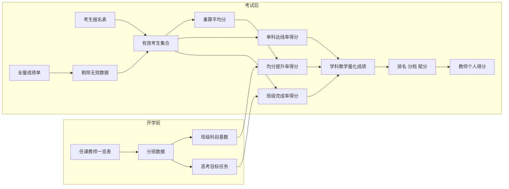
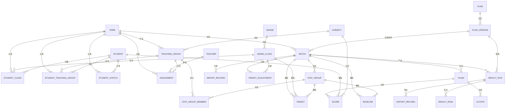

# 教学成绩量化考核 需求分析

本文档记录业务流程、计算口径、导入要求与验收标准。口径确认表是默认值的唯一来源；考核方案的配置结构、方案库、版本管理和核算时选择方式见 `docs/assessment-plan.md`；当前实现的系统结构与数据模型见 `docs/system-design.md`，后续目标模型见 `docs/design-roadmap.md`，历史数据的目录层级与工作表识别见 `docs/historical-data-checklist.md`。

## 使用者与目标

使用者是教务处一名老师，熟悉 Excel，不熟悉数据库和版本管理。每学期期中、期末各做一次全校三个年级的考核，每次处理数千名学生的成绩和上百名教师的任课关系，工作集中在考试结束后的一到两周。

系统要完成的事情：把现有 Excel 里的手工公式、手工汇总、手工排名分档，变成可以重复执行的流程，结果与学校现行表格逐项一致。

成功标准：

- 同一批次导入原始材料后，系统算出的均分、基数、均分提升率、达线人数、达线率、完成率、教学量化成绩、排名、档次、赋分、教师个人得分，与人工工作簿逐项一致；已知公式错误的位置按确认口径重算并列明差异，其余差异为零。
- 下学期重复操作时，任课教师、分班、基数、目标可以从上一批次复制，只修改变化部分。
- 结果页的每个数字都能展开查看分子、分母、基数和参与计算的学生名单。

## 本期范围

做：

- 导入 Excel，识别文件、工作表、表头与列。
- 建立学期、考核批次、行政班、教学班、统计组、任课关系、学生归属。
- 导入成绩、分数线、基数、目标任务、考核方案。
- 维护考核方案库，支持内置默认方案、派生方案、版本发布和核算时选择方案。
- 计算有效考生、均分、均分提升率、单科达线率、班级完成率、教学量化成绩。
- 按学科排名、分档、赋分，汇总教师个人得分。
- 导出 Excel，表格结构与学校现行工作簿一致。
- 保存历史批次结果，支持按教师、班级、学科对比。

不做：

- 排课、学籍管理、家长端、移动端。
- 考务系统接口对接；本期读取考务系统导出的文件。
- 解析 Word、PDF、图片格式的考核方案；方案在界面表单或 JSON 中录入。
- 在安装包里嵌入 LibreOffice；旧版文件转换使用本机安装的 LibreOffice。
- 多台电脑同时修改同一批次时的自动合并。

## 人工流程与系统步骤



系统里对应八个阶段，每个阶段完成后才能进入下一个：

| 阶段 | 输入 | 产出 | 是否可跳过 |
|---|---|---|---|
| 建批次 | 学年学期、考试类型、年级 | 一个空的考核批次 | 否 |
| 任课教师 | 任课教师一览表 | 教师与教学班的任课关系 | 否 |
| 分班与基数 | 学生名单、分班数据、入口成绩 | 学生归属、统计组科目基数 | 否 |
| 目标任务 | 高考目标任务表、走班目标任务表 | 各班各批次目标人数、合并组目标人数 | 否 |
| 考核方案 | 学校考核方案 | 指标、分值、档位表 | 否 |
| 考试数据 | 报名表、成绩单、分数线 | 考试原始数据 | 否 |
| 校验与清洗 | 以上全部 | 有效考生集合、剔除名单 | 否 |
| 计算与导出 | 有效数据与方案 | 结果表、排名、赋分、Excel | 否 |

高二、高三的任课教师、分班、基数可以直接从上一批次复制，只需要修改变化的部分。这是减少每学期工作量的关键。

## 数据关系



建模判断：

- 行政班用于学生日常管理，一个学生在同一个学期属于一个行政班。
- 教学班按学科划分。没有走班时，一个行政班在每个学科下对应一个教学班；有走班时，一个教学班可以包含多个行政班的学生。
- 学生和教学班的归属关系单独记录在 `STUDENT_TEACHING_GROUP`。一个学生在一个学期可以加入多个教学班，每个学科一个。
- 任课关系 `ASSIGNMENT` 挂教学班。一个教师可以承担多个教学班，一个教学班可以有一名或者多名任课教师。
- 成绩只记学生、科目、考试三个维度。教学班信息由学生的教学班归属得到，不在成绩表里重复保存。
- 单科达线率的统计单位是统计组 `STAT_GROUP`，按批次和学科建立。没有走班合并时，一个统计组对应一个教学班；走班合并统计时，一个统计组包含多个教学班。
- 单科目标任务和单科基数挂在统计组。班级完成率的分档目标挂在行政班。两类目标分开保存，分别承担单科达线率和班级完成率的分母。
- 统计组的成员是教学班，不重复记录学生。学生的学科归属仍由 `STUDENT_TEACHING_GROUP` 决定，统计组只负责汇总。
- 基数 `BASELINE` 按批次和统计组保存，并且有版本。目标 `TARGET` 按批次和统计组或者行政班保存，按学科划分时再增加学科维度。
- 考核批次是组织中心。导入数据、方案、计算结果都挂在批次下，批次之间互不影响，可以复制。
- 方案 `PLAN` 有多个版本 `PLAN_VERSION`。一个批次可以有多条计算结果 `RESULT_RUN`，每条结果引用一个方案版本；同一批数据可以用多个方案试算。
- 考核方案有内置默认方案和派生方案，方案版本有草稿、已发布、已停用三种状态。批次引用当前选用的版本，计算结果记录实际使用的版本；默认方案可以修改，修改生成新版本。
- 零目标补录和本班不参与的选择记录在 `TARGET_ADJUSTMENT`，不改写原始导入数据。

## 计算口径

以下口径由 2026 年春季学期高一、高二、高三的期中、期末工作簿和 2026 年高考专项工作簿逐表核对得出。工作簿里的列名写作“率”，实际存的是折算后的得分；系统同时保存原始比率和折算得分，界面显示两者。

### 1 有效考生

- 应考名单来自报名表，成绩来自成绩单，两者按考号取交集。
- 剔除缺考、违纪、作弊、借读、转学、休学、未选考。
- 走班学生按其实际授课的教学班计入对应学科，行政班不重复计人。
- 小语种考生（日语）不进入英语学科统计，总分保留日语成绩。
- 每批次保存参考人数、各科人数、走班人数和剔除名单。人数差异写入校验报告，由用户确认后才能计算。

### 2 均分与提升率（满分 40 分）

```
班级均分 = 班级总分 / 班级参考人数
年级均分 = 年级总分 / 年级参考人数
基数比值 = 班级中考均分 / 年级中考均分
均分提升率得分 = 班级均分 / 年级均分 / 基数比值 × 40
```

- 基数统一取中考成绩，三个年级一致。
- 年级均分包含该年级全部参评班级，包括小班。
- 年级总分均分取年级总计行，不取某个班级的单元格。
- 该指标衡量班级相对年级平均水平的变化。试卷难度变化时，班级与年级同时变化，比值仍然可比。
- 工作簿里这一列的数值就是得分，范围通常在 30 到 70 之间，可以直接进入综合得分。

### 3 单科达线率（满分 40 分）

```
单科达线人数 = 该科成绩达到单科本科线的学生人数
单科达线率得分 = 单科达线人数 / 单科目标任务 × 40
```

- 单科本科线按科目保存，物理类和历史类分别取线。
- 单科目标任务默认取班级本科目标任务。参考人数与该科人数用于校验，不参与这个分母。
- 不封顶。高一期末有班级的本科目标为 11 人，语文达线 49 人，得分为 178.18，工作簿按这个结果参与排名。40 是该项满分，得分可以超过 40。
- 走班合并统计时，分子为合并组内各教学班的达线人数之和，分母取统计组目标。统计组目标单独维护，成员教学班目标之和可以与它不同。结果记在统计组上，参与合并的班级不重复计分。
- 走班学生计入实际授课的教学班。
- 日语考生不进入英语学科的达线人数与人数统计。

### 4 班级完成率（满分 20 分）

```
实际完成分 = Σ(各档达线人数 × 档位权重)
目标基础分 = Σ(各档目标人数 × 档位权重)
完成率得分 = 实际完成分 / 目标基础分 × 20
```

| 档位 | 权重 |
|---|---|
| 清北 | 50 |
| C9 | 40 |
| 985 | 30 |
| 211 | 20 |
| 特控 | 10 |
| 本科 | 8 |

- 不封顶。实际完成分超过目标基础分时，得分超过 20。
- 目标基础分为 0 时，计算前的校验暂停流程并打开补齐窗口。可以逐项补录，也可以选择本班不参与并填写原因；补齐后重新计算得分和排名，记录补录人和时间；导出前再次校验，仍有 0 目标时不允许导出。
- 班级完成率得分是该班所有学科共用的一个值，计入每个学科的教学量化成绩。
- 走班合并统计时，完成率仍按行政班计算，单科达线率按统计组计算，两者使用各自的目标，不能互相替代。

### 5 学科教学量化成绩（满分合计 100 分）

```
教学量化成绩 = 均分提升率得分 + 单科达线率得分 + 班级完成率得分
```

三项分值合计 100：40 + 40 + 20。工作簿没有组内标准分步骤，三项直接相加。40、40、20 是各项满分，单项可以超过 40 或者 20，教学量化成绩可以超过 100。

### 6 排名、分档、赋分

- 排名的对象是统计组。同一教师任教多个班时，每个统计组单独排名；走班合并统计时，合并组只占一个名次。
- 排名组为同年级同学科，参评对象是该学科在该年级开设的统计组。
- 排名依据为教学量化成绩，从高到低。
- 档次按名次区间划分。历史方案使用三档，赋分 70、67、64。
- 默认按参评统计组数量生成边界：一档止于 `floor(n / 3)`，二档止于 `round(2 * n / 3)`；个别学科或者参评数量通过 `overrides` 覆盖。方案也可以切换为人工区间表。
- 期中、期末的 45 个学科排名组中，41 个同时符合两条边界公式。例外是 n=17（高三期中语文、数学、外语，一档实际止于 6，公式给出 5）和 n=18（高一期末化学，二档实际止于 18，公式给出 12）。这些边界在历史工作簿的「排序赋分备用数字」表里是人工填写的常数，因此该项仍待学校确认。
- 并列名次默认按 1、1、3 处理，即同分同名次并跳过后续名次。并列跨越档次边界时，整个并列组进入较高的档次，下一档从并列组最后一个名次之后开始。历史样本没有并列，该项仍待学校确认。
- 同一教师教多个班时，每个统计组分别取得档次与赋分；合并统计组只产生一个赋分。

### 7 教师个人得分

- 按年级、学科分别汇总。
- 取该教师所教统计组赋分中最高的两个组，求算术平均；只教一个组时取该组赋分。
- 结果保留一位小数。
- 跨年级任教的教师，按年级分别列出。

### 8 高考专项

高考批次使用单独的完成率：

```
目标任务完成率 = Σ(各档完成人数 × 档位权重) / Σ(各档目标人数 × 档位权重)
本科达线完成率 = 本科达线人数 / 本科达线目标
班级完成率得分 = (目标任务完成率 × 60% + 本科达线完成率 × 40%) × 20
```

其余指标与普通批次一致。高考专项按毕业年级单独建立批次，不与期中、期末批次混用。

### 9 学生变化与重算

- 转学、退学、留级、休学、借读的名单由教务处录入，或者从说明文件整理后导入。
- 名单确认后，按当前名单重算班级基数和目标任务，历史版本保留。
- 基数或者目标发生变化时，已有结果标记为需要重新计算；未重新计算时不允许导出。
- 借读、转学、退学的学生不进入班级统计，但保留在变化清单中，便于追溯。

## 口径确认表

已经确认的项写明依据；待确认项按当前口径实现，拿到学校答复后更新这一张表。表中与有效考生、统计范围、公式、分值、档位、排名、合并、个人得分和校验有关的规则全部进入方案配置，计算代码和导入器不另存一套默认值。

| 编号 | 问题 | 影响范围 | 当前口径 | 状态 | 确认依据 |
|---|---|---|---|---|---|
| 1 | 均分提升率的基数取哪次成绩 | 全部均分指标 | 中考成绩；基数比值 = 班级中考均分 / 年级中考均分 | 已确认 | 三个年级的基数工作表都按中考均分建立，提升率公式使用该比值 |
| 2 | 学科教师的达线率用哪条线 | 单科达线率 | 单科本科线，物理类与历史类分别取线 | 已确认 | 本科达线率计算表按科目列出达线人数，分数线取单科本科线 |
| 3 | 单科达线率的分母 | 单科达线率 | 单科目标任务；默认取班级本科目标任务，走班合并时取统计组目标 | 已确认 | 达线率 = 达线人数 / 班级目标任务 × 40；高一期末的平行班目标为 11 到 24 人，单科达线人数接近班级人数；合并组的统计组目标单独维护 |
| 4 | 三项指标是否封顶 | 综合得分 | 均分提升率、单科达线率、完成率都不封顶 | 已确认 | 单科达线率出现 178.18，完成率得分出现超过 20 的样本，工作簿按原值参与排名 |
| 5 | 三项指标的分值 | 综合得分 | 均分提升率 40、单科达线率 40、班级完成率 20 | 已确认 | 量化计算表按三项相加 |
| 6 | 档位权重 | 班级完成率 | 清北 50、C9 40、985 30、211 20、特控 10、本科 8 | 已确认 | 实际完成分与目标基础分都按这组权重计算 |
| 7 | 分档方式 | 档次与赋分 | 三档，赋分 70、67、64；边界默认按参评统计组数量生成，也可以按学科配置名次区间表 | 已确认 | 排名赋分表与排序赋分备用数字表 |
| 8 | 排名组 | 排名 | 同年级同学科，参评对象为该学科开设的统计组；合并统计组只占一个名次 | 已确认 | 各科排名的最大值等于该科参评统计组数；两个班级的政治合并后只出现一个政治名次 |
| 9 | 多班教师的个人得分 | 个人得分 | 取所教统计组赋分中最高的两个组求平均；只教一个组时取该组赋分 | 已确认 | 多份工作簿的教师结果反推一致，四班教师取其最高两个班 |
| 10 | 综合得分是否用标准分 | 综合得分与排名 | 三项折算为得分后直接相加，不做组内标准分 | 已确认 | 量化计算表没有标准分步骤 |
| 11 | 高考专项的完成率 | 高考批次 | 目标任务完成率 × 60% + 本科达线完成率 × 40% | 已确认 | 高考成绩量化工作簿的完成率表 |
| 12 | 走班生是否计入统计 | 全部统计结果 | 历史批次按学科计入实际教学班并在合并组汇总；修改后新规则：走班学生自成一个班级，也和其他班级一样单独统计，不再合并 | 已确认 | 学校明确答复走班学生自成一个班级单独统计，历史数据沿用当时合并说明 |
| 13 | 小语种如何处理 | 英语及全部学科 | 小语种考生不用考虑，不参与计算与量化考核统计 | 已确认 | 学校明确答复小语种不用考虑，不参与计算 |
| 14 | 学生流动如何影响目标与基数 | 完成率与提升率 | 按当前名单重算目标人数与基数 | 已确认 | 学生变化说明要求重新计算各班目标人数；基数表带核对日期 |
| 15 | 班主任是否单独考核 | 结果表结构 | 只保留班级完成率，不考核班主任；班级完成率得分计入该班任课教师量化成绩 | 已确认 | 学校明确答复只保留班级完成率，不考核班主任 |
| 16 | 排名并列的处理 | 排名与分档 | 同名次并跳过后续名次，如 1、1、3；由 `ranking.tieMode` 配置为 `competition` | 已确认 | 学校明确答复排名并列跳过后续名次（1，1，3……） |
| 17 | 分档边界是否随班级数调整 | 档次与赋分 | 各科每学期参评教师人数因请假等存在变动，采用人工维护分档边界（方案配置支持 `manual` 名次区间表，并提供比例参考） | 已确认 | 学校明确答复各科人数和教师变动多，确认采用人工维护分档边界区间表 |
| 18 | 小语种考生是否单独成组排名 | 排名组 | 小语种不用考虑，不参与计算与排名 | 已确认 | 学校明确答复小语种不参与计算 |
| 19 | 艺体生是否单独成组排名 | 排名组 | 平时期中、期末常规考试不参与统计；只在高考专项时参与统计 | 已确认 | 学校明确答复艺考生只在高考参与统计，平时不计算 |
| 20 | 目标基础分为 0 的班级 | 完成率 | 计算前暂停并打开补齐窗口；可以逐项补录，也可以选择本班不参与并填写原因；补齐后重算，记录审计，导出前复检 | 待细则答复 | 待学校核准具体算法前，维持当前安全拦截、弹窗补齐与审计策略 |
| 21 | 跨年级教师的个人得分 | 个人得分 | 按年级分别汇总输出，每个年级一条记录，不跨年级合并 | 已确认 | 学校明确答复跨年级任课教师的个人得分按年级分别输出 |
| 22 | 高一期中总分列的年级均分分母 | 均分提升率的总分列 | 按年级总计行计算；历史工作簿总分列误用某个班级的总均分作分母，复算时修正并列入差异报告 | 已确认 | 总分列公式引用 `$Q$22`（某个班级总均分 337.33），各科列引用 `$Q$24` 等总计行（总均分 388.01）；量化公式 `=Y2+Z2+U2`，总分列不进入教学量化成绩 |
| 23 | 走班合并统计组的分子与分母 | 单科达线率与统计组 | 合并组内达线人数相加，分母取统计组目标；结果只写一条 | 已确认 | 高一期中地理 `(4+16)/(14+4)`、政治 `(1+15)/(0+14)`、历史 `(5+3+1)/6`，高一期末政治 `(1+16)/(1+14)`；高一期中历史的统计组目标为 6，成员目标之和为 8，以统计组目标为准 |
| 24 | 合并统计组在导出表中的归属行 | 结果与导出 | 结果放在承担统计职责的班级行，参与合并的其他班级行保留任课教师、不重复显示得分 | 已确认 | 高一期中地理的合并结果只出现在承担统计职责的班级行；高一期末政治的承担统计职责班级行有教师和赋分，另一个成员行没有教师和得分 |
| 25 | 单科达线率是否封顶 | 单科达线率 | 不封顶，按达线人数除以单科目标任务乘 40 直接参与排名 | 已确认 | 高一期末某个平行班语文达线 49 人、目标 11 人，得分 178.18 |
| 26 | 单科成绩为 0 的处理 | 人数、均分、单科达线率 | 单科成绩为 0 按未参加该科考试处理，不计入该科人数、均分和达线人数；总分保留 | 已确认 | 高一期中卓越班有学生语文为 0、数学为 0；均分计算表语文人数 23、总分 2361，数学人数 23、总分 2537，0 分没有计入 |

修改默认值时只改这张表，并且同步更新 `docs/assessment-plan.md` 和 `docs/design-roadmap.md` 的默认值。未确认项不允许在代码里固定另一套默认值。

## 待确认项说明

这里分三类说明，避免把「历史数据里看不出来」和「还没有问学校」混在一起。

- 仍然需要学校确认：第 16 项排名并列、第 17 项分档边界。这两项已经做成方案配置项，当前默认值可以正常试算，但界面和导出文件不宣称它们是最终口径。
- 已经从历史工作簿确认并且已经实现：第 20 项零目标、第 23 项合并统计组、第 26 项单科 0 分。
- 无法从历史数据单独确认：第 16、17 项的具体做法；导出工作簿的最终表头、列宽、合并单元格、打印区域和样式。

### 16 排名并列

同一学科同一年级按教学量化成绩从高到低排名。如果两个或者多个统计组的得分完全相同，需要决定名次怎么写。当前按 `competition` 处理：同分同名次，下一名跳过。例如三个统计组的得分相同，名次写成 1、1、1，下一名写成 4；如果只有前两名同分，名次写成 1、1、3。

这个选择会影响并列统计组的档次和赋分。如果并列名次处于档次边界上，跳过后续名次会让后面的统计组进入更低的档次；不跳过则可能让更多统计组留在同一档。历史 6 份排名赋分表都是连续的 1 到 n，没有并列样本，所以无法从历史数据判断学校实际做法。系统把它作为方案配置项 `ranking.tieMode`，默认 `competition`，状态保持待确认。

通俗地说：两个老师得分一样时，是写成「并列第 1，下一位第 3」，还是写成「并列第 1，下一位第 2」。现在按「下一位第 3」处理，配置键是 `ranking.tieMode`，取值 `competition`。学校确认后可以改成 `dense`，或者在派生方案里单独设置，不需要改代码。

### 17 分档边界

三档赋分按名次区间划分：第 1 档 70 分，第 2 档 67 分，第 3 档 64 分。边界指每一档最后一个名次。当前默认按参评统计组数量 n 计算：一档止于 `floor(n/3)`，二档止于 `round(2n/3)`，其余为第三档。例如 n=22 时，一档为 1 到 7 名，二档为 8 到 15 名，三档为 16 到 22 名。

期中、期末的 45 个学科排名组中，41 个同时符合这两条公式。例外是 n=17（高三期中语文、数学、外语，一档实际止于 6，公式给出 5）和 n=18（高一期末化学，二档实际止于 18，公式给出 12）。这些边界在历史工作簿的「排序赋分备用数字」表里是人工填写的常数，无法确定学校是有意调整还是填写误差。

系统默认用比例生成边界，并为每个学科或者每个参评数量保留 `overrides`；也可以切换为人工区间表。状态保持待确认。学校确认后，如果是个别学科的特殊安排，保留 `overrides`；如果每学期都要人工调整，改用 `manual`。

通俗地说：一个学科有 22 个统计组时，前三档怎么分。现在默认第 1 到 7 名第一档、第 8 到 15 名第二档、第 16 到 22 名第三档。历史表格里有 4 个学科组的边界和这个公式不一样，所以不能确定学校是统一按比例分档，还是每学期人工填写。系统把两种做法都做成配置：`ratio` 按比例生成，`manual` 直接填写每个学科的名次区间。

### 20 零目标

已经确认并实现。核算前扫描目标，目标人数空白、六档全为 0、或者加权后目标基础分为 0 时暂停核算，打开补齐窗口。窗口按班级列出缺失档位，可以逐项填写；也可以选择「本班不参与」并填写原因。补齐后重新核算，补录人和时间记录在 `target_adjustments`，导出前再次校验。这个流程在批次工作台里，由「开始核算」自动触发。

### 23 合并统计组

已经确认并实现。合并算法属于方案配置，配置键是 `indicators.pass.merge`：分子取成员教学班达线人数之和，分母取统计组目标，结果写在承担统计职责的班级行。哪些教学班合并、统计组目标是多少属于批次数据，由每次考试的走班安排决定。

导入器会读取「本科达线率计算」等工作表里的合并说明。例如：
- 「地理张丽芬：走班卓越与鹭宁合并计算（14+4）」生成目标 18 的统计组，成员为卓越和鹭宁，承担统计职责的班级为鹭宁（卓越走班 14 人、鹭宁本班 4 人，结果行归入鹭宁）。
- 「政治王玲燕：走班546与鹭宁合并计算（0+14）」生成目标 14 的统计组，成员为 546 和鹭宁，承担统计职责的班级为鹭宁（546 走班 0 人、鹭宁本班 14 人，结果行归入鹭宁）。
- 「历史李娟（529-542-555：6）」「地理张瑞（539-542：5）」「政治张丽红（539-542-555：4）」通过破折号连接成员教学班（529 自动校正为 539），承担统计职责的班级为持有对应科目中考基数比的平行班 538。
没有给出目标人数的合并说明会保留为导入提醒，由用户确认。

### 导出模板样式

导出工作簿的工作表名称和列顺序已经按历史工作簿整理，最终的表头写法、列宽、合并单元格、打印区域和样式仍需要学校确认。这一项不影响计算口径，影响导出文件的验收。

## 已知历史数据差异

以下差异来自真实工作簿，复算时按确认口径重新计算，并在差异报告中逐项列出，不直接照抄原单元格。

- 高一期中「26春期中高一均分提升率计算」的总分列使用 `$Q$22`（某个班级的总均分 337.33）作分母，各科列使用 `$Q$24` 等年级总计行（总均分 388.01）。总分列不进入教学量化成绩，复算时统一按年级总计行计算。
- 高一期中地理提升率的部分公式引用了其他行，例如 `$AW3`，政治提升率引用 `$BA4`。复算时按本行数据重新计算。
- 高一期末化学的档次列与名次不单调：9 名、10 名为第三档，11 名为第二档。复算时按名次区间表重新判定。
- 高一期末单科达线率超过 40 是公式计算得到的正常结果。平行班的本科目标为 11 到 24 人，单科达线人数接近班级人数，得分可以远高于 40。
- 走班合并组的成员和统计组目标在不同批次不同：高一期中政治合并组的统计组目标是 14，高一期末同类合并组的统计组目标是 1 + 14 = 15；高一期中历史的统计组目标是 6，成员教学班目标之和是 8。差异来自走班安排和统计组目标，合并算法保持一致。
- 高一期中学生成绩表中，张子豪（5429055050）语文成绩为 2 分，但其「语文人数」列为空白。学校历史工作簿在均分统计中将其按未实考剔除（550 班语文计 51 人，年级语文实考 964 人，总均分为 86.01556017）。导入器自动关联 `<科目>人数` 计数列，当人数为空或 0 时为该生成绩标记 `invalid`，确保年级基准值完全吻合。
- 高一期中「25届基数」表中，556、553、554、555 班地理的「地均」单元格直接填入了基数比数值（如 1.1247），数值小于 3.0，而总分除以人数在 10.0 以上。导入器自动检测该异常填充，将其恢复为基数比，避免提升率计算发生量级偏差。
- 高一期中历史量化工作簿的「排名、赋分」工作表中，地理学科排名列未设置公式，部分平行班与重点班排名存在手工排列痕迹。量化引擎复算时统一按实际教学量化总分降序严格计算名次，并按方案分档区间赋分。
- 高考目标任务表中各行政班通常仅填写重点关注档位（如卓越班填清北/C9/985/211，平行班仅填本科），单元格留空属于学校设定的有效 0 目标，导入时按 0 导入；若行政班完全缺少目标配置或六档目标基础分为 0，触发零目标补齐弹窗。

## 导入要求

### 文件形态

- 一个批次通常有一个主工作簿，包含基础数据、均分、基数、提升率、达线、完成率、量化、排名赋分、个人得分等工作表。
- 教师一览、目标任务、走班目标任务、分数线可能单独成文件，也可能在主工作簿内。
- 期末高一、高二的工作簿内部各有一张任课教师一览工作表；跨年级任课关系优先取学期级教师一览表。
- `.xls` 文件由应用调用 LibreOffice 无界面转换，转换后按 `.xlsx` 读取；未安装 LibreOffice 时阻止导入，提示安装或者手工另存为 `.xlsx`。
- `.DS_Store`、`Thumbs.db`、`~$` 开头的临时文件直接忽略。

### 旧版文件转换

应用检测本机的 `soffice`，用独立的用户配置目录执行无界面转换，避免与用户正在运行的 LibreOffice 冲突。转换命令的形式为：

```sh
soffice --headless -env:UserInstallation=file://<独立配置目录> --convert-to xlsx --outdir <输出目录> <原文件>
```

转换后执行下面的校验，全部通过才进入导入：

- excelize 能打开转换文件。
- 工作表名称和数量与原文件一致。
- 合并单元格区域数量一致，关键区域的地址一致。
- 公式数量一致，抽样公式的文本一致。excelize 读取公式文本，不计算公式结果。
- 抽查关键单元格的值、文本格式和前导零。

校验失败时阻止导入，保留转换日志和失败位置，不把转换失败当成空数据。转换文件按内容哈希保存在应用数据目录，原文件继续保留；导入记录同时保存原文件路径、转换文件路径、转换程序版本和校验结果。转换只改变文件格式，不回写原文件。

已验证 4 个旧版文件可以转换并被 excelize 打开，公式保留；其中一个成绩册保留 435 个公式标签，应届达线率文件保留 13 个公式标签。导入时逐项校验工作表名称与数量、合并单元格和公式。

### 工作表识别

- 先按名称关键词匹配角色，再按前 15 行的表头关键词匹配，名称和表头都无法判断时列出候选由用户指定。
- 同一角色的多个工作表按「新」「修改」「核对后」标记选择当前版本，带「旧」「修改前」的保留为历史版本，无法判断时两份都导入并标记待确认。
- 一个工作簿在一个批次内导入一次，每个被使用的工作表生成一条工作表记录，带角色、表头行、数据范围和版本标记。
- 列映射保存原始列名、标准字段和用户改选记录。用户改选后可以重新导入，旧的映射保留。

### 表头与列

- 表头不在固定行，在前 15 行内寻找包含「班级」「姓名」「考号」「科目」「任课教师」中任意两个关键词的行。
- 多行合并表头按「上层-下层」组成列名；上层单元格向下填充到合并区域结束。
- 列名按同义词识别，识别结果在预览里显示，允许手工改列。
- 考号、考生号、学号按文本读取，保留前导零。
- 学生选科支持单字缩写，`"史"` 与 `"历"` 映射到历史方向（`history`），`"物"` 映射到物理方向（`physics`）。
- 走班合并名单支持「与」「和」「、」「+」「/」以及连字符破折号（`-`、`—`、`－`）分隔班级。
- 成绩表中存在 `<科目>人数` 计数列时，用于辅助确认学生该科是否实考；人数列为空或 0 时标记为无效，不计入班级与年级均分。
- 分数按数值读取；文本形式的数字转换失败时标记为待确认，不按零分处理。
- 空值、`/`、`-`、`缺考`、`缺`、`违纪`、`作弊`、`-1` 按无效标记处理，标记清单可以在界面配置。
- 身份证号、考生号、家庭住址、电话只用于匹配和核对，不写入结果表，不出现在导出文件里。

### 校验

- 阻断级问题：必填列为空、学号重复、班级不存在、学科不存在、成绩超出满分、报名表与成绩单人数差异过大、分数线缺失、目标基础分为 0、统计组目标缺失、合并组成员为空、正式核算选用未发布的方案版本。
- 提醒级问题：某班某科人数与报名人数不一致、某学生没有成绩也没有缺考标记、某班目标人数之和与年级目标不一致、某教师任教班级数与任课表不一致。
- 校验结果按文件、工作表、行号、列名、问题类型列出，可以导出 Excel 交给年级组长修改。
- 所有阻断级问题处理完后才允许计算；提醒级问题由用户确认后可以继续。

## 结果与导出

### 界面视角

- 按年级与学科：班级排名、档次、赋分，同一教师任教多个班时并列显示。
- 按班级：各科均分、基数、提升率、达线率、完成率、教学量化成绩。
- 按教师：任教班级、每个班的赋分、个人得分。

每个数字可以点开查看构成：分子、分母、基数、目标、参与计算的学生名单。这是核对结果和回应教师质疑的基础。

### 导出工作簿

导出文件按批次命名，例如 `2025-2026学年第一学期期中考试-教学成绩量化考核.xlsx`，保存在批次目录下。工作表与学校现行工作簿对应：

| 工作表 | 内容 |
|---|---|
| 基础数据 | 学生、班级、选科、考号、姓名、各科成绩 |
| 均分计算 | 班级、各科人数、总分、各科均分 |
| 基数 | 班级中考人数、中考总分、各科均分、基数比值 |
| 均分提升率 | 本次均分、基数、提升率得分 |
| 达线人数 | 各档总分达线人数、各科单科达线人数 |
| 达线率 | 各科达线人数、班级目标任务、达线率得分 |
| 完成率 | 实际完成分、目标基础分、完成率得分 |
| 量化计算 | 三项指标、教学量化成绩 |
| 排名赋分 | 量化成绩、排名、档次、赋分 |
| 个人得分 | 科目、任课教师、任教班级、赋分、个人得分 |
| 计算依据 | 方案名称与版本、输入哈希、基数与目标版本、计算时间 |
| 差异报告 | 历史工作簿旧值与系统重算值的差异，按文件、工作表、单元格、旧值、新值、原因列出 |

导出前检查结果是否为最新。输入、基数、目标、方案任一变化后，结果标记为需要重新计算，未重新计算时导出按钮不可用。

## 应用要求

- 计算和存储默认在本地完成，不依赖网络。启用 WebDAV 同步时，只连接用户配置的服务器，只上传加密后的数据包。
- 数据规模按三个年级、每个年级两千名学生、九个学科、五年历史数据估算。
- 单个一万行成绩文件在三秒内导入完成，一次完整计算在一秒内完成。验收时记录机器型号和冷热启动状态。
- 计算过程中关闭窗口或者断电，重新打开后能回到未完成的批次。
- 批次可以备份和恢复，换电脑时能整体迁移。
- 主要运行环境是 Windows，同时兼容 macOS。
- 旧版文件转换依赖本机安装的 LibreOffice。应用启动时检测 `soffice`，设置页允许手工指定可执行文件路径；转换在后台执行，失败时保留日志和失败位置。
- 导入失败时直接指出文件、工作表、行号、列名和问题类型，给出修改建议。
- 应用包体积不超过 30 MB。新增依赖前先测量。

## 验收标准

1. 用一个学期的真实材料完成一次完整复算，与人工工作簿逐项比对：班级参考人数、各科人数、总分均分、各科均分、基数比值、均分提升率得分、各档达线人数、各科单科达线人数、单科达线率得分、实际完成分、目标基础分、完成率得分、教学量化成绩、排名、档次、赋分、个人得分。已知历史数据差异中列出的公式错误按确认口径重算，其余差异全部为零。
2. 有效考生集合与人工剔除名单一致；走班学生、日语考生、转学与借读名单逐人核对。
3. 同一教师任教多个统计组时，个人得分等于最高两个组赋分的平均值；只教一个组时等于该组赋分。
4. 修改任意输入后，结果标记为需要重新计算，未重新计算时不能导出。
5. 导出的工作簿可以直接交给年级组长核对，表头、列顺序和数值与学校现行表格一致。
6. `.xls` 文件通过 LibreOffice 转换后可以导入，工作表、合并单元格、公式和抽样数值与转换前一致；转换失败或者未安装 LibreOffice 时阻断导入并给出明确原因，不产生空结果。
7. 一个工作簿包含二十个以上工作表时，按角色识别可以完成导入，未识别的工作表列在预览里由用户指定。
8. 导入一万行成绩文件不超过三秒，一次完整计算不超过一秒。
9. 单科达线率、均分提升率、完成率超过各自的满分时，结果按原值参与排名，不按 40 分或者 20 分截断。

## 尚未确认的问题

以下问题需要学校确认后写回口径确认表。第 16、17 项是计算口径；导出样式不影响计算结果，只影响导出文件的验收：

- 排名出现并列时是否跳过后续名次。当前按 1、1、3 处理，配置键为 `ranking.tieMode`。
- 分档边界是否统一按参评统计组数量生成，还是保留人工区间表。当前默认按比例生成，个别学科用 `overrides` 覆盖。
- 导出工作簿的最终表头写法、列宽、合并单元格、打印区域和样式。
