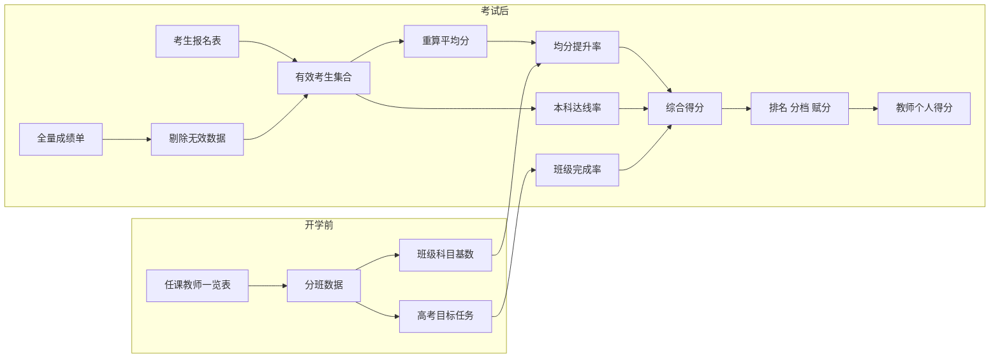

# 教学成绩量化考核 需求分析

## 使用场景

使用者是教务处一名老师，熟悉 Excel，不熟悉复杂软件。每学期期中、期末各做一次全校三个年级的考核，每次要处理数千名学生的成绩和上百名教师的任课关系。工作集中在考试结束后的一到两周，其他时间几乎不打开这个应用。

这意味着界面需要满足几点：进入应用就能看到上次做到哪一步；每一步都有明确的下一步按钮；导入失败时直接指出哪个文件、哪一行、哪一列出错；不需要理解数据库、批次、版本这类概念也能完成操作。

## 人工流程与系统步骤



系统里对应八个阶段，每个阶段完成后才能进入下一个：

| 阶段 | 输入 | 产出 | 是否可跳过 |
|---|---|---|---|
| 建批次 | 学年学期、考试类型、年级 | 一个空的考核批次 | 否 |
| 任课教师 | 任课教师一览表 | 教师与教学班的任课关系 | 否 |
| 分班与基数 | 学生名单、分班数据、入口成绩 | 学生归属、班级科目基数 | 否 |
| 目标任务 | 高考目标任务表 | 各班各批次目标人数 | 否 |
| 考核方案 | 学校考核方案 | 指标、权重、分档比例、赋分表 | 否 |
| 考试数据 | 报名表、成绩单、分数线 | 考试原始数据 | 否 |
| 校验与清洗 | 以上全部 | 有效考生集合、剔除名单 | 否 |
| 计算与导出 | 有效数据与方案 | 结果表、排名、赋分、Excel | 否 |

高二、高三的任课教师、分班、基数可以直接从上一批次复制，只需要修改变化的部分。这是减少每学期工作量的关键。

## 数据关系

```mermaid
erDiagram
  BATCH ||--o{ ASSIGNMENT : 包含
  BATCH ||--o{ EXAM : 包含
  BATCH ||--|| PLAN : 使用
  GRADE ||--o{ CLASS : 包含
  CLASS ||--o{ STUDENT_CLASS : 包含
  STUDENT ||--o{ STUDENT_CLASS : 归属
  CLASS ||--o{ TEACHING_GROUP : 组成
  SUBJECT ||--o{ TEACHING_GROUP : 对应
  TEACHER ||--o{ ASSIGNMENT : 承担
  TEACHING_GROUP ||--o{ ASSIGNMENT : 对应
  STUDENT ||--o{ SCORE : 取得
  SUBJECT ||--o{ SCORE : 对应
  EXAM ||--o{ SCORE : 包含
  EXAM ||--o{ CUTOFF : 包含
  CLASS ||--o{ BASELINE : 拥有
  CLASS ||--o{ TARGET : 拥有
  BATCH ||--o{ RESULT : 产出
```

几个建模上的判断：

- 统计单元使用教学班。没有走班时，一个行政班就是一个教学班；有走班时，一个行政班的学生按选科进入不同的教学班。用一套结构覆盖两种情况，避免为走班单独做一套计算。
- 任课关系挂在教学班上，不挂在行政班上。一个教师可以承担多个教学班，一个教学班可以有多个学科的任课教师。
- 成绩只记学生、科目、考试三个维度。班级信息通过学生在本次考试所属的教学班得到，不在成绩表里重复保存。
- 基数按班级、科目、批次保存，并且有版本。分班调整或选科调整后重新生成新版本，历史批次继续引用旧版本。
- 考核批次是组织中心。导入数据、方案、计算结果都挂在批次下，批次之间互不影响，可以复制。

## 计算链路

计算口径以学校现行方案为准。系统的目标是复现教务处现在用 Excel 得到的结果，通用做法与学校方案冲突时，采用学校方案。走班生被剔除、完成率不设上限这类现行做法，默认原样保留；需要调整时，由用户在考核方案里显式修改，系统不自行改变口径。

### 第一步 确定有效考生

应考名单来自考生报名表，成绩来自全量成绩单。两边取交集后，再剔除无效数据。

需要剔除的情况：

- 缺考：报名了但没有成绩，或成绩单标记为缺考。
- 违纪：成绩单标记为违纪或作弊。
- 借读：学籍不在本校。
- 转学、休学：考试期间已经离校。
- 未选考：报名表里没有该科目，成绩单里也没有。

剔除之后按教学班重新统计人数和平均分。考务系统给出的平均分包含缺考生，不能直接使用。

### 第二步 三项指标

均分提升率衡量教学增值，比较本次平均分与基数平均分。

```
均分提升率 = (本次平均分 - 基数平均分) / 基数平均分 × 100%
```

本科达线率衡量上线情况，分子是达到分数线的学生人数，分母是有效人数。

```
本科达线率 = 达线人数 / 有效人数 × 100%
```

班级完成率衡量目标达成，分子同上，分母来自高考目标任务。

```
班级完成率 = 达线人数 / 目标人数 × 100%
```

### 第三步 综合得分

三项指标按考核方案给出的权重合成。有两种常见做法，结果差异很大：

- 原始值加权：三项指标各自乘权重后相加。实现简单，但量纲不同，均分提升率可能是负数，完成率可能超过 100，直接相加会让某一项主导结果。
- 同组标准分加权：先在年级与学科的教师组内把每项指标转换为标准分，再乘权重相加。组内可比性更好，但要求每组人数足够，并且需要明确标准分的计算方式。

### 第四步 排名、分档、赋分

排名只在同年级同学科的教师之间进行。不同学科的平均分和达线率没有可比性，跨学科排名会得出错误结论。

分档按排名比例划分，例如前 20% 为 A 档、20% 到 50% 为 B 档、50% 到 80% 为 C 档、其余为 D 档。档位再映射到赋分，例如 100、90、80、70。分档比例和赋分表都由方案配置。

### 第五步 教师个人得分

一个教师可能教多个班，也可能跨年级。个人得分的合成方式需要在拿到真实数据后确认，常见做法有三种：

- 按有效学生人数加权平均。
- 按教学班数量算术平均。
- 先按班级赋分，再按学校规定的系数汇总。

## 需要数据确认的口径

以下问题无法从流程描述推断，需要看 Excel 里的公式和列名才能确定。这是历史数据到位后首先要做的事。

| 编号 | 问题 | 影响范围 | 目前的推断 |
|---|---|---|---|
| 1 | 均分提升率的基数取哪次成绩 | 全部均分指标 | 高一第一学期取中考，之后取分班时的入口成绩 |
| 2 | 本科达线率对学科教师是按总分线还是单科有效线 | 学科教师的达线率 | 班主任按总分线，学科教师按单科有效线 |
| 3 | 完成率是否封顶 | 综合得分 | 不封顶，超过 100% 按实际值参与计算 |
| 4 | 综合得分用原始值还是标准分 | 综合得分与排名 | 原始值加权，权重由方案给出 |
| 5 | 分档按比例还是按固定分数线 | 档位与赋分 | 按比例，每档至少一人 |
| 6 | 多班教师的个人得分如何合成 | 个人得分 | 按有效学生人数加权 |
| 7 | 班主任是否单独考核 | 结果表结构 | 单独一张表，不与学科教师混排 |
| 8 | 走班生如何归属教学班 | 全部统计结果 | 按报名表的选科与教学班归属 |
| 9 | 艺体生、小语种是否单独组 | 排名组划分 | 单独成组，不与普通考生混排 |
| 10 | 目标为 0 的班级如何处理 | 完成率 | 不参与完成率，该项按组内平均赋分 |

## 导入的现实问题

各年级组长提交的表格不会完全一致。系统需要处理：

- 表头名称不同，例如「姓名」「教师姓名」「任课教师」指的是同一列。按同义词表识别列，并允许用户手工指定。
- 列顺序不同，多余的说明列、合并单元格、标题行。
- 数字存成文本，学号丢失前导零。
- 全角字符、多余空格、换行符。
- 一个工作表里有多张表，或者一个文件有多个工作表。
- 教师同名同姓，需要工号区分；没有工号时按学科加班级区分。
- 班级名称写法不同，例如「高一(1)班」「高一1班」「1班」。

导入流程统一为：选择文件、选择工作表、预览前二十行、确认列对应关系、校验、导入。校验分两级，阻断级问题必须处理完才能继续，提醒级问题可以确认后忽略。

阻断级问题包括：必填列为空、学号重复、班级不存在、学科不存在、成绩超出满分、报名表与成绩单人数差异过大、分数线缺失。

提醒级问题包括：某班某科人数与报名人数不一致、某学生没有成绩也没有缺考标记、某班目标人数之和与年级目标不一致、某教师任教班级数与任课表不一致。

校验结果按文件、工作表、行号、列名、问题类型列出，可以导出 Excel 交给年级组长修改。

## 结果与导出

界面上的结果按三个视角查看：

- 按年级与学科：教师排名、档位、赋分。
- 按班级：各科指标、班级完成率、班主任视角的汇总。
- 按教师：任教班级、各项指标、个人得分。

每个数字都可以点开查看构成：分子、分母、基数、目标、参与计算的学生名单。这是核对结果和回应教师质疑的基础。

导出的 Excel 包含以下工作表：

1. 考核结果汇总
2. 教师个人得分
3. 学科排名与分档
4. 班级汇总
5. 有效考生明细
6. 剔除名单及原因
7. 基数与目标
8. 参数与公式说明
9. 原始导入数据

导出文件按批次命名，例如 `2025-2026学年第一学期期中考试-教学成绩量化考核.xlsx`，保存在批次目录下。导出的表格格式需要和学校现在提交的格式一致，这一项要等真实文件到位后确定。

## 应用层面的要求

- 全程离线，数据只保存在本机。
- 数据规模按三个年级、每个年级两千名学生、九个学科估算，五年历史数据。
- 导入一万行成绩在三秒内完成，一次完整计算在一秒内完成。
- 计算过程中关闭窗口或断电，重新打开后能回到未完成的批次。
- 批次可以备份和恢复，换电脑时能整体迁移。
- 主要运行环境是 Windows，同时兼容 macOS。
- 计算完成后修改任何输入，结果标记为需要重新计算，未重新计算时不允许导出。

## 后续步骤

历史数据到位后，按下面的顺序阅读，每读完一个阶段就更新本文档中对应的口径：

| 顺序 | 文件 | 要确认的内容 |
|---|---|---|
| 1 | 任课教师一览表 | 教师与班级、学科的对应方式，是否区分教学班 |
| 2 | 分班数据 | 学生字段、班级命名、是否有选科组合 |
| 3 | 班级科目基数 | 基数来自哪次成绩、计算方式、是否按有效人数 |
| 4 | 高考目标任务 | 目标按班级还是按学生、分几个批次 |
| 5 | 考生报名表 | 选科字段、缺考标记方式 |
| 6 | 全量成绩单 | 科目列、标记列、是否含总分与排名 |
| 7 | 分数线 | 批次数量、是否有单科有效线 |
| 8 | 考核方案 | 指标权重、分档比例、赋分表 |
| 9 | 最终结果 | 排名组、个人得分的合成公式 |

前八项用于还原计算过程，第九项用于验证还原结果。拿到第九项之后，用系统重算一遍，逐格比对，差异归零才算口径确认完成。
