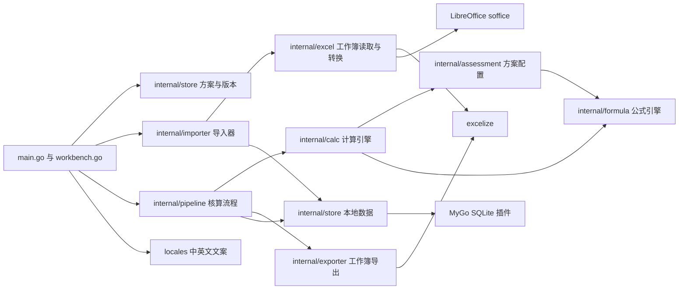
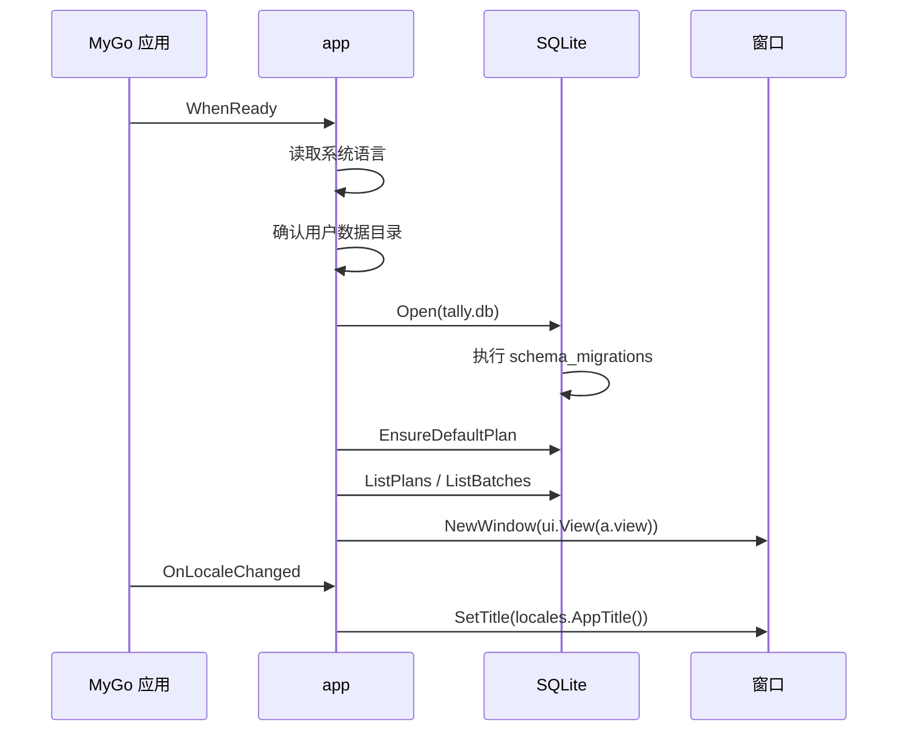
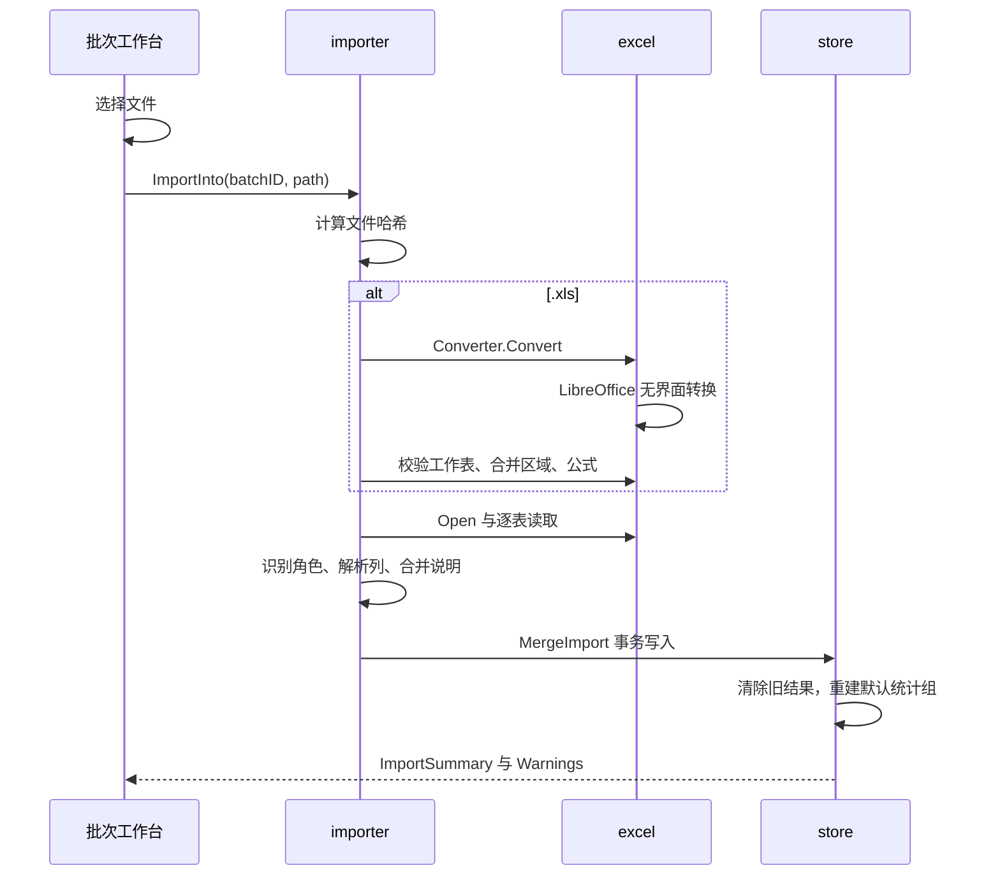
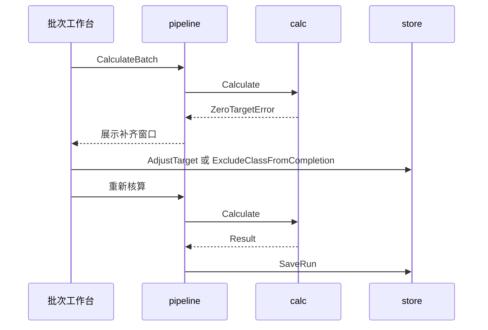
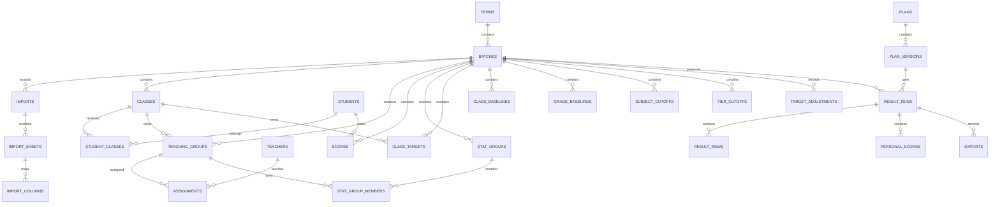

# 当前系统设计

本文档描述阶段一已经实现的系统。业务口径以 `docs/requirements-analysis.md` 为准，考核方案字段以 `docs/assessment-plan.md` 为准，后续阶段以 `docs/design-roadmap.md` 为准。本文档记录当前代码的实际结构、数据流、存储结构和限制，供后续实现与审查使用。

## 目标与边界

系统是一个单机桌面应用，运行在 Windows 与 macOS，界面由 MyGo 原生控件绘制。阶段一完成「建立批次 → 导入工作簿 → 核算 → 导出工作簿」这一条链路，数据保存在本机 SQLite，不依赖网络。

当前已经实现：

- 内置默认考核方案、派生方案数据模型、方案版本发布与停用。
- 新建考核批次，选择批次和已发布方案版本。
- 读取 `.xlsx`，通过 LibreOffice 转换并读取 `.xls`。
- 识别学生、教师、目标、基数、分数线工作表。
- 读取走班合并说明，建立显式统计组。
- 补齐零目标，或者让班级不参与完成率。
- 计算三项指标、排名、档次、赋分和教师个人得分。
- 导出结果工作簿，并在导出前复核输入摘要。

当前没有实现：

- 方案编辑界面、派生方案新建界面、方案对比界面。
- 逐学生的教学班归属表，以及跨行政班的走班学生归属。
- WebDAV 同步、数据包加密、自动备份、结果归档模式。
- 分班、分考场、教务统计等后续阶段。

## 总体组成



| 模块 | 职责 | 主要入口 |
|---|---|---|
| 根包 `tally` | 应用生命周期、方案库界面、批次工作台、后台任务与界面回写 | `main`、`app.load`、`app.view`、`app.batchView` |
| `internal/assessment` | 方案 JSON 结构、默认值、语义校验、公式编译检查 | `Decode`、`Validate`、`DefaultConfig` |
| `internal/formula` | 受限表达式词法分析、语法树、求值和变量引用检查 | `Compile`、`Expression.Eval` |
| `internal/calc` | 有效考生、三项指标、排名、档次、赋分、个人得分 | `Calculate` |
| `internal/store` | SQLite 迁移、方案版本、批次数据、导入合并、结果与导出记录 | `Open`、`MergeImport`、`SaveRun`、`LatestRun` |
| `internal/importer` | 工作表角色识别、列解析、走班合并说明、旧版文件导入 | `ImportWorkspace`、`ImportInto` |
| `internal/excel` | 打开工作簿、读取表格、检查工作表与合并区域、LibreOffice 转换 | `Open`、`ReadTableFromWorkbook`、`Converter.Convert` |
| `internal/pipeline` | 把批次数据转换为计算输入，协调核算与导出 | `BuildInput`、`CalculateBatch`、`ExportLatest` |
| `internal/exporter` | 生成结果工作簿，使用临时文件替换目标文件 | `Write` |
| `locales` | 中英文文案与生成的访问函数 | `locales.In`、`locales.Catalog` |

依赖方向保持单向：界面依赖业务模块，业务模块依赖存储和计算基础包；计算包不读取数据库，也不访问界面。`internal/calc` 只接收 `calc.Input`，因此可以用合成输入做单元测试，也可以由后续的自动核算流程复用。

## 核心接口

| 接口 | 输入与输出 | 约定 |
|---|---|---|
| `store.Open(ctx, path)` | 路径，返回 `*Store` | 打开数据库并执行建表迁移 |
| `store.EnsureDefaultPlan(ctx)` | 无参数，返回 `PlanVersion` | 没有内置方案时写入并发布；已有方案时返回最新已发布版本 |
| `store.CreateBatch(ctx, input)` | 学年、学期、考试、年级，返回 `Batch` | 相同批次不重复创建 |
| `store.MergeImport(ctx, batchID, data, report)` | 解析数据与导入报告，返回 `ImportSummary` | 主体在事务内写入，成功后清除旧结果并重建默认统计组 |
| `store.LoadBatchData(ctx, batchID)` | 批次标识，返回 `BatchData` | 一次读取核算需要的全部批次数据 |
| `store.AdjustTarget(...)` | 班级、档位、原值、新值、原因 | 只追加补录记录，不改写原始目标 |
| `store.ExcludeClassFromCompletion(...)` | 班级、原因 | 用空档位记录表示本班不参与完成率 |
| `store.SaveRun(...)` | 批次、方案版本、输入摘要、计算结果 | 新增正式运行，旧运行保留并取消正式标记 |
| `store.LatestRun(ctx, batchID)` | 批次标识，返回运行、结果行、个人得分 | 按运行标识倒序取最新一条 |
| `store.SaveExport(...)` | 运行标识、路径、文件哈希 | 追加导出记录 |
| `store.InputHash(plan, data)` | 方案配置与批次数据，返回 SHA-256 | 忽略批次状态、修订号、当前版本和创建时间 |
| `importer.ImportWorkspace(path, options)` | 文件路径与转换目录，返回 `ImportData`、`ImportReport` | 只解析，不写数据库 |
| `importer.ImportInto(ctx, store, batchID, path, options)` | 批次与文件路径，返回导入摘要 | 解析后调用 `MergeImport` |
| `pipeline.BuildInput(ctx, store, batchID, plan)` | 批次与方案，返回计算输入、批次数据和摘要 | 汇总阻断问题，不静默跳过 |
| `pipeline.CalculateBatch(ctx, store, batchID, versionID)` | 批次与已发布版本，返回计算结果 | 构建输入、计算并保存运行 |
| `pipeline.ExportLatest(ctx, store, batchID, path)` | 批次与目标路径 | 复核摘要、写出工作簿、记录导出 |
| `calc.Calculate(input, options)` | 计算输入与选项，返回结果 | 不访问数据库和界面；零目标返回 `ZeroTargetError` |
| `exporter.Write(input)` | 导出数据 | 先写临时文件，成功后再替换目标文件 |
| `assessment.Decode(data)` | 方案 JSON | 严格解析，未知字段拒绝 |
| `Config.Validate()`、`Config.ValidateFormulas()` | 方案配置 | 检查语义、公式语法和指标依赖 |

## 启动与生命周期



`app.load` 在测试中可以直接使用 `a.dataDir`，界面启动时使用 `mygo.App.Path(mygo.PathUserData)`。打开数据库失败、默认方案写入失败或者列表读取失败时，错误写入 `app.loadError`，界面显示本地数据库错误并停止渲染业务内容。

应用退出时关闭 SQLite 连接。当前没有后台定时任务，也没有启动时网络请求。

## 应用状态

根包只保存普通数据和 `ui` 的身份对象，跨构建不保存控件指针。主要状态如下：

| 字段 | 用途 |
|---|---|
| `dataDir`、`store` | 用户数据目录和数据库连接 |
| `language` | 当前界面语言，`en` 或 `zh-Hans` |
| `plans`、`versions`、`selectedPlanID`、`versionIndex` | 方案库当前选择 |
| `tab` | 当前页签，`0` 为方案库，`1` 为考核批次 |
| `batches`、`selectedBatchID` | 批次列表与当前批次 |
| `published`、`calculateVersion` | 可用于核算的已发布版本和当前选择 |
| `batchBusy`、`batchError`、`batchMessage` | 后台任务状态和用户提示 |
| `importSummary` | 最近一次导入的摘要与提醒 |
| `resultRows`、`personalScores`、`resultTable` | 最近一次核算结果 |
| `zeroOpen`、`zeroIssues`、`zeroValues`、`zeroReason` | 零目标补齐窗口 |
| `newBatchOpen` 与批次字段 | 新建批次窗口 |

批次状态当前只有三个取值：

| 状态 | 含义 |
|---|---|
| `draft` | 新建后尚未导入 |
| `imported` | 至少完成一次导入，已有结果被清除 |
| `calculated` | 已保存一次核算结果 |

方案版本状态为 `draft`、`published`、`retired`。正式核算只接受 `published`。

## 方案配置与版本

方案配置保存为 JSON，带 `schemaVersion`。`assessment.Decode` 使用严格模式，未知字段会被拒绝；`Validate` 检查枚举、指标分值合计、档位权重、排名边界、个人得分方式、专项规则和零目标处理；`ValidateFormulas` 编译全部公式并检查指标依赖。

首次启动时 `EnsureDefaultPlan` 查找 `kind = 'system'` 的方案。没有时写入 `assessment.DefaultConfig()`，版本 1 直接发布。已有内置方案时返回最新的已发布版本。

派生方案通过 `store.CreatePlan` 写入完整配置，版本 1 为草稿；`store.CreateDraft` 在已有方案下追加草稿版本；`Publish` 和 `Retire` 修改版本状态。当前界面提供发布和停用按钮，方案编辑、派生方案新建和版本对比还没有界面入口。

核算时 `pipeline.CalculateBatch` 读取版本并检查状态。批次保存 `current_plan_version_id`，结果运行记录保存实际使用的 `plan_version_id`。同一批次重新核算时，旧运行记录保留，`is_official` 被清零，新记录标记为正式结果。

## 批次与导入

### 新建批次

`store.CreateBatch` 接收学年、学期、考试类型和年级。唯一约束是 `terms(academic_year, semester)` 加 `batches(term_id, exam_type, grade)`。重复创建相同批次不会新增记录。当前考试类型限制为 `midterm`、`final`、`gaokao`，年级限制为 `g1`、`g2`、`g3`。

### 导入流程



文件级去重使用 SHA-256。`.xls` 转换文件放在 `<用户数据目录>/converted`，原文件不修改。当前没有把导入文件复制到按哈希命名的文件目录，导入记录保存原始路径、转换路径和文件哈希。

### 工作表角色

导入器先读取每个工作表前 15 行，按名称、表头和行数打分，选出学生、教师、目标、基数、分数线五类工作表。当前识别规则：

| 角色 | 必要表头 | 加分条件 |
|---|---|---|
| 学生成绩 | `班级`、`姓名`、`考号`、`考生号` 或 `学号` | 工作表名含「均分整理」「基础数据」「核对」 |
| 任课教师 | `班级`、`班主任`、至少一个学科 | 工作表名含「任课教师」「教师一览」 |
| 目标任务 | `班级`、`清北` 或 `本科` | 工作表名含「目标任务」 |
| 基数 | `班级`、至少一个基数均分列（`语均`、`数均`、`总均` 等） | 工作表名含「基数」 |
| 分数线 | `科目`、`本科线` 或 `特控线` | 行数越多分数越高 |

一个工作簿没有识别到任何角色时阻止导入。一个角色有多个候选时选择分数最高的工作表，其余工作表不参与本次导入。

### 学生与成绩

学生按考号读取，考号和学号保持文本，保留前导零。缺考、违纪、作弊和 `-1` 写入成绩标记，不写入分数。单科成绩为 0 时按未参加该科考试处理，不写入该科成绩；总分保留。选科组合含「物理」记为物理类，含「历史」记为历史类。学籍状态把「转学」「休学」「借读」「退学」转换为内部代码。

考号重复、必填字段为空、未知列无法解析时导入失败。班级汇总行（含「年级」「总计」「合计」「备注」「说明」）跳过。

### 班级别名

学生表可能使用 `800`、`900` 这类内部编号，目标表、教师表和基数表使用「卓越」「鹭宁」这类名称。导入器按学生人数与导入文件中带班级人数的表格匹配；人数唯一对应时把学生班级改名为目标班级，并写入导入提醒。人数相同导致多个候选时不自动改名。

### 走班合并说明

导入器扫描所有工作表文本，识别下面的形式：

```text
地理张丽芬：走班卓越与鹭宁合并计算（14+4）
政治王玲燕：走班546与鹭宁合并计算（0+14）
```

每个说明生成一个显式统计组：成员班级按「与」「和」「、」「+」「/」分隔，目标人数取括号内数字之和，承担统计职责的班级取第一个成员。一行有多条说明时全部解析。说明没有给出目标人数、成员数量与目标数量不一致、目标无法读取时只产生提醒，不生成统计组。

### 导入写入

`MergeImport` 先建立班级，再写学生、任课关系、班级目标、基数、分数线和显式统计组。学生成绩对应的学科教学班先建立，再建立显式统计组。事务提交后删除所有非显式统计组，并按教学班重建默认统计组；已经被显式统计组包含的教学班不再建立同名默认组。

导入会删除该批次已有结果运行和结果行，把批次状态改为 `imported`，并把修订号加一。导入摘要统计当前批次的班级、学生、教师、教学班、统计组、任课关系、班级目标、学科分数线和档位分数线数量。

`import_columns` 和 `import_sheets.version_tag` 当前只建表，导入器还没有写入列映射和版本标记。列映射改选、工作表版本选择和候选工作表确认属于后续导入界面。

## 核算流程

### 输入构建

`pipeline.BuildInput` 读取 `BatchData`，生成 `calc.Input`，同时计算输入摘要。核算前检查：

| 问题 | 结果 |
|---|---|
| 没有班级、学生、统计组或者有效考生 | 阻止核算 |
| 学科缺少年级基数均分 | 阻止核算 |
| 学科缺少物理类或者历史类分数线 | 阻止核算 |
| 档位缺少总分分数线 | 阻止核算 |
| 统计组缺少基数、单科目标或者成员 | 阻止核算 |
| 学生缺少教学班归属 | 阻止核算 |
| 目标基础分为 0 或者目标缺失 | 返回零目标问题，打开补齐窗口 |

年级均分从有效学生的成绩重新计算，单科成绩为 0 的不计入。年级基数优先使用工作表总计行，缺失时按班级人数加权。统计组基数优先使用统计组自己的值，缺失时对成员班级的基数均分取算术平均。

### 单项指标

每个统计组按学科计算一次：

- 班级均分等于成员教学班内有效学生该科成绩之和除以人数。
- 均分提升率得分使用 `class.average / grade.average / baseline.ratio × points`。
- 单科达线人数按学生类别选择物理类或者历史类分数线，得分使用 `passCount / statGroup.target × points`。
- 完成率对承担统计职责的班级计算，实际完成分和目标基础分都按方案档位权重加权。
- 三项得分默认不封顶；配置 `cap` 时先乘满分，再按上下限截断。

公式由 `internal/formula` 编译和执行。支持的变量包括 `class`、`grade`、`baseline`、`statGroup`、`tier`、`indicator` 和 `program`。指标可以引用其他指标，编译阶段检查循环依赖和未知变量；运行阶段遇到除零、缺失变量或者非有限数值时返回错误。

### 排名与赋分

排名组默认为同年级同学科。排序依据教学量化成绩，同分时按统计组标识稳定排序。`ranking.tieMode` 支持：

| 取值 | 名次写法 |
|---|---|
| `competition` | 1、1、3，默认值，仍待学校确认 |
| `dense` | 1、1、2 |
| `ordinal` | 1、2、3 |

分档默认按参评统计组数量生成：一档止于 `floor(n/3)`，二档止于 `round(2n/3)`。`overrides` 按学科和参评数量覆盖；`manual` 模式按学科读取人工区间。赋分默认 70、67、64。

### 个人得分

个人得分按教师、学科和年级汇总。默认 `top_two_average`：取该教师所教统计组赋分最高的两个组求平均；只有一个组时取该组赋分。合并统计组只产生一个赋分。结果保留一位小数。

### 零目标处理



零目标窗口按班级列出缺失档位。用户可以逐项补录并填写原因，也可以让班级不参与完成率并填写原因。补录写入 `target_adjustments`，原始导入目标不被改写。补齐或排除后立即重新核算。仍有零目标时窗口保持打开，并更新剩余问题。

### 结果保存

`SaveRun` 先把该批次所有旧运行标记为非正式，再插入新的正式运行，然后写入结果行和个人得分，把批次状态改为 `calculated`。结果行保存学科、统计组、承担统计职责的班级、任课教师、三项指标得分、总分、排名、档次、赋分和 `indicator_values_json`。

当前保存分为两次事务：运行记录与旧记录状态一次，结果行与批次状态一次。写入结果行失败时会留下一条没有明细的正式运行记录。后续需要在同一事务中完成运行记录、结果行、个人得分和批次状态更新。

### 输入摘要

`store.InputHash` 对方案配置和 `BatchData` 做 JSON 编码后计算 SHA-256。计算前把批次的 `Status`、`Revision`、`CurrentPlanVersionID`、`CreatedAt` 清零，避免核算本身改变摘要。导入、方案变化、目标补录或者班级排除都会改变摘要。

## 导出设计

导出入口是 `pipeline.ExportLatest`：

1. 读取批次最新运行、结果行和个人得分。
2. 读取运行使用的方案版本。
3. 重新构建当前输入摘要。
4. 当前摘要与运行摘要不一致时拒绝导出，提示先重新核算。
5. 调用 `exporter.Write` 写出工作簿。
6. 计算导出文件 SHA-256，写入 `exports`。

导出工作簿包含五张表：

| 工作表 | 内容 |
|---|---|
| 计算依据 | 学年学期、考试类型、年级、方案名称与版本、输入摘要、核算时间、导出时间 |
| 量化计算 | 每个统计组的班级、学科、教师、人数、均分、基数、三项得分和总分 |
| 排名赋分 | 每个统计组的教学量化成绩、排名、档次和赋分 |
| 个人得分 | 教师、年级、学科、所教统计组赋分和个人得分 |
| 结果明细 | 每个统计组的指标明细 JSON |

导出先写 `<目标名>.tmp.xlsx`，成功后再改名为目标文件，避免覆盖时留下半截文件。`excelize` 需要识别文件扩展名，临时文件保留 `.xlsx` 后缀。

## 数据模型

### 实体关系



### 表结构

方案表：

| 表 | 关键字段 | 约束 |
|---|---|---|
| `plans` | `id`、`name`、`kind`、`base_plan_version_id`、`description`、`created_at` | `kind` 为 `system` 或 `user` |
| `plan_versions` | `id`、`plan_id`、`version`、`status`、`schema_version`、`config_json`、`config_hash`、`parent_version_id`、`notes`、`created_at`、`created_by`、`published_at`、`published_by` | 唯一索引 `(plan_id, version)`，索引 `(plan_id, status)` |

批次与导入表：

| 表 | 关键字段 | 约束 |
|---|---|---|
| `terms` | `id`、`academic_year`、`semester` | 唯一索引 `(academic_year, semester)` |
| `batches` | `id`、`term_id`、`exam_type`、`grade`、`status`、`current_plan_version_id`、`revision`、`created_at` | 唯一索引 `(term_id, exam_type, grade)` |
| `imports` | `id`、`batch_id`、`file_hash`、`relative_path`、`converted_path`、`file_format`、`conversion_tool`、`conversion_report_json`、`row_count`、`status`、`created_at` | 唯一索引 `(batch_id, file_hash)` |
| `import_sheets` | `id`、`import_id`、`sheet_name`、`role`、`header_row`、`data_range`、`version_tag`、`is_current` | 唯一索引 `(import_id, sheet_name)` |
| `import_columns` | `id`、`import_sheet_id`、`source_column`、`standard_field`、`merged_header`、`is_user_selected` | 唯一索引 `(import_sheet_id, source_column)` |

人员与教学组织表：

| 表 | 关键字段 | 约束 |
|---|---|---|
| `classes` | `id`、`batch_id`、`name`、`headcount` | 唯一索引 `(batch_id, name)` |
| `students` | `id`、`student_no`、`name` | 唯一索引 `(student_no)` |
| `student_classes` | `id`、`batch_id`、`student_id`、`class_id`、`track`、`elective`、`japanese`、`walking`、`status`、`total_score` | 唯一索引 `(batch_id, student_id)` |
| `teachers` | `id`、`teacher_no`、`name` | 唯一索引 `(name)` |
| `teaching_groups` | `id`、`batch_id`、`subject`、`name`、`class_id` | 唯一索引 `(batch_id, subject, class_id)` |
| `assignments` | `id`、`teacher_id`、`teaching_group_id` | 唯一索引 `(teacher_id, teaching_group_id)` |

考核数据表：

| 表 | 关键字段 | 约束 |
|---|---|---|
| `scores` | `id`、`batch_id`、`student_id`、`subject`、`score`、`flag` | 唯一索引 `(batch_id, student_id, subject)` |
| `class_targets` | `id`、`batch_id`、`class_id`、`tier_key`、`target_count` | 唯一索引 `(batch_id, class_id, tier_key)` |
| `class_baselines` | `id`、`batch_id`、`class_id`、`subject`、`average`、`ratio` | 唯一索引 `(batch_id, class_id, subject)` |
| `grade_baselines` | `id`、`batch_id`、`subject`、`average` | 唯一索引 `(batch_id, subject)` |
| `subject_cutoffs` | `id`、`batch_id`、`subject`、`track`、`cutoff` | 唯一索引 `(batch_id, subject, track)` |
| `tier_cutoffs` | `id`、`batch_id`、`tier_key`、`track`、`cutoff` | 唯一索引 `(batch_id, tier_key, track)` |
| `stat_groups` | `id`、`batch_id`、`subject`、`name`、`lead_class_id`、`target`、`baseline_average`、`baseline_ratio`、`explicit` | 唯一索引 `(batch_id, subject, name)` |
| `stat_group_members` | `id`、`stat_group_id`、`teaching_group_id` | 唯一索引 `(stat_group_id, teaching_group_id)` |
| `target_adjustments` | `id`、`batch_id`、`class_id`、`tier_key`、`old_value`、`new_value`、`reason`、`created_by`、`created_at` | 索引 `(batch_id, class_id)` |

结果表：

| 表 | 关键字段 | 约束 |
|---|---|---|
| `result_runs` | `id`、`batch_id`、`plan_version_id`、`input_hash`、`is_official`、`created_at` | 每次核算新增一条，旧记录保留 |
| `result_rows` | `id`、`run_id`、`stat_group_id`、`stat_group_name`、`subject`、`lead_class_id`、`lead_class_name`、`teacher_names`、`class_count`、`class_average`、`grade_average`、`baseline_average`、`baseline_ratio`、`improvement_score`、`pass_count`、`pass_target`、`pass_score`、`completion_score`、`total`、`rank`、`tier_index`、`points`、`indicator_values_json` | 一个统计组一条 |
| `personal_scores` | `id`、`run_id`、`teacher_id`、`teacher_name`、`grade`、`subject`、`group_points_json`、`score` | 一个教师一个学科一条 |
| `exports` | `id`、`run_id`、`path`、`file_hash`、`created_at` | 索引 `(run_id)` |
| `schema_migrations` | `version`、`applied_at` | 当前写入版本 1 和版本 2 |

### 一致性规则

- 一个学生在同一批次只属于一个行政班。
- 当前实现按行政班建立同名教学班，学生通过班级归属自动进入同学科教学班。
- 一个统计组可以包含一个或者多个教学班，`lead_class_id` 指向结果所属的行政班。
- 默认统计组由教学班自动生成，目标取 `single_subject`，缺失时取 `undergraduate`；显式统计组由合并说明生成。
- 班级完成率目标按 `batch_id + class_id + tier_key` 保存。
- 班级基数按 `batch_id + class_id + subject` 保存，年级基数按 `batch_id + subject` 保存。
- 方案版本引用具体标识，结果运行记录实际使用的版本。
- 导入和核算都会增加批次修订号；输入摘要不包含修订号。

### 迁移与存储位置

`store.Open` 执行 `schema_migrations` 和建表语句，建表使用 `IF NOT EXISTS`。版本 2 记录当前批次与结果表结构。迁移没有单独的降级脚本，旧版本应用遇到更高版本数据库时没有保护逻辑。

当前用户数据目录：

```text
<用户数据目录>/
  tally.db
  converted/
```

`converted/` 保存 `.xls` 转换后的 `.xlsx`。导出文件路径由用户在保存对话框中选择。`files/`、`backups/`、`logs/`、`exports/` 属于后续设计，当前没有创建。

## 界面设计

视觉方向是安静的编辑式工具界面：暖灰纸面作为窗口底色，白色卡片承载信息，深墨色文字建立层级，低饱和青绿用于主操作、选中状态和流程进度。浅色与深色各自使用一套语义颜色，颜色集中在 `ui_theme.go`，界面代码只引用语义变量。

主窗口由 `app.view` 构建。顶部应用栏包含 Tally 标识、两个主导航页签和语言切换；主体区域按页签显示：

- 考核方案：左侧方案列表，右侧方案摘要、版本指标、版本表和发布、停用操作。
- 考核批次：左侧批次列表，右侧上方是批次摘要、三步流程和处理操作，下方是结果表。上下两段可以拖动分隔线调整高度，结果表始终保留自己的视口。

空状态使用图标、一句说明和完成该页目标的按钮。导入、核算、导出和错误结果以带图标的提示块显示在操作附近。状态使用徽标区分草稿、已导入、已核算、已发布和已停用。

新建批次使用模态窗口，通过 `ui.Form` 和 `ui.Field` 提供学年、学期、考试类型和年级字段。零目标使用独立模态窗口，逐个班级显示档位输入框，列表在固定高度内滚动，原因输入框使用 `Field.Error` 显示错误。

后台任务在 `win != nil` 时通过 goroutine 执行，完成后用 `win.Update` 回到界面线程；测试和没有窗口时同步执行。界面构建函数不做文件读写和计算。

所有用户可见文字来自 `locales/en.json` 与 `locales/zh-Hans.json`。`locales/catalog_gen.go` 由 `go tool mygo generate` 生成。语言切换调用 `mygo.App.SetLocale`；窗口标题在 `OnLocaleChanged` 中重新设置。测试固定语言，不依赖系统语言。

主导航使用 `ui.TabsBase` 自绘页签外观，保留页签的键盘和读屏语义。列表使用 `ui.Sidebar`，表格使用 `ui.Table`，对话框使用 `ui.Modal`，表单使用 `ui.Form` 与 `ui.Field`。应用栏、主体和左右列表分别设置 `RoleBanner`、`RoleMain` 与 `RoleComplementary`。结果表使用稳定的 `Key`，表格的选中状态保存在 `ui.ListState`。

窗口默认尺寸为 1120×760，最小尺寸为 900×620。测试覆盖默认尺寸、最小尺寸、深色主题、语言切换、页签切换、弹窗和批次流程。

## 错误处理

| 层次 | 处理方式 | 用户看到的内容 |
|---|---|---|
| 文件与工作表 | 返回带工作表名、行号或列名的错误 | 导入失败原因 |
| 导入合并 | 事务失败时返回错误，不保留半份数据 | 导入失败原因 |
| 输入构建 | 汇总全部阻断问题 | 核算前校验失败 |
| 零目标 | 返回 `ZeroTargetError` 和问题列表 | 补齐窗口 |
| 公式与计算 | 返回统计组、指标和变量信息 | 核算失败原因 |
| 导出 | 摘要不一致、写文件失败或者改名失败 | 导出失败原因 |

错误直接返回并显示，不使用空数据、零值或者默认结果掩盖失败。后台任务的错误通过 `finishImport`、`finishCalculate`、`finishZeroWork`、`finishExport` 写回界面状态。

## 性能与容量

目标数据规模是三个年级、每个年级两千名学生、九个学科、五年历史。当前 SQLite 表按批次建立索引，成绩唯一索引覆盖批次、学生和学科，统计组按批次和学科查询。

导入、核算和导出都在后台执行。核算一次读取批次数据到内存，计算复杂度主要随学生数、统计组数和学科数增长。真实高一期中工作簿的试算规模是 966 名学生、140 个统计组、140 条结果和 73 条个人得分。

当前 macOS 应用包为 18.5 MB，质量上限为 30 MB。主要体积来源是 MyGo、SQLite 插件和 excelize。

## 测试设计

| 层次 | 位置 | 覆盖内容 |
|---|---|---|
| 配置 | `internal/assessment/*_test.go` | 默认配置、严格 JSON、枚举、指标分值、公式依赖 |
| 公式 | `internal/formula/formula_test.go` | 词法、语法、求值、错误输入 |
| 计算 | `internal/calc/calc_test.go` | 三项指标、排名、并列、边界、零目标、合并组、高考专项、个人得分 |
| 存储 | `internal/store/store_test.go` | 迁移、方案版本、批次、导入、结果和导出记录 |
| 导入 | `internal/importer/importer_test.go` | 合并说明、班级别名、单科 0 分 |
| Excel | `internal/excel/*_test.go` | 工作簿读取、工作表检查、合并区域、LibreOffice 往返 |
| 界面 | `main_test.go`、`workbench_test.go`、`workbench_flow_test.go` | 页签、语言切换、新建批次、导入、核算、零目标、导出、结果表 |

界面测试使用 `ui.NewTester` 驱动真实视图函数。当前根包语句覆盖率 76.7%，质量要求为 65%。LibreOffice 集成测试使用 `-tags integration`，验证旧版文件转换后可以被 excelize 打开。

## 设计决策

| 决策 | 当前选择 | 原因 | 影响 |
|---|---|---|---|
| 本地存储 | MyGo SQLite 插件 | 单机使用，无需安装数据库，支持事务和索引 | 多端同步需要另行设计 |
| Excel 读写 | excelize；`.xls` 使用 LibreOffice | 不手写文件格式解析，复用成熟库 | 旧版文件依赖本机 LibreOffice |
| 方案配置 | JSON 加 `schemaVersion` | 规则集中管理，版本可追溯 | 结构变化需要迁移设计 |
| 统计组 | 教学班组合成统计组 | 单科达线率可以按合并组计算一次 | 需要维护成员和目标 |
| 核算触发 | 用户点击「开始核算」 | 导入数据可能分多次完成，自动核算会产生中间结果 | 输入变化后需要用户重新核算 |
| 输入摘要 | 方案配置加批次数据的 SHA-256 | 导出前可以判断结果是否仍然有效 | 任何相关数据变化都会使导出被阻止 |
| 导出写入 | 临时 `.tmp.xlsx` 加改名 | 防止目标文件写坏 | 目标目录需要允许改名前创建临时文件 |
| 界面文字 | 语言目录加生成访问函数 | 中英文完整，界面代码不直接写文字 | 修改文案需要重新生成目录 |
| 错误处理 | 在出错位置返回错误 | 不把失败伪装成空数据 | 界面必须处理每一种错误状态 |

## 已知限制

- 方案库界面只能查看、发布和停用；新建派生方案、编辑配置、版本对比还没有界面。
- 新建批次窗口的文本输入和下拉框还没有控件级标签，依赖相邻说明文字。
- 导入列映射表和工作表版本标记已经建表，导入器尚未写入。
- 教学班按行政班建立，逐学生的走班教学班归属尚未实现。
- 单科 0 分按导入规则固定处理，尚未做成方案开关。
- 核算结果保存分为两次事务，跨事务失败会留下空运行记录。
- 数据库迁移只支持向前执行，旧版本应用没有数据库版本保护。
- 导出工作簿的表头、列宽、合并单元格、打印区域和样式仍待学校确认。
- 第 16 项排名并列和第 17 项分档边界仍待学校确认。
- WebDAV 同步、备份、结果归档、分班、分考场和教务统计属于后续阶段。

## 代码索引

| 文件 | 内容 |
|---|---|
| `main.go` | 应用入口、方案库页面、语言切换、窗口标题 |
| `workbench.go` | 批次列表、批次详情、新建批次、导入、核算、零目标、导出、结果表 |
| `workbench_test.go`、`workbench_flow_test.go` | 批次流程与界面交互测试 |
| `internal/assessment/config.go` | 方案结构、严格解析、语义校验 |
| `internal/assessment/default.go` | 内置默认方案 |
| `internal/assessment/formulas.go` | 方案公式编译与依赖检查 |
| `internal/formula/` | 受限表达式语言 |
| `internal/calc/engine.go` | 核算入口、有效考生、零目标检查 |
| `internal/calc/row.go` | 单项指标计算 |
| `internal/calc/ranking.go` | 排名、分档、赋分 |
| `internal/calc/personal.go` | 教师个人得分 |
| `internal/store/store.go` | 数据库打开、迁移、方案与版本 |
| `internal/store/batch.go` | 批次、导入、结果、导出记录、输入摘要 |
| `internal/importer/importer.go` | 工作表识别与导入解析 |
| `internal/excel/` | 工作簿读取、表头识别、LibreOffice 转换 |
| `internal/pipeline/pipeline.go` | 输入构建、核算、导出 |
| `internal/exporter/exporter.go` | 结果工作簿生成 |
