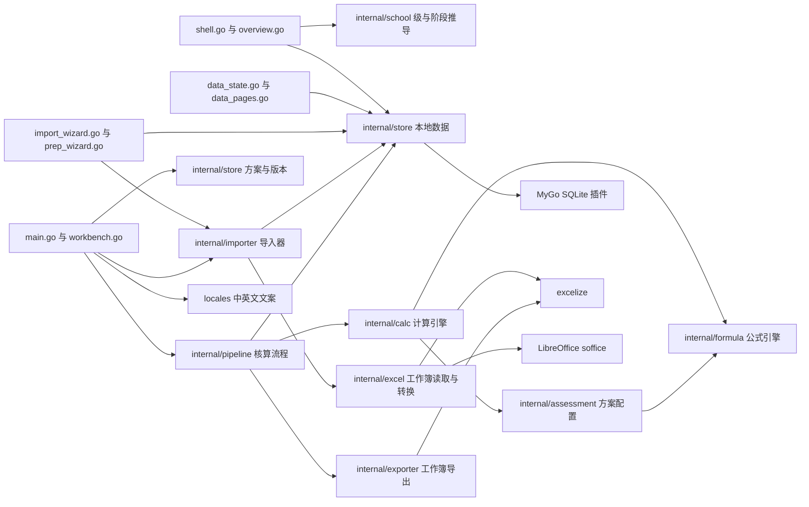
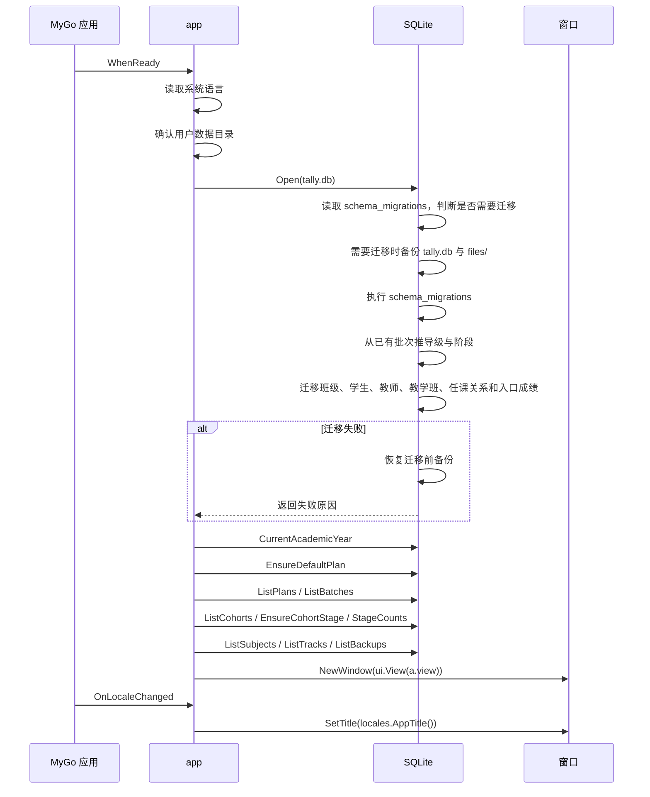
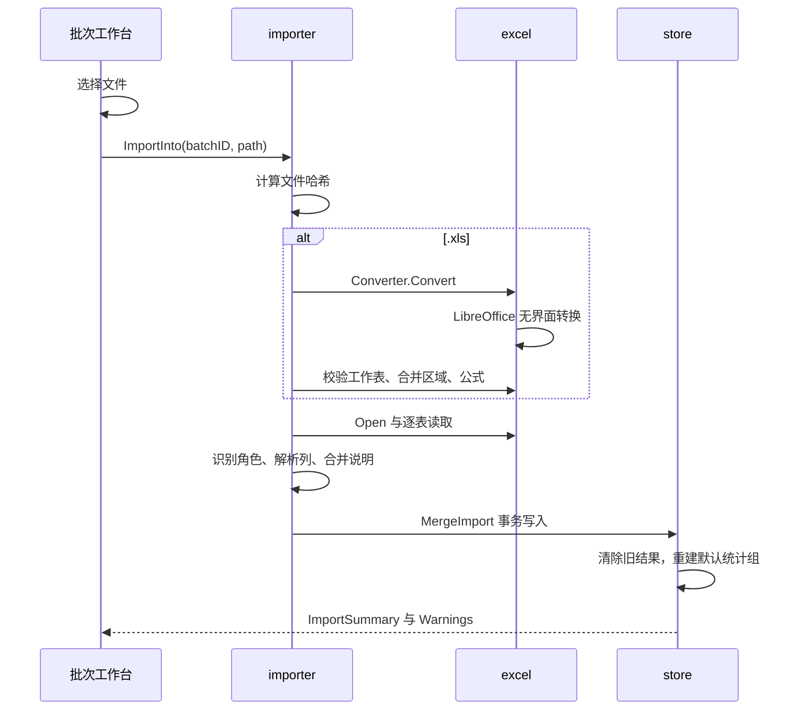
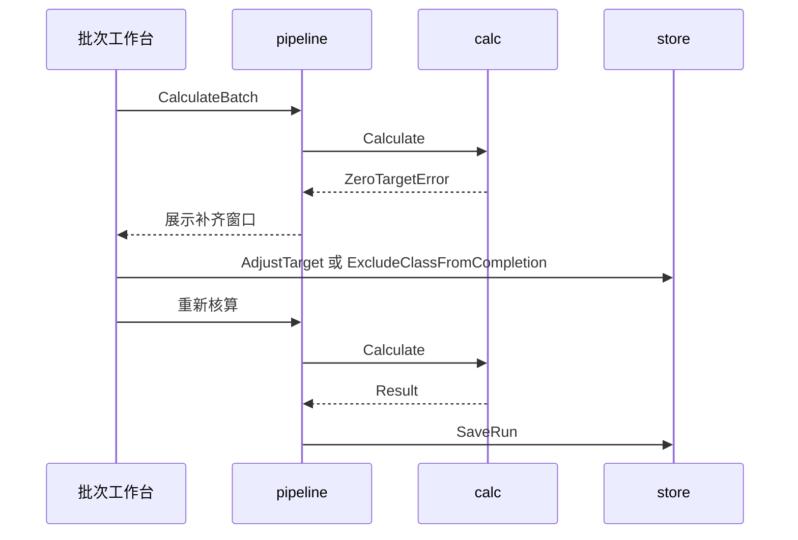

# 当前系统设计

本文档描述阶段一至阶段四已经实现的系统。业务口径以 `docs/requirements-analysis.md` 为准，考核方案字段以 `docs/assessment-plan.md` 为准，产品结构以 `docs/product-redesign.md` 为准。本文档记录当前代码的实际结构、数据流、存储结构和限制，供后续实现与审查使用。

## 目标与边界

系统是一个单机桌面应用，运行在 Windows 与 macOS，界面由 MyGo 原生控件绘制。产品重构第一至第四阶段完成应用外壳、级与阶段切换、总览、基础数据组织、数据页面、设置与备份、引导式导入、年级准备清单、阶段复制与核对、考试与本次考核、报名名单、成绩、分数线、目标、合并组与数据质量，原有链路「建立批次 → 导入工作簿 → 核算 → 导出工作簿」继续可用。数据保存在本机 SQLite，不依赖网络。

当前已经实现：

- 左侧导航、顶栏、级选择、阶段切换、当前学年、总览与新建年级。
- `internal/school` 从系统日期、入学年份和学年推导级、届与阶段。
- 数据库版本 5 的 `cohorts`、`cohort_stages`、`app_settings`、学校档案、行政班、学生、教师、教学班、任课关系、入口成绩、导入记录、数据修订和审计日志。
- 考试结构：`exams`、`exam_cohorts`、`exam_subjects`、`exam_rosters`、`exam_scores`、`exam_subject_cutoffs`、`exam_tier_cutoffs`，以及本次考核的 `assessments`、`assessment_class_targets`、`assessment_stat_groups`、`assessment_stat_group_members`、`assessment_stat_group_targets`、`assessment_target_adjustments`。
- 旧数据库在迁移前自动备份；只在数据库版本低于当前版本时备份，迁移失败时恢复备份。
- 工作簿按内容哈希复制到 `files/`，导入记录保存应用内副本路径与用户选择时的源路径。
- 学生、教师、教学班、入口成绩与导入记录页面支持浏览、搜索、筛选和查看来源。
- 班级、学生、教师、任课关系和入口成绩的六步引导式导入：选择数据项、选择文件、识别工作表、映射列名、校验、导入结果。
- 导入模板生成、自动列名匹配、示例值、阻断问题和提醒问题、提醒确认、应用内文件副本、导入问题清单与导入记录详情。
- 导入撤销按变更记录反向执行；同一阶段存在更新的导入时阻止撤销，没有变更记录的旧导入不提供撤销。
- 进入新学年时自动建立阶段并复制班级阶段信息、教学班、任课关系、学生阶段归属和学生教学班归属；新阶段标记为待核对，总览提供查看变化、确认核对和稍后核对。
- 历史阶段显示为只读，导入入口不可用，已有数据仍可浏览、搜索和筛选。
- 设置页面支持学科名称、满分、启用状态、选科类别和立即备份、恢复备份。
- 考试页面支持新建考试、多级参加、考试详情、报名名单查询、成绩查询与分布、班级均分对比、分数线与达线人数、目标矩阵、合并组编辑和数据质量。
- 考试数据导入沿用六步向导，支持报名名单、成绩、分数线和目标；导入记录保存来源工作表、来源行和问题参数。
- 数据质量页面按阻断与提醒筛选，按数据项和导入记录筛选，问题按数据项分组，点击问题跳转到对应考试、页签和学生查询。
- 考试准备清单显示报名名单、成绩、分数线和目标的数量与完成状态。
- 「档案纸与靛墨」设计变量，浅色与深色主题，默认窗口 1280 × 800、最小窗口 1024 × 640。
- 内置默认考核方案、派生方案数据模型、方案版本发布与停用。
- 新建考核批次，选择批次和已发布方案版本。
- 读取 `.xlsx`，通过 LibreOffice 转换并读取 `.xls`。
- 识别学生、教师、目标、基数、分数线工作表。
- 读取走班合并说明，建立显式统计组。
- 补齐零目标，或者让班级不参与完成率。
- 计算三项指标、排名、档次、赋分和教师个人得分。
- 导出结果工作簿，并在导出前复核输入摘要。

当前没有实现：

- 跨行政班的走班归属与高考专项完整流程。
- 由考试结构直接驱动的核算：本次考核的报名名单、成绩、分数线和目标已经保存，核算仍读取旧 `batches`、`scores` 和结果表。
- 方案编辑界面、派生方案新建界面、方案对比界面。
- WebDAV 同步、数据包加密、结果归档模式。
- 分班、分考场、教务统计等后续阶段。

## 总体组成



| 模块 | 职责 | 主要入口 |
|---|---|---|
| 根包 `tally` | 应用生命周期、外壳、总览、数据页面、引导式导入、年级准备清单、阶段核对、设置、考试与本次考核、数据质量、方案库界面、批次工作台、后台任务与界面回写 | `main`、`app.load`、`app.view`、`app.pageContent`、`app.reloadDataPages`、`app.reloadExamData`、`app.openImportWizard` |
| `internal/school` | 学年起点、级与届、阶段序号和阶段写法的推导 | `AcademicYearStart`、`StageIndex`、`EnrollmentYear` |
| `internal/assessment` | 方案 JSON 结构、默认值、语义校验、公式编译检查 | `Decode`、`Validate`、`DefaultConfig` |
| `internal/formula` | 受限表达式词法分析、语法树、求值和变量引用检查 | `Compile`、`Expression.Eval` |
| `internal/calc` | 有效考生、三项指标、排名、档次、赋分、个人得分 | `Calculate` |
| `internal/store` | SQLite 迁移、级与阶段、学校档案、组织数据、入口成绩、导入记录与撤销、阶段复制、备份恢复、考试与本次考核、方案版本、批次数据、结果与导出记录 | `Open`、`CreateCohort`、`StageCounts`、`ValidateStageImport`、`ApplyStageImport`、`UndoImportRun`、`CopyStageFromPrevious`、`CreateBackup`、`RestoreBackup`、`CreateExam`、`ApplyExamImport`、`SaveStatGroup`、`ExamQualityIssues`、`MergeImport`、`SaveRun` |
| `internal/importer` | 工作表角色识别、引导式导入字段与列名映射、列解析、模板生成、走班合并说明、旧版文件导入 | `InspectWorkbook`、`AutoMapping`、`ParseSheet`、`WriteTemplate`、`ImportWorkspace`、`ImportInto` |
| `internal/excel` | 打开工作簿、读取表格、检查工作表与合并区域、LibreOffice 转换 | `Open`、`ReadTableFromWorkbook`、`Converter.Convert` |
| `internal/pipeline` | 把批次数据转换为计算输入，协调核算与导出 | `BuildInput`、`CalculateBatch`、`ExportLatest` |
| `internal/exporter` | 生成结果工作簿，使用临时文件替换目标文件 | `Write` |
| `locales` | 中英文文案与生成的访问函数 | `locales.In`、`locales.Catalog` |

依赖方向保持单向：界面依赖业务模块，业务模块依赖存储和计算基础包；计算包不读取数据库，也不访问界面。`internal/calc` 只接收 `calc.Input`，因此可以用合成输入做单元测试，也可以由后续的自动核算流程复用。

## 核心接口

| 接口 | 输入与输出 | 约定 |
|---|---|---|
| `store.Open(ctx, path)` | 路径，返回 `*Store` | 检查版本；低于当前版本时先备份，再建表和迁移；迁移失败时恢复备份 |
| `store.BackupBeforeOpen(root)` | 数据目录 | 数据库存在且非空时创建备份，返回备份目录 |
| `store.CreateBackup(root)` | 数据目录 | 复制 `tally.db` 与 `files/`，保留最近二十份 |
| `store.ListBackups(root)`、`store.RestoreBackup(root, name)` | 数据目录与备份名称 | 列出从新到旧的备份；恢复前先备份当前数据库 |
| `store.CurrentAcademicYear(ctx, fallback)` | 默认学年，返回保存的学年起点 | 没有设置时使用系统日期推导 |
| `store.SetAcademicYear(ctx, start)` | 学年起点 | 写入 `app_settings`，阶段标签随之更新 |
| `store.CreateCohort(ctx, year, currentStart)` | 入学年份与当前学年起点，返回 `Cohort` | 校验范围与重复，写入当前阶段记录 |
| `store.ListCohorts(ctx)` | 无参数，返回全部级 | 入学年份新的在前 |
| `store.EnsureCohortStage(...)` | 级、学年与阶段写法 | 已存在时保持不变 |
| `store.StageCounts(ctx, cohortID, start, grade)` | 级与阶段，返回基础数据数量 | 从当前阶段的组织数据与入口成绩汇总班级、学生、教师、任课和基数 |
| `store.ListSubjects(ctx)`、`store.UpdateSubject(...)` | 无参数或者学科 | 读取九个预置学科；修改名称、满分与启用状态 |
| `store.ListTracks(ctx)`、`store.UpdateTrack(...)` | 无参数或者选科类别 | 读取物理类与历史类；修改名称与启用状态 |
| `store.ListClasses(ctx, cohortID, stageID)` | 级与阶段 | 返回当前阶段的行政班、人数与班主任 |
| `store.ListStudents(ctx, StudentFilter)` | 阶段、班级、选科、状态、关键词与分页 | 返回学生、教学班归属、来源与总数 |
| `store.ListTeachers(ctx, stageID, query)` | 阶段与关键词 | 返回教师、任课数量和来源 |
| `store.ListTeachingGroups(ctx, stageID, query)` | 阶段与关键词 | 返回教学班、成员班级、任课教师、人数与来源 |
| `store.ListBaselines(ctx, stageID, classID, query)` | 阶段、班级与关键词 | 返回入口成绩汇总与来源 |
| `store.ListImportRuns(ctx, stageID)` | 阶段 | 返回导入文件、工作表、行数与提醒数量 |
| `store.ValidateStageImport(ctx, cohortID, stageID, req)` | 级、阶段与解析结果 | 返回新增、更新、跳过、阻断和提醒，不写数据库 |
| `store.ApplyStageImport(ctx, cohortID, stageID, req)` | 级、阶段与解析结果 | 阻断问题存在时返回 `ErrImportBlocked`；同一文件同类数据重复时返回 `ErrDuplicateImport`；写入、变更记录和问题在同一个事务中完成 |
| `store.CanUndoImport(ctx, runID)` | 导入记录 | 返回是否可以撤销和原因代码；同一阶段存在更新的导入时阻止 |
| `store.UndoImportRun(ctx, runID)` | 导入记录 | 反向应用变更记录，增加阶段修订号并写入审计日志 |
| `store.CopyStageFromPrevious(ctx, cohortID, toStageID)` | 级与目标阶段 | 复制班级阶段信息、教学班、任课关系、学生阶段归属和学生教学班归属，标记待核对 |
| `store.ConfirmStageReview(ctx, stageID)` | 阶段 | 写入核对时间和已核对状态 |
| `store.MergeStageRoster(...)` | 级、阶段、学生名单与导入报告 | 写入行政班、学生、级归属和阶段归属，不创建批次 |
| `store.MergeStageAssignments(...)` | 级、阶段、教师与任课关系 | 写入教师、教学班、任课关系和学生的教学班归属 |
| `store.MergeStageBaselines(...)` | 级、阶段与入口成绩 | 写入入口成绩集、学科满分和班级、阶段汇总 |
| `store.StoreImportFile(path, hash)` | 原文件与内容哈希 | 复制到 `files/<哈希><扩展名>`，重复哈希直接复用 |
| `store.CreateExam(ctx, input)` | 学年、学期、考试类型、名称、日期、参加的级与学科满分 | 新建考试、每个级的阶段快照、本次考核和考试科目 |
| `store.ListExams(ctx)`、`store.GetExam(ctx, id)` | 无参数或者考试标识 | 返回考试与参加的级，最近的在前 |
| `store.GetExamCohort(ctx, examID, cohortID)` | 考试与级 | 返回阶段的考试快照 |
| `store.GenerateExamRoster(ctx, examID, cohortID, track)` | 考试、级与默认选科 | 从阶段归属生成报名名单，缺少选科时返回 `ErrExamTrackMissing` |
| `store.ValidateExamImport(ctx, req)`、`store.ApplyExamImport(ctx, req)` | 报名名单、成绩、分数线或者目标 | 只校验或者事务写入，保存来源工作表与来源行，写入问题参数 |
| `store.ListExamRoster(ctx, filter)`、`store.ListExamScores(ctx, filter)` | 考试、级、关键词、学科与班级 | 分页返回报名名单与成绩，带来源和导入记录 |
| `store.ExamScoreSummaries`、`ExamScoreBands`、`ExamClassAverages`、`ExamCutoffImpacts` | 考试与级 | 返回科目汇总、十等分分布、班级均分和达线人数 |
| `store.ListExamSubjectCutoffs(ctx, examID, cohortID)`、`ListExamTierCutoffs` | 考试与级 | 返回单科线与档位线 |
| `store.SetClassTarget(ctx, assessmentID, classID, tier, target)` | 本次考核、班级、档位与目标 | 覆盖单个班级单个档位的目标 |
| `store.ListExamStatGroups(ctx, assessmentID)` | 本次考核 | 返回合并组、成员、目标、基线与承担统计职责的班级 |
| `store.SaveStatGroup(ctx, input)`、`store.DeleteStatGroup` | 合并组输入 | 校验学科、班级、成员和成员学生，写入成员与目标 |
| `store.ExamQualityIssues(ctx, examID, cohortID)` | 考试与级 | 返回报名、成绩、分数线、目标和合并组问题，带来源与参数 |
| `store.ListExamQualitySummaries(ctx)` | 无参数 | 返回每场考试每个级的问题，供数据质量页面使用 |
| `store.ExamPrep(ctx, examID, cohortID)` | 考试与级 | 返回准备清单数量与问题 |
| `school.AcademicYearStart(t)` | 日期，返回学年起点 | 9 月 1 日进入新学年 |
| `school.StageIndex(enrollment, start)` | 入学年份与学年起点 | 1 到 3 为高一到高三，4 为已毕业 |
| `store.EnsureDefaultPlan(ctx)` | 无参数，返回 `PlanVersion` | 没有内置方案时写入并发布；已有方案时返回最新已发布版本 |
| `store.CreateBatch(ctx, input)` | 学年、学期、考试、年级，返回 `Batch` | 相同批次不重复创建 |
| `store.MergeImport(ctx, batchID, data, report)` | 解析数据与导入报告，返回 `ImportSummary` | 主体在事务内写入，成功后清除旧结果并重建默认统计组 |
| `store.LoadBatchData(ctx, batchID)` | 批次标识，返回 `BatchData` | 一次读取核算需要的全部批次数据 |
| `store.AdjustTarget(...)` | 班级、档位、原值、新值、原因 | 只追加补录记录，不改写原始目标 |
| `store.ExcludeClassFromCompletion(...)` | 班级、原因 | 用空档位记录表示本班不参与完成率 |
| `store.SaveRun(...)` | 批次、方案版本、输入摘要、计算结果 | 新增正式运行，旧运行保留并取消正式标记 |
| `store.LatestRun(ctx, batchID)` | 批次标识，返回运行、结果行、个人得分 | 按运行标识倒序取最新一条 |
| `store.SaveExport(...)` | 运行标识、路径、文件哈希 | 追加导出记录 |
| `store.InputHash(plan, data)` | 方案配置与批次数据，返回 SHA-256 | 忽略批次状态、修订号、当前版本和创建时间 |
| `importer.InspectWorkbook(path, options)` | 文件路径与转换目录，返回工作簿、工作表、表头、预览行和文件哈希 | 只读取，不写数据库；`.xls` 通过 LibreOffice 转换 |
| `importer.AutoMapping(kind, table, subjects)` | 数据项、工作表与学科 | 按表头同义词生成默认列名映射 |
| `importer.ParseSheet(workbook, sheet, kind, mapping, subjects)` | 工作表与映射 | 返回标准字段、原始行号和解析问题 |
| `importer.WriteTemplate(kind, subjects, path)` | 数据项、学科与目标路径 | 写出包含数据表和说明表的模板 |
| `importer.ImportWorkspace(path, options)` | 文件路径与转换目录，返回 `ImportData`、`ImportReport` | 只解析，不写数据库 |
| `importer.ImportInto(ctx, store, batchID, path, options)` | 批次与文件路径，返回导入摘要 | 解析后调用 `MergeImport` |
| `pipeline.BuildInput(ctx, store, batchID, plan)` | 批次与方案，返回计算输入、批次数据和摘要 | 汇总阻断问题，不静默跳过 |
| `pipeline.CalculateBatch(ctx, store, batchID, versionID)` | 批次与已发布版本，返回计算结果 | 构建输入、计算并保存运行 |
| `pipeline.ExportLatest(ctx, store, batchID, path)` | 批次与目标路径 | 复核摘要、写出工作簿、记录导出 |
| `calc.Calculate(input, options)` | 计算输入与选项，返回结果 | 不访问数据库和界面；零目标返回 `ZeroTargetError` |
| `exporter.Write(input)` | 导出数据 | 先写临时文件，成功后再替换目标文件 |
| `assessment.Decode(data)` | 方案 JSON | 严格解析，未知字段拒绝 |
| `Config.Validate()`、`Config.ValidateFormulas()` | 方案配置 | 检查语义、公式语法和指标依赖 |

## 启动与生命周期



`app.load` 在测试中可以直接使用 `a.dataDir`，界面启动时使用 `mygo.App.Path(mygo.PathUserData)`。打开数据库失败、默认方案写入失败或者列表读取失败时，错误写入 `app.loadError`，界面显示本地数据库错误并停止渲染业务内容。

应用退出时关闭 SQLite 连接。当前没有后台定时任务，也没有启动时网络请求。

## 应用状态

根包只保存普通数据和 `ui` 的身份对象，跨构建不保存控件指针。主要状态如下：

| 字段 | 用途 |
|---|---|
| `dataDir`、`store` | 用户数据目录和数据库连接 |
| `language` | 当前界面语言，`en` 或 `zh-Hans` |
| `plans`、`versions`、`selectedPlanID`、`versionIndex` | 方案库当前选择 |
| `page` | 当前页面，总览、数据页面、本次考核、计算结果、方案库、设置或帮助 |
| `systemAcademicYear`、`academicYearStart` | 系统日期推导的学年与保存的当前学年 |
| `cohorts`、`selectedCohortID` | 级列表与当前级 |
| `cohortStages`、`selectedStageID` | 当前级的阶段记录与正在查看的阶段 |
| `stageCounts`、`stageClasses` | 当前阶段的准备情况与行政班名称 |
| `classes`、`students`、`studentsTotal` | 当前阶段的行政班、学生页与总数 |
| `teachers`、`teachingGroups`、`baselines`、`importRuns` | 教师、教学班、入口成绩与导入记录 |
| `dataQuery`、`dataClassFilter`、`dataTrackFilter`、`dataStatusFilter` | 学生搜索与筛选 |
| `teacherQuery`、`groupQuery`、`groupSubjectFilter` | 教师与教学班搜索、学科筛选 |
| `baselineQuery`、`baselineClassFilter`、`importQuery` | 入口成绩与导入记录筛选 |
| `studentDetail`、`studentDetailOpen`、`selectedStudentID` | 学生详情面板 |
| `subjects`、`tracks`、`subjectDrafts`、`trackDrafts` | 学科与选科类别的当前值与编辑值 |
| `backups`、`restoreBackupName`、`restoreOpen` | 备份列表与恢复确认对话框 |
| `dataBusy`、`dataError`、`dataMessage` | 数据页面后台导入状态与提示 |
| `importWizard` | 引导式导入的当前数据项、步骤、工作表、列名映射、校验结果、提醒确认和导入结果 |
| `importRunID`、`importDetail` | 当前导入记录与详情侧栏 |
| `prepOpen` | 是否显示年级准备清单 |
| `stageReviewOpen`、`stageNoticeDismissed` | 阶段复制变化窗口与手动关闭的核对提示 |
| `newCohortOpen`、`newCohortYear`、`newCohortError` | 新建年级窗口 |
| `settingsError` | 设置页面的错误 |
| `batches`、`selectedBatchID` | 批次列表与当前批次 |
| `published`、`calculateVersion` | 可用于核算的已发布版本和当前选择 |
| `batchBusy`、`batchError`、`batchMessage` | 后台任务状态和用户提示 |
| `importSummary` | 最近一次导入的摘要与提醒 |
| `resultRows`、`personalScores`、`resultTable` | 最近一次核算结果 |
| `zeroOpen`、`zeroIssues`、`zeroValues`、`zeroReason` | 零目标补齐窗口 |
| `newBatchOpen` 与批次字段 | 新建批次窗口 |

批次状态当前只有三个取值：

| 状态 | 含义 |
|---|---|
| `draft` | 新建后尚未导入 |
| `imported` | 至少完成一次导入，已有结果被清除 |
| `calculated` | 已保存一次核算结果 |

方案版本状态为 `draft`、`published`、`retired`。正式核算只接受 `published`。

## 方案配置与版本

方案配置保存为 JSON，带 `schemaVersion`。`assessment.Decode` 使用严格模式，未知字段会被拒绝；`Validate` 检查枚举、指标分值合计、档位权重、排名边界、个人得分方式、专项规则和零目标处理；`ValidateFormulas` 编译全部公式并检查指标依赖。

首次启动时 `EnsureDefaultPlan` 查找 `kind = 'system'` 的方案。没有时写入 `assessment.DefaultConfig()`，版本 1 直接发布。已有内置方案时返回最新的已发布版本；没有已发布版本时读取最新版本配置并追加一条已发布版本；没有任何版本时从出厂配置恢复。

派生方案通过 `store.CreatePlan` 写入完整配置，版本 1 为草稿；`store.CreateDraft` 在已有方案下追加草稿版本；`store.UpdatePlan` 在当前方案下追加版本，内置方案直接发布，派生方案保存为草稿；`Publish` 发布草稿；`Retire` 停用派生方案的已发布版本，收到内置方案时返回 `ErrSystemPlanRetire`。内置方案通过事务追加已发布版本，旧版本保留，当前版本在新版本写入前保持有效。

当前界面在方案摘要右侧提供「更新本方案」和「保存新的方案」两个入口，打开 JSON 配置模态窗口。保存前执行严格解析、语义校验和公式编译。派生方案还提供发布和停用按钮；内置方案不显示停用按钮。

核算时 `pipeline.CalculateBatch` 读取版本并检查状态。批次保存 `current_plan_version_id`，结果运行记录保存实际使用的 `plan_version_id`。同一批次重新核算时，旧运行记录保留，`is_official` 被清零，新记录标记为正式结果。

## 批次与导入

### 引导式导入

年级准备清单和各类数据页面共用同一套六步导入向导：


- 数据项包括班级、学生、教师、任课关系和入口成绩。选择数据项时显示当前级、阶段、届、已完成状态和必需列名。
- 工作簿按内容哈希读取，`.xls` 先交给 LibreOffice 转换。工作表按名称、表头和行数打分，自动选中匹配度最高的一张，用户可以改选。
- 列名映射按表头同义词自动生成，映射表显示标准字段、必需标记、原始列名和第一行示例值。入口成绩的学科和比值字段使用当前学科名称显示。
- 校验阶段返回新增、更新、跳过、阻断和提醒数量。阻断问题通过 `ErrImportBlocked` 阻止事务写入；提醒问题需要用户勾选确认后才能导入。
- 写入在一个事务中完成，同时保存导入记录、工作表、列名映射、问题清单、变更记录和阶段修订号。同一阶段、同一数据项、同一文件哈希再次导入时返回 `ErrDuplicateImport`。
- 导入结果提供查看数据、继续导入下一项、从同一工作簿继续导入和结束。继续导入会保留当前工作簿，重新选择目标工作表并生成新的列名映射。
- 导入记录详情显示数据项、文件、状态、行数、工作表、来源路径和问题清单。撤销按变更记录反向执行；同一阶段存在更新的导入时阻止撤销，没有变更记录的旧导入返回具体原因。

年级准备清单按班级、学生、教师、任课关系和入口成绩的顺序显示完成状态。每项已完成时提供查看入口，未完成时提供导入入口；总览的「继续准备」进入这张清单。

进入新学年时，`app.reloadCohorts` 为当前级建立阶段记录，并调用 `CopyStageFromPrevious` 复制上一阶段的班级阶段信息、教学班、任课关系、学生阶段归属和学生教学班归属。新阶段写入 `review_status = 'pending'`，总览显示核对提示，提供「查看变化」「确认核对」「稍后核对」。阶段历史显示待核对或者已核对徽标。历史阶段的导入入口不可用。

### 新建批次

`store.CreateBatch` 接收学年、学期、考试类型和年级。唯一约束是 `terms(academic_year, semester)` 加 `batches(term_id, exam_type, grade)`。重复创建相同批次不会新增记录。当前考试类型限制为 `midterm`、`final`、`gaokao`，年级限制为 `g1`、`g2`、`g3`。

### 导入流程



文件级去重使用 SHA-256。`.xls` 转换文件放在 `<用户数据目录>/converted`，原文件不修改。当前没有把导入文件复制到按哈希命名的文件目录，导入记录保存原始路径、转换路径和文件哈希。

### 工作表角色

导入器先读取每个工作表前 15 行，按名称、表头和行数打分，选出学生、教师、目标、基数、分数线五类工作表。当前识别规则：

| 角色 | 必要表头 | 加分条件 |
|---|---|---|
| 学生成绩 | `班级`、`姓名`、`考号`、`考生号` 或 `学号` | 工作表名含「均分整理」「基础数据」「核对」 |
| 任课教师 | `班级`、`班主任`、至少一个学科 | 工作表名含「任课教师」「教师一览」 |
| 目标任务 | `班级`、`清北` 或 `本科` | 工作表名含「目标任务」 |
| 基数 | `班级`、至少一个基数均分列（`语均`、`数均`、`总均` 等） | 工作表名含「基数」 |
| 分数线 | `科目`、`本科线` 或 `特控线` | 行数越多分数越高 |

一个工作簿没有识别到任何角色时阻止导入。一个角色有多个候选时选择分数最高的工作表，其余工作表不参与本次导入。

### 学生与成绩

学生按考号读取，考号和学号保持文本，保留前导零。缺考、违纪、作弊和 `-1` 写入成绩标记，不写入分数。单科成绩为 0 时按未参加该科考试处理，不写入该科成绩；总分保留。选科组合含「物理」记为物理类，含「历史」记为历史类。学籍状态把「转学」「休学」「借读」「退学」转换为内部代码。

考号重复、必填字段为空、未知列无法解析时导入失败。班级汇总行（含「年级」「总计」「合计」「备注」「说明」）跳过。

### 班级别名

学生表可能使用 `800`、`900` 这类内部编号，目标表、教师表和基数表使用「卓越」「鹭宁」这类名称。导入器按学生人数与导入文件中带班级人数的表格匹配；人数唯一对应时把学生班级改名为目标班级，并写入导入提醒。人数相同导致多个候选时不自动改名。

### 走班合并说明

导入器扫描所有工作表文本，识别下面的形式：

```text
地理张丽芬：走班卓越与鹭宁合并计算（14+4）
政治王玲燕：走班546与鹭宁合并计算（0+14）
```

每个说明生成一个显式统计组：成员班级按「与」「和」「、」「+」「/」分隔，目标人数取括号内数字之和，承担统计职责的班级取第一个成员。一行有多条说明时全部解析。说明没有给出目标人数、成员数量与目标数量不一致、目标无法读取时只产生提醒，不生成统计组。

### 导入写入

`MergeImport` 先建立班级，再写学生、任课关系、班级目标、基数、分数线和显式统计组。学生成绩对应的学科教学班先建立，再建立显式统计组。事务提交后删除所有非显式统计组，并按教学班重建默认统计组；已经被显式统计组包含的教学班不再建立同名默认组。

导入会删除该批次已有结果运行和结果行，把批次状态改为 `imported`，并把修订号加一。导入摘要统计当前批次的班级、学生、教师、教学班、统计组、任课关系、班级目标、学科分数线和档位分数线数量。

引导式导入写入 `import_sheets` 的工作表名称、角色、表头行和数据范围，不写列映射和版本标记。考试数据导入同时写入 `import_columns` 的标准字段、原始列名和用户选择标记。`import_sheets.version_tag` 尚未写入；列映射改选、工作表版本选择和候选工作表确认属于后续导入界面。

## 核算流程

### 输入构建

`pipeline.BuildInput` 读取 `BatchData`，生成 `calc.Input`，同时计算输入摘要。核算前检查：

| 问题 | 结果 |
|---|---|
| 没有班级、学生、统计组或者有效考生 | 阻止核算 |
| 学科缺少年级基数均分 | 阻止核算 |
| 学科缺少物理类或者历史类分数线 | 阻止核算 |
| 档位缺少总分分数线 | 阻止核算 |
| 统计组缺少基数、单科目标或者成员 | 阻止核算 |
| 学生缺少教学班归属 | 阻止核算 |
| 目标基础分为 0 或者目标缺失 | 返回零目标问题，打开补齐窗口 |

年级均分从有效学生的成绩重新计算，单科成绩为 0 的不计入。年级基数优先使用工作表总计行，缺失时按班级人数加权。统计组基数优先使用统计组自己的值，缺失时对成员班级的基数均分取算术平均。

### 单项指标

每个统计组按学科计算一次：

- 班级均分等于成员教学班内有效学生该科成绩之和除以人数。
- 均分提升率得分使用 `class.average / grade.average / baseline.ratio × points`。
- 单科达线人数按学生类别选择物理类或者历史类分数线，得分使用 `passCount / statGroup.target × points`。
- 完成率对承担统计职责的班级计算，实际完成分和目标基础分都按方案档位权重加权。
- 三项得分默认不封顶；配置 `cap` 时先乘满分，再按上下限截断。

公式由 `internal/formula` 编译和执行。支持的变量包括 `class`、`grade`、`baseline`、`statGroup`、`tier`、`indicator` 和 `program`。指标可以引用其他指标，编译阶段检查循环依赖和未知变量；运行阶段遇到除零、缺失变量或者非有限数值时返回错误。

### 排名与赋分

排名组默认为同年级同学科。排序依据教学量化成绩，同分时按统计组标识稳定排序。`ranking.tieMode` 支持：

| 取值 | 名次写法 |
|---|---|
| `competition` | 1、1、3，默认值，仍待学校确认 |
| `dense` | 1、1、2 |
| `ordinal` | 1、2、3 |

分档默认按参评统计组数量生成：一档止于 `floor(n/3)`，二档止于 `round(2n/3)`。`overrides` 按学科和参评数量覆盖；`manual` 模式按学科读取人工区间。赋分默认 70、67、64。

### 个人得分

个人得分按教师、学科和年级汇总。默认 `top_two_average`：取该教师所教统计组赋分最高的两个组求平均；只有一个组时取该组赋分。合并统计组只产生一个赋分。结果保留一位小数。

### 零目标处理



零目标窗口按班级列出缺失档位。用户可以逐项补录并填写原因，也可以让班级不参与完成率并填写原因。补录写入 `target_adjustments`，原始导入目标不被改写。补齐或排除后立即重新核算。仍有零目标时窗口保持打开，并更新剩余问题。

### 结果保存

`SaveRun` 先把该批次所有旧运行标记为非正式，再插入新的正式运行，然后写入结果行和个人得分，把批次状态改为 `calculated`。结果行保存学科、统计组、承担统计职责的班级、任课教师、三项指标得分、总分、排名、档次、赋分和 `indicator_values_json`。

当前保存分为两次事务：运行记录与旧记录状态一次，结果行与批次状态一次。写入结果行失败时会留下一条没有明细的正式运行记录。后续需要在同一事务中完成运行记录、结果行、个人得分和批次状态更新。

### 输入摘要

`store.InputHash` 对方案配置和 `BatchData` 做 JSON 编码后计算 SHA-256。计算前把批次的 `Status`、`Revision`、`CurrentPlanVersionID`、`CreatedAt` 清零，避免核算本身改变摘要。导入、方案变化、目标补录或者班级排除都会改变摘要。

## 导出设计

导出入口是 `pipeline.ExportLatest`：

1. 读取批次最新运行、结果行和个人得分。
2. 读取运行使用的方案版本。
3. 重新构建当前输入摘要。
4. 当前摘要与运行摘要不一致时拒绝导出，提示先重新核算。
5. 调用 `exporter.Write` 写出工作簿。
6. 计算导出文件 SHA-256，写入 `exports`。

导出工作簿包含五张表：

| 工作表 | 内容 |
|---|---|
| 计算依据 | 学年学期、考试类型、年级、方案名称与版本、输入摘要、核算时间、导出时间 |
| 量化计算 | 每个统计组的班级、学科、教师、人数、均分、基数、三项得分和总分 |
| 排名赋分 | 每个统计组的教学量化成绩、排名、档次和赋分 |
| 个人得分 | 教师、年级、学科、所教统计组赋分和个人得分 |
| 结果明细 | 每个统计组的指标明细 JSON |

导出先写 `<目标名>.tmp.xlsx`，成功后再改名为目标文件，避免覆盖时留下半截文件。`excelize` 需要识别文件扩展名，临时文件保留 `.xlsx` 后缀。

## 数据模型

### 实体关系

```mermaid
erDiagram
  PLANS ||--o{ PLAN_VERSIONS : contains
  COHORTS ||--o{ COHORT_STAGES : advances
  COHORTS ||--o{ CLASSES : owns
  CLASSES ||--o{ CLASS_STAGE_INFO : appears
  COHORT_STAGES ||--o{ CLASS_STAGE_INFO : holds
  STUDENTS ||--o{ STUDENT_COHORTS : joins
  COHORTS ||--o{ STUDENT_COHORTS : receives
  STUDENTS ||--o{ STUDENT_STAGE_MEMBERSHIPS : belongs
  COHORT_STAGES ||--o{ STUDENT_STAGE_MEMBERSHIPS : holds
  CLASSES ||--o{ STUDENT_STAGE_MEMBERSHIPS : groups
  COHORT_STAGES ||--o{ TEACHING_GROUPS : contains
  TEACHERS ||--o{ ASSIGNMENTS : teaches
  TEACHING_GROUPS ||--o{ ASSIGNMENTS : assigned
  STUDENTS ||--o{ STUDENT_TEACHING_GROUPS : attends
  TEACHING_GROUPS ||--o{ STUDENT_TEACHING_GROUPS : includes
  COHORTS ||--o{ BASELINE_SETS : owns
  BASELINE_SETS ||--o{ BASELINE_SUBJECTS : defines
  BASELINE_SETS ||--o{ BASELINE_SCORES : stores
  BASELINE_SETS ||--o{ BASELINE_AGGREGATES : summarizes
  COHORT_STAGES ||--o{ BASELINE_AGGREGATES : scopes
  IMPORT_RUNS ||--o{ IMPORT_SHEETS : contains
  IMPORT_SHEETS ||--o{ IMPORT_COLUMNS : maps
  IMPORT_RUNS ||--o{ IMPORT_ISSUES : reports
  IMPORT_RUNS ||--o{ IMPORT_CHANGES : records
  EXAMS ||--o{ EXAM_COHORTS : covers
  COHORTS ||--o{ EXAM_COHORTS : participates
  COHORT_STAGES ||--o{ EXAM_COHORTS : snapshots
  EXAMS ||--o{ EXAM_SUBJECTS : configures
  COHORTS ||--o{ EXAM_SUBJECTS : scopes
  EXAMS ||--o{ EXAM_ROSTERS : lists
  COHORTS ||--o{ EXAM_ROSTERS : scopes
  STUDENTS ||--o{ EXAM_ROSTERS : registers
  EXAMS ||--o{ EXAM_SCORES : contains
  COHORTS ||--o{ EXAM_SCORES : scopes
  STUDENTS ||--o{ EXAM_SCORES : earns
  EXAMS ||--o{ EXAM_SUBJECT_CUTOFFS : has
  EXAMS ||--o{ EXAM_TIER_CUTOFFS : has
  EXAM_COHORTS ||--o| ASSESSMENTS : produces
  PLAN_VERSIONS ||--o{ ASSESSMENTS : selects
  ASSESSMENTS ||--o{ ASSESSMENT_CLASS_TARGETS : has
  CLASSES ||--o{ ASSESSMENT_CLASS_TARGETS : receives
  ASSESSMENTS ||--o{ ASSESSMENT_STAT_GROUPS : has
  CLASSES ||--o{ ASSESSMENT_STAT_GROUPS : leads
  ASSESSMENT_STAT_GROUPS ||--o{ ASSESSMENT_STAT_GROUP_MEMBERS : contains
  TEACHING_GROUPS ||--o{ ASSESSMENT_STAT_GROUP_MEMBERS : joins
  ASSESSMENT_STAT_GROUPS ||--o| ASSESSMENT_STAT_GROUP_TARGETS : has
  ASSESSMENTS ||--o{ ASSESSMENT_TARGET_ADJUSTMENTS : adjusts
  ASSESSMENTS ||--o{ RESULT_RUNS : produces
  TERMS ||--o{ BATCHES : contains
  BATCHES ||--o{ SCORES : contains
  STUDENTS ||--o{ SCORES : earns
  BATCHES ||--o{ STAT_GROUPS : contains
  STAT_GROUPS ||--o{ STAT_GROUP_MEMBERS : contains
  TEACHING_GROUPS ||--o{ STAT_GROUP_MEMBERS : joins
  BATCHES ||--o{ RESULT_RUNS : produces
  PLAN_VERSIONS ||--o{ RESULT_RUNS : uses
  RESULT_RUNS ||--o{ RESULT_ROWS : contains
  RESULT_RUNS ||--o{ PERSONAL_SCORES : contains
  RESULT_RUNS ||--o{ EXPORTS : records
```



### 表结构

学校档案与级、阶段表：

| 表 | 关键字段 | 约束 |
|---|---|---|
| `app_settings` | `key`、`value` | 保存当前学年起点 |
| `cohorts` | `id`、`name`、`enrollment_year`、`graduation_year`、`status`、`created_at` | 唯一索引 `(enrollment_year)` 与 `(name)` |
| `cohort_stages` | `id`、`cohort_id`、`academic_year_start`、`grade_level`、`copied_from_stage_id`、`review_status`、`confirmed_at` | 唯一索引 `(cohort_id, academic_year_start)` 与 `(cohort_id, grade_level)` |
| `subjects` | `key`、`name`、`full_mark`、`sort_order`、`enabled` | 预置语文、数学、英语、物理、化学、生物、历史、地理、政治 |
| `tracks` | `key`、`name`、`sort_order`、`enabled` | 预置 `physics`、`history` |
| `grade_levels` | `key`、`name`、`sort_order` | 预置 `g1`、`g2`、`g3` |

人员与教学组织表：

| 表 | 关键字段 | 约束 |
|---|---|---|
| `classes` | `id`、`cohort_id`、`name`、`created_at`、`import_run_id`、`source_sheet`、`source_row` | 唯一索引 `(cohort_id, name)`；班级身份在级内保持稳定 |
| `class_stage_info` | `id`、`class_id`、`stage_id`、`head_teacher_id`、`room`、`status`、来源字段 | 唯一索引 `(class_id, stage_id)` |
| `students` | `id`、`student_no`、`name`、`created_at`、来源字段 | 唯一索引 `(student_no)` |
| `student_cohorts` | `id`、`student_id`、`cohort_id`、`graduation_year_override`、`status`、来源字段 | 唯一索引 `(student_id, cohort_id)` |
| `student_stage_memberships` | `id`、`student_id`、`stage_id`、`class_id`、`status`、`walking`、`track`、`elective`、`japanese`、`total_score`、来源字段 | 唯一索引 `(student_id, stage_id)` |
| `teachers` | `id`、`teacher_no`、`name`、`subject`、`created_at`、来源字段 | 工号非空时唯一；工号为空时 `(name, subject)` 唯一 |
| `teaching_groups` | `id`、`stage_id`、`subject`、`name`、`kind`、来源字段 | 唯一索引 `(stage_id, subject, name)` |
| `student_teaching_groups` | `id`、`student_id`、`stage_id`、`subject`、`teaching_group_id`、来源字段 | 唯一索引 `(student_id, stage_id, subject)` |
| `assignments` | `id`、`teacher_id`、`teaching_group_id`、`role`、来源字段 | 唯一索引 `(teacher_id, teaching_group_id)` |

入口成绩表：

| 表 | 关键字段 | 约束 |
|---|---|---|
| `baseline_sets` | `id`、`cohort_id`、`name`、`source`、`kind`、`status`、`created_at`、来源字段 | 唯一索引 `(cohort_id, name)` |
| `baseline_subjects` | `id`、`baseline_set_id`、`subject`、`full_mark`、`enabled` | 唯一索引 `(baseline_set_id, subject)` |
| `baseline_scores` | `id`、`baseline_set_id`、`student_id`、`subject`、`score`、`flag`、来源字段 | 唯一索引 `(baseline_set_id, student_id, subject)` |
| `baseline_aggregates` | `id`、`baseline_set_id`、`stage_id`、`scope_type`、`scope_id`、`subject`、`average`、`count`、`ratio`、来源字段 | 唯一索引 `(baseline_set_id, stage_id, scope_type, scope_id, subject)` |

导入与审计表：

| 表 | 关键字段 | 约束 |
|---|---|---|
| `import_runs` | `id`、`scope_type`、`scope_id`、`data_kind`、`file_hash`、`stored_path`、`relative_path`、`converted_path`、`mapping_json`、`status`、`row_count`、`error_count`、`warning_count`、`created_at` | 唯一索引 `(scope_type, scope_id, data_kind, file_hash)` |
| `import_sheets` | `id`、`import_run_id`、`sheet_name`、`role`、`header_row`、`data_range`、`version_tag`、`is_current` | 唯一索引 `(import_run_id, sheet_name)` |
| `import_columns` | `id`、`import_sheet_id`、`source_column`、`standard_field`、`merged_header`、`is_user_selected` | 唯一索引 `(import_sheet_id, source_column)` |
| `import_issues` | `id`、`import_run_id`、`severity`、`row_number`、`column_name`、`code`、`message`、`resolved` | 索引 `(import_run_id)` |
| `import_changes` | `id`、`import_run_id`、`entity`、`entity_id`、`action`、`before_json`、`after_json` | 记录新增、更新和跳过的数据项 |
| `data_revisions` | `scope_type`、`scope_id`、`revision`、`updated_at` | 主键 `(scope_type, scope_id)` |
| `audit_log` | `id`、`action`、`entity`、`entity_id`、`detail_json`、`created_at`、`operator` | 导入、编辑、计算、导出、删除和恢复 |

旧批次与考试数据表继续保留，服务现有工作台：

| 表 | 状态 |
|---|---|
| `terms`、`batches`、`scores`、`class_targets`、`grade_baselines`、`subject_cutoffs`、`tier_cutoffs`、`result_runs`、`result_rows`、`personal_scores`、`exports`、`imports` | 保留原表名与原结构；新组织表与旧批次并行存在 |
| `legacy_classes`、`legacy_student_classes`、`legacy_teachers`、`legacy_teaching_groups`、`legacy_assignments` | 迁移前的旧表改名保留，供核对与回退 |
| `legacy_import_sheets`、`legacy_import_columns`、`legacy_class_targets`、`legacy_class_baselines`、`legacy_stat_groups`、`legacy_stat_group_members`、`legacy_target_adjustments` | 迁移前改名保留，迁移数据写入新表 |

考试数据表：

| 表 | 关键字段 | 约束 |
|---|---|---|
| `exams` | `id`、`academic_year_start`、`term`、`exam_type`、`name`、`exam_date`、`sequence`、`status`、`created_at` | 唯一索引 `(academic_year_start, term, exam_type, name)`；索引 `(academic_year_start, exam_date)` |
| `exam_cohorts` | `id`、`exam_id`、`cohort_id`、`stage_id`、`grade_level_at_exam` | 唯一索引 `(exam_id, cohort_id)`；索引 `(cohort_id, exam_id)` |
| `exam_subjects` | `id`、`exam_id`、`cohort_id`、`subject`、`full_mark`、`enabled` | 唯一索引 `(exam_id, cohort_id, subject)` |
| `exam_rosters` | `id`、`exam_id`、`cohort_id`、`student_id`、`class_id`、`exam_no`、`candidate_no`、`track`、`total_score`、`status`、`subjects_json`、`import_run_id`、来源字段 | 唯一索引 `(exam_id, cohort_id, student_id)`；非空考号唯一索引 `(exam_id, exam_no) WHERE exam_no <> ''`；索引 `(exam_id, candidate_no)` 与 `(exam_id, cohort_id, class_id)` |
| `exam_scores` | `id`、`exam_id`、`cohort_id`、`student_id`、`subject`、`score`、`flag`、`import_run_id`、来源字段 | 唯一索引 `(exam_id, cohort_id, student_id, subject)`；索引 `(exam_id, cohort_id, subject)` |
| `exam_subject_cutoffs` | `id`、`exam_id`、`cohort_id`、`subject`、`track`、`cutoff` | 唯一索引 `(exam_id, cohort_id, subject, track)` |
| `exam_tier_cutoffs` | `id`、`exam_id`、`cohort_id`、`tier_key`、`track`、`cutoff` | 唯一索引 `(exam_id, cohort_id, tier_key, track)` |

本次考核表：

| 表 | 关键字段 | 约束 |
|---|---|---|
| `assessments` | `id`、`exam_cohort_id`、`plan_version_id`、`status`、`current_run_id`、`revision`、`created_at` | 唯一索引 `(exam_cohort_id)`；索引 `(status)` |
| `assessment_class_targets` | `id`、`assessment_id`、`class_id`、`tier_key`、`target_count` | 唯一索引 `(assessment_id, class_id, tier_key)` |
| `assessment_stat_groups` | `id`、`assessment_id`、`subject`、`name`、`lead_class_id`、`baseline_average`、`baseline_ratio`、`baseline_source`、`explicit` | 唯一索引 `(assessment_id, subject, name)` |
| `assessment_stat_group_members` | `id`、`stat_group_id`、`teaching_group_id` | 唯一索引 `(stat_group_id, teaching_group_id)` |
| `assessment_stat_group_targets` | `id`、`stat_group_id`、`target_count` | 唯一索引 `(stat_group_id)` |
| `assessment_target_adjustments` | `id`、`assessment_id`、`scope_type`、`scope_id`、`subject`、`kind`、`reason`、`value`、`created_at` | 迁移时按考核、范围、班级、档位、原因和创建时间检查重复 |

方案表：

| 表 | 关键字段 | 约束 |
|---|---|---|
| `plans` | `id`、`name`、`kind`、`base_plan_version_id`、`description`、`created_at` | `kind` 为 `system` 或 `user` |
| `plan_versions` | `id`、`plan_id`、`version`、`status`、`schema_version`、`config_json`、`config_hash`、`parent_version_id`、`notes`、`created_at`、`created_by`、`published_at`、`published_by` | 唯一索引 `(plan_id, version)`，索引 `(plan_id, status)` |

旧考试数据表：

| 表 | 关键字段 | 约束 |
|---|---|---|
| `terms` | `id`、`academic_year`、`semester` | 唯一索引 `(academic_year, semester)` |
| `batches` | `id`、`term_id`、`exam_type`、`grade`、`status`、`current_plan_version_id`、`revision`、`created_at` | 唯一索引 `(term_id, exam_type, grade)` |
| `imports` | `id`、`batch_id`、`file_hash`、`relative_path`、`converted_path`、`file_format`、`conversion_tool`、`conversion_report_json`、`row_count`、`status`、`created_at` | 唯一索引 `(batch_id, file_hash)` |
| `scores` | `id`、`batch_id`、`student_id`、`subject`、`score`、`flag` | 唯一索引 `(batch_id, student_id, subject)` |
| `class_targets` | `id`、`batch_id`、`class_id`、`tier_key`、`target_count` | 唯一索引 `(batch_id, class_id, tier_key)` |
| `class_baselines` | `id`、`batch_id`、`class_id`、`subject`、`average`、`ratio` | 唯一索引 `(batch_id, class_id, subject)` |
| `grade_baselines` | `id`、`batch_id`、`subject`、`average` | 唯一索引 `(batch_id, subject)` |
| `subject_cutoffs`、`tier_cutoffs`、`stat_groups`、`stat_group_members`、`target_adjustments` | 保持原有字段 | 服务现有核算流程 |

结果表：

| 表 | 关键字段 | 约束 |
|---|---|---|
| `result_runs` | `id`、`batch_id`、`plan_version_id`、`input_hash`、`is_official`、`created_at` | 每次核算新增一条，旧记录保留 |
| `result_rows` | `id`、`run_id`、`stat_group_id`、`stat_group_name`、`subject`、`lead_class_id`、`lead_class_name`、`teacher_names`、`class_count`、`class_average`、`grade_average`、`baseline_average`、`baseline_ratio`、`improvement_score`、`pass_count`、`pass_target`、`pass_score`、`completion_score`、`total`、`rank`、`tier_index`、`points`、`indicator_values_json` | 一个统计组一条 |
| `personal_scores` | `id`、`run_id`、`teacher_id`、`teacher_name`、`grade`、`subject`、`group_points_json`、`score` | 一个教师一个学科一条 |
| `exports` | `id`、`run_id`、`path`、`file_hash`、`created_at` | 索引 `(run_id)` |
| `schema_migrations` | `version`、`applied_at` | 当前写入版本 1、3、4 和版本 5 |

### 一致性规则

- 一个学生在一个阶段只属于一个行政班。
- 教师优先按工号识别；没有工号时按姓名与学科识别。
- 一个学生在一个阶段每个学科最多属于一个教学班。
- 教学班按阶段、学科和名称唯一；学生名单导入不创建教学班，任课关系导入创建教学班。
- 入口成绩按级保存；同一个级的三个年级阶段共用同一套入口成绩。
- 导入记录按范围、数据类型和文件哈希唯一；已经完成导入的同一文件再次导入时返回 `ErrDuplicateImport`，撤销后的记录可以重新导入。
- 一个统计组可以包含一个或者多个教学班，`lead_class_id` 指向结果所属的行政班。
- 默认统计组由教学班自动生成，目标取 `single_subject`，缺失时取 `undergraduate`；显式统计组由合并说明生成。
- 考试覆盖多个级时，每个级通过 `exam_cohorts` 保存考试当时的阶段；历史考试不随当前阶段改写。
- 同一考试同一级只有一条本次考核；报名名单、成绩、分数线和目标都按考试与级保存。
- 报名名单先按学生身份唯一，非空考号在考试内唯一；成绩必须属于报名名单，学生和学科唯一。
- 合并组的成员教学班必须属于本次考核的阶段；承担统计职责的班级必须属于同一阶段，并且至少一名学生通过成员教学班加入合并组。
- 班级完成率目标按 `assessment_id + class_id + tier_key` 保存；单科目标按 `assessment_stat_group_targets` 保存。
- 批次的班级基数按 `batch_id + class_id + subject` 保存，年级基数按 `batch_id + subject` 保存；组织层的入口成绩汇总保存到 `baseline_aggregates`。
- 方案版本引用具体标识，结果运行记录实际使用的版本。
- 导入和核算都会增加修订号；输入摘要不包含修订号。

### 迁移与存储位置

`store.Open` 先以只读方式读取 `schema_migrations`。版本高于 5 时拒绝打开；版本低于 5 时关闭连接，备份 `tally.db` 与 `files/`，再打开并执行迁移。迁移失败时关闭连接，把数据库和 `files/` 恢复到迁移前备份，并返回失败原因。数据库版本已经是 5 时不创建备份。

版本 4 迁移先执行预检：`terms.academic_year` 与 `batches.grade` 必须可以解析，旧学生归属必须指向存在的旧班级，教师工号不能重复。预检通过后改名旧表、创建新表、写入学校档案、迁移组织数据和入口成绩、迁移导入记录、初始化数据修订，最后写入版本 4。

版本 5 迁移建立考试、报名名单、成绩、分数线、本次考核、班级目标、合并组、合并组成员、合并组目标和调整记录表。迁移逐条读取旧 `batches` 与 `terms`，把学年和年级解析为级与阶段，按学年、学期和考试类型归并考试；旧批次的成绩、分数线和目标写入对应的考试与级；报名名单从 `student_stage_memberships` 生成，`subjects_json` 从 `student_teaching_groups` 按学科排序生成；缺少班级阶段信息时按学生阶段归属补写 `class_stage_info`。结果运行增加 `assessment_id`，并关联到对应的本次考核。

版本 5 迁移在学年、年级、级或阶段无法解析时直接返回错误，由迁移前备份恢复数据库，不跳过失败记录。迁移使用 `INSERT OR IGNORE` 和明确的重复检查，重复打开数据库不会重复写入报名名单、合并组、目标和调整记录。

迁移由多次 `Transaction` 组成，不是单个原子操作。失败恢复依靠迁移前备份；预检失败时数据库没有被修改。旧版本应用遇到更高版本数据库时拒绝打开。

当前用户数据目录：

```text
<用户数据目录>/
  tally.db
  files/
  backups/
  converted/
```

`files/` 保存按内容哈希命名的导入工作簿副本，`backups/` 保存最近二十份数据库与文件副本，`converted/` 保存 `.xls` 转换后的 `.xlsx`。导出文件路径由用户在保存对话框中选择，不写入固定的 `exports/` 目录。

版本 4 迁移覆盖组织数据：级、阶段、班级、学生、教师、教学班、任课关系、入口成绩和导入记录。版本 5 迁移覆盖考试、报名名单、成绩、分数线、班级目标、合并组、合并组目标和结果关联。旧 `batches`、`scores`、`result_runs` 和结果行继续保留，核算仍读取旧批次数据。

## 界面设计

视觉方向是安静的编辑式工具界面：暖灰纸面作为窗口底色，白色卡片承载信息，深墨色文字建立层级，靛青用于主操作、选中状态和流程进度。浅色与深色各自使用一套语义颜色，颜色集中在 `ui_theme.go`，界面代码只引用语义变量。

主窗口由 `app.view` 构建。顶栏显示当前级、阶段、届、学年与语言切换；左侧栏分为工作台、数据、考核、分析、方案和支持六组，数据组包含年级与班级、学生、教师与任课、教学班与合并组、入口成绩与目标、成绩与分数线、数据质量和导入记录。

- 总览：准备情况、继续准备入口、当前阶段统计与最近导入。
- 年级准备清单：五项基础数据的完成状态、查看入口、导入入口和下一步。
- 引导式导入：数据项、文件、工作表、列名映射、校验和结果六个步骤；映射页显示示例值，校验页显示问题清单和提醒确认。
- 阶段核对：总览提示、复制变化窗口、确认核对与稍后核对。
- 年级与班级：级摘要、阶段历史和当前阶段行政班。
- 学生：按学号与姓名搜索，按班级、选科类别和状态筛选，表格选择后打开来源详情。
- 教师与任课：教师列表与任课关系两个视图，支持关键词搜索并显示来源。
- 教学班与合并组：教学班按学科筛选，显示成员班级、任课教师、学生人数和来源；合并组在考试详情的合并组页签内维护。
- 入口成绩与目标：按班级筛选，显示均分、人数、比值和来源。
- 导入记录：按文件、路径或工作表搜索，显示文件、时间、工作表、行数、提醒和来源；详情侧栏显示问题清单并支持撤销。
- 成绩与分数线：按学年、学期、类型、名称和日期列出考试，最近的在最前；考试详情顶部显示当前级与考试当时的阶段，多个级参加的考试可以切换级。
- 考试详情：报名名单、成绩、分数线、目标、合并组和数据质量六个页签。成绩页显示科目汇总、十等分分布和班级均分；分数线页显示单科线、档位线和达线人数；目标页按班级和方案档位编辑；合并组页新建、编辑和删除合并组，删除前二次确认。
- 考试准备清单：显示报名名单、成绩、分数线和目标的数量与完成状态，已完成的项可以跳转到对应页签。
- 数据质量：按阻断和提醒筛选，按数据项与导入记录筛选；问题按数据项分组，点击问题跳到对应考试页签，学生问题同时带上学生查询。
- 设置：当前学年、学科名称与满分、选科类别、立即备份、备份列表、恢复确认和语言。
- 考核方案：左侧方案列表，右侧方案摘要、版本指标、版本表、更新本方案、保存新的方案和派生方案的发布、停用操作。
- 考核批次：左侧批次列表，右侧上方是批次摘要、三步流程和处理操作，下方是结果表。上下两段可以拖动分隔线调整高度，结果表始终保留自己的视口。

空状态使用图标、一句说明和完成该页目标的按钮。导入、核算、导出和错误结果以带图标的提示块显示在操作附近。状态使用徽标区分草稿、已导入、已核算、已发布和已停用。

新建批次使用模态窗口，通过 `ui.Form` 和 `ui.Field` 提供学年、学期、考试类型和年级字段。零目标使用独立模态窗口，逐个班级显示档位输入框，列表在固定高度内滚动，原因输入框使用 `Field.Error` 显示错误。恢复备份使用 `ui.AlertDialog` 二次确认，确认后先备份当前数据库，再替换数据库与原始文件。

后台任务在 `win != nil` 时通过 goroutine 执行，完成后用 `win.Update` 回到界面线程；测试和没有窗口时同步执行。界面构建函数不做文件读写和计算。

所有用户可见文字来自 `locales/en.json` 与 `locales/zh-Hans.json`。`locales/catalog_gen.go` 由 `go tool mygo generate` 生成。语言切换调用 `mygo.App.SetLocale`；窗口标题在 `OnLocaleChanged` 中重新设置。测试固定语言，不依赖系统语言。

主导航使用 `ui.Sidebar` 与 `ui.SidebarSection`，表格使用 `ui.Table`，对话框使用 `ui.Modal` 与 `ui.AlertDialog`，表单使用 `ui.Form` 与 `ui.Field`，搜索使用 `ui.SearchField`，筛选使用 `ui.Select`。应用栏与主体分别设置 `RoleBanner` 与 `RoleMain`，详情面板设置 `RoleComplementary`。结果表和学生表使用稳定的 `Key`，表格的选中状态保存在 `ui.ListState`。

窗口默认尺寸为 1280×800，最小尺寸为 1024×640。测试覆盖默认尺寸、最小尺寸、深色主题、中英文切换、数据页面搜索与筛选、备份恢复确认和批次流程。

## 错误处理

| 层次 | 处理方式 | 用户看到的内容 |
|---|---|---|
| 数据库迁移 | 预检失败直接返回；执行失败关闭连接并恢复迁移前备份 | 迁移失败位置与恢复结果 |
| 文件与工作表 | 返回带工作表名、行号或列名的错误 | 导入失败原因 |
| 导入合并 | 事务失败时返回错误，不保留半份数据 | 导入失败原因 |
| 考试导入 | 阻断问题阻止写入；同一考试、同一级、同一数据项和同一文件哈希再次导入时返回重复导入；提醒问题需要确认 | 阻断原因、重复导入提示或提醒确认 |
| 合并组 | 校验学科、成员教学班、成员学生、承担统计职责的班级和目标 | 合并组保存失败原因 |
| 原始文件副本 | 复制或同步失败时返回错误，不写入导入记录 | 文件保存失败原因 |
| 备份与恢复 | 关闭数据库后复制；恢复前先备份当前数据库 | 备份或恢复失败原因 |
| 输入构建 | 汇总全部阻断问题 | 核算前校验失败 |
| 零目标 | 返回 `ZeroTargetError` 和问题列表 | 补齐窗口 |
| 公式与计算 | 返回统计组、指标和变量信息 | 核算失败原因 |
| 导出 | 摘要不一致、写文件失败或者改名失败 | 导出失败原因 |

错误直接返回并显示，不使用空数据、零值或者默认结果掩盖失败。后台任务的错误通过 `finishImport`、`finishCalculate`、`finishZeroWork`、`finishExport` 写回界面状态。

## 性能与容量

目标数据规模是三个年级、每个年级两千名学生、九个学科、五年历史。当前 SQLite 表按批次建立索引，成绩唯一索引覆盖批次、学生和学科，统计组按批次和学科查询。

导入、核算和导出都在后台执行。核算一次读取批次数据到内存，计算复杂度主要随学生数、统计组数和学科数增长。真实高一期中工作簿的试算规模是 966 名学生、140 个统计组、140 条结果和 73 条个人得分。

当前 macOS 应用包为 19.9 MB，质量上限为 30 MB。主要体积来源是 MyGo、SQLite 插件和 excelize。

## 测试设计

| 层次 | 位置 | 覆盖内容 |
|---|---|---|
| 配置 | `internal/assessment/*_test.go` | 默认配置、严格 JSON、枚举、指标分值、公式依赖 |
| 公式 | `internal/formula/formula_test.go` | 词法、语法、求值、错误输入 |
| 计算 | `internal/calc/calc_test.go` | 三项指标、排名、并列、边界、零目标、合并组、高考专项、个人得分 |
| 存储 | `internal/store/store_test.go`、`cohort_test.go`、`school_migration_test.go`、`school_data_test.go` | 迁移与失败恢复、级与阶段、组织数据、入口成绩、导入记录、备份和方案版本 |
| 存储 | `internal/store/guided_import_test.go`、`stage_copy_test.go` | 校验阻断、重复文件、撤销、入口成绩撤销、阶段复制与核对 |
| 存储 | `internal/store/exam_store_test.go`、`exam_migration_test.go` | 考试、报名名单、成绩、分数线、目标、合并组、准备清单、问题记录、来源行、重新导入和旧考试数据迁移 |
| 导入 | `internal/importer/importer_test.go`、`guided_test.go` | 合并说明、班级别名、单科 0 分、工作表识别、列名映射、模板和教师身份校验 |
| Excel | `internal/excel/*_test.go` | 工作簿读取、工作表检查、合并区域、LibreOffice 往返 |
| 界面 | `main_test.go`、`shell_test.go`、`data_pages_test.go`、`import_wizard_test.go`、`exam_pages_test.go`、`workbench_test.go`、`workbench_flow_test.go` | 外壳、语言切换、数据页面搜索与筛选、来源、最小窗口、备份恢复、六步导入、提醒确认、同工作簿继续导入、考试列表与详情、成绩分布、目标保存、合并组删除确认、数据质量筛选与跳转、考试准备清单、阶段核对、历史阶段只读、新建批次、核算、零目标、导出、结果表 |

界面测试使用 `ui.NewTester` 驱动真实视图函数，语言通过 `i18n.SetLocaleFunc` 与 `tt.SetLocale` 固定。质量要求见 `CONSTRAINTS.md`。LibreOffice 集成测试使用 `-tags integration`，验证旧版文件转换后可以被 excelize 打开。

## 设计决策

| 决策 | 当前选择 | 原因 | 影响 |
|---|---|---|---|
| 本地存储 | MyGo SQLite 插件 | 单机使用，无需安装数据库，支持事务和索引 | 多端同步需要另行设计 |
| Excel 读写 | excelize；`.xls` 使用 LibreOffice | 不手写文件格式解析，复用成熟库 | 旧版文件依赖本机 LibreOffice |
| 方案配置 | JSON 加 `schemaVersion` | 规则集中管理，版本可追溯 | 结构变化需要迁移设计 |
| 统计组 | 教学班组合成统计组 | 单科达线率可以按合并组计算一次 | 需要维护成员和目标 |
| 核算触发 | 用户点击「开始核算」 | 导入数据可能分多次完成，自动核算会产生中间结果 | 输入变化后需要用户重新核算 |
| 输入摘要 | 方案配置加批次数据的 SHA-256 | 导出前可以判断结果是否仍然有效 | 任何相关数据变化都会使导出被阻止 |
| 导出写入 | 临时 `.tmp.xlsx` 加改名 | 防止目标文件写坏 | 目标目录需要允许改名前创建临时文件 |
| 界面文字 | 语言目录加生成访问函数 | 中英文完整，界面代码不直接写文字 | 修改文案需要重新生成目录 |
| 错误处理 | 在出错位置返回错误 | 不把失败伪装成空数据 | 界面必须处理每一种错误状态 |

## 已知限制

- 方案库界面提供 JSON 配置编辑、更新本方案、保存新的方案、发布和停用；分节表单、公式编辑器和版本对比还没有界面。
- 新建批次窗口的文本输入和下拉框还没有控件级标签，依赖相邻说明文字。
- 引导式导入支持班级、学生、教师、任课关系、入口成绩、报名名单、成绩、分数线和班级目标；合并组通过考试页面的合并组编辑器维护。
- 入口成绩当前按班级和学科导入汇总值，逐学生的入口成绩与来源明细尚未接入向导。
- 工作簿版本标记（新、旧、修改）尚未写入；工作表角色由名称、表头和用户选择确定。
- 撤销以阶段为单位检查更新的导入：同一阶段存在任何更新导入时阻止撤销，避免删除后续导入仍在引用的数据。
- 阶段推进自动从上一阶段复制，尚未提供「从空白阶段开始」的选择。
- 教学班按行政班建立，跨行政班的走班教学班归属尚未实现；合并组页面已经支持手动建立成员与目标。
- 单科 0 分按导入规则固定处理，尚未做成方案开关。
- 核算结果保存分为两次事务，跨事务失败会留下空运行记录。
- 版本 5 迁移覆盖考试、报名名单、成绩、分数线、目标、合并组和结果关联；核算仍读取旧批次表，旧表暂不删除。
- 迁移由多次事务组成，失败恢复依赖迁移前备份；没有逐条迁移报告页面。
- 学生、教师、教学班和入口成绩页面只提供列表、搜索和筛选，单条编辑与批量编辑尚未实现。
- 数据页面分页固定读取前 200 条，滚动加载更多尚未接入。
- 导出工作簿的表头、列宽、合并单元格、打印区域和样式仍待学校确认。
- 第 16 项排名并列和第 17 项分档边界仍待学校确认。
- WebDAV 同步、结果归档、分班、分考场和教务统计属于后续阶段。

## 代码索引

| 文件 | 内容 |
|---|---|
| `main.go` | 应用入口、方案库页面、语言切换、窗口标题 |
| `shell.go`、`overview.go` | 左侧导航、顶栏、总览、设置与帮助 |
| `cohort_state.go` | 级与阶段状态、学年切换、准备情况 |
| `data_state.go`、`data_pages.go` | 数据页面状态、搜索筛选、学生详情、来源显示 |
| `import_wizard.go`、`prep_wizard.go` | 六步引导式导入、列名映射、校验、提醒确认、导入结果、年级准备清单 |
| `exam_state.go` | 考试列表、当前考试与级、考试数据读取、新建考试、报名名单生成、目标保存、合并组编辑 |
| `exam_pages.go` | 考试列表、考试详情六个页签、考试准备清单 |
| `quality_page.go` | 数据质量汇总、严重程度与数据项筛选、导入记录筛选、问题跳转 |
| `settings_school.go` | 学科与选科类别保存、立即备份、恢复备份 |
| `workbench.go` | 批次列表、批次详情、新建批次、导入、核算、零目标、导出、结果表 |
| `workbench_test.go`、`workbench_flow_test.go` | 批次流程与界面交互测试 |
| `internal/assessment/config.go` | 方案结构、严格解析、语义校验 |
| `internal/assessment/default.go` | 内置默认方案 |
| `internal/assessment/formulas.go` | 方案公式编译与依赖检查 |
| `internal/formula/` | 受限表达式语言 |
| `internal/calc/engine.go` | 核算入口、有效考生、零目标检查 |
| `internal/calc/row.go` | 单项指标计算 |
| `internal/calc/ranking.go` | 排名、分档、赋分 |
| `internal/calc/personal.go` | 教师个人得分 |
| `internal/store/store.go` | 数据库打开、迁移、方案与版本 |
| `internal/store/cohort.go` | 级、阶段、学年设置、阶段数量与班级名称 |
| `internal/store/school_data.go` | 学校档案、组织数据查询、导入记录 |
| `internal/store/school_migration.go` | 版本 4 预检、旧表改名与组织数据迁移 |
| `internal/store/school_import.go` | 学生名单、任课关系与入口成绩导入 |
| `internal/store/guided_import.go`、`guided_import_apply.go`、`guided_import_undo.go` | 引导式导入校验、事务写入、变更记录与撤销 |
| `internal/store/stage_copy.go` | 阶段复制与核对状态 |
| `internal/store/backup.go` | 数据库与原始文件备份、列出备份、恢复备份 |
| `internal/store/exam_store.go` | 考试、报名名单、成绩、分数线、目标、合并组、准备清单与数据质量查询 |
| `internal/store/exam_import.go` | 考试数据校验、事务写入、来源行与问题记录 |
| `internal/store/exam_migration.go` | 版本 5 旧考试、成绩、分数线和目标迁移 |
| `internal/store/batch.go` | 批次、导入、结果、导出记录、输入摘要 |
| `internal/importer/importer.go` | 工作表识别与导入解析 |
| `internal/importer/guided.go`、`template.go` | 引导式导入字段、列名映射、解析与 Excel 模板 |
| `internal/excel/` | 工作簿读取、表头识别、LibreOffice 转换 |
| `internal/pipeline/pipeline.go` | 输入构建、核算、导出 |
| `internal/exporter/exporter.go` | 结果工作簿生成 |
