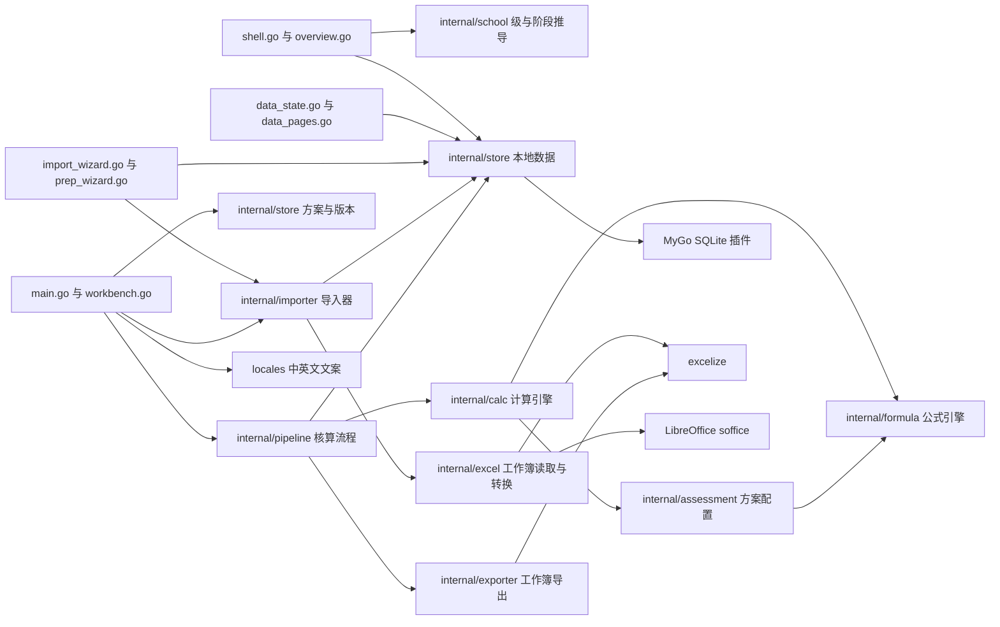
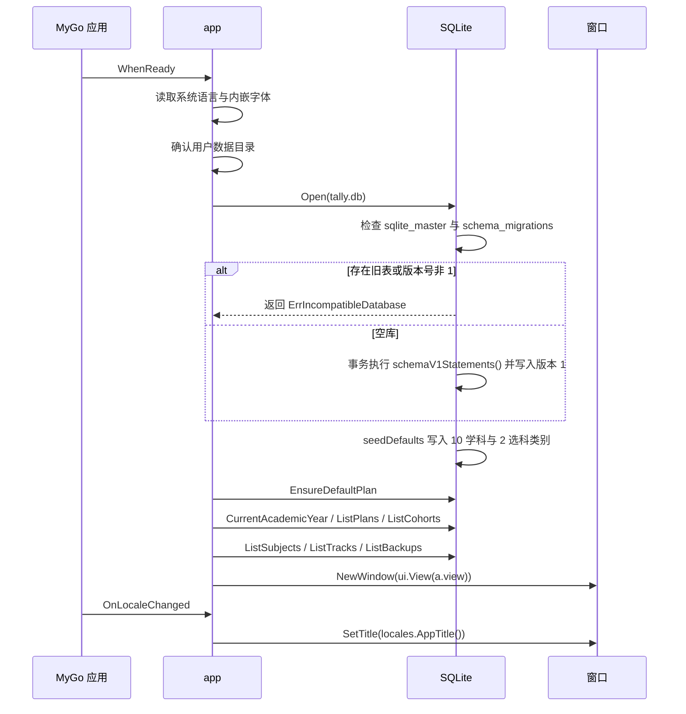
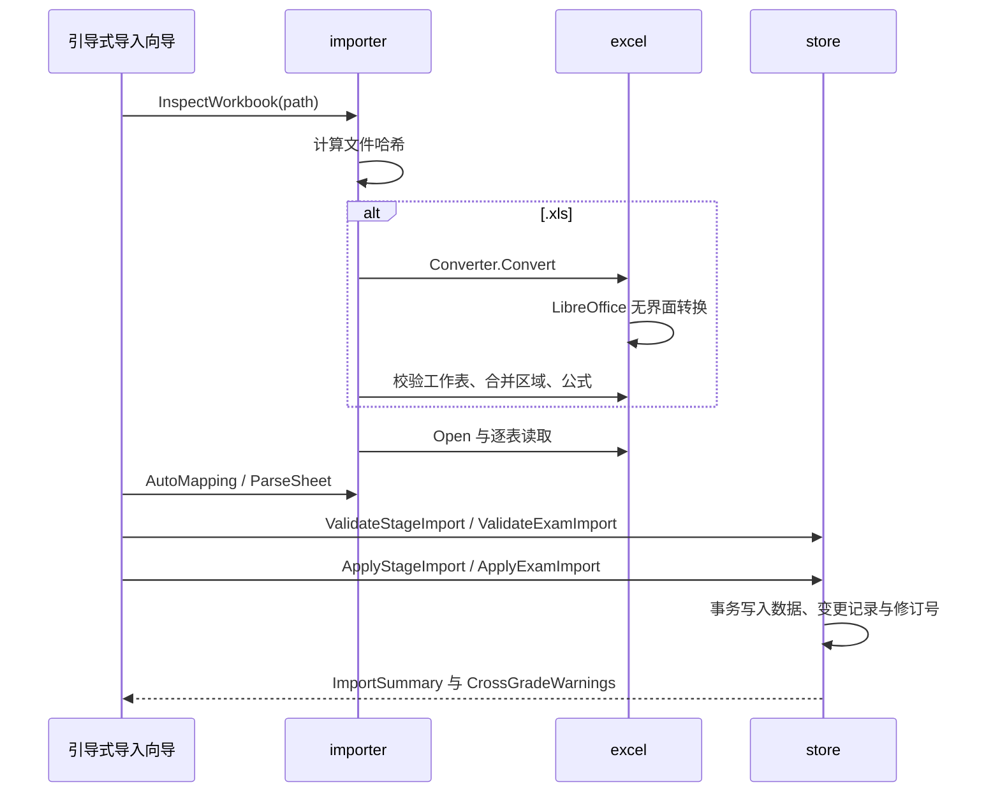
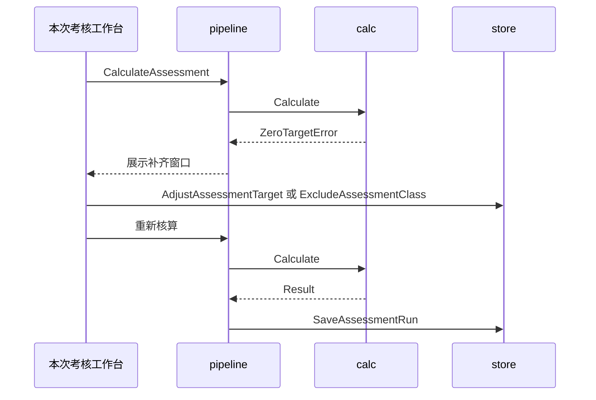

# 当前系统设计

本文档描述当前代码已经实现的系统。业务口径以 `docs/requirements-analysis.md` 为准，考核方案字段以 `docs/assessment-plan.md` 为准，产品结构以 `docs/product-redesign.md` 为准。本文档记录当前代码的实际结构、数据流、存储结构和限制，供后续实现与审查使用。

## 目标与边界

系统是一个单机桌面应用，运行在 Windows 与 macOS，界面由 MyGo 原生控件绘制。数据保存在本机 SQLite，不依赖网络（WebDAV 加密云端同步为可选协同能力）。

当前已经完成重构**阶段 1（Schema v1 单一真理源与存储引擎重构）与阶段 2（全校统一导航、年级档案 6 页签、升学与毕业封存向导、师生三年完整档案、走班教学班编排与结果归档导入模式）**：彻底移除了旧版 `batches` / `terms` / `cohort_stages` / `class_stage_info` / `legacy_*` 等表及旧库迁移代码，在 `internal/store/schema.go` 建立全新 `SchemaVersion = 1` 单一真理源结构，保留 `internal/assessment`、`internal/formula`、`internal/calc`、`internal/sync`、`internal/exporter` 核心能力与高一期中 697 个核对点 0 差异基准，并已全面切换为全校统一导航与「档案即分析」界面架构。

当前已经实现：

- **Schema v1 单一真理源初始化**：`store.Open` 检查 `schema_migrations`；遇到任何旧版核心表或非 `v1` 版本直接返回 `ErrIncompatibleDatabase`，提示新建或重置干净数据库；新库一次写入全套 `schemaV1Statements()`、预置 10 个学科（含日语）、2 个选科类别（物理类、历史类）与内置默认考核方案。
- **年级三年生命周期与升学/结届引擎**（`internal/store/cohort.go`、`cohort_pages.go`）：`cohorts` 持久化 `enrollment_year`、`graduation_year`、`current_phase`（`g1 | g2 | g3 | graduated`）与 `current_academic_year_start`；`PromoteCohort` 原子支持 `PromoteDirect`（原班直升，自动延续班级并写入 `continued_from_class_id` 继承链、班主任、常规教学班与任课关系）和 `PromoteReclassify`（选科重分班，归档旧阶段班级与任课、清空学生当前班级等待重分班）；`PreviewGraduateCohort` 与 `GraduateCohort` 支持毕业封存并自动结束该届活跃任课与班主任、释放仅在该届任教的教师占用；界面已提供升学向导与毕业封存预览弹窗。
- **全校师资实时占用与跨级兼任提示**（`internal/store/faculty.go`、`profile_pages.go`）：`ListTeachersWithOccupancy` 实时聚合未毕业年级的活跃任课（`teaching_assignments.status='active'`）与活跃班主任（`class_head_teachers.status='active'`），计算 `inactive` / `idle` / `active_single` / `active_multi`；`DetectCrossGradeWarnings`、`AssignTeacherToGroup` 与 `SetClassHeadTeacher` 在跨在读年级兼任时返回非阻断 `CrossGradeWarning`；`EndTeachingAssignment` 支持结束任课释放占用。
- **学生建档、多级匹配、复读前溯与重复合并**（`internal/store/students.go`）：`students` 在级内按 `(cohort_id, student_no)` 建档并支持 `previous_student_id` 关联往届复读/留级前档（`SetStudentPreviousLink`）；`MatchStudent` 按 `student_no > candidate_code > name+class_name` 匹配并拦截同班重名歧义（`ErrAmbiguousStudentMatch`）；`MergeStudents` 在同届内原子合并重复档案并记录 `student_events`；`ListBaselines` 结合 `student_entry_scores` 与 `cohort_baseline_overrides` 输出班级与年级入口基数。
- **考试快照、成绩排名、考核引擎与结果归档**（`internal/store/exams.go`、`assessments.go`、`exam_import.go`、`archive.go`）：`exams` / `exam_cohorts` / `exam_participants` / `exam_scores` / `exam_cutoffs` 完整固化参考快照与各级排名（`RecomputeExamRanks`）；`assessments` / `assessment_class_targets`（含 `actual_count`） / `assessment_stat_groups` / `assessment_stat_group_members` / `assessment_target_adjustments` 承接本次考核；`result_runs` / `result_rows`（含 `participants_json` 与 `indicator_values_json`） / `result_row_teachers` / `personal_scores` / `archived_assessments` / `export_records` 持久化正式/试算与归档只读结果。
- **全校统一导航与师生三年完整档案**（`shell.go`、`cohort_pages.go`、`profile_pages.go`、`internal/store/profiles.go`、`internal/exporter/analysis.go`）：左侧栏统一为「总览 / 年级档案 / 教师档案 / 考试与考核 / 考核方案」主导航与底部工具栏；年级详情 6 页签含走班教学班与学生编排弹窗、班级走势传承链弹窗；学生三年档案（含复读前溯一键跳转、异动时间线与导出）和教师执教档案（含实时占用徽章、跨届得分趋势与 Excel 导出）均已上线。
- **其余功能页面**：六步引导式导入与撤销（含结果归档导入向导）、考试列表与六页签详情、数据质量、本次考核工作台（试算、正式计算、重新计算标记、零目标补齐、考核级分档边界按科微调弹窗、结果详情与边界溯源、版本对比抽屉与导出）、多维分析工作台与保存视图（`saved_views`）、方案配置页（公式选项表单）、WebDAV 加密同步（含本地双端协议与冲突回归测试）与目录备份恢复。

当前后续计划（发版后远期规划）：

- 真实 WebDAV 网盘端到端实测与导出模板最终样式确认（后置至发版后跟进）。
- 智能分班与智能分考场模块；核算触发继续维持手动点击触发。

## 总体组成



| 模块 | 职责 | 主要入口 |
|---|---|---|
| 根包 `tally` | 应用生命周期、外壳、总览、数据页面、引导式导入、年级准备清单、阶段核对、设置、考试与本次考核、数据质量、方案库界面、本次考核工作台、结果页与分析页、后台任务与界面回写 | `main`、`app.load`、`app.view`、`app.pageContent`、`app.reloadDataPages`、`app.reloadExamData`、`app.openImportWizard` |
| `internal/school` | 学年起点、级与届、阶段序号和阶段写法的推导 | `AcademicYearStart`、`StageIndex`、`EnrollmentYear`、`StageKey` |
| `internal/assessment` | 方案 JSON 结构、默认值、语义校验、公式编译检查 | `Decode`、`Validate`、`DefaultConfig` |
| `internal/formula` | 受限表达式词法分析、语法树、求值和变量引用检查 | `Compile`、`Expression.Eval` |
| `internal/calc` | 有效考生、三项指标、排名、档次、赋分、个人得分 | `Calculate`、`IsValidStudent` |
| `internal/store` | Schema v1 初始化与拒绝旧库、级生命周期（升学流转与毕业封存）、全校教师实时占用与跨级提示、学生建档/复读前溯/合并、教学班与走班映射、考试快照与排名重算、本次考核与结果、导入校验/事务写入/撤销、师生档案查询、多维分析与保存视图、备份与同步状态 | `Open`、`CreateCohort`、`PromoteCohort`、`PreviewGraduateCohort`、`GraduateCohort`、`ListTeachersWithOccupancy`、`DetectCrossGradeWarnings`、`MatchStudent`、`SetStudentPreviousLink`、`MergeStudents`、`GetStudentProfile`、`GetTeacherProfile`、`QueryClassTrendChain`、`CreateExam`、`ApplyStageImport`、`ApplyExamImport`、`UndoImportRun`、`LoadAssessmentData`、`SaveAssessmentRun` |
| `internal/importer` | 工作表角色识别、引导式导入字段与列名映射、列解析、模板生成、走班合并说明、旧版文件导入 | `InspectWorkbook`、`AutoMapping`、`ParseSheet`、`WriteTemplate`、`WriteIssueList`、`ImportWorkspace`、`ImportInto` |
| `internal/excel` | 打开工作簿、读取表格、检查工作表与合并区域、LibreOffice 转换 | `Open`、`ReadTableFromWorkbook`、`Converter.Convert` |
| `internal/pipeline` | 把本次考核数据转换为计算输入，协调试算、正式核算、结果差异与导出 | `BuildAssessmentInput`、`CalculateAssessment`、`TrialAssessment`、`ExportAssessment`、`DiffAssessmentRuns` |
| `internal/exporter` | 生成结果工作簿与五大维度分析报表，使用临时文件替换目标文件 | `Write`、`ExportTeacherTrend`、`ExportClassTrend`、`ExportSubjectComparison`、`ExportStudentTracking`、`ExportAssessmentComparison` |
| `internal/sync` | WebDAV 加密同步与跨设备冲突检测 | `Client` 等同步入口 |
| `locales` | 中英文文案与生成的访问函数 | `locales.In`、`locales.Catalog` |

依赖方向保持单向：界面依赖业务模块，业务模块依赖存储和计算基础包；计算包不读取数据库，也不访问界面。`internal/calc` 只接收 `calc.Input`，因此可以用合成输入做单元测试，也可以由后续的自动核算流程复用。

## 核心接口

| 接口 | 输入与输出 | 约定 |
|---|---|---|
| `store.Open(ctx, path)` | 路径，返回 `*Store` | 开启外键约束；若发现旧版表或 `schema_migrations` 非 `v1`，返回 `ErrIncompatibleDatabase`；空库写入 Schema v1、预置 10 个学科与 2 个选科类别及默认方案 |
| `store.CreateBackup(root)`、`ListBackups(root)`、`RestoreBackup(root, name)` | 数据目录与备份名称 | 复制 `tally.db` 与 `files/`，保留最近二十份；恢复前先备份当前数据库 |
| `store.CurrentAcademicYear(ctx, fallback)`、`SetAcademicYear(ctx, start)` | 默认学年 / 学年起点 | 读写 `app_settings`，没有设置时使用系统日期推导 |
| `store.CreateCohort(ctx, year, currentStart)`、`ListCohorts`、`GetCohort` | 入学年份与学年起点 | 写入 `cohorts`，按入学年份倒序返回 |
| `store.PromoteCohort(ctx, cohortID, PromoteInput)` | 级与升学参数，返回 `PromoteResult` | 支持 `PromoteDirect`（延续班级并建立 `continued_from_class_id` 链、班主任、常规教学班与任课）与 `PromoteReclassify`（归档旧阶段班级与任课、清空当前分班）；旧阶段任课与班主任以 `end_reason='promoted'` 结束 |
| `store.PreviewGraduateCohort(ctx, cohortID)`、`GraduateCohort(ctx, cohortID)` | 级标识，返回影响摘要 / 归档结果 | 预览并原子执行毕业封存：将 `cohorts.current_phase` 设为 `graduated`，归档班级、教学班、在籍学生，并结束该届所有活跃任课与班主任（`end_reason='graduated'`）以释放仅在本届任教的教师 |
| `store.ListTeachersWithOccupancy(ctx, query, statusFilter, subjectFilter)` | 筛选条件，返回 `[]TeacherOccupancy` | 实时聚合未毕业年级的活跃任课与班主任，计算 `inactive` / `idle` / `active_single` / `active_multi` |
| `store.DetectCrossGradeWarnings(ctx, teacherID, targetCohortID)` | 教师与目标级，返回 `*CrossGradeWarning` | 教师在其他在读年级有活跃任职时返回非阻断提示；`AssignTeacherToGroup` 与 `SetClassHeadTeacher` 写入同时返回该提示 |
| `store.EndTeachingAssignment(ctx, assignmentID, reason)` | 任课记录与原因 | 将活跃任课闭合为 `ended` |
| `store.ListClasses`、`CreateClass`、`DeleteClass`、`ListTeachers`、`ListTeachingGroups`、`CreateTeachingGroup`、`AssignWalkingStudent` | 级、阶段或班级/教学班参数 | 维护按 `(cohort_id, phase)` 建实例的班级、常规/走班教学班与显式走班学生映射 |
| `store.ListStudents(ctx, StudentFilter)`、`GetStudent(ctx, stageID, studentID)` | 筛选条件与分页 | 返回学生、当前班级、教学班归属、来源与总数；支持 `previous_student_id` |
| `store.MatchStudent(ctx, cohortID, phase, studentNo, candidateCode, name, className)` | 多维标识 | 按 `student_no > candidate_code > name+class_name` 匹配，存在歧义时返回 `ErrAmbiguousStudentMatch` |
| `store.SetStudentPreviousLink(ctx, studentID, previousStudentID)`、`MergeStudents(ctx, targetID, sourceID)` | 学生标识 | 绑定复读/留级前档或同届内合并重复学生档案并写 `student_events` |
| `store.GetStudentProfile(ctx, studentID)`、`GetTeacherProfile(ctx, teacherID)`、`QueryClassTrendChain(ctx, classID)` | 档案/班级标识 | 返回学生三年完整档案（含前溯往届）、教师执教全校档案（含跨届轨迹）与沿 `continued_from_class_id` 串联的班级走势 |
| `store.StageCounts`、`EnsureCohortStage`、`ListCohortStages`、`CopyStageFromPrevious`、`ConfirmStageReview` | 级与阶段视图参数 | 阶段 1 界面兼容层，通过 `EncodeStageID`/`DecodeStageID` 映射 `(cohort_id, phase)` 并把核对状态存入 `app_settings` |
| `store.ValidateStageImport(ctx, cohortID, stageID, req)`、`ApplyStageImport(ctx, cohortID, stageID, req)` | 级、阶段与解析结果 | 阻断问题返回 `ErrImportBlocked`；重复文件返回 `ErrDuplicateImport`；事务写入并记录 `import_changes` 与跨级提示 |
| `store.CanUndoImport(ctx, runID)`、`UndoImportRun(ctx, runID)` | 导入记录 | 同一范围存在更新的导入时阻止撤销；否则反向应用 `import_changes` 并写审计日志 |
| `store.CreateExam(ctx, input)`、`ListExams`、`GetExam`、`GetExamCohort`、`ListExamSubjects` | 考试信息 | 新建考试、每个级的 `exam_cohorts`（含 `phase_at_exam` 与 `subjects_json`）与非月考的 `assessments` |
| `store.GenerateExamRoster`、`AddExamRosterStudents`、`ValidateExamImport`、`ApplyExamImport` | 考试与级数据 | 从当前级学生或导入文件生成/更新 `exam_participants`、`exam_scores`、`exam_cutoffs` 与 `assessment_class_targets` |
| `store.RecomputeExamRanks(ctx, examID, cohortID)` | 考试与级 | 重算 `exam_participants` 总分与年级/类别/班级排名及 `exam_scores` 单科排名 |
| `store.ExamScoreSummaries`、`ExamScoreBands`、`ExamClassAverages`、`ExamCutoffImpacts`、`ExamQualityIssues`、`ExamPrep` | 考试与级 | 返回科目汇总、分布、班级均分、达线影响、数据质量问题与准备清单 |
| `store.ListClassTargets`、`SetClassTarget`、`AdjustAssessmentTarget`、`ExcludeAssessmentClass`、`ApplyZeroTargetBatch` | 本次考核目标参数 | 维护班级六档目标、补录调整与不参与完成率记录 |
| `store.EnsureAssessmentStatGroups`、`ListExamStatGroups`、`SaveStatGroup`、`DeleteStatGroup` | 本次考核合并组参数 | 维护统计组、成员教学班与统计组目标 |
| `store.AssessmentForExamCohort`、`LoadAssessmentContext`、`LoadAssessmentData`、`ListAssessmentBoundaryOverrides`、`SaveAssessmentBoundaryOverrides`、`ResetAssessmentBoundaryOverride`、`ResetAllAssessmentBoundaryOverrides`、`SaveAssessmentRun`、`LatestOfficialAssessmentRun`、`AssessmentRowStudents` | 本次考核标识与边界微调 | 读取考试快照与分档微调数据构建 `BatchData`，维护考核级按科分档边界覆盖（事务内记录 `audit_logs` 与修订号），保存运行、`result_run_boundaries`、`result_rows`、`result_row_teachers`、`personal_scores` 与 `ChangedInputItems` |
| `store.QueryTeacherTrends`、`QueryClassTrends`、`QuerySubjectComparison`、`QueryStudentTracking`、`QueryAssessmentComparison` | 多维分析参数 | 返回五大维度分析数据；支持 `SaveView` / `ListViews` / `DeleteView` |
| `pipeline.BuildAssessmentInput`、`CalculateAssessment`、`TrialAssessment`、`ExportAssessment`、`DiffAssessmentRuns` | 本次考核与方案版本 | 构建计算输入、校验并执行试算/正式计算；对存在其他有效总分线时全选科未划线档位豁免阻断按零达线计；导出前核对 `InputHash`，不一致时拒绝导出 |
| `calc.Calculate(input, options)` | 计算输入与选项 | 纯内存计算三项指标、排名、分档（优先采用 `BoundaryOverrides`，参评组数变化或越界返回 `BoundaryStaleError`）、赋分与个人得分；零目标返回 `ZeroTargetError` |
| `exporter.Write`、`ExportTeacherTrend` 等 | 导出数据 | 先写临时文件，成功后再原子替换目标文件 |
| `assessment.Decode`、`Config.Validate`、`Config.ValidateFormulas` | 方案 JSON 与配置 | 严格解析配置并校验语义、公式语法与指标依赖 |

## 启动与生命周期



`app.load` 在测试中可以直接使用 `a.dataDir`，界面启动时使用 `mygo.App.Path(mygo.PathUserData)`。打开数据库失败（含检测到旧版不兼容库）、默认方案写入失败或者列表读取失败时，错误写入 `app.loadError`，界面显示本地数据库错误并停止渲染业务内容。

应用退出时关闭 SQLite 连接。当前没有后台定时任务，也没有启动时网络请求。

## 应用状态

根包只保存普通数据和 `ui` 的身份对象，跨构建不保存控件指针。主要状态如下：

| 字段 | 用途 |
|---|---|
| `dataDir`、`store` | 用户数据目录和数据库连接 |
| `language` | 当前界面语言，`en` 或 `zh-Hans` |
| `plans`、`versions`、`selectedPlanID`、`versionIndex` | 方案库当前选择 |
| `planConfig`、`planConfigVersionID`、`planSaveChoice`、`planForm` | 方案配置页的编辑状态与保存选择 |
| `page` | 当前页面，总览、数据页面、本次考核、计算结果、方案库、设置或帮助 |
| `systemAcademicYear`、`academicYearStart` | 系统日期推导的学年与保存的当前学年 |
| `cohorts`、`selectedCohortID` | 级列表与当前级 |
| `cohortStages`、`selectedStageID` | 当前级的阶段记录与正在查看的阶段 |
| `stageCounts`、`stageClasses` | 当前阶段的准备情况与行政班名称 |
| `classes`、`students`、`studentsTotal` | 当前阶段的行政班、学生页与总数 |
| `teachers`、`teachingGroups`、`baselines`、`importRuns` | 教师、教学班、入口成绩与导入记录 |
| `dataQuery`、`dataClassFilter`、`dataTrackFilter`、`dataStatusFilter` | 学生搜索与筛选 |
| `teacherQuery`、`groupQuery`、`groupSubjectFilter` | 教师与教学班搜索、学科筛选 |
| `baselineQuery`、`baselineClassFilter`、`importQuery` | 入口成绩与导入记录筛选 |
| `studentDetail`、`studentDetailOpen`、`selectedStudentID` | 学生详情面板 |
| `subjects`、`tracks`、`subjectDrafts`、`trackDrafts` | 学科与选科类别的当前值与编辑值 |
| `backups`、`restoreBackupName`、`restoreOpen` | 备份列表与恢复确认对话框 |
| `dataBusy`、`dataError`、`dataMessage` | 数据页面后台导入状态与提示 |
| `importWizard` | 引导式导入的当前数据项、步骤、工作表、列名映射、校验结果、提醒确认和导入结果 |
| `importRunID`、`importDetail` | 当前导入记录与详情侧栏 |
| `prepOpen` | 是否显示年级准备清单 |
| `stageReviewOpen`、`stageNoticeDismissed` | 阶段复制变化窗口与手动关闭的核对提示 |
| `newCohortOpen`、`newCohortYear`、`newCohortError` | 新建年级窗口 |
| `settingsError` | 设置页面的错误 |
| `published`、`calculateVersion` | 可用于核算的已发布版本和当前选择 |
| `assessments`、`selectedAssessmentID`、`assessmentContext` | 考核概览列表、当前考核与详情上下文 |
| `assessmentRun`、`assessmentRows`、`assessmentPersonal` | 当前考核的最新运行、结果行与个人得分 |
| `assessmentBusy`、`assessmentError`、`assessmentMessage` | 核算后台任务状态与提示 |
| `resultTable` | 结果表选中状态 |
| `zeroOpen`、`zeroIssues`、`zeroValues`、`zeroReason` | 零目标补齐窗口 |
| `exams`、`selectedExamID`、`examCohortID` | 考试列表、当前考试与当前级 |
| `exam` 与考试数据字段 | 考试快照、报名名单、成绩、汇总、分布、班级均分、分数线、目标、合并组、准备清单与质量问题的当前页数据、筛选条件和后台状态 |
| `newExam*` 字段 | 新建考试窗口 |
| `examTargetDrafts`、`statGroup*` 字段 | 目标编辑草稿与合并组窗口 |
| `qualityExams`、`qualitySeverity`、`qualityDataItem`、`qualityImports`、`qualityImportOptions`、`qualityImportRun`、`qualityLoaded` | 数据质量页数据与筛选 |

批次状态当前只有三个取值：

| 状态 | 含义 |
|---|---|
| `draft` | 新建后尚未导入 |
| `imported` | 至少完成一次导入，已有结果被清除 |
| `calculated` | 已保存一次核算结果 |

方案版本状态为 `draft`、`published`、`retired`。正式核算只接受 `published`。

## 方案配置与版本

方案配置保存为 JSON，带 `schemaVersion`。`assessment.Decode` 使用严格模式，未知字段会被拒绝；`Validate` 检查枚举、指标分值合计、档位权重、排名边界、个人得分方式、专项规则和零目标处理；`ValidateFormulas` 编译全部公式并检查指标依赖。

首次启动时 `EnsureDefaultPlan` 查找 `kind = 'system'` 的方案。没有时写入 `assessment.DefaultConfig()`，版本 1 直接发布。已有内置方案时返回最新的已发布版本；没有已发布版本时读取最新版本配置并追加一条已发布版本；没有任何版本时从出厂配置恢复。

派生方案通过 `store.CreatePlan` 写入完整配置，版本 1 为草稿；`store.CreateDraft` 在已有方案下追加草稿版本；`store.UpdatePlan` 在当前方案下追加版本，内置方案直接发布，派生方案保存为草稿；`Publish` 发布草稿；`Retire` 停用派生方案的已发布版本，收到内置方案时返回 `ErrSystemPlanRetire`。内置方案通过事务追加已发布版本，旧版本保留，当前版本在新版本写入前保持有效。

方案页顶部是方案下拉框，下面是方案信息、适用范围、数据口径、走班口径、指标、档位、排名与分档、个人得分、专项规则和校验的完整表单，全部配置项直接可改。指标公式、比例模式分档边界和完成率覆盖使用公式选项表单：下拉框选择形状，数字框填写均等份数或权重，下方句子预览当前公式的含义；选择编译成原公式文本写回 `assessment.Config`，保存时仍然整体编译检查。当前公式匹配某个形状时选中对应选项，没有匹配的形状时以「自定义表达式」只读回显，重新选择后覆盖。底部只有一个「保存」按钮，点击后询问更新当前方案还是保存为新的方案；两种选择都会校验配置和公式，写入后立即发布，界面不显示版本号、版本状态和停用操作。

核算时 `pipeline.CalculateAssessment` 读取版本并检查状态，只接受 `published`。考核保存 `plan_version_id` 与 `current_run_id`，结果运行记录保存实际使用的 `plan_version_id`。同一考核重新核算时，旧运行记录保留，`is_official` 被清零，新记录标记为正式结果。版本下拉框默认选中当前考核上次使用的版本，该版本不可用时回退到第一个已发布版本。

## 批次与导入

### 引导式导入

年级准备清单和各类数据页面共用同一套六步导入向导：


- 数据项在年级上下文里是班级、学生、教师、任课关系和入口成绩，在考试上下文里是报名名单、成绩、分数线和目标。选择数据项时显示当前级、阶段、届、已完成状态和必需列名。
- 工作簿按内容哈希读取，`.xls` 先交给 LibreOffice 转换。工作表按名称、表头和行数打分，自动选中匹配度最高的一张，用户可以改选。
- 列名映射按表头同义词自动生成，映射表显示标准字段、必需标记、原始列名和第一行示例值。入口成绩的学科和比值字段使用当前学科名称显示。
- 教师一览宽表与横向分数线表没有需要映射的字段，映射页显示「列名已自动识别」提示。
- 校验阶段返回新增、更新、跳过、阻断和提醒数量。阻断问题通过 `ErrImportBlocked` 阻止事务写入；提醒问题需要用户勾选确认后才能导入。
- 成绩数据的校验页额外显示按未参加处理的单科 0 分数量；报名名单之外的考生可以整批补建并加入本场考试报名名单（`store.AddExamRosterStudents`），也可以从本次导入中跳过，跳过数量在结果步骤继续显示。问题清单可以导出为 Excel 工作簿，交给年级组修改后重新导入。
- 写入在一个事务中完成，同时保存导入记录、工作表、列名映射、问题清单、变更记录和阶段修订号。同一阶段、同一数据项、同一文件哈希再次导入时返回 `ErrDuplicateImport`。
- 导入结果提供查看数据、继续导入下一项、从同一工作簿继续导入和结束。继续导入会保留当前工作簿，重新选择目标工作表并生成新的列名映射。
- 导入记录详情显示数据项、文件、状态、行数、工作表、来源路径和问题清单。撤销按变更记录反向执行；同一阶段存在更新的导入时阻止撤销，没有变更记录的旧导入返回具体原因。

年级准备清单按班级、学生、教师、任课关系和入口成绩的顺序显示完成状态。每项已完成时提供查看入口，未完成时提供导入入口；总览的「继续准备」进入这张清单。

进入新学年时，`app.reloadCohorts` 为当前级建立阶段记录，并调用 `CopyStageFromPrevious` 复制上一阶段的班级阶段信息、教学班、任课关系、学生阶段归属和学生教学班归属。新阶段写入 `review_status = 'pending'`，总览显示核对提示，提供「查看变化」「确认核对」「稍后核对」。阶段历史显示待核对或者已核对徽标。历史阶段的导入入口不可用。

### 新建考试与导入写回

`store.CreateExam` 接收学年、学期、考试类型、名称、日期、参加的级与学科满分。唯一约束是 `exams(academic_year_start, term, exam_type, name)`，并为每个参加的级建立 `exam_cohorts`（固化 `phase_at_exam` 与 `subjects_json`），除月考（`monthly`）按需创建外自动预建 `assessments`。阶段组织数据导入通过 `ValidateStageImport` / `ApplyStageImport` 写入；考试数据导入通过 `ValidateExamImport` / `ApplyExamImport` 写入，并在同一事务中记录 `import_runs`、`import_sheets`、`import_columns`、`import_issues`、`import_changes` 与 `data_revisions`。

### 导入流程



文件级去重使用 SHA-256。`.xls` 转换文件放在 `<用户数据目录>/converted`，原文件不修改；导入工作簿按内容哈希复制到 `files/`，导入记录保存原始路径、应用内副本路径、转换路径和文件哈希。

### 工作表角色

导入器先读取每个工作表前 15 行，按名称、表头和行数打分，选出学生、教师、目标、基数、分数线五类工作表。当前识别规则：

| 角色 | 必要表头 | 加分条件 |
|---|---|---|
| 学生成绩 | `班级`、`姓名`、`考号`、`考生号` 或 `学号` | 工作表名含「均分整理」「基础数据」「核对」 |
| 任课教师 | `班级`、`班主任`、至少一个学科 | 工作表名含「任课教师」「教师一览」 |
| 目标任务 | `班级`、`清北` 或 `本科` | 工作表名含「目标任务」 |
| 基数 | `班级`、至少一个基数均分列（`语均`、`数均`、`总均` 等） | 工作表名含「基数」 |
| 分数线 | `科目`、`本科线` 或 `特控线` | 行数越多分数越高 |

一个工作簿没有识别到任何角色时阻止导入。一个角色有多个候选时选择分数最高的工作表，其余工作表不参与本次导入。

### 考试数据工作表

考试上下文里的六步向导用同一套打分识别报名名单、成绩、分数线和目标四类工作表：

| 角色 | 必要表头 | 加分条件 |
|---|---|---|
| 报名名单 | 学号或考号、姓名、班级 | 工作表名含「报名」或「名单」 |
| 成绩 | 学号或考号、姓名、至少两个学科列 | 工作表名为「总」「汇总」或含「总成绩」 |
| 分数线 | 科目、本科线或特控线 | 工作表名含「分数线」 |
| 目标 | 班级、档位名 | 工作表名含「目标」 |

报名名单与成绩按实际数据行数加分，完整名单行数最多，用来区分按班级拆分的表；其余角色按非空单元格行数加分。各解析器跳过含「年级」「总计」「合计」「备注」「说明」的汇总行。入口成绩先匹配「语均」这类均分列，再回退到学科总名列；目标表头匹配「档位名」「档位名目标」和「档位名-」前缀，以及档位同义词。

横向排列的分数线表（两个以上「科目」列、每组后面跟各条线列）按组解析：档位从「特控线」这类列名识别，类别从分组上方的「总分(物理)」这类分组行识别，识别不出类别时整表失败；「总分」行写入档位线，其余行按学科写入单科线。零分值产生提醒不导入，未启用的学科产生提醒并跳过。

### 学生与成绩

学生按考号读取，考号和学号保持文本，保留前导零。缺考、违纪、作弊和 `-1` 写入成绩标记，不写入分数。单科成绩为 0 时按未参加该科考试处理，不写入该科成绩；总分保留。选科组合含「物理」记为物理类，含「历史」记为历史类。学籍状态把「转学」「休学」「借读」「退学」转换为内部代码。

考号重复、必填字段为空、未知列无法解析时导入失败。班级汇总行（含「年级」「总计」「合计」「备注」「说明」）跳过。

### 班级别名

学生表可能使用内部编号，目标表、教师表和基数表使用「实验甲」「实验乙」这类班级名称。导入器按学生人数与导入文件中带班级人数的表格匹配；人数唯一对应时把学生班级改名为目标班级，并写入导入提醒。人数相同导致多个候选时不自动改名。

### 走班合并说明

导入器扫描所有工作表文本，识别走班合并说明（下例均为脱敏合成写法）：

```text
地理教师A：走班甲班与乙班合并计算（14+4）
政治教师B：走班丙班与乙班合并计算（0+14）
历史教师C（1班-2班-3班：6）
地理教师D（4班-5班：5，）
政治教师E（4班-5班-6班：4）
```

支持两种提取模式：
1. 走班显式合并：成员班级按「与」「和」「、」「+」「/」分隔，目标人数取括号内数字之和，承担统计职责的班级取承载班级。
2. 走班教学班破折号列表：成员班级按 `-` 分隔，目标人数取冒号后数值，承担统计职责的班级自动匹配持有对应科目中考基数比的平行班。

一行有多条说明时全部解析。说明没有给出目标人数、成员数量与目标数量不一致、目标无法读取时只产生提醒，不生成统计组。

### 导入写入

`ApplyStageImport` 与 `ApplyExamImport` 在单一事务中写入班级、学生、教师、教学班、任课关系、入口成绩或考试报名名单、成绩、分数线与班级目标，同时记录 `import_changes` 供撤销与 `import_issues` 供数据质量追踪。考试导入完成后可通过 `EnsureAssessmentStatGroups` 建立或刷新默认统计组；已经被显式统计组包含的教学班不再建立同名默认组。

引导式导入写入 `import_sheets` 的工作表名称、角色、表头行和数据范围，以及 `import_columns` 的标准字段与原始列名。`import_sheets.version_tag` 尚未写入；工作表版本选择和候选工作表确认属于后续导入界面。

### 结果归档导入

历史考试缺少完整成绩或方案参数时，可通过考试详情页「导入归档结果」或导入中心「结果归档」模式直接导入历史结果工作簿：

- **表头与角色识别（`importer.InspectArchiveWorkbook`）**：先调用 `excel.ReadMergedRows` 按左上角取值展开合并单元格，在前 15 行定位单行或双行复合表头，严格按列名识别 `量化计算`、`排名赋分`、`个人得分` 三类结果工作表（不依赖工作表顺序），同时支持长表、多学科宽表及历史多栏个人得分汇总块，并将空值与异常值按 `blocking` / `warning` 写入 `ImportIssue`。
- **事务写入与只读保护（`store.ValidateArchivedResultImport` / `ApplyArchivedResultImport`）**：校验无阻断错误后，在同一事务内补建缺失班级与教师档案、写入 `result_runs(is_official=1, input_summary_json='{"mode":"archived","import_run_id":<run_id>}')`、`result_rows`、`result_row_teachers`、`personal_scores`、在 `archived_assessments` 登记只读归档记录并记入 `import_runs`、`import_changes` 与 `audit_logs`（支持安全撤销回滚）。
- **只读约束与防误标**：`AssertAssessmentCalculable` 与 `pipeline` 在试算及正式计算前拦截归档考核并报错（`ErrAssessmentArchived`）；底层变更标记及工作台 `staleInputItems` 自动跳过归档考核，界面展示「结果归档（只读）」徽章与说明。

## 核算流程

### 输入构建

`pipeline.BuildInput` 读取 `BatchData`，生成 `calc.Input`，同时计算输入摘要。核算前检查：

| 问题 | 结果 |
|---|---|
| 没有班级、学生、统计组或者有效考生 | 阻止核算 |
| 学科缺少年级基数均分 | 阻止核算 |
| 学科缺少物理类或者历史类分数线 | 阻止核算 |
| 档位缺少总分分数线 | 阻止核算 |
| 统计组缺少基数、单科目标或者成员 | 阻止核算 |
| 学生缺少教学班归属 | 阻止核算 |
| 目标基础分为 0 或者目标缺失 | 返回零目标问题，打开补齐窗口 |

年级均分从有效学生的成绩重新计算，单科成绩为 0 或未实考标记（通过 `<科目>人数` 计数列识别）的不计入。年级基数优先使用工作表总计行，缺失时按班级人数加权。统计组基数优先使用统计组自己的值，缺失时优先由承担统计职责的班级（`LeadClassID`）继承其中考基数比或均分，仍缺失时对成员班级的基数均分取算术平均。针对中考基数表中均分列误填基数比的异常数据（均分 < 3.0 且总均分正常），导入器自动识别并纠正为基数比。各班目标表中未列出的档位单元格按 0 导入，六档全为 0 或加权基础分为 0 时触发零目标补齐窗口。

### 本次考核核算

本次考核工作台走独立入口，与批次路径共用输入构建、阻断检查和计算引擎。`pipeline.CalculateAssessment` 先读取方案版本并检查 `published` 状态，再调用 `pipeline.BuildAssessmentInput`。`store.LoadAssessmentData` 从考试结构读取核算输入：行政班与班级阶段信息、报名名单、成绩、单科线与档位线、班级目标、补录与不参与记录、合并组、入口成绩与任课关系，转换为 `BatchData`。`store.SaveAssessmentRun` 保存运行、结果行与个人得分，把考核状态改为 `calculated`。`pipeline.ExportAssessment` 导出前重新构建输入摘要，与运行摘要不一致时返回「数据或者方案已经变化，需要重新核算」错误。

试算走 `pipeline.TrialAssessment`，结果按非正式运行保存，不改变考核状态，也不影响正式结果。界面提供「开始试算」「正式计算」和「导出」三个动作；只有存在最新正式运行且该运行未标记需要重新计算时导出可用（`officialExportReady`）。

「需要重新计算」标记以最新正式运行为准：界面取该运行保存的输入摘要，与当前数据按数据项对比（`store.ChangedInputItems`），有数据项变化时详情显示「需要重新计算」状态徽标和列出变化数据项的警告提示；没有摘要的运行（迁移来的旧运行）回退到整体 `InputHash` 对比，此时不显示数据项清单。试算不改变该标记。

### 单项指标

每个统计组按学科计算一次：

- 班级均分等于成员教学班内有效学生该科成绩之和除以人数。
- 均分提升率得分使用 `class.average / grade.average / baseline.ratio × points`。
- 单科达线人数按学生类别选择物理类或者历史类分数线，得分使用 `passCount / statGroup.target × points`。
- 完成率对承担统计职责的班级计算，实际完成分和目标基础分都按方案档位权重加权。
- 三项得分默认不封顶；配置 `cap` 时先乘满分，再按上下限截断。

公式由 `internal/formula` 编译和执行。支持的变量包括 `class`、`grade`、`baseline`、`statGroup`、`tier`、`indicator` 和 `program`。指标可以引用其他指标，编译阶段检查循环依赖和未知变量；运行阶段遇到除零、缺失变量或者非有限数值时返回错误。

### 排名与赋分

排名组默认为同年级同学科。排序依据教学量化成绩，同分时按统计组标识稳定排序。`ranking.tieMode` 支持：

| 取值 | 名次写法 |
|---|---|
| `competition` | 1、1、3，默认值（已确认） |
| `dense` | 1、1、2 |
| `ordinal` | 1、2、3 |

分档默认按参评统计组数量生成：一档止于 `floor(n/3)`，二档止于 `round(2n/3)`。`overrides` 按学科和参评数量覆盖；`manual` 模式按学科读取人工区间；考核级按科微调（`assessment_boundary_overrides`）优先级高于方案配置，若参评统计组数发生变化则触发 `BoundaryStaleError` 阻断并引导复核；每次运行通过 `result_run_boundaries` 固化各科生效边界与来源。赋分默认 70、67、64。

### 个人得分

个人得分按教师、学科和年级汇总。默认 `top_two_average`：取该教师所教统计组赋分最高的两个组求平均；只有一个组时取该组赋分。合并统计组只产生一个赋分。结果保留一位小数。

### 零目标处理



零目标窗口按班级列出缺失档位。用户可以逐项补录并填写原因，也可以让班级不参与完成率并填写原因。补录或排除写入 `assessment_target_adjustments`，原始导入目标不被改写。补齐或排除后立即重新核算。仍有零目标时窗口保持打开，并更新剩余问题。

### 结果保存

`SaveAssessmentRun` 在单一事务内完成：当 `official == true` 时先把该考核的所有旧正式运行 `is_official` 置 0，插入新的 `result_runs`（记录 `input_hash` 与逐项 `input_summary_json`），再批量写入 `result_rows`（含 `participants_json` 与 `indicator_values_json` 及封顶前数值与分子分母）、`result_row_teachers` 与 `personal_scores`（绑定 `teacher_id`、`teacher_name_snapshot`、`cohort_id`、`phase_at_exam`）；正式运行会把考核 `status` 改为 `calculated` 并更新 `current_run_id`（试算只保存运行与明细，不改变考核状态与正式指针）。

### 输入摘要

`store.InputHash` 对方案配置和 `BatchData` 做 JSON 编码后计算 SHA-256。计算前把元信息的 `Status`、`Revision`、`CurrentPlanVersionID`、`CreatedAt` 清零，避免核算本身改变摘要。导入、方案变化、目标补录或者班级排除都会改变摘要。

`store.InputSummary` 分别对方案与每个数据项（`roster`、`scores`、`cutoffs`、`targets`、`groups`、`baseline`、`assignments`、`classes`、`exclusions`、`boundaries`）计算哈希，保存在运行记录的 `input_summary_json` 里；`store.ChangedInputItems` 对比运行保存的摘要与当前摘要，返回变化数据项的标识。

## 导出设计

本次考核导出入口是 `pipeline.ExportAssessment`，流程如下：

1. 读取本次考核最新正式运行、结果行和个人得分。
2. 读取运行使用的方案版本。
3. 重新构建当前输入摘要与 `InputHash`。
4. 当前哈希与运行哈希不一致时拒绝导出，提示先重新核算。
5. 调用 `exporter.Write` 写出工作簿。
6. 计算导出文件 SHA-256，写入 `export_records`。

导出工作簿包含五张表：

| 工作表 | 内容 |
|---|---|
| 计算依据 | 学年学期、考试类型、年级、方案名称与版本、分档边界微调清单（学科、参评组数、一档止于、二档止于、调整备注，无微调时写明按方案默认边界）、输入摘要、核算时间、导出时间 |
| 量化计算 | 每个统计组的班级、学科、教师、人数、均分、基数、三项得分和总分 |
| 排名赋分 | 每个统计组的教学量化成绩、排名、档次和赋分 |
| 个人得分 | 教师、年级、学科、所教统计组赋分和个人得分 |
| 结果明细 | 每个统计组的指标明细 JSON |

导出先写 `<目标名>.tmp.xlsx`，成功后再改名为目标文件，避免覆盖时留下半截文件。`excelize` 需要识别文件扩展名，临时文件保留 `.xlsx` 后缀。

## 数据模型（Schema v1）

### 实体关系

```mermaid
erDiagram
  PLANS ||--o{ PLAN_VERSIONS : versions
  TEACHERS ||--o{ CLASS_HEAD_TEACHERS : leads
  TEACHERS ||--o{ TEACHING_ASSIGNMENTS : teaches
  TEACHERS ||--o{ RESULT_ROW_TEACHERS : credited
  TEACHERS ||--o{ PERSONAL_SCORES : earns
  COHORTS ||--o{ CLASSES : owns
  CLASSES ||--o| CLASSES : continued_from
  CLASSES ||--o{ CLASS_HEAD_TEACHERS : has_head
  COHORTS ||--o{ TEACHING_GROUPS : owns
  CLASSES ||--o{ TEACHING_GROUPS : admin_group
  TEACHING_GROUPS ||--o{ TEACHING_ASSIGNMENTS : assigns
  TEACHING_GROUPS ||--o{ TEACHING_GROUP_STUDENTS : walking_members
  COHORTS ||--o{ STUDENTS : enrolls
  CLASSES ||--o{ STUDENTS : current_class
  STUDENTS ||--o| STUDENTS : previous_student
  STUDENTS ||--o{ TEACHING_GROUP_STUDENTS : attends_walking
  STUDENTS ||--o{ STUDENT_ENTRY_SCORES : entry_scores
  COHORTS ||--o{ COHORT_BASELINE_OVERRIDES : baseline_overrides
  STUDENTS ||--o{ STUDENT_EVENTS : history
  EXAMS ||--o{ EXAM_COHORTS : covers
  COHORTS ||--o{ EXAM_COHORTS : participates
  EXAM_COHORTS ||--o{ EXAM_PARTICIPANTS : registers
  STUDENTS ||--o{ EXAM_PARTICIPANTS : snapshot
  CLASSES ||--o{ EXAM_PARTICIPANTS : class_snapshot
  EXAM_PARTICIPANTS ||--o{ EXAM_SCORES : earns
  TEACHING_GROUPS ||--o{ EXAM_SCORES : group_snapshot
  EXAM_COHORTS ||--o{ EXAM_CUTOFFS : defines
  EXAM_COHORTS ||--o| ASSESSMENTS : produces
  PLAN_VERSIONS ||--o{ ASSESSMENTS : selects
  ASSESSMENTS ||--o{ ASSESSMENT_CLASS_TARGETS : has_targets
  CLASSES ||--o{ ASSESSMENT_CLASS_TARGETS : targets_for
  ASSESSMENTS ||--o{ ASSESSMENT_STAT_GROUPS : has_groups
  CLASSES ||--o{ ASSESSMENT_STAT_GROUPS : leads
  ASSESSMENT_STAT_GROUPS ||--o{ ASSESSMENT_STAT_GROUP_MEMBERS : contains
  TEACHING_GROUPS ||--o{ ASSESSMENT_STAT_GROUP_MEMBERS : joins
  ASSESSMENTS ||--o{ ASSESSMENT_TARGET_ADJUSTMENTS : adjusts
  ASSESSMENTS ||--o{ ASSESSMENT_BOUNDARY_OVERRIDES : overrides
  ASSESSMENTS ||--o{ RESULT_RUNS : runs
  ASSESSMENTS ||--o| ARCHIVED_ASSESSMENTS : archives
  PLAN_VERSIONS ||--o{ RESULT_RUNS : uses
  RESULT_RUNS ||--o{ RESULT_RUN_BOUNDARIES : records
  RESULT_RUNS ||--o{ RESULT_ROWS : contains
  RESULT_ROWS ||--o{ RESULT_ROW_TEACHERS : credits
  RESULT_RUNS ||--o{ PERSONAL_SCORES : summarizes
  RESULT_RUNS ||--o{ EXPORT_RECORDS : exports
  IMPORT_RUNS ||--o{ IMPORT_SHEETS : sheets
  IMPORT_SHEETS ||--o{ IMPORT_COLUMNS : columns
  IMPORT_RUNS ||--o{ IMPORT_ISSUES : issues
  IMPORT_RUNS ||--o{ IMPORT_CHANGES : changes
```



### 表结构

全校永久配置与师资层：

| 表 | 关键字段 | 约束与索引 |
|---|---|---|
| `schema_migrations` | `version`、`applied_at` | 主键 `version`；当前写入版本 `1` |
| `app_settings` | `"key"`、`value`、`updated_at` | 保存学年起点、`soffice_path`、外观与阶段兼容核对元数据 |
| `subjects` | `"key"`、`name`、`full_mark`、`sort_order`、`enabled` | 预置语文、数学、英语、日语、物理、化学、生物、历史、政治、地理 10 个学科 |
| `tracks` | `"key"`、`name`、`sort_order`、`enabled` | 预置 `physics`、`history` |
| `plans` | `id`、`name`、`scope`、`is_system`、`created_at` | 唯一索引 `(name)` |
| `plan_versions` | `id`、`plan_id`、`version`、`status`、`config_json`、`note`、`created_by`、`parent_version_id`、`change_summary`、`config_hash`、`published_at`、`created_at` | 唯一索引 `(plan_id, version)`；`status IN ('draft','published','retired')` |
| `sync_state` | `"key"`、`value`、`updated_at` | WebDAV 同步配置与设备标识 |
| `saved_views` | `id`、`page`、`name`、`config_json`、`created_at` | 唯一索引 `(page, name)` |
| `teachers` | `id`、`teacher_no`、`name`、`primary_subject`、`status`、`note`、`import_run_id`、`source_sheet`、`source_row`、`created_at`、`updated_at` | 部分唯一索引 `(teacher_no) WHERE teacher_no <> ''`；索引 `(name)`；`status IN ('active','inactive')` |

年级三年生命周期层：

| 表 | 关键字段 | 约束与索引 |
|---|---|---|
| `cohorts` | `id`、`enrollment_year`、`graduation_year`、`current_phase`、`current_academic_year_start`、`graduated_at`、`created_at` | 唯一索引 `(enrollment_year)`；`current_phase IN ('g1','g2','g3','graduated')` |
| `classes` | `id`、`cohort_id`、`phase`、`name`、`continued_from_class_id`、`track_hint`、`room`、`status`、`import_run_id`、`source_sheet`、`source_row`、`created_at` | 唯一约束 `(cohort_id, phase, name)`；索引 `(continued_from_class_id)`；`status IN ('active','archived','graduated')` |
| `class_head_teachers` | `id`、`class_id`、`teacher_id`、`cohort_id`、`phase`、`status`、`started_at`、`ended_at`、`end_reason` | 部分唯一索引 `(class_id) WHERE status = 'active'`；索引 `(teacher_id, status)` |
| `teaching_groups` | `id`、`cohort_id`、`phase`、`subject`、`name`、`kind`、`admin_class_id`、`status`、`import_run_id`、`source_sheet`、`source_row`、`created_at` | 唯一约束 `(cohort_id, phase, subject, name)`；`kind IN ('admin','walking')` |
| `students` | `id`、`cohort_id`、`student_no`、`candidate_code`、`name`、`gender`、`current_class_id`、`current_track`、`elective_combo`、`foreign_lang`、`status`、`entry_total_score`、`previous_student_id`、`import_run_id`、`source_sheet`、`source_row`、`created_at`、`updated_at` | 部分唯一索引 `(cohort_id, student_no) WHERE student_no <> ''`；索引 `(cohort_id, candidate_code)`、`(cohort_id, current_class_id)`、`(previous_student_id)` |
| `teaching_group_students` | `id`、`teaching_group_id`、`student_id`、`cohort_id`、`phase`、`subject`、`started_at`、`ended_at` | 仅存走班显式映射；唯一约束 `(teaching_group_id, student_id)`；部分唯一索引 `(student_id, cohort_id, phase, subject) WHERE ended_at IS NULL` |
| `teaching_assignments` | `id`、`teacher_id`、`cohort_id`、`phase`、`teaching_group_id`、`role`、`status`、`started_at`、`ended_at`、`end_reason`、`import_run_id`、`source_sheet`、`source_row` | 部分唯一索引 `(teacher_id, teaching_group_id, role) WHERE status = 'active'`；索引 `(teacher_id, status)`；`role IN ('primary','assistant')` |
| `student_entry_scores` | `id`、`student_id`、`subject`、`score`、`import_run_id`、`source_sheet`、`source_row` | 唯一约束 `(student_id, subject)` |
| `cohort_baseline_overrides` | `id`、`cohort_id`、`scope_type`、`scope_id`、`subject`、`average`、`ratio`、`import_run_id`、`source_sheet`、`source_row` | 唯一约束 `(cohort_id, scope_type, scope_id, subject)`；`scope_type IN ('class','grade')` |
| `student_events` | `id`、`student_id`、`cohort_id`、`phase`、`event_type`、`from_value_json`、`to_value_json`、`exam_id`、`note`、`occurred_at` | 索引 `(student_id, occurred_at)`；`event_type IN ('enrolled','promoted','class_changed','track_changed','status_changed','merged','graduated')` |

考试、快照与考核结果层：

| 表 | 关键字段 | 约束与索引 |
|---|---|---|
| `exams` | `id`、`academic_year_start`、`term`、`exam_type`、`name`、`exam_date`、`sequence`、`status`、`created_at` | 唯一约束 `(academic_year_start, term, exam_type, name)`；`term IN ('autumn','spring')` |
| `exam_cohorts` | `id`、`exam_id`、`cohort_id`、`phase_at_exam`、`subjects_json` | 唯一约束 `(exam_id, cohort_id)`；`phase_at_exam IN ('g1','g2','g3','gaokao')` |
| `exam_participants` | `id`、`exam_cohort_id`、`student_id`、`class_id`、`class_name_snapshot`、`track_snapshot`、`elective_snapshot`、`foreign_lang_snapshot`、`status_snapshot`、`exam_no`、`total_score`、`grade_rank`、`grade_total_count`、`track_rank`、`track_total_count`、`class_rank`、`class_total_count`、`is_valid_for_calc`、`import_run_id`、`source_sheet`、`source_row` | 唯一约束 `(exam_cohort_id, student_id)`；索引 `(exam_cohort_id, class_id)`、`(exam_cohort_id, grade_rank)` |
| `exam_scores` | `id`、`exam_participant_id`、`subject`、`score`、`flag`、`teaching_group_id_snapshot`、`subject_grade_rank`、`subject_class_rank`、`import_run_id`、`source_sheet`、`source_row` | 唯一约束 `(exam_participant_id, subject)`；索引 `(subject, subject_grade_rank)` |
| `exam_cutoffs` | `id`、`exam_cohort_id`、`kind`、`key`、`track`、`cutoff` | 唯一约束 `(exam_cohort_id, kind, key, track)`；`kind IN ('subject','tier')` |
| `assessments` | `id`、`exam_cohort_id`、`plan_version_id`、`status`、`current_run_id`、`revision`、`created_at` | `exam_cohort_id` 唯一；`status IN ('draft','calculated','stale')` |
| `assessment_class_targets` | `id`、`assessment_id`、`class_id`、`tier_key`、`target_count`、`actual_count` | 唯一约束 `(assessment_id, class_id, tier_key)` |
| `assessment_stat_groups` | `id`、`assessment_id`、`subject`、`name`、`lead_class_id`、`target_count`、`baseline_average`、`baseline_ratio`、`baseline_source`、`explicit` | 唯一约束 `(assessment_id, subject, name)` |
| `assessment_stat_group_members` | `stat_group_id`、`teaching_group_id` | 主键 `(stat_group_id, teaching_group_id)` |
| `assessment_target_adjustments` | `id`、`assessment_id`、`class_id`、`tier_key`、`adjusted_target`、`excluded`、`reason`、`updated_at` | 唯一约束 `(assessment_id, class_id, tier_key)` |
| `assessment_boundary_overrides` | `id`、`assessment_id`、`subject`、`group_count`、`first_rank`、`second_rank`、`reason`、`updated_at` | 唯一约束 `(assessment_id, subject)` |
| `result_runs` | `id`、`assessment_id`、`plan_version_id`、`input_hash`、`input_summary_json`、`is_official`、`created_at` | 每次核算新增一条，旧记录保留 |
| `result_run_boundaries` | `id`、`run_id`、`subject`、`group_count`、`first_rank`、`second_rank`、`source`、`reason` | 唯一约束 `(run_id, subject)`；`source IN ('default','override')` |
| `result_rows` | `id`、`run_id`、`stat_group_id`、`stat_group_name`、`subject`、`lead_class_id`、`lead_class_name`、`class_count`、`class_average`、`grade_average`、`baseline_average`、`baseline_ratio`、`improvement_raw`、`improvement_score`、`pass_count`、`pass_target`、`pass_raw`、`pass_score`、`completion_actual`、`completion_base`、`completion_raw`、`completion_participate`、`completion_score`、`total_score`、`rank`、`tier_index`、`points`、`participants_json`、`indicator_values_json` | 一个统计组一条 |
| `result_row_teachers` | `result_row_id`、`teacher_id`、`teacher_name_snapshot` | 主键 `(result_row_id, teacher_id)`；索引 `(teacher_id)` |
| `personal_scores` | `id`、`run_id`、`teacher_id`、`teacher_name_snapshot`、`cohort_id`、`phase_at_exam`、`subject`、`group_points_json`、`score` | 唯一约束 `(run_id, teacher_id, subject)`；索引 `(teacher_id)` |
| `archived_assessments` | `assessment_id`、`import_run_id`、`created_at` | 主键 `assessment_id`；索引 `idx_archived_assessments_import(import_run_id)`；标记考核为结果归档只读状态 |
| `export_records` | `id`、`run_id`、`file_path`、`file_hash`、`exported_at` | 导出记录 |

导入、修订与审计表：

| 表 | 关键字段 | 约束与索引 |
|---|---|---|
| `import_runs` | `id`、`scope_type`、`scope_id`、`kind`、`file_hash`、`relative_path`、`stored_path`、`converted_path`、`file_format`、`row_count`、`inserted_count`、`updated_count`、`skipped_count`、`blocking_count`、`warning_count`、`status`、`mapping_json`、`created_at` | `scope_type IN ('school','cohort','exam')`；`status IN ('applied','undone','failed')` |
| `import_sheets` | `id`、`import_run_id`、`sheet_name`、`role`、`header_row`、`data_range`、`version_tag`、`is_current` | 唯一约束 `(import_run_id, sheet_name)` |
| `import_columns` | `id`、`import_sheet_id`、`source_column`、`standard_field` | 唯一约束 `(import_sheet_id, source_column)` |
| `import_issues` | `id`、`import_run_id`、`severity`、`row_num`、`col_name`、`code`、`args_json` | 校验问题记录 |
| `import_changes` | `id`、`import_run_id`、`table_name`、`row_id`、`action`、`before_json`、`after_json` | 支持反向撤销 |
| `data_revisions` | `scope_key`、`revision`、`updated_at` | 主键 `scope_key` |
| `audit_logs` | `id`、`action`、`target_type`、`target_id`、`payload_json`、`created_at` | 操作审计日志 |

### 一致性规则

- **全校师资实时占用**：不在 `teachers` 表持久化锁定标记；教师当前状态实时由未毕业年级的活跃任课（`teaching_assignments.status = 'active'`）与活跃班主任（`class_head_teachers.status = 'active'`）计算。跨在读年级兼任给予温和确认提示但不阻断；年级结届（`GraduateCohort`）自动闭合该届活跃任职，立即释放教师。
- **行政班阶段实例与传承链**：`classes` 按 `(cohort_id, phase, name)` 唯一；原班直升自动填充 `continued_from_class_id`，重分班置为 `NULL`。
- **教学班与走班**：常规教学班（`kind = 'admin'`）通过 `admin_class_id` 自动覆盖行政班学生；仅走班教学班（`kind = 'walking'`）在 `teaching_group_students` 写入显式成员，且同学生同阶段同科至多一条活跃走班记录。
- **学生建档与复读前溯**：学生学号在 `cohort_id` 内唯一；复读生在新届建立独立记录保证各届人数与基数统计纯净，通过 `previous_student_id` 链接往届档案；同届重复档案通过 `MergeStudents` 合并。
- **考试不可变快照**：`exam_participants` 与 `exam_scores` 固化参考时的班级、类别、外语、状态与教学班快照，后续升学或调班不改写历史考试。
- **方案与结果可追溯**：结果行保存 `participants_json` 与 `indicator_values_json`，通过 `result_row_teachers` 与 `personal_scores` 关联真实 `teacher_id` 与快照姓名；输入变化通过 `data_revisions` 与 `InputHash` 标记待重算。

### 初始化与存储位置

`store.Open` 先检查 `sqlite_master`：若检测到旧版表（如 `batches`、`terms`、`cohort_stages`、`class_stage_info`、`student_cohorts`、`student_stage_memberships`、`student_teaching_groups`、`baseline_sets`、`baseline_aggregates`、`exam_rosters`、`exam_subjects`、`sync_settings`、`exports` 等）或 `schema_migrations` 最大版本号不等于 `1`，直接关闭并返回 `ErrIncompatibleDatabase`，要求新建干净数据库；空库则在一个事务中执行 `schemaV1Statements()` 并写入 `schema_migrations(version=1)`，随后调用 `seedDefaults` 与 `EnsureDefaultPlan`。

当前用户数据目录：

```text
<用户数据目录>/
  tally.db
  files/
  backups/
  converted/
```

`files/` 保存按内容哈希命名的导入工作簿副本，`backups/` 保存最近二十份数据库与文件副本，`converted/` 保存 `.xls` 转换后的 `.xlsx`。导出文件路径由用户在保存对话框中选择，路径与文件哈希记入 `export_records`。

## 界面设计

视觉方向遵循 AstraFoundry Sunbeam 设计系统（规范见仓库根目录 `DESIGN.md` 与 `.agents/skills/sunbeam/SKILL.md`）：浅色以暖纸 `#FAF8F5`、深色以暖墨黑 `#090706` 为画布，中性色全部取自暖墨色阶，单屏唯一明黄 `#FFCC00` 仅用于核心主操作与键盘焦点环；窗口壳体、侧栏与文档流卡片采用 Flat 材质（无毛玻璃与阴影），模态弹窗、下拉菜单与 Toast 浮层采用 Raised 材质（`sunbeam.PanelSurface` + `sunbeam.Layer(sunbeam.Raised)` + 同心圆角）。颜色与材质集中在 `ui_theme.go` 与 `ui_components.go`，组件内不写物理色值或深浅分支；字体通过 `internal/fonts` 内嵌 Allo（西文/数字）与霞鹜文楷屏幕阅读版 GB（简体中文），以逗号回退链 `"Allo, LXGW WenKai Screen"` 注册到 MyGo；不再依赖 `lobe-mygo`。

主窗口由 `app.view` 构建，采用全校统一导航（移除单级工作区锁定）。左侧栏主栏包含 5 项：总览、年级档案、教师档案、考试与考核、考核方案；底部固定 3 项：导入记录、设置与同步、帮助。

- 总览：全校高一/高二/高三在读态势卡、教师占用统计、近期考试、当前阶段准备情况与继续准备入口。
- 年级档案与详情 6 页签：在读年级与已毕业历史届列表；进入年级详情后提供概览与周期（含升学流转向导与毕业封存预览弹窗）、班级与教学班（含班主任指定、班级传承链走势弹窗、新建走班教学班与走班学生编排弹窗）、学生档案、任课安排、入口成绩与历次考试六页签。
- 学生三年完整档案与教师执教档案：学生档案展示名片（含复读/留级前溯 `previous_student_id` 一键跳转）、三年趋势图、历次考试明细、学籍异动时间线与 Excel 导出；教师档案展示实时占用徽章（空闲 / 单届在任 / 跨届兼任 / 已停用）、跨届个人得分趋势图、按届带班历史与 Excel 导出。
- 引导式导入与结果归档导入：数据项、文件、工作表、列名映射、校验和结果六个步骤；映射页显示示例值，校验页显示问题清单和提醒确认；结果归档模式支持只读预检、导入历史结果工作簿并支持完整撤销。
- 导入记录：按文件、路径或工作表搜索，显示文件、时间、工作表、行数、提醒和来源；详情侧栏显示问题清单并支持二次确认撤销。
- 考试与考核中心：按学年、学期、类型、名称和日期列出考试，最近的在最前；考试详情顶部显示当前级与考试当时的阶段，多个级参加的考试可以切换级。
- 考试详情：报名名单、成绩、分数线、目标、合并组和数据质量六个页签。成绩页显示科目汇总、十等分分布和班级均分；分数线页显示单科线、档位线和达线人数；目标页按班级和方案档位编辑；合并组页新建、编辑和删除合并组，删除前二次确认。归档考试显示「结果归档（只读）」提示。
- 考试准备清单：显示报名名单、成绩、分数线和目标的数量与完成状态，已完成的项可以跳转到对应页签。
- 数据质量：按阻断和提醒筛选，按数据项筛选；导入记录筛选只列被质量问题引用的记录，没有引用时隐藏；问题按数据项分组，点击问题跳到对应考试页签，学生问题同时带上学生查询。
- 设置：当前学年、学科名称与满分、选科类别、立即备份、备份列表、恢复确认、WebDAV 加密同步、外观和语言。
- 考核方案：顶部方案下拉框和类型标签，下方是分节的可视化配置表单，底部固定一个保存按钮；保存时选择更新当前方案或保存为新的方案。指标公式、比例模式分档边界和完成率覆盖用公式选项表单修改：下拉框选择形状、数字框填写份数或权重、句子预览公式含义，选择编译成原公式文本写回配置。
- 本次考核：左侧考核列表，右侧是详情：数据、计算、导出三步流程、准备清单、方案版本选择、操作区「调整分档边界」弹窗入口（支持按科预填、行内编辑一档/二档区间与备注、单科与全部恢复默认、参评组数变化复核高亮）、「开始试算」「正式计算」与「导出」动作、输入变化后的「需要重新计算」标记（列出变化数据项）、结果版本下拉（正式与试算运行）、版本对比抽屉和结果表；点击结果行打开结果详情弹窗，显示各指标的公式、操作数、封顶前与得分值、计算依据、生效分档边界与来源、合并组、承担班级、任课教师和参与学生。归档考核隐藏试算、重算、边界微调与方案切换入口，保留结果查阅与导出。
- 结果与多维分析：支持按教师、班级、学科、学生和考核五大维度汇总对比、保存视图与报表导出。

空状态使用图标、一句说明和完成该页目标的按钮。导入、核算、导出和错误结果以带图标的提示块显示在操作附近。状态使用徽标区分草稿、已导入、已核算、已发布和已停用。

新建考试使用模态窗口，提供学年、学期、考试类型、名称、日期、参加的级和各学科满分。零目标使用独立模态窗口，逐个班级显示档位输入框，列表在固定高度内滚动，原因输入框使用 `Field.Error` 显示错误。恢复备份使用 `ui.AlertDialog` 二次确认，确认后先备份当前数据库，再替换数据库与原始文件。

后台任务在 `win != nil` 时通过 goroutine 执行，完成后用 `win.Update` 回到界面线程；测试和没有窗口时同步执行。界面构建函数不做文件读写和计算。

所有用户可见文字来自 `locales/en.json` 与 `locales/zh-Hans.json`。`locales/catalog_gen.go` 由 `go tool mygo generate` 生成。语言切换调用 `mygo.App.SetLocale`；窗口标题在 `OnLocaleChanged` 中重新设置。测试固定语言，不依赖系统语言。

主导航使用 `ui.Sidebar` 与 `ui.SidebarSection`，表格使用 `ui.Table`，对话框使用 `ui.Modal` 与 `ui.AlertDialog`，表单使用 `ui.Form` 与 `ui.Field`，搜索使用 `ui.SearchField`，筛选使用 `ui.Select`。应用栏与主体分别设置 `RoleBanner` 与 `RoleMain`，详情面板设置 `RoleComplementary`。结果表和学生表使用稳定的 `Key`，表格的选中状态保存在 `ui.ListState`。

窗口默认尺寸为 1280×800，最小尺寸为 1024×640。测试覆盖默认尺寸、最小尺寸、深色主题、中英文切换、数据页面搜索与筛选（含下拉框的读屏名称与当前值）、备份恢复确认、方案公式选项表单、试算与重新计算标记、结果版本切换与结果详情和批次流程。

## 错误处理

| 层次 | 处理方式 | 用户看到的内容 |
|---|---|---|
| 数据库迁移 | 预检失败直接返回；执行失败关闭连接并恢复迁移前备份 | 迁移失败位置与恢复结果 |
| 文件与工作表 | 返回带工作表名、行号或列名的错误 | 导入失败原因 |
| 导入合并 | 事务失败时返回错误，不保留半份数据 | 导入失败原因 |
| 考试导入 | 阻断问题阻止写入；同一考试、同一级、同一数据项和同一文件哈希再次导入时返回重复导入；提醒问题需要确认 | 阻断原因、重复导入提示或提醒确认 |
| 合并组 | 校验学科、成员教学班、成员学生、承担统计职责的班级和目标 | 合并组保存失败原因 |
| 原始文件副本 | 复制或同步失败时返回错误，不写入导入记录 | 文件保存失败原因 |
| 备份与恢复 | 关闭数据库后复制；恢复前先备份当前数据库 | 备份或恢复失败原因 |
| 输入构建 | 汇总全部阻断问题 | 核算前校验失败 |
| 零目标 | 返回 `ZeroTargetError` 和问题列表 | 补齐窗口 |
| 公式与计算 | 返回统计组、指标和变量信息 | 核算失败原因 |
| 导出 | 摘要不一致、写文件失败或者改名失败 | 导出失败原因 |

错误直接返回并显示，不使用空数据、零值或者默认结果掩盖失败。后台任务的结果通过 `finishAssessmentCalculate`、`finishZeroWork`、`finishAssessmentExport` 与导入完成回调写回界面状态。

## 性能与容量

目标数据规模是三个年级、每个年级两千名学生、十个学科、五年历史。当前 SQLite 表按 `exam_cohort_id`、`student_id`、`teacher_id` 与 `(cohort_id, phase)` 建立复合及唯一索引。

导入、核算和导出都在后台执行。核算一次读取本次考核数据到内存，计算复杂度主要随学生数、统计组数和学科数增长。真实高一期中工作簿的黄金样例规模是 965 名有效考生、135 个统计组、135 条结果和 73 条个人得分（697 个核对点 0 差异）。

当前 macOS 应用包为 34.8 MB，质量上限为 40 MB。主要体积来源是 MyGo、SQLite 插件、excelize 以及内嵌字体（Allo OTF 约 0.4 MB，zstd 压缩的霞鹜文楷屏幕阅读版 GB 约 11.0 MB）。

## 测试设计

| 层次 | 位置 | 覆盖内容 |
|---|---|---|
| 配置 | `internal/assessment/*_test.go` | 默认配置、严格 JSON、枚举、指标分值、公式依赖 |
| 公式 | `internal/formula/formula_test.go` | 词法、语法、求值、错误输入 |
| 计算 | `internal/calc/calc_test.go` | 三项指标、排名、并列、边界、零目标、合并组、高考专项、个人得分 |
| 存储 | `internal/store/store_test.go`、`cohort_test.go`、`school_data_test.go`、`guided_import_test.go`、`exam_store_test.go`、`assessment_data_test.go`、`archive_test.go`、`analysis_test.go`、`saved_views_test.go`、`workspace_l1_test.go`、`stage1_redesign_test.go`、`system_plan_test.go` | Schema v1 初始化与旧库拒绝、级生命周期（升学流转、原班直升/重分班、毕业封存）、全校教师实时占用与跨级提示、学生建档/匹配/复读前溯/合并、考试快照与排名重算、本次考核数据读取与结果保存、结果归档写入与原子撤销、师生三年档案与班级传承链查询、引导式导入校验阻断与撤销、保存视图和方案版本 |
| 导入 | `internal/importer/importer_test.go`、`guided_test.go`、`archive_test.go` | 合并说明、班级别名、单科 0 分、工作表识别、列名映射、结果归档长宽表与合并单元格解析、模板和教师身份校验 |
| Excel | `internal/excel/*_test.go` | 工作簿读取、工作表检查、合并区域、LibreOffice 往返 |
| 界面 | `main_test.go`、`shell_test.go`、`cohort_pages_test.go`、`profile_pages_test.go`、`data_pages_test.go`、`import_wizard_test.go`、`exam_pages_test.go`、`archive_ui_test.go`、`plan_page_test.go`、`workbench_test.go`、`workbench_flow_test.go` | 全校统一导航、语言切换、年级档案 6 页签与升学/结届/走班弹窗、师生三年档案与导出、数据页面搜索与筛选、下拉框读屏名称与当前值、来源、最小窗口、备份恢复、六步导入与结果归档导入、提醒确认、同工作簿继续导入、考试列表与详情、成绩分布、目标保存、合并组删除确认、数据质量筛选与跳转、考试准备清单、阶段核对、历史阶段只读、新建考试、方案公式选项表单、本次考核试算与正式计算、重新计算标记、结果版本切换与对比、结果详情、零目标补齐、结果表与双态双色快照 |

界面测试使用 `ui.NewTester` 驱动真实视图函数，语言通过 `i18n.SetLocaleFunc` 与 `tt.SetLocale` 固定。质量要求见 `CONSTRAINTS.md`。LibreOffice 集成测试使用 `-tags integration`，验证旧版文件转换后可以被 excelize 打开。

## 设计决策

| 决策 | 当前选择 | 原因 | 影响 |
|---|---|---|---|
| 本地存储 | MyGo SQLite 插件 | 单机使用，无需安装数据库，支持事务和索引 | 多端同步需要另行设计 |
| Excel 读写 | excelize；`.xls` 使用 LibreOffice | 不手写文件格式解析，复用成熟库 | 旧版文件依赖本机 LibreOffice |
| 方案配置 | JSON 加 `schemaVersion`，界面用配置项表单 | 规则集中管理，版本可追溯，用户不需要接触配置文件 | 结构变化需要迁移设计 |
| 公式编辑 | 选项表单：下拉框选形状、数字框填份数与权重，选择编译成公式文本写回配置 | 用户看不懂代码，界面不要求理解表达式；公式文本仍统一保存，引擎与校验复用 | 超出既有形状的规则需要为表单增加选项行 |
| 统计组 | 教学班组合成统计组 | 单科达线率可以按合并组计算一次 | 需要维护成员和目标 |
| 核算触发 | 用户点击「开始核算」 | 导入数据可能分多次完成，自动核算会产生中间结果 | 输入变化后需要用户重新核算 |
| 输入摘要 | 方案配置加批次数据的 SHA-256 | 导出前可以判断结果是否仍然有效 | 任何相关数据变化都会使导出被阻止 |
| 导出写入 | 临时 `.tmp.xlsx` 加改名 | 防止目标文件写坏 | 目标目录需要允许改名前创建临时文件 |
| 界面文字 | 语言目录加生成访问函数 | 中英文完整，界面代码不直接写文字 | 修改文案需要重新生成目录 |
| 错误处理 | 在出错位置返回错误 | 不把失败伪装成空数据 | 界面必须处理每一种错误状态 |

## 已知限制

- 方案页提供覆盖全部配置项的分节表单、方案下拉切换和保存后询问更新当前方案或保存为新的方案；公式使用选项表单修改，超出既有形状的规则只能以自定义表达式只读回显；版本记录只在数据库里供已有核算结果引用。
- 引导式导入支持班级、学生、教师、任课关系、入口成绩、报名名单、成绩、分数线、班级目标与结果归档；合并组通过考试页面的合并组编辑器维护。
- 工作簿版本标记（新、旧、修改）尚未写入；工作表角色由名称、表头和用户选择确定。
- 撤销以导入范围为单位检查更新的导入：同一范围存在任何更新导入时阻止撤销，避免删除后续导入仍在引用的数据。
- 单科 0 分按导入规则固定处理，尚未做成方案开关。
- 导出工作簿的表头、列宽、合并单元格、打印区域和样式后置至发版后与学校确认。
- 第 20 项零目标具体细则待学校确认（当前维持安全拦截、弹窗补齐与审计策略）。
- 核算维持手动点击触发；分班、分考场属于后续阶段。

## 代码索引

| 文件 | 内容 |
|---|---|
| `main.go`、`error_localization.go` | 应用入口、应用状态、语言切换、窗口标题与错误文案本地化 |
| `shell.go`、`overview.go` | 全校统一导航左侧栏、总览态势卡、设置与帮助 |
| `cohort_state.go`、`cohort_pages.go` | 级与阶段状态、年级档案列表与详情 6 页签、升学流转与毕业封存弹窗、走班教学班与学生编排弹窗、班级走势弹窗 |
| `profile_state.go`、`profile_pages.go` | 学生三年完整档案页（含复读前溯跳转与异动时间线）、教师执教档案页（含实时占用徽章与跨届趋势导出） |
| `data_state.go`、`data_pages.go` | 数据页面状态、搜索筛选、学生详情、来源显示 |
| `import_wizard.go`、`import_center.go`、`prep_wizard.go` | 六步引导式导入、导入中心、列名映射、校验、提醒确认、名单外考生处理、问题清单导出、导入结果、年级准备清单 |
| `exam_state.go`、`exam_pages.go` | 考试列表、当前考试与级、考试数据读取、新建考试、报名名单生成、目标保存、合并组编辑、考试详情六个页签 |
| `quality_page.go` | 数据质量汇总、严重程度与数据项筛选、引用导入记录筛选、问题跳转 |
| `plan_page.go` | 方案配置页：分节表单、方案切换、公式选项表单、保存新方案或更新本方案 |
| `settings_school.go`、`settings_sync.go`、`settings_window.go` | 学科与选科类别保存、备份恢复、WebDAV 同步、外观与窗口设置 |
| `workbench.go`、`workbench_diff.go` | 本次考核列表与详情、准备清单、方案版本选择、试算与正式计算、重新计算标记、零目标窗口、导出、结果版本选择、版本对比、结果详情弹窗、结果表 |
| `analysis_page.go`、`analysis_state.go` | 五大维度多维分析页、保存视图与报表导出 |
| `internal/assessment/` | 方案结构、严格解析、内置默认方案、语义校验、公式编译与选项表单 |
| `internal/formula/` | 受限表达式语言 |
| `internal/calc/` | 核算入口、有效考生、零目标检查、单项指标、排名、分档、赋分、教师个人得分 |
| `internal/store/schema.go` | Schema v1 建表与索引定义（`schemaV1Statements`） |
| `internal/store/store.go` | 数据库打开、Schema v1 校验与拒绝旧库、默认学科/类别初始化、方案与版本管理 |
| `internal/store/types.go` | 阶段、升学、教师占用、师生档案、考试、考核、结果与导入类型定义 |
| `internal/store/cohort.go` | 级生命周期、`PromoteCohort`（原班直升/选科重分班）、`PreviewGraduateCohort`、`GraduateCohort` 与阶段 1 界面兼容视图 |
| `internal/store/faculty.go` | 全校师资实时占用、`DetectCrossGradeWarnings`、班主任与任课分配/结束、班级与教学班管理 |
| `internal/store/students.go` | 学生查询、`MatchStudent` 多级匹配、`SetStudentPreviousLink` 复读前溯、`MergeStudents` 合并、入口基数聚合 |
| `internal/store/exams.go`、`exam_import.go` | 考试与级快照、报名名单生成与补建、成绩/分数线/目标导入校验与写入、`RecomputeExamRanks`、准备清单与质量检查 |
| `internal/store/assessments.go`、`archive.go` | 本次考核上下文、核算输入加载、运行/结果/个人得分事务保存、结果归档校验写入与只读守卫、统计组、目标调整与输入哈希摘要 |
| `internal/store/profiles.go` | `GetStudentProfile`、`GetTeacherProfile` 与 `QueryClassTrendChain` |
| `internal/store/analysis.go`、`workspace.go` | 五大维度多维分析查询与工作区实时台账聚合 |
| `internal/store/imports.go`、`imports_apply.go` | 阶段引导式导入校验、事务写入、变更记录、撤销与文件副本存储 |
| `internal/store/backup.go`、`saved_views.go`、`appearance.go`、`sync_settings.go` | 备份与恢复、保存视图、外观设置与同步状态 |
| `internal/importer/` | 工作表识别、引导式导入字段、列名映射、解析、结果归档工作簿解析（`archive.go`）、模板与问题清单导出 |
| `internal/excel/` | 工作簿读取、表头识别、LibreOffice 转换 |
| `internal/pipeline/` | 输入构建、试算与正式核算、版本差异、导出 |
| `internal/exporter/` | 结果工作簿与五大维度分析报表生成 |
