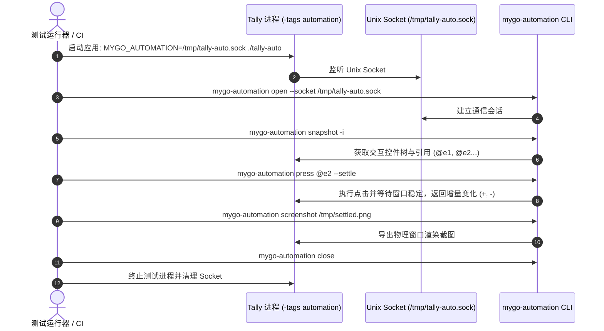

# Tally 测试流程与规范

本文档定义 Tally 的全套测试流程、执行标准与分层验证机制。

---

## 1. 测试体系设计理念（双轨测试）

Tally 是基于 MyGo 构建的纯 Go 原生桌面应用，具有重数据核算、复杂表格、多维度报表导出与双向云端同步的业务特征。为了彻底摒弃依赖操作系统无障碍权限与桌面焦点的脆弱脚本，项目统一采用 **「内轨无头测试 + 外轨插件驱动」** 的双轨测试架构：

- **内轨（Headless UI Tests via `ui.NewTester`）**：
  - 纯内存无头运行，毫秒级响应，零系统窗口依赖，完全跨平台（macOS、Linux CI、Windows）。
  - 覆盖 **100% 的 View 页面** 与 **100% 的 Modal 弹窗**。
  - 每个界面必须在无头测试中自动捕获 **深色（Dark）与浅色（Light）两张 `tt.Image()` 快照**，落盘至 `testdata/snapshots/`，实现渲染稳定性与排版回归保障。
- **外轨（E2E Automation via `mygo-automation`）**：
  - 基于 MyGo 官方自动化插件 `github.com/egoist/mygo/plugins/automation` 与 `mygo-automation` 命令行工具。
  - 通过编译标签 `//go:build automation` 严格隔离，正式发布版本绝不包含，杜绝体积膨胀与安全暴露。
  - 测试进程通过专用 Unix Domain Socket 驱动构建产物，实现真实进程生命周期、全链路业务流与完整视窗截图。
- **基石（Golden Dataset 真实数据回归）**：
  - 核心核算引擎、公式、并列排名跳跃与分档边界等，均通过标准脱敏 Excel 样本逐表逐单元格核对（697+ 核对点 0 差异）。

---

## 2. 覆盖清单与测试矩阵（12 个 View + 9 个 Modal）

所有用户可见界面必须有专属的 `ui.NewTester` 测试用例，且必须通过深浅色双模态快照校验。

### 2.1 核心视图矩阵（12 个 View）

| 序号 | 视图名称 | 源码对应 | 核心断言与交互点 |
|:---|:---|:---|:---|
| 1 | **应用外壳 (Shell)** | `shell.go:shellView` | 导航折叠/展开、各路由切换、底部状态栏、全局快捷键响应 |
| 2 | **总览看板 (Overview)** | `overview.go:overviewView` | 学届卡片渲染、当前阶段徽标、年级准备清单、快捷操作入口 |
| 3 | **核算工作台 (Workbench)** | `workbench.go:workbenchView` | 考试批次选择、指标网格、重算标记展示、试算与正式计算流转 |
| 4 | **对比分析 (Analysis)** | `analysis_page.go:analysisPageView` | 5 个分析维度切换、对比指标筛选器、趋势图表区域、视图导出 |
| 5 | **质量监测 (Quality)** | `quality_page.go:qualityPageView` | 各科达线率、极差与离散度指标、高低分段统计、图表切换 |
| 6 | **数据管理 (DataPages)** | `data_pages.go:dataPagesView` | 学届与阶段筛选、学生花名册、教师任课关系网格、入口成绩表 |
| 7 | **考试管理 (ExamPages)** | `exam_pages.go:examPagesView` | 考试批次列表、学期分类、考试详情 6 个 Tab 切换、准备状态 |
| 8 | **考核方案配置 (PlanPage)** | `plan_page.go:planPageView` | 方案库版本切换、指标权重分段表单、公式选项编辑器、保存提示 |
| 9 | **准备向导 (PrepWizard)** | `prep_wizard.go:prepWizardView` | 届别初始化向导步骤、下一步/上一步按钮、年级准备清单项核对 |
| 10 | **导入向导 (ImportWizard)** | `import_wizard.go:importWizardView` | 6 步引导流程、文件拖拽区域、表头映射确认、数据校验错误列表 |
| 11 | **学校设置 (SettingsSchool)** | `settings_school.go:settingsSchoolView` | 学校名称、学段设置、学科清单编辑、保存持久化确认 |
| 12 | **同步设置 (SettingsSync)** | `settings_sync.go:settingsSyncView` | WebDAV 地址/凭据表单、连接测试状态、远端版本检查、备份恢复 |

### 2.2 交互弹窗矩阵（9 个 Modal）

| 序号 | 弹窗名称 | 源码触发与定义 | 核心断言与交互点 |
|:---|:---|:---|:---|
| 1 | **新建学届 (NewCohortModal)** | `overview.go:newCohortModal` | 入学年份选择、学制配置、表单验证、确定创建回调 |
| 2 | **阶段流转确认 (StageReviewModal)** | `overview.go:stageReviewModal` | 阶段流转风险提醒、确认复选框、进入下一阶段触发 |
| 3 | **新建考试 (NewExamModal)** | `exam_pages.go:newExamModal` | 学年学期联动、考试类型选择、名称与日期填写校验 |
| 4 | **走班/统计组维护 (StatGroupModal)** | `exam_pages.go:statGroupModal` | 学科选择、统计组名称输入、组长指定、目标人数设定 |
| 5 | **零目标/异常确认 (ZeroModal)** | `workbench.go:zeroModal` | 目标基础分为 0 异常警示、豁免/阻断原因录入、核算继续确认 |
| 6 | **核算结果详情 (ResultDetailModal)** | `workbench.go:resultDetailModal` | 单条结果指标拆解、均分提升率基数展示、个人赋分明细 |
| 7 | **保存分析视图 (AnalysisSaveViewModal)** | `analysis_page.go:analysisSaveViewModal` | 视图名称录入、设为默认视图开关、保存生效验证 |
| 8 | **指标与公式配置 (PlanIndicatorModal)** | `plan_page.go:1004` | 权重数值调整、分档区间阈值编辑、公式合法性校验 |
| 9 | **同步冲突解决 (SyncConflictModal)** | `settings_sync.go:syncConflictOpen` | 本地优先 / 远端覆盖双向裁决、冲突差异提示、合并确认 |

---

## 3. `tt.Image()` 快照规范（Light & Dark 双色规范）

每一个界面与弹窗测试用例都必须生成并校验浅色（Light）与深色（Dark）各一张 PNG 渲染快照。

### 3.1 渲染稳定与时钟进阶原则

MyGo UI 的时钟在测试器中是虚拟时钟（Virtual Clock）。视图在外部输入或状态变更后，需要推进时钟至稳定状态，避免动画中间态造成快照抖动：

```go
func settleView(tt *ui.Tester) {
    tt.Frame()
    tt.Advance(time.Second) // 驱动所有过渡、动画与定时器到达稳定终态
    tt.Frame()
}
```

### 3.2 双模态快照捕获与断言标准

统一使用测试辅助函数 `captureDualSnapshot(t, tt, snapshotName)`：

```go
func captureDualSnapshot(t *testing.T, tt *ui.Tester, name string) {
    t.Helper()
    
    // 1. 确保视图稳定
    settleView(tt)
    if tt.FramePending() {
        t.Fatalf("snapshot %s: view did not settle", name)
    }

    dir := filepath.Join("testdata", "snapshots")
    _ = os.MkdirAll(dir, 0o755)

    // 2. 浅色模式快照 (Light)
    tt.SetDark(false)
    settleView(tt)
    imgLight := tt.Image()
    if imgLight == nil || imgLight.Bounds().Empty() {
        t.Fatalf("snapshot %s: light image is empty", name)
    }
    savePNG(t, filepath.Join(dir, name+"_light.png"), imgLight)

    // 3. 深色模式快照 (Dark)
    tt.SetDark(true)
    settleView(tt)
    imgDark := tt.Image()
    if imgDark == nil || imgDark.Bounds().Empty() {
        t.Fatalf("snapshot %s: dark image is empty", name)
    }
    savePNG(t, filepath.Join(dir, name+"_dark.png"), imgDark)

    // 4. 双模态视觉差异断言：深色模式背景亮度必须显著低于浅色模式
    bgLight := imgLight.RGBAAt(imgLight.Bounds().Min.X+4, imgLight.Bounds().Min.Y+4)
    bgDark := imgDark.RGBAAt(imgDark.Bounds().Min.X+4, imgDark.Bounds().Min.Y+4)
    if int(bgDark.R)+int(bgDark.G)+int(bgDark.B) >= int(bgLight.R)+int(bgLight.G)+int(bgLight.B) {
        t.Errorf("snapshot %s: dark mode background is not darker than light mode", name)
    }
}
```

### 3.3 快照文件管理

- **路径约定**：统一保存在 `testdata/snapshots/` 目录下。
- **文件命名**：`<view_or_modal_name>_light.png` 和 `<view_or_modal_name>_dark.png`。
- **版本控制**：快照图片纳入 Git 版本库管理。任何破坏性排版或无意的样式变更都会引起 Git Diff 告警，作为视觉 Code Review 的依据。

---

## 4. `mygo-automation` 插件外挂测试规范

### 4.1 插件集成与编译隔离

在仓库根目录设立 `automation_tag.go`，通过 Go build tags 将自动化插件限制在测试构建中：

```go
//go:build automation

package main

import _ "github.com/egoist/mygo/plugins/automation"
```

正式发布的构建命令（`go tool mygo build`）不带该 tag，因此自动化 socket 监听代码完全不会进入生产分发二进制。

### 4.2 客户端安装与环境准备

在开发者机器与 CI 环境中，统一从应用固定的 MyGo 版本编译安装客户端：

```sh
go install github.com/egoist/mygo/plugins/automation/cmd/mygo-automation
```

### 4.3 外挂自动化执行标准流



### 4.4 常用命令对照

| 测试意图 | `mygo-automation` 规范命令 |
|:---|:---|
| 连接并创建会话 | `mygo-automation open --socket /tmp/tally-auto.sock` |
| 读取交互控件树 | `mygo-automation snapshot -i` |
| 点击按钮并等待稳定 | `mygo-automation press @e<ID> --settle` |
| 文本框输入内容 | `mygo-automation fill @e<ID> "高一期中" --settle` |
| 等待特定元素出现 | `mygo-automation wait --text "核算完成" --settle` |
| 保存全尺寸真实截图 | `mygo-automation screenshot testdata/snapshots/e2e_full.png` |
| 结束会话 | `mygo-automation close` |

---

## 5. 质量准入与命令执行速查

开发者或 CI 执行验收时，遵循以下执行顺序：

```sh
# 1. 语法、格式与原生 UI 检查
gofmt -l .
go vet ./...
go tool mygo vet
go tool mygo i18n check

# 2. 纯内存双轨无头测试与双色快照提取
go test -race -v ./...

# 3. 自动化插件构建检查（验证带 tags 构建与跨平台编译）
go build -tags automation -o build/tally-autotest .
GOOS=linux GOARCH=amd64 go build -o /dev/null .
GOOS=windows GOARCH=amd64 go build -o /dev/null .

# 4. 正式打包体积检查
go tool mygo build
```
